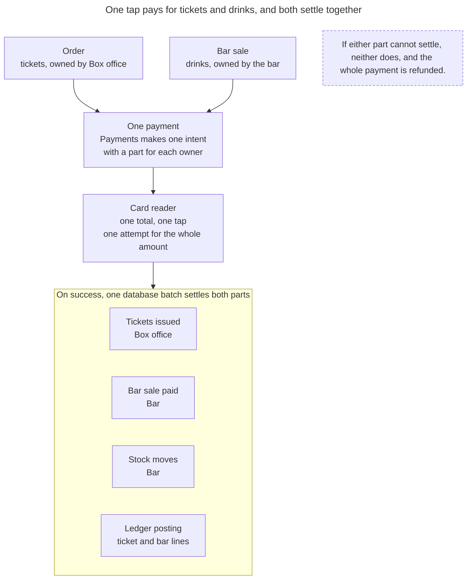

# Bar: stock, prices and till (specification)

Nov 16, 2026 · @Matthew Adcock

## What this is

The second-round specification for the `bar` module: products and prices, a till for the bar and a panel on the box office desk, a refusals register, bar tabs, stock with deliveries and stocktakes, and bar income in the ledger. Matt's nine questions are answered (tab 9) and every contract with another module is agreed with its owner (tab 4), so each tab states the design as decided.

| Tab | Holds |
| --- | --- |
| 1. Scope and glossary | What is in and out, the two releases, and the words |
| 2. Data model | 22 tables: 21 with their id prefixes, guards and data classes, and one keyed table of stock levels |
| 3. Rules and flows | Openings, bar sales, who may sell, payment, refunds, the age check and refusals, bar tabs, stock, the ledger |
| 4. Interface to other modules | What the bar needs from Payments, Finance and the rest, and what it offers |
| 5. Screens | Eighteen screens: the till, the desk panel, fifteen console screens and "My bar tab" in the members' area, with wireframes of the till, the desk panel and My bar tab |
| 6. Settings and abilities | 20 settings, 25 abilities, 7 record types, 1 fact, 5 notification types |
| 7. Stories | 48 stories: 39 in the first release, 8 of them gates, and 9 later |
| 8. Tests | 70 tests, 13 of which must never regress |
| 9. Questions for Matt | The nine questions put to Matt, and his decisions |

## The main choices

- **The bar takes no money itself.** Every payment is a Payments intent, and the bar owns one part of it. Till sessions, the float, cash-up, refund limits and the card reader stay Payments'.
- **Stock never blocks a sale.** A level may go below zero and the sale still completes; the stock screen shows the shortfall. A missed delivery entry must not stop the till on a show night.
- **The bar holds one customer detail: the name on a bar tab.** Bar tabs come in two kinds: a staff tab its holder adds to from their own phone and pays later, and a floating tab bar staff open for one night. The name is erased after a retention period. The refusals register records the outcome, the reason, the product, the member of staff and the time, never the customer.
- **Income only in the ledger.** Each sale posts bar income, by category where wanted. Stock has quantities and a last cost for reports, with no value in the accounts.
- **Stock can be switched off.** A tea-and-raffle table needs prices and a till, and gets exactly that.
- **Who may sell is a requirement, not a new mechanism.** An outlet can name a requirement such as bar training, checked through the kit's `core.requirement` check.

## One card reader, tickets and drinks together

This is the requirement the design starts from. At the box office desk, a person who may sell drinks sees a bar panel beside the order. Adding drinks adds a second part to the same payment, so the customer sees one total and taps once.

*combined payment · two owners, one intent, one batch*

1. The desk asks each panel what it would add. The bar answers with its lines and amount.
2. Payments creates one intent with two parts: the order's and the bar sale's.
3. One attempt goes to the reader for the whole amount.
4. On success, Payments settles both parts in a single database batch: tickets are issued, the bar sale is paid, stock moves and one ledger posting carries the money line, the ticket lines and the bar lines.
5. If either part cannot settle, neither does, and the whole payment is refunded.

Bar and Box office never import each other. Both plug into Payments, through `payments.settlement` and the `payments.desk-basket` contract set out in tab 4. Payments owns the till that hosts the desk, so the bar works with no box office installed. A later refund of the drinks cannot reach the ticket money, and the reverse, because Payments counts refunds per part.
