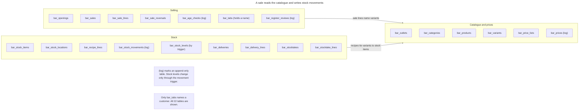

# 2. Data model

*data model · all 22 tables in 3 groups*

One module, 22 tables: 21 with ids and the keyed `bar_stock_levels`. A bar sale is anonymous: it has no account, no name and no free text. Two tables can hold something about a customer. `bar_tabs` holds the name on a bar tab, and for a short time a receipt address. `bar_age_checks` may hold a short description of a person refused, and only when a theatre switches that on. Everywhere else the only people are staff, as actors.

## How to read this part

Tables follow the Foundations layout: a heading line (realm, subject, retention, append-only), then one row per column. Conventions on every table, not repeated:

- `id` is `col.id()` with the table's prefix, primary key, internal, keep.
- `created_at` and, unless append-only, `updated_at` are UTC milliseconds, internal, keep.
- Money is `col.minor` with `col.currency` beside it. Quantities are whole integers in a stock item's base unit. No `real` column is used anywhere: a quantity is a count, which the Foundations ruling on `real` excludes.
- A staff column is `col.account(name, { role: 'actor', onMerge })`. Every staff column is `onMerge: 'alias'`, in every table: who sold, opened, closed, received, counted, approved or reviewed is a record of an act and is never rewritten by a merge. One account column in the module is `'move'`, `bar_tabs.holder_account`, and its declaration states why. On erasure the reference is kept and Identity anonymises the account. Every read, count or guard by account uses the kit's account scope (the survivor and its aliases): a staff tab's limit and total, the fact `bar.tab-holder`, the rule that a tab is not written off by its opener or holder, and the rule that a stocktake is not approved by the person who submitted it. Where a CHECK compares two account columns, the unit's guard makes the same comparison by account scope, since a CHECK sees only stored ids.
- A reference to another module's record (a performance, a ledger account, a payment part) is by id only. The bar reads no other module's tables.
- Every table except `bar_tabs` has `subject: 'none'`, so by the Foundations rule none of them holds a personal or special column. Reasons are terms from a vocabulary, never typed text. The one free-text column, `bar_age_checks.description`, is `col.freeText` with erasure in a table that declares a retention, which is the case the rule allows.

| Mark | Meaning | Enforced by |
| --- | --- | --- |
| Append-only | Rows are never updated or deleted; a correction is a new row | Generated triggers |
| Guarded | Updates only along the life cycle in part 3 | Triggers and CHECKs named in the table |
| Plain | Ordinary editable data | Abilities only |

## Id prefixes

Registered with Foundations in the index in its part 4. All are time-sorted; none is `random`, because no bar id acts as a secret. Each begins with `b` to stay clear of the other second-round modules.

| Table | Prefix | Table | Prefix |
| --- | --- | --- | --- |
| bar\_outlets | `bout` | bar\_stock\_movements | `bmov` |
| bar\_categories | `bcat` | bar\_deliveries | `bdel` |
| bar\_products | `bprd` | bar\_delivery\_lines | `bdll` |
| bar\_variants | `bvar` | bar\_stocktakes | `bstk` |
| bar\_price\_lists | `bpls` | bar\_stocktake\_lines | `bskl` |
| bar\_prices | `bprc` | bar\_openings | `bopn` |
| bar\_stock\_items | `bsti` | bar\_sales | `bsal` |
| bar\_stock\_locations | `bloc` | bar\_sale\_lines | `bsln` |
| bar\_recipe\_lines | `brcp` | bar\_sale\_reversals | `brev` |
| bar\_age\_checks | `bage` | bar\_tabs | `btab` |
| bar\_register\_reviews | `brrv` | bar\_stock\_levels | none: keyed by item and location |

## What is sold

### bar\_outlets (plain)

**`bar_outlets`**: realm operational; subject none; no retention; not append-only. A place that sells.

| Column | Type | Constraints | Class | On erasure | Notes |
| --- | --- | --- | --- | --- | --- |
| `name` | text | not null, unique among active | internal | keep | "Foyer bar" |
| `kind` | text | one of bar, kiosk, desk | internal | keep | desk marks the outlet the box office desk panel sells from |
| `price_list_id` | ref `bar_price_lists` | not null | internal | keep | The default list at this outlet |
| `stock_location_id` | ref `bar_stock_locations` | nullable | internal | keep | Where its sales take stock from. Null means its sales move no stock |
| `space_id` | ref `core_spaces` | nullable | internal | keep | Where it is, for the Tonight hub |
| `sell_requirement` | text | nullable; a requirement reference, `<source>:<the source's scoped id>` | internal | keep | What a seller must meet to sell here, such as `training:tcmp_...`. Plain text: never read inside, no foreign key |
| `self_service` | boolean | not null, default false | internal | keep | Staff tab holders may serve themselves from this outlet |
| `active` | boolean | not null | internal | keep | An outlet with bar sales is retired, never deleted |

Partial unique index on `kind` where `kind = 'desk'` and `active`: one desk outlet.

### bar\_categories (plain)

**`bar_categories`**: realm operational; subject none; not append-only.

| Column | Type | Constraints | Class | On erasure | Notes |
| --- | --- | --- | --- | --- | --- |
| `name` | text | not null, unique | internal | keep |  |
| `position` | integer | not null | internal | keep | Order on the till |
| `colour` | text | nullable; a named token, not a hex value | internal | keep | Always paired with the name on screen |
| `income_account_id` | text | nullable; a Finance account id (`lac_`) whose module is the bar | internal | keep | Null posts to the system account `bar.income`. The form's picker reads Finance's `accountsFor('bar', 'income')` |
| `tax_code` | text | default none | internal | keep | Carried to ledger entries; unused until Finance supports tax |
| `active` | boolean | not null | internal | keep |  |

### bar\_products (plain)

**`bar_products`**: realm operational; subject none; not append-only.

| Column | Type | Constraints | Class | On erasure | Notes |
| --- | --- | --- | --- | --- | --- |
| `category_id` | ref `bar_categories` | not null | internal | keep |  |
| `name` | text | not null | public | keep | May appear on a public price list page |
| `age_restricted` | boolean | not null, default false | internal | keep | Triggers the age check |
| `image_file_id` | ref `core_files` | nullable | internal | keep | Through a file slot |
| `position` | integer | not null | internal | keep |  |
| `active` | boolean | not null | internal | keep | A product with bar sales is retired, never deleted |

### bar\_variants (plain)

**`bar_variants`**: realm operational; subject none; not append-only. One sellable size of a product.

| Column | Type | Constraints | Class | On erasure | Notes |
| --- | --- | --- | --- | --- | --- |
| `product_id` | ref `bar_products` | not null | internal | keep |  |
| `name` | text | not null; unique within the product | public | keep | "Pint". A one-size product has one variant named "Each", hidden on the till |
| `barcode` | text | nullable, unique when not null | internal | keep | For a scanner on merchandise |
| `position` | integer | not null | internal | keep |  |
| `active` | boolean | not null | internal | keep |  |

### bar\_price\_lists (plain)

**`bar_price_lists`**: realm operational; subject none; not append-only.

| Column | Type | Constraints | Class | On erasure | Notes |
| --- | --- | --- | --- | --- | --- |
| `name` | text | not null, unique | internal | keep | "Standard", "Committee", "Staff" |
| `system_key` | text | nullable, unique when not null | internal | keep | `standard` is created at setup and cannot be removed |
| `restricted` | boolean | not null, default false | internal | keep | Choosing a restricted list at the till needs `bar.sale.use-restricted-price-list` |
| `falls_back` | boolean | not null, default true | internal | keep | A variant with no price on this list uses Standard |
| `percent_off` | integer | nullable; 1 to 100 | internal | keep | Set: the list has no price rows of its own. Each price is Standard's, less this percentage, rounded to the nearest minor unit with halves rounded up |
| `customer_requirement` | text | nullable; a requirement reference. Used by the later story BAR-56 only | internal | keep | What an identified customer must meet to have this list, such as `membership:<the type's id>` |
| `active` | boolean | not null | internal | keep |  |

Trigger: a list with `percent_off` set may not have rows in `bar_prices`.

### bar\_prices (append-only)

**`bar_prices`**: realm operational; subject none; append-only. The newest row for a variant and list at the moment a line is written wins, and the line copies the amount, so an old bar sale never changes.

| Column | Type | Constraints | Class | On erasure | Notes |
| --- | --- | --- | --- | --- | --- |
| `variant_id` | ref `bar_variants` | not null | internal | keep |  |
| `price_list_id` | ref `bar_price_lists` | not null | internal | keep |  |
| `amount_minor` | minor units | at least 0; null withdraws the price | public | keep | A variant with no price cannot be sold |
| `currency` | currency | not null | public | keep |  |
| `effective_from` | timestamp | not null | internal | keep | May be in the future, for a planned rise |
| `set_by` | account (actor, alias) | not null | internal | keep |  |

## Where and when it is sold

### bar\_openings (guarded)

**`bar_openings`**: realm operational; subject none; not append-only. One period of trading at one outlet.

| Column | Type | Constraints | Class | On erasure | Notes |
| --- | --- | --- | --- | --- | --- |
| `outlet_id` | ref `bar_outlets` | not null | internal | keep |  |
| `performance_id` | ref `core_performances` | nullable | internal | keep | Null for a social or a daytime kiosk |
| `occasion_term` | text | nullable; a term of the vocabulary `bar.occasion` | internal | keep | "Social", "Private hire"; used when there is no performance |
| `operating_day` | local date | not null | internal | keep | From the core's `operatingDayOf` |
| `state` | text | one of open, closed | internal | keep |  |
| `opened_by`, `closed_by` | account (actor, alias) |  | internal | keep | Null `closed_by` when closed by the task |
| `opened_at`, `closed_at` | timestamp |  | internal | keep |  |

Partial unique index on `outlet_id` where `state = 'open'`: an outlet has one open opening. Trigger: closed is final.

### bar\_sales (guarded)

**`bar_sales`**: realm operational; subject none; no retention; not append-only. One basket and its payment.

| Column | Type | Constraints | Class | On erasure | Notes |
| --- | --- | --- | --- | --- | --- |
| `reference` | text | not null, unique | internal | keep | Short code a person can read out, shown on the till and in reports |
| `opening_id` | ref `bar_openings` | not null | internal | keep |  |
| `price_list_id` | ref `bar_price_lists` | not null | internal | keep | The list every line was priced from |
| `state` | text | one of open, awaiting\_payment, on\_tab, paid, void | internal | keep | Part 3. `on_tab`: charged to a bar tab and not yet paid |
| `tab_id` | ref `bar_tabs` | nullable; set once, when the sale is charged | internal | keep | The bar tab it was charged to |
| `self_served` | boolean | not null, default false | internal | keep | Charged by the tab's holder from "My bar tab", not by a seller |
| `label` | text | nullable; a term of `bar.park-label` or a number | internal | keep | Set when parked. Not free text: "Table 4", "Interval 2" come from a list or a counter |
| `total_minor` | minor units | not null, at least 0; trigger-kept sum of live lines | internal | keep |  |
| `currency` | currency | not null | internal | keep |  |
| `intent_id` | text | nullable; a Payments intent id (`pay_`) | internal | keep | Set when payment starts. A sale paid through a bar tab has none: the tab holds the intent |
| `part_id` | text | nullable; a Payments part id (`pip_`) | internal | keep | This sale's part of that intent |
| `channel` | text | one of till, desk, self | internal | keep | desk when it came through `payments.desk-basket`; self when self-served |
| `sold_by` | account (actor, alias) | not null | internal | keep | The seller; the tab's holder on a self-served sale |
| `client_key` | text | not null, unique | internal | keep | Made on the device, so a repeated request creates one sale |
| `paid_at`, `voided_at` | timestamp |  | internal | keep |  |
| `void_reason_term` | text | nullable; vocabulary `bar.void-reason` | internal | keep | Required when a sale with lines is voided |

Triggers: paid and void are final; a sale leaves open only with at least one line; `total_minor` cannot change once the sale has left open. A sale may enter `on_tab` only while its tab is `open` and only if the tab's total would stay within its limit. It leaves `on_tab` only to paid, when its tab settles, or to void, when it is taken off the tab. A sale may be `self_served` only on a staff tab, only when `sold_by` is the tab's holder, and only at an outlet with `self_service` on.

### bar\_sale\_lines (guarded)

**`bar_sale_lines`**: realm operational; subject none; not append-only.

| Column | Type | Constraints | Class | On erasure | Notes |
| --- | --- | --- | --- | --- | --- |
| `sale_id` | ref `bar_sales` | not null | internal | keep |  |
| `variant_id` | ref `bar_variants` | not null | internal | keep |  |
| `price_id` | ref `bar_prices` | not null | internal | keep | The price row the amount was copied from |
| `quantity` | integer | at least 1 | internal | keep |  |
| `unit_minor` | minor units | at least 0 | internal | keep | Copied from the price |
| `discount_minor` | minor units | at least 0, at most `unit_minor * quantity` | internal | keep |  |
| `discount_reason_term` | text | vocabulary `bar.discount-reason`; required when the discount is above 0 | internal | keep |  |
| `amount_minor` | minor units | CHECK equals `unit_minor * quantity - discount_minor` | internal | keep |  |
| `reversed_quantity` | integer | default 0; CHECK between 0 and `quantity`; trigger-kept | internal | keep |  |
| `reversed_minor` | minor units | default 0; CHECK between 0 and `amount_minor`; trigger-kept | internal | keep |  |

Trigger: lines may be inserted, changed or deleted only while the sale is open.

### bar\_sale\_reversals (guarded)

**`bar_sale_reversals`**: realm operational; subject none; not append-only. A paid line, or part of it, refunded or being refunded.

| Column | Type | Constraints | Class | On erasure | Notes |
| --- | --- | --- | --- | --- | --- |
| `sale_line_id` | ref `bar_sale_lines` | not null | internal | keep |  |
| `refund_id` | text | not null; a Payments refund id (`rfd_`) | internal | keep | One refund may cover several lines of one bar sale |
| `state` | text | one of requested, succeeded, failed | internal | keep | Follows the Payments refund; succeeded and failed are final |
| `quantity` | integer | at least 0 | internal | keep | 0 for a money-only goodwill refund |
| `amount_minor` | minor units | above 0 | internal | keep |  |
| `reason_term` | text | not null; vocabulary `bar.refund-reason` | internal | keep |  |
| `stock_outcome` | text | one of returned, wasted, none | internal | keep | What happened to the goods |
| `requested_by` | account (actor, alias) | not null | internal | keep |  |

Triggers, as Payments does for its own refunds: a reversal entering requested adds its quantity and amount to the line's `reversed_quantity` and `reversed_minor`; one entering failed subtracts them. The line's CHECKs therefore refuse a refund past what was sold, however two refunds race. A reversal's quantity, amount and line cannot change after insert.

### bar\_tabs (guarded)

bar\_tabs: realm by row (`members` for a staff tab, `audience` for a floating tab); subject `{ account: 'holder_account', email: 'holder_email', unlinked: 'staff' }`, the account winning where both are present; redact ability `bar.tab.write-off`; retention `bar.retention.tab-names`; not append-only. A running bill under a name. It is the only bar table with a subject.

| Column | Type | Constraints | Class | On erasure | Notes |
| --- | --- | --- | --- | --- | --- |
| `kind` | text | one of staff, floating; never changes | internal | keep | Part 3 says how the two differ |
| `realm` | text | CHECK: members when `kind` is staff, audience when floating | internal | keep | The row's realm |
| `outlet_id` | ref `bar_outlets` | required for a floating tab; null for a staff tab | internal | keep | A floating tab belongs to one outlet. A staff tab belongs to none |
| `opening_id` | ref `bar_openings` | required for a floating tab; null for a staff tab | internal | keep | The opening a floating tab was started in |
| `holder_name` | `col.personal` text | 1 to 80 characters; null only after erasure | personal | erase | Floating: typed by staff, "Priya", "Hamlet company". Staff: copied from the account's display name when opened |
| `holder_account` | account (subject, move). It is `'move'` because one live staff tab per holder is a unique rule on the stored id, and the tab is the holder's living record | required for a staff tab; on a floating tab nullable, set only when staff pick a known person with the core's person picker; null after erasure | personal | erase | Never set from a typed email address |
| `holder_email` | `col.email` | nullable; floating tabs only | personal | erase | Where the receipt is sent. Cleared in the batch that records `receipt_sent_at` |
| `holder_email_digest` | text | nullable; indexed | personal | erase | The core's `addressDigest(address, 'bar.tab-receipt')`. Stays after the address is cleared, and shows the tab to the account whose verified address matches (part 3) |
| `receipt_sent_at` | timestamp | nullable | internal | keep |  |
| `state` | text | one of open, settling, settled, written\_off, joined | internal | keep | settled and written\_off are final. A joined tab takes no charges and is never paid by itself: its sales are paid, or left unpaid, with the tab it was joined to |
| `limit_minor` | minor units | nullable; above 0 | internal | keep | Copied when opened from `bar.tabs.staff-limit` or `bar.tabs.limit`; null when that setting is 0. A person with `bar.tab.write-off` may raise a floating tab's |
| `total_minor` | minor units | not null, at least 0; trigger-kept | internal | keep | The sum of the bar sales charged to it |
| `currency` | currency | not null | internal | keep |  |
| `intent_id`, `part_id` | text | nullable; Payments ids | internal | keep | Set while the tab is settling and kept once settled |
| `opened_by` | account (actor, alias) | not null | internal | keep | The seller, or the holder when a staff tab opened itself by self-service |
| `closed_by` | account (actor, alias) | nullable | internal | keep | Who settled it or wrote it off |
| `joined_to` | ref bar\_tabs | nullable; set exactly when the state is joined | internal | keep | The staff tab this one was joined to when two accounts were merged |
| `opened_at`, `closed_at` | timestamp |  | internal | keep |  |
| `write_off_reason_term` | text | nullable; vocabulary `bar.write-off-reason` | internal | keep | Required when written off |

Guards, each a CHECK, a trigger or a partial unique index:

- One live staff tab per account: unique on `holder_account` where `kind` is staff and `state` is open or settling. When two accounts that each hold a live staff tab are merged, the bar's merge step joins the two tabs first (part 4), so the move never meets this rule. A sale's `tab_id` is set once and is not re-pointed: the absorbed tab becomes joined, keeps its sales, and its total is carried onto the survivor's tab.
- One live floating tab per name per outlet: unique on (`outlet_id`, `holder_name`) where `kind` is floating and `state` is open or settling.
- `total_minor` changes only by the trigger on `bar_sales`. A final state cannot change.
- When the state is written\_off, `closed_by` differs from `opened_by` and from `holder_account`.
- `holder_email` and `holder_email_digest` are null on a staff tab.

Retention: `bar.retention.tab-names` after a tab closes, the sweep erases `holder_name`, `holder_account`, `holder_email` and `holder_email_digest` and keeps the row. An erasure request for the account erases them at once, except while the tab is unpaid (part 4). A floating tab under a name alone, with no account and no address, is reached only by staff: it appears on the data request screen as a manual step.

### bar\_age\_checks (append-only)

bar\_age\_checks: realm operational; subject none; retention `bar.retention.age-checks`; append-only except erasure. The age-check and refusals register. It records what staff did, never who the customer was. On screen it is called the refusals register; the table keeps its name.

| Column | Type | Constraints | Class | On erasure | Notes |
| --- | --- | --- | --- | --- | --- |
| `opening_id` | ref `bar_openings` | not null | internal | keep |  |
| `sale_id` | ref `bar_sales` | nullable | internal | keep | Null when the sale was never started |
| `outcome` | text | one of not\_needed, id\_checked, self\_attested, refused | internal | keep | not\_needed: clearly over the challenge age. self\_attested: a staff tab holder serving themselves a restricted product |
| `refusal_term` | text | vocabulary `bar.refusal-reason`; required when refused | internal | keep | Seeded with No ID, ID not accepted, Under age, Buying for someone under age, Already drunk, Other |
| `variant_id` | ref `bar_variants` | nullable | internal | keep | What was refused: from the line that raised the prompt, or picked by the seller |
| `description` | `col.freeText` text | nullable; at most 120 characters; refused unless `bar.age-check.description` is on | personal free text | erase | A short description of the person refused. It names nobody, and the field's hint says not to write a name. Removed with the row by the retention sweep |
| `by` | account (actor, alias) | not null | internal | keep |  |
| `at` | timestamp | not null | internal | keep |  |

### bar\_register\_reviews (append-only)

bar\_register\_reviews: realm operational; subject none; append-only. One row each time a manager signs the register as checked.

| Column | Type | Constraints | Class | On erasure | Notes |
| --- | --- | --- | --- | --- | --- |
| `outlet_id` | ref `bar_outlets` | nullable | internal | keep | Null means every outlet |
| `from_day`, `to_day` | local date | `to_day` not before `from_day` | internal | keep | The operating days checked |
| `refusals` | integer | at least 0 | internal | keep | The count of refusals in the period when signed |
| `reviewed_by` | account (actor, alias) | not null | internal | keep |  |
| `reviewed_at` | timestamp | not null | internal | keep |  |

## Stock

### bar\_stock\_items (plain)

**`bar_stock_items`**: realm operational; subject none; not append-only. A thing that is counted.

| Column | Type | Constraints | Class | On erasure | Notes |
| --- | --- | --- | --- | --- | --- |
| `name` | text | not null, unique | internal | keep | "House lager 50 l keg" |
| `category_id` | ref `bar_categories` | nullable | internal | keep | For grouping count sheets |
| `base_unit` | text | one of each, ml, g; fixed once the item has a movement | internal | keep |  |
| `pack_size` | integer | at least 1 | internal | keep | Base units in one pack as delivered: 24 for a case, 50000 for a keg |
| `pack_name` | text | not null | internal | keep | "case", "keg", "box" |
| `count_unit_size` | integer | at least 1 | internal | keep | Base units in the unit people count in: 750 for a wine bottle, 1 for a can |
| `cost_minor` | minor units | nullable; per pack, from the last delivery | internal | keep | For variance value in reports only |
| `currency` | currency |  | internal | keep |  |
| `reorder_level` | integer | nullable, base units, across all locations | internal | keep | Below this the item shows as low |
| `active` | boolean | not null | internal | keep |  |

### bar\_stock\_locations (plain)

**`bar_stock_locations`**: realm operational; subject none; not append-only.

| Column | Type | Constraints | Class | On erasure | Notes |
| --- | --- | --- | --- | --- | --- |
| `name` | text | not null, unique | internal | keep | "Bar", "Cellar" |
| `active` | boolean | not null | internal | keep | A location holding stock cannot be retired |

### bar\_recipe\_lines (plain)

**`bar_recipe_lines`**: realm operational; subject none; not append-only. What selling one of a variant uses up. Unique on (`variant_id`, `stock_item_id`).

| Column | Type | Constraints | Class | On erasure | Notes |
| --- | --- | --- | --- | --- | --- |
| `variant_id` | ref `bar_variants` | not null | internal | keep |  |
| `stock_item_id` | ref `bar_stock_items` | not null | internal | keep |  |
| `quantity` | integer | at least 1, base units | internal | keep | 568 for a pint, 1 for a can |

A variant with no recipe line moves no stock (a programme given no stock item, tap water). The table allows several lines per variant; the first release's screens write one (part 9, question 2).

### bar\_stock\_movements (append-only)

**`bar_stock_movements`**: realm operational; subject none; append-only. Every change to a level.

| Column | Type | Constraints | Class | On erasure | Notes |
| --- | --- | --- | --- | --- | --- |
| `stock_item_id` | ref `bar_stock_items` | not null | internal | keep |  |
| `location_id` | ref `bar_stock_locations` | not null | internal | keep |  |
| `kind` | text | one of opening, delivery, sale, sale\_reversal, wastage, adjustment, transfer\_out, transfer\_in | internal | keep |  |
| `quantity` | integer | not 0; signed, base units | internal | keep | Negative leaves the location |
| `reason_term` | text | vocabulary `bar.wastage-reason`; required for wastage | internal | keep |  |
| `source_type`, `source_id` | text | not null | internal | keep | The sale line, reversal, delivery line, stocktake line or transfer that caused it |
| `idempotency_key` | text | not null, unique | internal | keep | Built from the source, so a replayed batch moves stock once |
| `by` | account (actor, alias) | nullable for the system | internal | keep |  |
| `at` | timestamp | not null | internal | keep |  |

CHECK: the sign matches the kind (delivery, transfer\_in and sale\_reversal positive; sale, wastage and transfer\_out negative; adjustment and opening either).

### bar\_stock\_levels (guarded, no id)

**`bar_stock_levels`**: realm operational; subject none; primary key (`stock_item_id`, `location_id`).

| Column | Type | Constraints | Class | On erasure | Notes |
| --- | --- | --- | --- | --- | --- |
| `quantity` | integer | not null; no lower bound | internal | keep | Kept only by the trigger on `bar_stock_movements` |
| `last_counted_at` | timestamp | nullable | internal | keep | Set when a stocktake is approved |

Trigger: a direct update that does not come from a movement insert is refused. The level is a cache of the movements and a health check compares the two.

### bar\_deliveries and bar\_delivery\_lines (guarded)

**`bar_deliveries`**: realm operational; subject none; not append-only.

| Column | Type | Constraints | Class | On erasure | Notes |
| --- | --- | --- | --- | --- | --- |
| `location_id` | ref `bar_stock_locations` | not null | internal | keep |  |
| `supplier_term` | text | nullable; vocabulary `bar.supplier` | internal | keep | A business name from a list the theatre keeps |
| `supplier_ref` | text | nullable, at most 40 characters | internal | keep | The delivery note number |
| `state` | text | one of draft, received | internal | keep | received is final |
| `received_by` | account (actor, alias) |  | internal | keep |  |
| `received_at` | timestamp |  | internal | keep |  |

**`bar_delivery_lines`**: realm operational; subject none. Editable only while the delivery is a draft.

| Column | Type | Constraints | Class | On erasure | Notes |
| --- | --- | --- | --- | --- | --- |
| `delivery_id` | ref `bar_deliveries` | not null | internal | keep |  |
| `stock_item_id` | ref `bar_stock_items` | not null; unique within the delivery | internal | keep |  |
| `packs` | integer | at least 0 | internal | keep |  |
| `loose_units` | integer | at least 0, base units | internal | keep | For a part pack |
| `pack_cost_minor` | minor units | nullable | internal | keep | Updates the item's `cost_minor` on receipt |

### bar\_stocktakes and bar\_stocktake\_lines (guarded)

**`bar_stocktakes`**: realm operational; subject none; not append-only.

| Column | Type | Constraints | Class | On erasure | Notes |
| --- | --- | --- | --- | --- | --- |
| `location_id` | ref `bar_stock_locations` | not null | internal | keep |  |
| `state` | text | one of counting, submitted, approved, abandoned | internal | keep |  |
| `scope` | text | one of full, category | internal | keep |  |
| `category_id` | ref `bar_categories` | required when scope is category | internal | keep |  |
| `started_by`, `submitted_by`, `approved_by` | account (actor, alias) | CHECK `approved_by` is null or differs from `submitted_by`, unless the variance is under the setting (part 3) | internal | keep |  |
| `started_at`, `submitted_at`, `approved_at` | timestamp |  | internal | keep |  |
| `variance_value_minor` | minor units | nullable; signed; set at submission | internal | keep | At last pack cost |

Partial unique index on `location_id` where state is counting or submitted: one live stocktake per location.

**`bar_stocktake_lines`**: realm operational; subject none. Editable only while counting.

| Column | Type | Constraints | Class | On erasure | Notes |
| --- | --- | --- | --- | --- | --- |
| `stocktake_id` | ref `bar_stocktakes` | not null | internal | keep |  |
| `stock_item_id` | ref `bar_stock_items` | not null; unique within the stocktake | internal | keep |  |
| `counted` | integer | nullable until counted; at least 0, base units | internal | keep | Entered as count units and a part unit, stored in base units |
| `expected` | integer | nullable; set at submission from the level | internal | keep | Signed: a level may be negative |
| `variance_reason_term` | text | vocabulary `bar.variance-reason`; optional | internal | keep |  |

## Vocabularies the bar asks Core domain to hold

Ten: `bar.occasion`, `bar.park-label`, `bar.void-reason`, `bar.discount-reason`, `bar.refund-reason`, `bar.refusal-reason`, `bar.wastage-reason`, `bar.variance-reason`, `bar.supplier`, `bar.write-off-reason`. Each ships with starter terms a theatre edits. Using terms in place of typed notes is what lets every table but `bar_tabs` have no subject and survive every erasure untouched.

## What is deliberately not stored

- No customer on a bar sale. A bar sale has no account and no name. A customer appears only as the name on a bar tab the sale was charged to. A receipt by email for an ordinary bar sale and a pre-order would each add a subject on a new table; both are later stories and leave these tables as they are.
- No free text, except the optional description on a refusal. No note on a sale, a wastage or a count.
- No receipt address once the receipt has gone. Only its keyed digest stays.
- No card data. The bar holds a Payments part id and nothing else about the payment.
- No stock value in the ledger. `cost_minor` feeds reports only; stock value in the accounts is the later story BAR-55.
- No money owed in the ledger. An unpaid bar tab is a total on the tab and a line in the Bar tabs owed report until it is paid.
