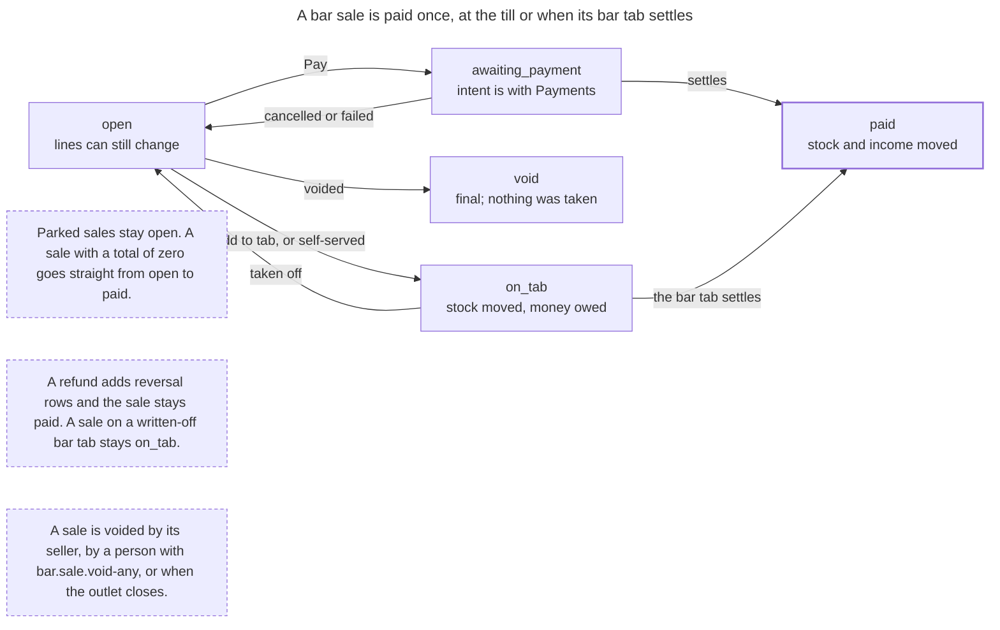
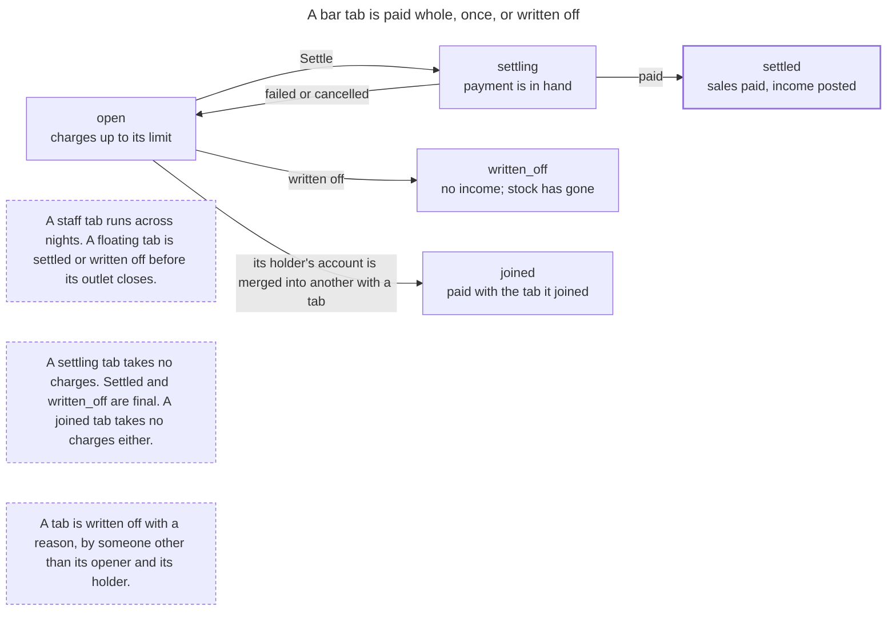

# 3. Rules and flows

*bar sale states · 5 states, paid at the till or through a bar tab*

A bar sale is paid, its stock is deducted and its income is posted in one batch, or none of it happens. When tickets are in the same payment, that one batch is also the batch that issues the tickets.

## The rule behind every rule

Every change of state is one unit of work, committed as one D1 batch (Foundations U1 to U6). A guard is on the statement itself, as a `WHERE` clause, a CHECK or a trigger, never a read followed by a write. Where a guarded update could match no row without an error, the unit carries the kit's guard, a read statement in the same batch that fails the batch unless the guard passed. No rule here depends on a count of rows changed: D1's count includes rows written by triggers and search indexes, so code may test that it is above nought and never that it is an exact number. Bar SQL never reads `changes()`. No bar unit branches on whether a conditional write won: each passes its guard or fails whole, a replay is refused by the guard or by an idempotency key, and what follows a change of state (a tab's total, a stock level) is kept by a trigger on the row that changed. So the bar needs no claim stamp (Foundations part 3). A later rule that did need to record which of two outcomes happened would use one.

A change that touches many rows is written set-wise (Foundations U7 to U9): one statement reads its rows from one JSON parameter with `json_each`, and `unit.announce()` and `unit.audit()` take the set. This is how the bar writes the stock movements of a sale, the sales voided when an opening closes, the sales paid when a bar tab settles, the movements of a delivery and the adjustments of a stocktake. A set is capped by `core.units.set-rows-limit` (500, provisional). A delivery, a stocktake or a bar tab that would pass the cap is refused before it starts, with the figure: the delivery is split in two, the stocktake is counted by category, the tab is settled and a new one opened.

## An opening

| Transition | Guard | In the same batch |
| --- | --- | --- |
| (none) to open | `bar.opening.manage`; the outlet is active and has no open opening (unique index) | Opening row; event `bar.opening.opened` |
| (none) to open, at the desk | The first bar line added at the box office desk on an operating day, by a person with `bar.sale.sell` | The desk outlet's opening for that operating day, with the performance the desk screen is serving if it names one |
| (none) to open, by self-service | A staff tab holder's first self-served charge at a self-service outlet that has no opening | An opening with the occasion "Self-service" |
| open to closed | `bar.opening.manage`, or the task after `bar.openings.close-after`; no bar sale of the opening is awaiting payment; no floating tab of the opening is open or settling | Every open or parked sale of the opening is voided with the reason "not completed"; event `bar.opening.closed` |

- Closing is refused while a sale is awaiting payment, because an attempt may still succeed. The screen names the sale and the person who started it.
- Closing is refused while a floating tab is open or settling, naming the tabs: "2 bar tabs are open: Priya 18.40, Hamlet company 42.00." Each is settled or written off first. A staff tab never blocks closing.
- An opening is not a till session. A session is one person's cash responsibility and belongs to Payments; an opening is the outlet trading. Three people can each hold a session during one opening.
- A performance that is cancelled does not close an opening. The bar may still trade; the opening keeps its performance for reporting.

## A bar sale

| Transition | Guard | In the same batch |
| --- | --- | --- |
| (none) to open | `bar.sale.sell`; the opening is open; the `client_key` is new; the seller meets the outlet's sell requirement (below) | Sale row with the outlet's price list |
| open: line added, changed, removed | Sale is open; the variant is active and has a price on the list, or on Standard when the list falls back | Line with the price copied; `total_minor` rewritten by trigger |
| open: price list changed | Sale is open; a restricted list needs `bar.sale.use-restricted-price-list` | Every line re-priced from the new list; a line with no price on it is refused by name |
| open: parked | A label is chosen | `label` set. The sale stays open and leaves the till's working area |
| open to awaiting payment | At least one line; the total the screen sent equals `total_minor`, else refused quoting both figures; the age check is answered if any line is restricted; the seller has an open till session and meets the sell requirement | A Payments intent with this sale as one part (below); `intent_id` and `part_id` set |
| open to paid, total zero | Every line is priced at zero or fully discounted | Stock movements; no intent, no posting |
| awaiting payment to paid | Payments calls the settle handler: the part's amount equals `total_minor` and the sale is awaiting payment | Sale paid; stock movements; ledger entries; event `bar.sale.paid` |
| awaiting payment to open | The intent was cancelled or expired, or the attempt failed and staff chose to change the sale | `intent_id` and `part_id` cleared; lines editable again |
| open to on tab | "Add to tab" by a seller with `bar.tab.open`, or a self-served charge by the tab's holder; the tab is open and its total would stay within its limit; the age check is answered if any line is restricted | `tab_id` set; the tab's total rises; stock movements, because the drinks are handed over now |
| on tab to paid | The tab's settle handler (below) | Every sale on the tab paid in one statement; ledger entries. No stock moves again |
| on tab to void | `bar.sale.void-any`, while the tab is open | The sale is taken off the tab: void with a reason, the tab's total falls, stock returns |
| open to void | `bar.sale.sell` for your own unpaid sale; `bar.sale.void-any` for another person's | `void_reason_term` if it had lines. No stock, no money |

Rules.

- **Nothing is paid before an answer.** The bar never marks a sale paid. Only the settle handler does, and only Payments calls it.
- **An unknown attempt keeps the sale awaiting payment.** The till shows "Waiting for the card reader" with Check again and Cancel, as the desk does. Another method is offered only once the first attempt is known to have failed, so nobody pays twice.
- **A paid sale is never edited.** A mistake after payment is a reversal and a refund.
- **The price is fixed when the line is written.** A price change during an opening affects the next line added, never a line already in a basket.
- **A discount** needs `bar.sale.discount`, a reason term, and stays within `bar.sales.max-discount-percent` of the line. A discount is a figure on the line, so the total a customer sees is the total they pay.
- **Zero-priced lines** are allowed (tap water, a staff drink on a zero price list) and move stock like any other.

## Who may sell at an outlet

An outlet may name one requirement its sellers must meet, such as bar training. It is a `core.requirement` reference checked through the kit, as Foundations ruled; the bar declares no point of its own for it.

| Step | Rule |
| --- | --- |
| Setting it | A person with `bar.outlet.manage` picks a requirement for an outlet from the kit's picker (`requirements.options`), or none. The bar stores the reference as text, `<source>:<the source's scoped id>` or `fact:<name>`, and never reads inside it. `requirements.describe` gives the label shown beside it |
| Checking | When a person starts selling at the outlet (opening the till, or the first bar line on the desk panel), and again when a bar sale leaves open, the bar calls `requirements.check([account], [ref], at, record)` for the seller, with `whenUnavailable: 'met'` |
| Met | Selling continues. An answer may carry a quantity; the bar ignores it |
| Not met | Refused, with the source's translated reason and the remedy: "Bar training has lapsed. Ask the bar manager, or book a session." |
| Override | A person with `bar.sale.override-requirement` may allow that seller for this opening only, never themselves. The override is audited with who allowed it and for whom |
| Unavailable | The module that judges it is off or absent. The kit only reports unavailable, and the host chooses what that means. The bar passes `met`, because the requirement restricts who may sell and a switched-off module must not close the bar. The till and the outlet's form say the verdict came from a source that is unavailable |

- A requirement never grants an ability. The seller still needs `bar.sale.sell`.
- The on-shift check uses the same call where a theatre wants it as a condition and not as a grant: `fact:front-of-house.on-shift`.
- A staff tab holder serving themselves is a customer, not a seller, and is not checked.
- Member prices, in the later story BAR-56, are the same call for an identified customer against a price list's `customer_requirement`, with `whenUnavailable: 'not-met'`, because that grants a benefit and a switched-off module must not give the member price to everyone. A customer with no account is not met, so hand-chosen price lists stay the way to give a price to someone the till cannot identify.

## Price lists

- **A list with its own prices.** The newest effective row in `bar_prices` for the variant and list wins. A variant with no price on the list uses Standard when the list falls back, and otherwise cannot be sold from it.
- **A percentage list.** A list with `percent_off` set takes every price from Standard, less the percentage, rounded to the nearest minor unit with halves rounded up: a 4.50 pint at 25% off is 3.38. It has no prices of its own, so a change to Standard changes it at once. It covers everything the outlet sells.
- A percentage list is not a discount: no reason is asked for and `bar.sales.max-discount-percent` does not apply. A line discount on top of it is allowed and capped as usual.
- The line stores the price it was sold at, so later changes never alter a sale.
- A restricted list needs `bar.sale.use-restricted-price-list` to choose at the till. Reports show sales by price list, so committee sales can be counted.

## One payment for drinks, with or without tickets

This is Matt's requirement: the Nottingham New Theatre has one card reader, and drinks are often sold with tickets. Payments provides the mechanism (intent parts, `payments.settlement`, `payments.desk-basket`). Payments owns the till component that hosts the desk; Box office is one contributor to it and the bar another. The bar's side:

### Drinks only, at the till

1. Staff build the sale and press Pay.
2. One batch moves the sale to awaiting payment and calls `createIntent` with one part: owner module `bar`, record the sale id, amount the sale total, channel desk, the seller's till session.
3. Staff choose a method from `methodsFor('desk')`: the reader, cash, or an attested card payment. `startAttempt` runs through Payments.
4. On success Payments calls the bar's `settle(unit, part)` inside its own unit. The bar adds: sale to paid, one stock movement per recipe line, the audit entry and `bar.sale.paid`, and returns its ledger entries.
5. The till shows the result band, and change due for cash.

### Drinks with tickets, at the box office desk

1. The desk screen shows the bar's panel, contributed through `payments.desk-basket`, to a person who holds `bar.sale.sell`. Staff add drinks beside the order or reservation being paid for.
2. The panel keeps an open bar sale on the desk outlet. The desk screen shows one total: the tickets' amount due plus the bar sale's total.
3. When staff press Take payment, the desk asks each contribution to `prepare(unit, context)`. The bar's moves its sale to awaiting payment and returns `{ owner: { module: 'bar', record: saleId }, amountMinor }`, always above zero: a zero-total bar sale never reaches `prepare`. Box office adds its own part. Payments writes the intent and its parts in the same batch and checks that the parts sum to the amount.
4. One attempt, one payment on the reader.
5. On success Payments calls `settle` once per part in one batch: Box office confirms the order and issues tickets; the bar marks its sale paid, moves stock and returns its ledger entries. The posting has one line for the money and each owner's own income lines, so ticket income and bar income never mix.
6. If the attempt fails, both parts stay unsettled: the order stays reserved and the bar sale stays awaiting payment, still attached. Staff retry, change method, or remove the drinks. Removing them makes Payments call the bar's `release(unit, part)`, which returns the sale to open, and the intent is rebuilt without the bar part.

`release(unit, part)` is an optional member of the bar's `payments.settlement` handler, not of its desk panel contribution. It is safe to call twice. Payments calls it on cancel, on final failure, when the desk removes the bar's part and when the intent expires. For a bar sale it returns the sale to open; for a bar tab it returns the tab from settling to open.

### When a part cannot settle

There is no partial settlement: any refusal settles nothing.

| Case | What happens |
| --- | --- |
| The bar part cannot settle | By construction it always can: stock never blocks a sale, and a sale awaiting payment cannot be voided or edited. If the handler still refuses or throws (a bug), nothing settles. The same holds if the entries it returns do not total its part, or name an account that is not the bar's: Payments treats that as the bar refusing, not as a failed batch. In each case the provider's answer is recorded; if money was taken, Payments marks the intent unfulfilled and refunds it whole, and the reservation stays reserved |
| The ticket part cannot settle (seats gone after a late answer) | Payments marks the whole intent unfulfilled and refunds it in full, drinks included. The bar's `cannotSettle(part)` returns the sale to open with its lines kept, and the till shows "Payment refunded, take payment again". No stock moved, no bar income posted |

Refunding the drinks along with the tickets in that rare case is the cost of one batch for one payment.

### Refunding one part

A refund names one part and cannot exceed it; Payments keeps the limit per part. Cancelling a ticket therefore cannot refund the drinks, and refunding a drink cannot touch the ticket money, although one card payment paid for both. A refund across two owners is two refunds.

## The age check and refusals

| Step | Rule |
| --- | --- |
| Prompt | When the first restricted line is added to a sale and `bar.age-check.enabled` is on, the till asks: "Does the customer look under 25?" with the challenge age from `bar.age-check.challenge-age` |
| Clearly over | One press. Writes `not_needed`. Nothing more is asked for that sale |
| ID checked | Writes `id_checked`. The sale continues |
| Refused | Staff choose a refusal reason. Writes `refused` with the product refused, taken from the line that raised the prompt. The restricted lines are removed and the rest of the sale continues |
| Refusing for another reason | "Refuse sale" is in the basket's menu for any sale, restricted or not, because a reason such as "Already drunk" has nothing to do with age. The seller marks the lines refused and those are removed |
| Refusal without a sale | The till has a "Record a refusal" action for a customer turned away before anything was rung up. The seller may pick the product refused |
| Paying or charging | A sale with a restricted line cannot leave open until the check is answered (guard in the batch: an age-check row for the sale exists and is not refused) |

- **Every refusal carries a reason** from `bar.refusal-reason`, seeded with No ID, ID not accepted, Under age, Buying for someone under age, Already drunk and Other. A theatre edits the list.
- **The register holds** the outcome, the reason, the product refused, the member of staff, the opening and the time. It never holds the customer's name, date of birth or a photograph.
- **A description of the person** is offered only when `bar.age-check.description` is on, which it is not by default: one optional field on the refusal sheet, at most 120 characters, with the guidance "Clothing, height, hair, apparent age. Do not write a name, or anything about race, religion, disability or health". The Nottingham New Theatre expects to switch it on. The description appears only on the register and in its export; it is never copied into an audit entry, an event, a notification or a report. A person with `bar.age-check.review` may erase it from a row, the audit entry for that recording who and when but not the words, and the retention sweep removes it with its row.
- **Signing the register.** A person with `bar.age-check.review` signs the register as checked for a range of operating days. The signature records the number of refusals it covered. The console home shows a card when the register has gone unsigned for longer than `bar.age-check.review-every`.
- The layout follows what UK licensing authorities commonly ask of a refusals log: date and time, what was refused, why, who refused, and a regular check signed by a manager. The licensing export (part 5) lists the register and the signatures.

## Bar tabs

A bar tab is a running bill under a name. Bar sales are charged to it and it is paid once, in full. Bar tabs are off until `bar.tabs.enabled` is switched on. There are two kinds.

| Matter | Staff tab | Floating tab |
| --- | --- | --- |
| Who has one | A person with `bar.tab.hold`. It opens itself the first time they, or a seller, charge to it. One per account, across all outlets | Anyone, by name: a director covering the cast. Opened at an open outlet by a person with `bar.tab.open`. One per name per outlet |
| Who charges | The holder, by self-service; or a seller with `bar.tab.open` at the till, who picks the holder | Sellers with `bar.tab.open` only, for anyone who asks |
| How long it runs | Until paid, across nights. The holder is reminded once it is older than `bar.tabs.staff-reminder-after`, and again weekly | That opening only |
| Closing the outlet | Never blocks it | Blocks it: every floating tab is settled or written off first |
| Limit | From `bar.tabs.staff-limit`. At the limit further charges are refused until it is paid | From `bar.tabs.limit`. A person with `bar.tab.write-off` may raise it |
| Paid | At the till, whole, by the holder or anyone paying for them | At the till, whole |
| Receipt | In the holder's notifications | By email, when an address was given |

### Charging, settling and writing off

*bar tab states · open, settling, settled, written_off, joined*

| Step | Rule |
| --- | --- |
| Charge | Instead of Pay, the seller chooses "Add to tab" and picks the tab. In one batch the sale moves from open to `on_tab`, the tab's total rises and stock moves. The age check and the outlet's sell requirement apply exactly as for a paid sale |
| Over the limit | A charge that would take the tab over its limit is refused with both figures: "This would take the tab to 54.20. Its limit is 50.00." |
| Take off | A person with `bar.sale.void-any` may take a sale off an open tab. It becomes void and its stock returns in the same batch |
| Settle | Any seller with `bar.sale.sell` may settle. Paying a tab is one Payments intent with one part whose owner is `{ module: 'bar', record: <the tab> }`, for the tab's whole total. The tab is `settling` while the payment is in hand and takes no charges. On success, one batch marks the tab settled and every sale on it paid, and returns their income entries by category. A failed or cancelled payment returns the tab to open |
| Write off | A person with `bar.tab.write-off` who did not open the tab, and is not its holder, closes it with a reason. Its sales stay `on_tab` under a written-off tab: stock has gone, no income is posted, and the amount appears in the Bar tabs report |
| Refund | A sale paid through a tab is refunded like any paid sale, against the tab's part |

- **Income is posted when the tab is paid,** not when drinks are charged. Nothing owed appears in the ledger. A Bar tabs owed report lists open staff tabs by holder, age and amount.
- **No part payment.** A tab is paid whole. Splitting a bill is done by opening two tabs.
- **One settle handler.** The same `payments.settlement` contribution handles a bar sale and a bar tab; the part's owner record says which.
- **Not at the desk.** A bar tab is charged and settled at the till only, never on the box office desk panel.
- Merged accounts. When two accounts that each hold a live staff tab are merged, the absorbed account's tab becomes `joined` and its total is carried onto the survivor's tab (part 4). A joined tab takes no charges. Its sales are paid when the tab it was joined to settles, in the same statement, and stay `on_tab` if that tab is written off.

### Self-service on a staff tab

A staff tab holder opens "My bar tab" on their own phone, chooses a self-service outlet, picks products and confirms. One batch creates a bar sale already `on_tab`, marked `self_served`, with the holder as seller, and moves stock.

- No bar device, no seller and no till session are needed, because no money is taken.
- If the outlet has no opening, one opens itself with the occasion "Self-service", and the auto-close task closes it.
- Prices are Standard, or a price list the holder may choose. At NNT that is the committee list, so the 25% applies.
- Products that need an age check are not offered unless `bar.tabs.self-service-restricted` is on. With it on, the holder attests their own age once and the register records `self_attested`.
- A holder can charge only their own tab, and cannot void, discount or refund. A mistaken charge is taken off by a person with `bar.sale.void-any`.

### Receipts, and how a floating tab reaches an account

Staff may type an email address when opening a floating tab or when settling it. An address typed by bar staff is not a verified address, so the bar never sets `holder_account` from it, and the till never shows whether an address belongs to an account.

1. When the tab is paid, a receipt listing the items and the total is sent to the typed address as a transactional message, whatever the address is. A replayed settle answer does not send it twice.
2. The bar stores a keyed digest of the address beside the tab, made with the core's `addressDigest(address, 'bar.tab-receipt')`, never by the bar's own code, so it always agrees with Identity's.
3. In the batch that records `receipt_sent_at`, the address is cleared and the digest stays.
4. When a signed-in person opens their own history, the bar asks Identity for the digests of that account's verified addresses under the same key name (`verifiedAddressDigests`) and shows the floating tabs whose digest matches.

So the link is made only for the account's owner and only by an address Identity has verified. `holder_account` on a floating tab is set only when staff pick a known person with the core's person picker.

### A person's data

- A tab whose `holder_account` is the person's, or whose digest matches one of their verified addresses, is that person's data.
- While the address is still held, before the receipt, the row is found by the kit's ordinary email subject.
- After that there is no email column for the automatic sweep to find, so the bar contributes the rows itself: to `core.export-contributor`, the matched tabs with their bar sales; to `core.erasure-handler`, clearing the digest and the name on matched tabs while the money lines stay.
- An unpaid tab contributes a `core.erasure-hold`, so a person cannot erase a debt.
- Tabs that match no account stay with the retention sweep, which erases names, addresses and digests on closed tabs after `bar.retention.tab-names`.

## Refunding a paid bar sale

| Step | Rule |
| --- | --- |
| Request | `bar.sale.refund` on a paid sale: choose lines and quantities, or an amount of goodwill against one line; choose a reason term and what happened to the goods (returned to stock, wasted, nothing to return). One batch calls `requestRefund` for the bar's part and writes one reversal row per line in requested, which reserves the quantity and amount on the line |
| Approval, sending | Payments' rules: two people above the self-approve limit, back by the method that paid, cash handed back and confirmed by a person. `payments.refund.request` and `payments.refund.approve` are owner-neutral; `bar.sale.refund` gates who may start a bar refund |
| Success | Payments calls the bar's `refunded(unit, part, refund)`. One batch moves the refund's reversals to succeeded, writes the stock movement (`sale_reversal` into the location when returned; a `sale_reversal` and a `wastage` when wasted; none otherwise) and `bar.sale.refunded`, and returns the ledger entries that reverse the income |
| Failure or decline | The bar hears `payments.refund.failed` (and the decline through the same handler) and moves the reversals to failed, which releases the line's reserved figures. No stock or ledger effect was ever written |

- The line's CHECKs cap reversals at what was sold; Payments' part counter caps the money. Both hold when two refunds race.
- Stock and income move only at success, never at request, so a refund that is declined leaves nothing to undo.
- A whole-intent refund by Payments (the unfulfilled path) calls nothing here for a sale that never reached paid.

## Stock

### The level is a sum, and it may go below zero

- A stock level changes only through a movement row. The trigger on movements keeps `bar_stock_levels`; a direct update is refused.
- **Stock never blocks a sale.** The drink is in the customer's hand whatever the count says, so a guard would only stop the till recording the truth. A negative level is shown in red with a word ("3 below zero") and listed in the stock report as a sign that a delivery or a count is missing.
- Every movement carries an idempotency key built from its source (`bar:sale-line:<id>:<stock item>`), so a batch that is replayed moves stock once.

### What moves stock

| Fact | Movement | When |
| --- | --- | --- |
| A sale is paid (or completed at zero) | `sale`, negative, one per recipe line times the quantity, at the outlet's stock location | The settle batch |
| A sale is charged to a bar tab | `sale`, negative, the same | The charge batch. Settling the tab moves nothing more |
| A sale is taken off a bar tab | `sale_reversal`, positive | The same batch that voids it |
| A refund succeeds with goods returned | `sale_reversal`, positive | The refund success batch |
| A refund succeeds with goods wasted | `sale_reversal` positive and `wastage` negative | The same batch, so the level is unchanged and the waste is counted |
| A delivery is received | `delivery`, positive: packs times pack size plus loose units | Draft to received |
| Wastage is recorded | `wastage`, negative, with a reason term | `bar.stock.waste` |
| Stock is moved between locations | `transfer_out` and `transfer_in`, equal and opposite | One batch, `bar.stock.receive` |
| A stocktake is approved | `adjustment`, counted less expected, per line with a variance | The approval batch |
| A stock item is first set up | `opening`, the starting quantity | With the item, or the first stocktake |

- An outlet with no stock location, and a theatre with `bar.stock.enabled` off, sell without movements. Prices and the till work alone.
- A variant whose recipe was changed uses the recipe current at the moment the stock moves. The movement records the quantity, so history does not change.
- A variant uses one stock item in a whole quantity: 1 can, 175 ml of a wine bottle, 568 ml of a mini keg of cider. Several ingredients per variant is the later story BAR-53.

### A delivery

| Transition | Guard |
| --- | --- |
| (none) to draft | `bar.stock.receive` |
| draft to received | At least one line with a quantity. One batch writes the movements, updates each item's `cost_minor` where a pack cost was entered, and announces `bar.delivery.received` |

Received is final. A mistake is corrected by a second delivery, by wastage, or at the next stocktake.

### A stocktake

| Transition | Guard | In the same batch |
| --- | --- | --- |
| (none) to counting | `bar.stock.count`; no live stocktake for the location (unique index) | Stocktake and one line per active stock item in scope, `counted` empty |
| counting: lines entered | Stocktake is counting | When `bar.stocktake.blind` is on, the screen does not show the expected level |
| counting to submitted | Every line is counted, or marked not counted (which removes it from the count) | `expected` copied from the levels at that moment; `variance_value_minor` computed at last pack cost |
| submitted to approved | `bar.stocktake.approve`. The approver is not the submitter, unless the absolute variance value is at or under `bar.stocktake.self-approve-under` (CHECK and guard) | One `adjustment` movement per line with a variance; `last_counted_at` set; event `bar.stocktake.approved` |
| submitted to counting | The approver sends it back for a recount | `expected` cleared |
| counting or submitted to abandoned | `bar.stock.count` for your own, `bar.stocktake.approve` for any | Nothing moves |

- **Selling during a count.** A stocktake does not freeze the till. `expected` is read at submission, not at the start, so sales made while counting are already in it. The guidance on the screen is to count when the outlet is shut; the rule keeps the figures honest when it is not.
- **Movements between submission and approval** change the level, not the stocktake. The adjustment is the variance as submitted, applied on top, which is correct because the variance is a fact about the moment of submission.
- **A count is entered** as whole count units and a part unit (4 bottles and about half), and stored in base units. For a keg the part is entered as a percentage; counting a keg by weight is part of the later story BAR-53.

## What is posted to the ledger, and when

Positive is a debit, negative a credit. `clearing` is cash for cash, `payments.other` for money taken some other way, and the provider's card clearing account for cards, and is Payments' line, not the bar's. The bar never calls `postEntries` for a sale: its handlers return entries and Payments writes one sealed posting per intent, setting `for_module` on each stored entry from the part's owner. The bar does not set it. A part's entries total exactly the part and name only the bar's accounts; entries that do not are treated as the bar refusing to settle (see "When a part cannot settle").

| Fact | Posted when | The bar's entries |
| --- | --- | --- |
| Bar sale paid | The settle batch | Credits to the income account of each line's category (or `bar.income`), summing to the part's amount; each carries the opening's production and performance when it has one |
| Bar tab paid | The tab's settle batch | The same credits for every sale on the tab, summing to the tab's part |
| Refund succeeded | The refund success batch | Debits to the same income accounts, for the reversal's amount |
| Discount, percentage price list | Not posted | Income is recorded net; the discount total is a report figure |
| Zero-total sale | Not posted | The ledger records money, and none moved |
| A charge to a bar tab; a written-off tab | Not posted | Nothing owed appears in the ledger. Both are report figures |
| Wastage, variance, deliveries | Not posted in the first release | Stock has no value in the ledger yet (later story BAR-55) |

- Bar income is recognised when the money is taken. For a sale paid at once that is the moment of sale; for a bar tab it is when the tab is paid.
- A handler posts only to accounts whose module is its own: `bar.income`, which the bar declares, and any income account an administrator has created and given to the bar.
- The idempotency key is `bar:sale:<id>:paid` for a sale's entries, `bar:tab:<id>:settled` for a tab's and `bar:reversal:<refund id>` for a refund's.
- When tickets and drinks share a payment, the bar's lines sit in the same posting as the ticket lines and the one money line.

## Scheduled work

| Rule | Detail |
| --- | --- |
| An opening left open | The task `bar.close-openings` closes one that has been open longer than `bar.openings.close-after` and has had no sale for an hour, unless a sale is awaiting payment or a floating tab is open or settling. For those it raises a console home card instead |
| A sale left open | Voided when its opening closes |
| A staff tab left unpaid | The holder is reminded once it is older than `bar.tabs.staff-reminder-after`, then weekly |
| Names on closed tabs | The retention sweep erases them after `bar.retention.tab-names` |
| Register rows | The retention sweep deletes them after `bar.retention.age-checks` |
| Low stock | When a movement takes an item's total across locations below its `reorder_level`, `bar.stock-item.ran-low` is announced once, and again only after the level has risen above it |
| Levels drift | A health check sums movements and compares with the levels; any difference is a failing check |
