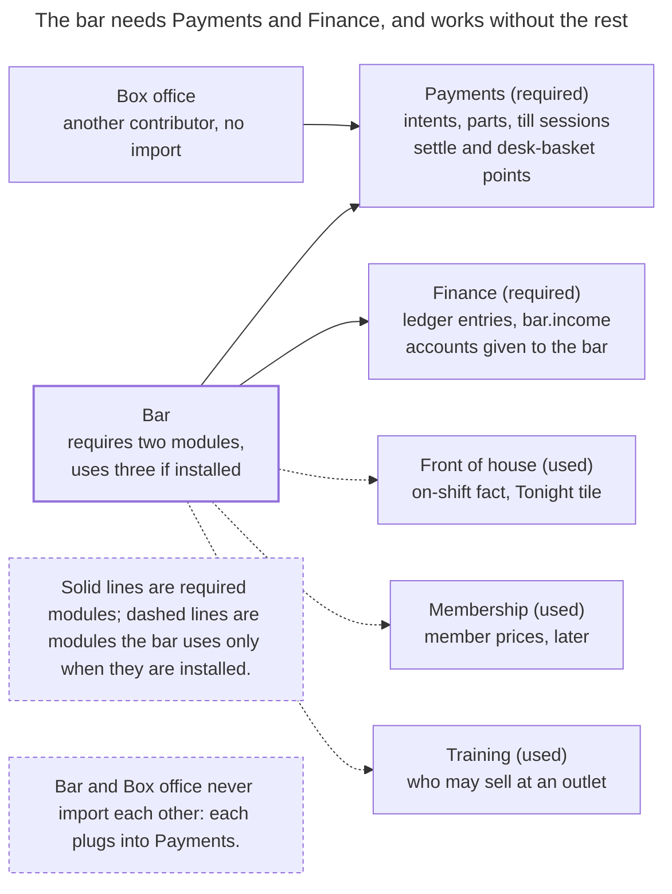

# 4. Interface to other modules

*module map · 2 required, 3 used*

The bar requires Payments and Finance and nothing else. It meets Box office only inside Payments' two points, so neither module imports the other and either can be switched off alone. Every contract in this part was agreed with its owner on 16 November 2026.

## Dependencies

| Module | `requires` | `uses` | Why |
| --- | --- | --- | --- |
| `bar` | `payments`, `finance` | `front-of-house`, `membership`, `training` | Payments collects and refunds; Finance holds the income. The soft links run through facts, requirements and points only |

No loop: Payments never imports the bar. It reaches a bar sale through the bar's contribution to `payments.settlement`. Payments owns the till component that hosts `payments.desk-basket`; Box office is one contributor and the bar another, and neither imports the other. With Box office switched off the bar still sells from its own till, and a drinks-only sale is a one-part intent. With the bar switched off the desk panel is absent.

## Services the bar uses

| From | Service | Used for |
| --- | --- | --- |
| `#modules/payments` | `createIntent`, `cancelIntent` | A drinks-only sale, or the payment of a bar tab: one intent with one part |
|  | `startAttempt`, `answerAttempt`, `intentStatus`, `methodsFor('desk')` | Taking the payment at the till, through Payments' own pay sheet |
|  | `requestRefund` | Refunding the bar's part |
|  | `openSession`, `closeSession` | The seller's till session, with `point_label` set to the outlet's name |
| `#modules/finance` | `accountFor('bar.income')`, `accountsFor('bar', 'income')`, `isPeriodOpen` | Resolving income accounts for the entries it hands to Payments, and filling the category form's account picker |
| The kit | `requirements.options`, `requirements.describe`, `requirements.check` | The outlet's sell requirement (part 3) |
| The core | `addressDigest(address, 'bar.tab-receipt')` | The digest of a floating tab's receipt address |
| Identity | `verifiedAddressDigests(accountId, 'bar.tab-receipt')`, server side; the person picker | Showing a floating tab to the account whose verified address matches; picking a known person for a tab. The till never learns whether an address has an account |
| Core domain | `operatingDayOf`, vocabularies, the file slot for a product image, transactional messages | Openings, reason terms, product pictures, the tab receipt and the staff tab reminder |

The bar does not call `postEntries` for a sale. The money line and the income lines must be one sealed posting, so Payments writes it from the entries each owner returns.

## Services the bar offers (`#modules/bar`)

| Service | Kind | Does |
| --- | --- | --- |
| `priceOf(variantId, priceListId?)` | read | The current price, following the fall-back rule and a percentage list. For a public price list component |
| `menu(outletId)` | read | Categories, products, variants and prices on sale at an outlet |
| `salesSummary(filter)` | read | Quantity and net amount by opening, performance, category, product and price list. For production and finance reports |
| `stockLevels(filter)` | read | Levels by item and location, with the low mark |
| `openingFor(performanceId)` | read | Whether an outlet is trading for a performance, for the Tonight hub |
| `addStockMovement(unit, movement)` | write | For a later module that consumes bar stock (a hospitality package). Adds to the caller's unit; never commits |

## Extension points

### Contributed by the bar to Payments

| Point | Contribution |
| --- | --- |
| `payments.settlement` | Handlers for parts whose owner module is `bar`, whether the owner record is a bar sale or a bar tab: `settle(unit, part)`, `cannotSettle(part)`, `refunded(unit, part, refund)` and the optional `release(unit, part)`. `release` is safe to call twice; Payments calls it when the desk cancels the payment or removes the bar's part, on final failure and on intent expiry, and the bar returns its sale to open or its tab from settling to open |
| `payments.desk-basket` | The "Bar" panel for the desk's payment step, and the functions that turn its open bar sale into a part |

`payments.desk-basket` is a code point. A contribution has these members:

| Member | Meaning |
| --- | --- |
| `id`, `label` | `bar`, "Bar" |
| `ability` | `bar.sale.sell`. The panel is absent for a person without it |
| `panel` | A component shown in the desk's right-hand panel. It is given the desk's context: the till session, and the performance the desk is serving if any |
| `summary(context)` | read. The lines to show under the tickets and the amount to add to the total, or nothing when the panel is empty |
| `prepare(unit, context)` | write. Adds the statements that ready this module's part and returns `{ owner: { module, record }, amountMinor }` with an amount above zero, or nothing when empty. Called in the batch that creates the intent |

The rules of `payments.settlement` the bar relies on:

| Rule | Effect on the bar |
| --- | --- |
| `settle(unit, part)` and `refunded(unit, part, refund)` return the owner's ledger entries: account, signed amount, production, performance, tax code. Payments adds the money line, writes one sealed posting for the intent and sets `for_module` on each entry from the part's owner | The bar never posts for a sale and never sets `for_module`. Its entries total exactly the part |
| A handler posts only to accounts whose module is its own. A handler whose entries do not total its part, or that names another module's account, is treated as that owner refusing: the provider's answer is recorded, nothing settles, and the intent is unfulfilled and refunded. It does not fail the batch | A category's income account is one of the bar's: `bar.income`, or an income account an administrator created and gave to the bar |
| No partial settlement. Any refusal settles nothing; if money was taken the intent is unfulfilled and refunded whole | Tickets failing stops the drinks; drinks failing leaves the reservation reserved |
| A refund names one part and cannot exceed it. `payments.refund.request` and `payments.refund.approve` are owner-neutral. A refund across two owners is two refunds | `bar.sale.refund` gates who may start a bar refund, then the bar calls Payments |
| A till session's expected cash counts attempts, which belong to no owner | Bar cash and ticket cash are cashed up together |

### Offered by the bar

| Point | Kind | A contribution is | Release |
| --- | --- | --- | --- |
| `bar.report` | data | A report another module adds to the bar's Reports screen | Later |

The bar declares no point for a per-person condition. Who may sell at an outlet and who may have a price list are requirement references checked through the kit's `requirements.check`, with `core.requirement` providers from Training, Membership and any declared fact.

### Contributed by the bar to other modules' points

| Point | Contribution |
| --- | --- |
| `core.navigation` | `menu: 'console'`, group Bar. Everyday: Bar sales, Bar tabs, Openings, Stock, Deliveries, Stocktakes. Set-up: Products, Price lists, Outlets, Reports, Refusals register, Settings. `menu: 'live'`: Till. `menu: 'members'`: My bar tab, shown by `bar.tab.hold` |
| `core.tonight-tile` | A Till tile per outlet that is open or has a performance tonight, naming the ability `bar.sale.sell` |
| `core.home-card` | Console home: "2 stocktakes awaiting approval", "Foyer bar has been open since yesterday", "6 items are low", "2 bar tabs are still open at the foyer bar", "The refusals register has not been signed for 9 days" |
| `core.quick-action` | "Open the till", "Record a delivery", "Record wastage" |
| `core.record-tab` | On a performance record: "Bar", with the opening's takings and top sellers, for a person with `bar.report.view` |
| `core.setup-step` | Add a first outlet; add products and prices; choose income accounts; set opening stock (optional) |
| `core.health-check` | Stock levels equal the sum of movements (expect zero differences); no bar sale awaiting payment for more than an hour; no opening open for more than a day; every active variant has a price on Standard |
| `core.record-resolver` | Titles and links for bar sale (its reference), bar tab, opening, product, stock item, delivery, stocktake |
| `core.search-source` | Products and stock items by name; a bar sale by reference |
| `core.change-impact` | For a performance: "The foyer bar has an opening planned" |
| `core.delete-guard` | A space with an active outlet cannot be deleted |
| `core.vocabulary` | The ten vocabularies in part 2, with starter terms |
| `core.privacy-record` | One entry: "The bar keeps the name on a bar tab, and for a floating tab an email address until the receipt is sent, then only a keyed digest of it. It keeps a description of a person refused only where the theatre has switched that on. It records which member of staff sold, refunded, counted and checked age." |
| `core.export-contributor` | The bar tabs matched to a person by account or by digest, with their bar sales |
| `core.erasure-handler` | Clears the name and digest on matched tabs; the money lines stay |
| `core.erasure-hold` | An unpaid bar tab holds its holder's erasure, so a debt cannot be erased |
| `finance.system-account` | `{ key: 'income', name: 'Bar income', kind: 'income' }`. Finance prefixes the module, so the account is `accountFor('bar.income')` |
| `front-of-house.tonight-figure` | Bar takings for tonight's openings |
| `front-of-house.report-section` | A bar section for the night report: takings by outlet, refusals, floating tabs written off |

`core.merge-handler`: one step, for the single once-only row the bar has, a person's live staff tab. Staff columns are `alias` and are left alone; `bar_tabs.holder_account` is `move`. The step runs in the merge's handler stage, before the move stage. If both accounts hold a live staff tab, the move would break the rule of one live staff tab per holder, so the step joins the tabs first. A sale's `tab_id` is set once, so no sale row is re-pointed; the balance moves instead. In one unit the absorbed account's tab becomes `joined` with `joined_to` naming the survivor's tab, and the survivor's tab total rises by the absorbed tab's total. That is one guarded update: the trigger that keeps a tab's total adds a joined tab's total to the tab it names, and takes it off again if joined\_to is cleared, so no later statement has to know whether the join won. From then on the survivor's tab is the only live one: settling it pays, in the same statement, every sale on it and on each tab joined to it; writing it off leaves them all `on_tab`; and its statement, on the record and on "My bar tab", reads across them. A tab already joined to the absorbed tab is re-pointed to the survivor's. The joined tab may stand over its limit; it then takes no charges until it is paid. If either tab is settling, the step answers "not yet" and the staged merge tries again. The step is safe to repeat: a tab already joined is left as it is.

Undoing a merge. A merge can be undone for 30 days, and the survivor's tab will have changed since, so the bar supplies its own undo statements and no listed values are put back. They are one unit, safe to repeat, and act only on a tab that is still `joined`. Undo is the exact reverse of the forward order: Identity points the module's move columns back first, and these statements run after. Sales charged after the merge stay with the survivor's tab.

| The survivor's tab is | The undo does |
| --- | --- |
| open | Returns the joined tab to open and clears `joined_to`. The move's undo has already given it back to its former holder, so the rule of one live staff tab per holder is never broken |
| settling | Answers "not yet", as the merge step does |
| settled | Nothing is taken off: the joined tab's sales were paid with the survivor's tab and stay paid. The joined tab becomes settled, with the survivor tab's closing time and `closed_by`, and `joined_to` is cleared |
| written\_off | Nothing is taken off. The joined tab becomes written\_off with the same reason, time and `closed_by`, its sales stay `on_tab`, and `joined_to` is cleared |

Each case writes an audit entry naming both tabs. A sale taken off a joined tab before the undo has already lowered both totals, so when the undo clears joined\_to on an open pair, the trigger takes the joined tab's total as it stands off the survivor's tab, not the figure carried at the merge. In the settled and written-off cases the survivor's tab is final and its total does not change.

`finance.period-close-check`: none in the first release. Bar income is posted only when money is taken, so an open outlet, an unapproved stocktake or an unpaid bar tab leaves nothing waiting to arrive in a period that is closing; a bar tab paid later posts into the earliest open period. An open till session and a payment in hand are Payments' own blockers. When stock gains a value in the ledger (later story BAR-55), a submitted stocktake dated in the period becomes a blocker, with the sentence "A stocktake for this period has not been approved" and a link to it.

## Facts and secrets

| Kind | Name | Detail |
| --- | --- | --- |
| Fact | `bar.tab-holder` | `standing: true`, site-wide. True for an account that has `bar.tab.hold` or holds an open staff tab, and never for a floating tab. Its `holders` lists those accounts, and both it and the check read by account scope, so an alias answers as its survivor. It exists so that a holder with no other standing can open the members' area, where "My bar tab" lives. It grants nothing by itself; `bar.tab.hold` still guards the screen |
| Secret key name | `bar.tab-receipt` | Declared to the core's key store, for `addressDigest`. The bar holds no credential and reaches no outside service |

## Events

Payloads are identifiers and amounts only, never a name or an address. Each event states `internal`.

### Announced

| Event | When | Payload | `internal` | Why |
| --- | --- | --- | --- | --- |
| `bar.opening.opened`, `bar.opening.closed` | An outlet starts or stops trading | openingId, outletId, performanceId | false | Useful to a night report |
| `bar.sale.paid` | The settle batch, for a sale paid at once or through a tab | saleId, openingId | false | A sales feed for an outside accounts system. A reference and ids, no person |
| `bar.sale.refunded` | A refund's success batch | saleId, refundId | false | The counterpart |
| `bar.sale.voided` | A sale with lines is voided | saleId | true | Operational |
| `bar.tab.opened`, `bar.tab.settled`, `bar.tab.written-off` | Bar tab states | tabId, outletId, amountMinor | true | Operational. A tab has a subject, so nothing leaves the platform |
| `bar.age-check.refused` | A refusal is recorded | ageCheckId, openingId | true | For the duty manager's night report; nothing outside needs it |
| `bar.delivery.received` | Draft to received | deliveryId | true | Operational |
| `bar.stock-item.ran-low` | An item crosses its reorder level | stockItemId | true | Operational |
| `bar.stocktake.submitted`, `bar.stocktake.approved` | Stocktake states | stocktakeId | true | Staff workflow |

### Heard

| Event | Reaction |
| --- | --- |
| `payments.refund.failed` (owner module `bar`) | Reversals of that refund to failed |
| `payments.intent.expired`, `payments.intent.unfulfilled` (a part owned by `bar`) | Handled through `cannotSettle` and `release`; the event is the safety net that returns a sale to open, or a tab from settling to open, if neither ran |
| `payments.session.closed` | Nothing stored; the till signs the person out of selling |
| `core.performance.cancelled`, `core.performance.rescheduled`, `core.performance.moved` | Nothing changes. An opening keeps its performance |
| `core.account.merged` | Nothing: the merge step above and the `col.account` declarations do the work |

Notifications. The bar declares five notification types through Core domain (part 6): three to staff as preferences, and the tab receipt and the staff tab reminder as transactional messages.

## Jobs and scheduled tasks

| Name | Kind | Does |
| --- | --- | --- |
| `bar.close-openings` | task, every 5 minutes from the one cron | Closes openings past `bar.openings.close-after` with no recent sale, nothing awaiting payment and no floating tab open or settling |
| `bar.remind-staff-tabs` | task, daily | Sends `bar.staff-tab-reminder` to the holder of each unpaid staff tab that is due one |
| `bar.build-export` | job | Builds a licensing or sales export file and puts it in the file store |

Each is safe to run twice: each is a guarded transition, records what it sent, or writes a file under a key built from its request. Names on closed tabs and old register rows are removed by the core's retention sweep, from the retentions the tables declare.

## Routes that are not behind an ability

None. "My bar tab" is in the members' area and is guarded by `bar.tab.hold`. A public price list (later story BAR-46) is a Nuxt Content component (`core.public-component`: `BarPriceList`) rendered on the server from `menu`, cached, with no route of its own.

## What the bar needs from the others

| From | Need | Status |
| --- | --- | --- |
| Payments | The `payments.desk-basket` contract above (`id`, `label`, `ability`, `panel`, `summary`, `prepare`), with `prepare` in the intent's batch; and an optional, idempotent `release` on the `payments.settlement` handler | Agreed; in part 4 of the Box office, payments and ledger specification |
| Payments | `settle` and `refunded` return the owner's ledger entries, and Payments seals one posting per intent | Agreed |
| Payments | Refund abilities that act on any owner's part | Agreed: owner-neutral |
| Finance | `finance.system-account`, and `accountsFor(module, kind)` | Agreed. Every account belongs to one module |
| Box office | The desk's payment step calls `summary` and `prepare`, shows one total, and passes the performance it is serving. Removing a part goes through Payments, which calls that owner's `release` | Agreed. Box office is a contributor to Payments' till like the bar |
| Foundations | `core.requirement` with `whenUnavailable`; a subject with both an account and an email; `col.freeText` in a table with a retention; id prefixes | Agreed; the 21 prefixes are registered |
| Core domain | Ten vocabularies; `operatingDayOf`; a file slot on a product; transactional messages | Matches its specification |
| Identity | `verifiedAddressDigests`; the person picker; a fact with `standing: true` opening the members' area | Agreed |
| Front of house | The fact `front-of-house.on-shift`, on a performance, true for a confirmed assignment. It does not tell a bar shift from a steward's, so a theatre that maps it to `bar.sale.sell` lets every confirmed volunteer sell. A theatre that wants it narrower uses a role, or the outlet's sell requirement | As specified by Front of house |
| Training | A requirement source `training`, so an outlet can name a competency as its sell requirement | Through `core.requirement`; nothing bar-specific |
| Membership | A requirement source `membership`, for the later story BAR-56 | Later |
| Form builder | Nothing in the first release. A cellar checklist could later use a form slot on an opening |  |
| Interface | Live mode for the till; the shared `LiveKeypad` (UI-36); the money rule (expected total); the record-tab, home-card and tonight-tile points; "My bar tab" in the members' area | Agreed |
