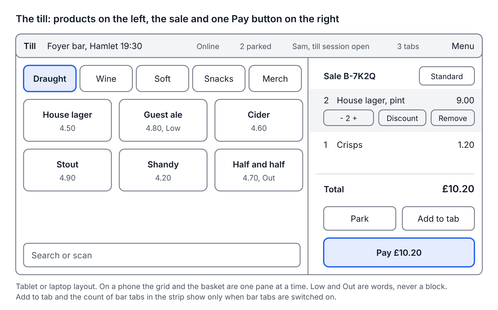
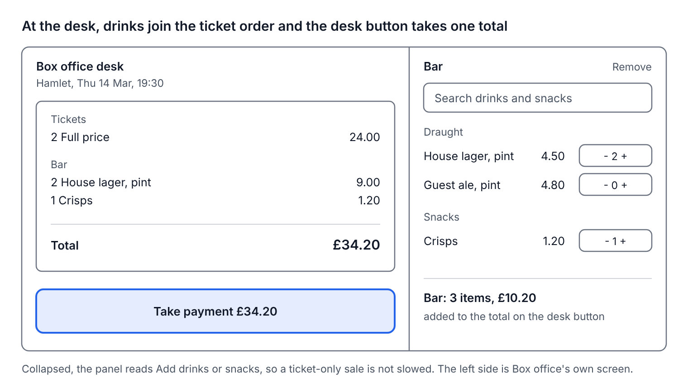
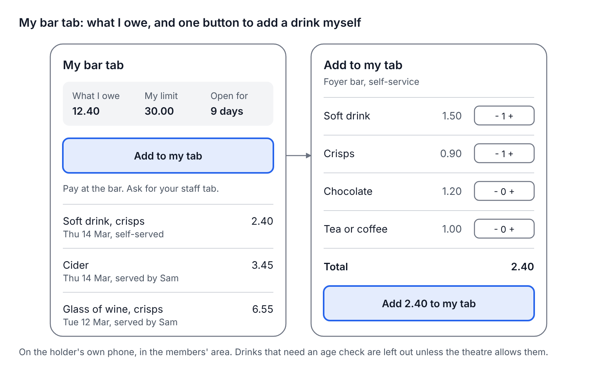

# 5. Screens

The bar has one live-mode screen (the till), one panel on the box office desk, fifteen console screens built from Interface's page types, and one screen in the members' area. No screen is in the public shell.

## Screen list

| # | Screen | Address | Page type | Opens for |
| --- | --- | --- | --- | --- |
| S1 | Till | `/live/till` | Live | `bar.sale.sell` |
| S2 | Bar panel on the desk | inside `/console/box-office/sell` | Panel in the desk screen | `bar.sale.sell` |
| S3 | Bar sales | `/console/bar/sales` | List | `bar.sale.view` |
| S4 | Bar sale | `/console/bar/sales/<reference>` | Record | `bar.sale.view` |
| S5 | Openings | `/console/bar/openings` | List | `bar.report.view` |
| S6 | Opening | `/console/bar/openings/<id>` | Record | `bar.report.view` |
| S7 | Stock | `/console/bar/stock` | List | `bar.stock.view` |
| S8 | Stock item | `/console/bar/stock/<id>` | Record | `bar.stock.view` |
| S9 | Deliveries, and Record a delivery | `/console/bar/deliveries` | List, Form | `bar.stock.receive` |
| S10 | Stocktakes, Count, and Review | `/console/bar/stocktakes` | List, Steps, Record | `bar.stock.count`, `bar.stocktake.approve` |
| S11 | Products | `/console/bar/products` | List, Record, Form | `bar.product.manage` |
| S12 | Price lists | `/console/bar/price-lists` | List, Record | `bar.price.manage` |
| S13 | Outlets | `/console/bar/outlets` | List, Form | `bar.outlet.manage` |
| S14 | Reports | `/console/bar/reports` | List of reports, each a List | `bar.report.view` |
| S15 | Refusals register | `/console/bar/age-checks` | List | `bar.age-check.view` |
| S16 | Settings | `/console/bar/settings` | Settings (generated) | `bar.settings.manage` |
| S17 | Bar tabs | `/console/bar/tabs` | List, Record | `bar.tab.view` |
| S18 | My bar tab | `/members/bar/tab` | Steps, in the members' area | `bar.tab.hold` |

Bar is its own group in the console sidebar. Everyday work is Bar sales, Bar tabs, Openings, Stock, Deliveries and Stocktakes; set-up is Products, Price lists, Outlets, Reports, Refusals register and Settings. A shell follows whose business a screen does, not what guards it: everything where staff act for the theatre is under `/console/bar` or in live mode, and a person's own staff tab is in the members' area.

## S1. Till (live mode)

One job: serve the customer in front of you. Dark ground, every control at least 48 by 48 pixels, no sidebar. It opens from the Till tile on the Tonight hub.

**Status strip.** "Till", the outlet and what it is open for ("Foyer bar, Hamlet 19:30"), the connection state in words, the number of actions waiting to send, the seller's name with their till session, and a way out.

**Before selling.** If the outlet has no opening, a person with `bar.opening.manage` sees "Open the foyer bar" with tonight's performances and "Something else" (an occasion term). A person without it sees who can open it. If the seller has no till session, Payments' open-session panel asks for the float first.

**Selling, on a tablet or laptop: two panes.**

*till wireframe · tablet or laptop, two panes, bar tabs switched on*

- **Categories** are two or three large segments; more scroll sideways within the bar. A category's colour is always beside its name.
- **A product tile** adds its only variant at once. A product with several variants opens a sheet of them ("Pint 4.50", "Half 2.30"); the last one chosen is first. A tile shows "Low" or "Out" from stock as a word, and is never disabled by stock.
- **The basket** lists lines with quantity steppers. Selecting a line shows Discount (with `bar.sale.discount`) and Remove. The basket's menu has "Refuse sale".
- **The price list** is named in the basket header. Pressing it offers the lists the seller may use.
- **Pay** is the one primary action and carries the total. **Park** sets the sale aside under a label; parked sales sit behind a counter in the status strip. With bar tabs switched on, **Add to tab** sits between them.
- **On a phone** there is one pane at a time: the grid, with a bar at the foot showing the item count and total that opens the basket.

**Bar tabs.** "Add to tab" opens a sheet with two groups: "Floating tabs", the open ones for this outlet tonight, each with its name and total; and "Staff tabs", searched by name. "New tab" opens a floating tab: one field for the name, and an optional email address "for the receipt". Choosing a tab charges the sale and shows a result band: "Added to Priya's tab. Tab total 18.40." A charge over the limit is refused in words with both figures. The status strip shows a count, "3 tabs", which opens the list. A tab in the list has one primary action, "Settle 18.40", which opens Payments' pay sheet; settling a floating tab offers the email field again if it is empty. The till never says whether an address belongs to an account.

**Age check and refusals.** Adding the first restricted product opens a full-width sheet: "Does the customer look under 25?" with three buttons: "No, clearly over", "Yes, ID checked", "Refuse sale". Refuse asks for a reason from the list and shows the product being refused. "Refuse sale" in the basket's menu does the same for any sale, with the seller marking the lines refused. The status strip's menu has "Record a refusal" for a customer turned away before a sale, with an optional product. With `bar.age-check.description` on, the refusal sheet has one more optional field, "Description of the person", at most 120 characters with a counter, and the guidance "Clothing, height, hair, apparent age. Do not write a name, or anything about race, religion, disability or health". When a seller does not meet the outlet's requirement the till says why and what to do, and a person with `bar.sale.override-requirement` sees "Allow for this opening".

**Paying.** Payments' pay sheet, the same component the desk uses: the methods from `methodsFor('desk')`, each a large button; for cash, quick amounts from `bar.till.quick-cash-amounts` as buttons beside the shared `LiveKeypad`, and the change due; for the reader, "Waiting for the card reader" with Check again and Cancel. The sheet shows the total the till expects; if the server's differs, the payment is refused and both figures are shown (Interface's money rule). Cash is offered after a card attempt only once that attempt is known to have failed.

**Result.** A full-width band with a word, a shape and a colour: "Paid" with a tick, and "Change 9.80" for cash; or "Not paid" with a cross and the reason. A sound or vibration where the device allows. The next sale starts on any press.

**Other actions** in the status strip's menu: parked sales, today's sales by me (to find one to refund), record wastage (with `bar.stock.waste`), close the outlet (with `bar.opening.manage`), cash up (Payments' close-session flow).

**Without a connection.** The grid and prices stay on screen from the copy loaded when the till opened, and a sale can be built. Pay and Add to tab are disabled with the words "Payments need a connection". Nothing is queued in the first release; cash sales taken offline are the later story BAR-54.

**States.** Loading: the frame and tile skeletons. Empty: "No products are on sale at this outlet. Add products" for a person who can, otherwise who can. Refused: why, and who can open the outlet or grant the ability.

## S2. Bar panel on the box office desk

Box office's desk screen has a right-hand panel for `payments.desk-basket`. The bar's contribution, shown to a person with `bar.sale.sell` when `bar.desk.enabled` is on and a desk outlet exists:

*desk panel wireframe · the bar panel open beside a ticket order*

- **Collapsed:** "Add drinks or snacks", so a ticket-only sale is not slowed.
- **Open:** a search field and the desk outlet's products as a compact list grouped by category, each row a name, a price and a stepper. Calm intensity, laptop first: this is the console, not live mode.
- **Lines** the bar has added appear under the tickets in the desk's own summary, labelled "Bar", with one total for everything.
- **Age check** as on the till, as a dialog.
- **Take payment** is the desk's button, not the bar's. Its label carries the combined total.
- **After payment** the desk's confirmation lists "Bar: 2 items, 5.70" beside the tickets.
- **If the reader gives no answer** the desk stays on the payment as Box office specifies; the bar lines stay attached and cannot be edited until the attempt is known.
- **Remove** takes the bar lines out of a payment that has not started or has failed.

The panel has no bar tabs: a bar tab is charged and settled at the till only.

## S3 and S4. Bar sales

**List.** Columns: reference, time, outlet, opening, items, total, method, state, sold by. On a phone a card keeps reference, total and state. Filters in the address: date, outlet, opening, state, seller, "has a refund". Export with `bar.report.export`.

**Record.** Title "Bar sale B-7K2Q" with a state badge that carries a word. Summary strip: total, paid by, outlet, opening, sold by, time. Tabs: Lines (with any reversals under each line), Payment (a link to the Payments intent, never repeated data), History. Primary action when paid: "Refund", which opens a panel: choose lines and quantities, the reason, what happened to the goods; the button reads "Refund 4.50". Refused states say why: "Refunds over 20.00 need a second person. Send this refund for approval."

## S5 and S6. Openings

**List.** Outlet, what for, operating day, opened and closed, takings, state. Primary action: "Open an outlet".

**Record.** Title "Foyer bar, Hamlet, Thu 14 Mar". Summary strip: takings, bar sales, average sale, refunds, discounts given, age-check refusals. Tabs: Summary (takings by category and by method, top sellers), Bar sales, Stock used (movements of kind sale, summed by item), Age checks, History. Primary action while open: "Close outlet", which names what will be voided ("2 parked sales will be voided"). It is refused while a floating tab is open or settling, and lists each with its total; a staff tab never blocks it.

## S7 and S8. Stock

**List.** One row per stock item: name, category, a level per location in count units ("4 bottles and 300 ml"), total, low mark, last counted. A negative level is red with the words "3 below zero". Filters: category, location, low only, below zero only. Primary action: "Record a delivery". Row actions: Record wastage, Move between locations (short forms in a panel).

**Record.** Summary strip: on hand, reorder level, pack, last cost, last counted. Tabs: Movements (a List: time, kind, quantity, location, source link, by), Sold as (the variants whose recipes use it), History.

## S9. Deliveries

A Form page: location, supplier (from the list), delivery note number, then lines: search a stock item, packs, loose units, pack cost (optional). A draft saves as it goes. The save bar reads "Receive 14 lines into Cellar". After receipt the delivery is a read-only record with links to its movements.

## S10. Stocktakes

**Count** is a Steps page built for a phone held in a cellar: 1 Choose (location; everything or one category), 2 Count, 3 Check, 4 Submit.

- Step 2 lists items by category with two fields each: whole count units and the part unit. Large steppers; a "Not counted" switch per item; progress as "18 of 42 counted". It saves every entry and can be left and resumed.
- With `bar.stocktake.blind` on, no expected figure appears before submission.
- Step 3 shows only what is unusual: items not counted, and, when not blind, the largest differences.
- Step 4's button reads "Submit count of Cellar".

**Review** is the Record page of a submitted stocktake. Summary strip: location, counted by, submitted, variance value, items over, items short. A table of lines with expected, counted, variance in units and in value, sorted by absolute value, with a reason per line (optional). Primary action: "Approve and adjust stock", whose confirmation states the consequence: "17 stock levels will change. Net variance -42.60." The action menu has "Send back for recount". A person who submitted the count sees why they cannot approve it and who can.

## S11 to S13. Products, price lists, outlets

- **Products.** List by category with drag to reorder (and Move up, Move down for a keyboard). The product Record has tabs Variants and prices (a grid of variants against price lists; a cell edit writes a new price row, and a price can be dated to start later), Stock (the recipe per variant: stock item and quantity, with a unit hint such as "175 ml is a medium glass"), Outlets (where it is sold), History.
- **Price lists.** A list Record shows every variant with its price on this list and on Standard, and what falls back. A list is either priced by hand or "a percentage off Standard": with a percentage set, the grid is read-only and shows each worked price. Bulk action on a hand-priced list: raise selected prices by a percentage or an amount, with a preview of old and new before saving.
- **Outlets.** A short form in a panel: name, kind, space, price list, stock location, which categories it sells, "Staff tab holders may serve themselves here", and "Sellers must meet", a requirement chosen from the kit's picker or none. Beside a requirement whose source is switched off the form says it is not being enforced.

## S14. Reports

Each is a List with filters in the address and CSV export.

| Report | Shows |
| --- | --- |
| Sales | Quantity, gross, discount and net by day, opening, performance, production, category, product, variant, price list, seller |
| Takings by method | Net by payment method per opening, with a link to the Payments sessions that cover it |
| Bar tabs owed | Open staff tabs by holder, age and amount; and written-off tabs for a period |
| Stock on hand | Levels and value at last cost, by location |
| Stock movement | Opening level, deliveries, sold, wasted, adjusted, closing level per item for a period |
| Variance | Each stocktake's variance by item and in total, over time |
| Wastage | By reason and item |
| Licensing export | For a date range: openings with times, the refusals register with the product refused and the reason, the managers' signatures, and sales of restricted products by day. The layout is a plain CSV a theatre adapts to its licensing authority |

## S15. Refusals register

A List: time, outlet, outcome, reason, product refused, recorded by, bar sale; and the description where that setting is on. Filters: date, outlet, outcome. Rows are read only, except that a person who may sign the register may choose "Erase description" on a row, which asks for confirmation and cannot be undone. Its one primary action, for a person with `bar.age-check.review`, is "Sign as checked": choose the days, see the number of refusals they cover, confirm. Signatures are listed above the rows with who signed and when. Its empty state explains what the register is for.

## S17. Bar tabs

For `bar.tab.view`. **List.** Columns: name, kind, outlet, opened, sales, total, state. Filters: kind, state, outlet, date. A saved filter, "Owed", shows open staff tabs, oldest first.

**Record.** The summary strip shows total, limit, opened by and state; its tabs are Bar sales, Payment and History. Actions: "Settle", "Raise limit" and "Write off", which asks for a reason and states the consequence: "42.00 will not be collected. Stock already taken is not returned." A person who opened the tab, or whose tab it is, sees why they cannot write it off and who can.

## S18. My bar tab

In the members' area, for `bar.tab.hold`, built for the holder's own phone. It is a Steps page, not a Live page: it is a person's own business, not a show-night job. It needs no device at the bar, no till session and no seller.

*My bar tab wireframe · the holder's phone: the tab, then adding to it*

- Summary strip: what I owe, my limit, and how long the tab has been open.
- Primary action: "Add to my tab". It opens a short Steps flow: choose the outlet (skipped when only one is self-service or the address names one), pick products from a compact list with steppers, then confirm on a button that names the amount: "Add 2.40 to my tab".
- The result says what happened in words: "Added. You now owe 14.90."
- Below: the bar sales on the tab, newest first, each with its date, items and amount, and who served it or "Self-served". Floating tabs matched to one of the person's verified addresses are listed beneath, as history.
- Refused states: at the limit ("Your tab is at its limit of 30.00. Pay it at the bar to add more."); no self-service outlet; no tab ability, naming who can grant it.
- It says how to pay: "Pay at the bar. Ask for your staff tab."

The address is stable, and an outlet can be named in it: `/members/bar/tab?outlet=<outlet id>` opens the screen with that self-service outlet already chosen. The link is plain and survives sign-in: someone not signed in is sent to sign in and lands back on the same address with the outlet kept. An outlet that is unknown, retired or not self-service is ignored and the screen asks which outlet. A theatre may print a QR code of that link and put it on the bar; the platform does not make or manage the code, and nothing depends on one. A person who is not a member of anything else can still open the screen, because the fact `bar.tab-holder` gives them a standing (part 4); without `bar.tab.hold` the address answers page not found, as every members' address does.

## Cards, tiles and tabs in other modules' screens

| Where | What |
| --- | --- |
| Tonight hub | A Till tile per outlet that is open or has a performance tonight; bar takings as a figure in the Front of house section |
| Console home | "2 stocktakes awaiting approval. Review." "Foyer bar has been open since yesterday. Close it." "6 items are low. See stock." "2 bar tabs are still open at the foyer bar." "The refusals register has not been signed for 9 days." |
| Performance record | A record tab named Bar: takings and top sellers for that performance's openings |
| Night report | A bar section: takings by outlet, refusals, floating tabs written off |
| Members' area menu | My bar tab, for a person with `bar.tab.hold` |
| Payments session record | Nothing from the bar: a session lists attempts, which already include bar payments |

## Check against Interface's conventions

| Convention | How the bar meets it |
| --- | --- |
| One page type per screen | The table at the top; no custom page |
| One primary action | Pay on the till; Take payment stays the desk's; "Add to my tab" on My bar tab; one per console screen |
| Money shows the expected total | The till and the panel send the total; the server refuses a mismatch quoting both |
| State is never only a colour | Low, Out, below zero, Paid and Not paid all carry a word |
| Live mode works without a connection | In part, as agreed with Matt: the till stays usable for building a sale and says plainly that paying needs a connection |
| One job during a performance is a Live page; a person's own business is in their own shell | The till is Live; My bar tab is in the members' area |
| Filters live in the address; every list exports | S3, S5, S7, S14, S15, S17 |
| No jargon outside the console | My bar tab says "what I owe", "my limit" and "Pay at the bar"; the bar has no public screen |
| Settings are generated | S16 has no hand-built markup |

## The keypad

The till uses the shared `LiveKeypad` component from the core set (story UI-36) and draws none of its own. It is used in money mode for cash tendered and discounts, which hands the screen an amount in minor units, and in whole-number mode for quantities and counts. The keypad never confirms on its own: the screen's one primary action does, and names the amount. The quick cash amounts from `bar.till.quick-cash-amounts` are buttons on the till screen beside the keypad, not keys of it. The till is a Live page, so the status strip, queued acts and the rule that cash is offered only after a known card failure apply to it.
