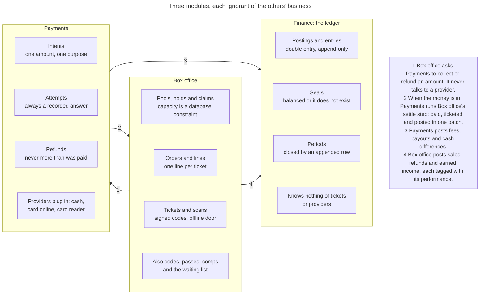

# Box office, payments and ledger: specification

Nov 16, 2026 · @Matthew Adcock

Workstream 4 of the detailed-design stage. It specifies ticketing, the payment provider interface and the money ledger for the new platform, and reports the last-seat proof on D1.

## Summary

- **Three modules:** Box office, Payments and Finance (the ledger only). Bar and Membership can later take money through Payments and the ledger without the box office existing.
- **The last seat sells once because the database refuses a second sale.** Claims are rows, a trigger keeps a counter, and a CHECK caps it at capacity. Proved on local D1: 11 of 11 cases, including 40 buyers racing for one seat. A run on a deployed database is waiting on a yes from Matt.
- **Paid means ticketed.** A payment's success, the order's confirmation, its tickets and its ledger posting are one database batch. The one way it can fail (money arriving after the seats have gone) ends in an automatic refund, never an oversell.
- **Every payment attempt ends in a recorded answer**, from the provider or from a named person. "No answer" is its own state, and the seats stay held until it is resolved.
- **The ledger is double entry and append-only.** A posting balances or does not exist. Periods are closed by adding a row; late facts post into the next open period.
- **Buying needs no sign-in**, and the audience screens never mention membership. An order is still keyed to an account, which identity creates unclaimed for the buyer's address.
- **Size:** 37 tables, 59 stories (51 in the first release), 52 named never-regress tests, 9 questions for Matt.

Start with **9. Questions for Matt**; everything else can be read in any order.

## At a glance

*module map · 3 modules, 4 links*

Payments reaches Box office only through an extension point, so it does not depend on it. The same point will serve the Bar and Membership.

## Status

Draft 1, 16 November 2026. All nine parts and the proof are written.

| Part | State | Waits on |
| --- | --- | --- |
| 1. Scope | Drafted |  |
| 2. Data model | Drafted, in the Foundations format |  |
| 3. States and rules | Drafted, three life-cycle diagrams |  |
| 4. Interface to other modules | Drafted; agreed with Foundations, Identity and Core domain by message | Identity: whether an anonymous desk sale may have no account |
| 5. Screens | Drafted, three wireframes | Workstream 6 for the shells and the look |
| 6. Settings and abilities | Drafted | Workstream 2 for preset role names |
| 7. Stories | Drafted |  |
| 8. Test plan | Drafted |  |
| 9. Questions for Matt | Nine questions, each with a recommendation | Matt |
| Proof: last seat on D1 | Passed locally | Matt's yes to a run on a deployed database |

**What this draft does not do.** It names no visual design. It does not choose a first payment provider (question 2). Its defaults in part 6 are proposals. Its claims about Stripe, SumUp, pretix and Cloudflare are sourced to their own documentation where they appear; nothing was tested against a real provider.
