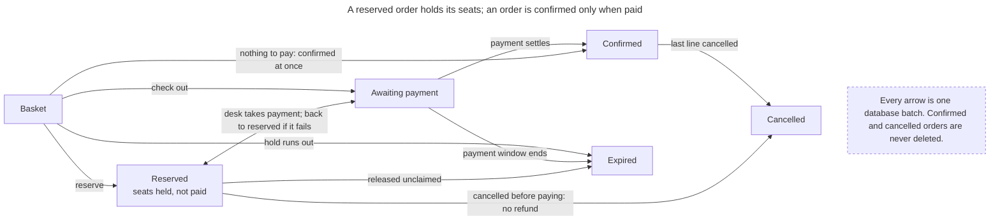
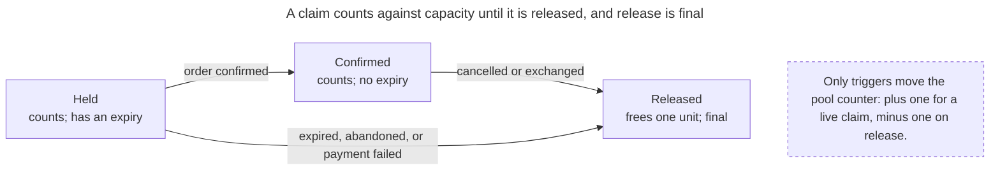
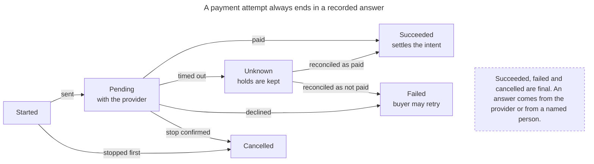

# 3. States and rules

## The rule behind every rule

Every change of state below is **one unit of work, committed as one D1 batch** (Foundations draft 1). A guard is written on the statement itself, as a `WHERE` clause, a CHECK or a trigger, never as a read followed by a write. Where a guarded update could match no rows without raising an error, the batch carries the kit's guard, a read statement that raises and fails it, so a transition either happens whole or leaves nothing behind. No unit here compares D1's count of changed rows with an exact number: that count includes rows written by triggers and search indexes, and the claim tables carry triggers (Foundations part 3, "Counting changes once tables have triggers"). Wherever this part says a conditional write must take effect, it means the guard passed.

## A performance on sale

| From | To | Guard | Who |
| --- | --- | --- | --- |
| draft | on sale | At least one pool with capacity above zero; every pool's band has at least one price; if any price is above zero, a payment provider is active for the online channel or the performance is desk-only | `box-office.performance.manage`, or automatically at `on_sale_at` |
| on sale | paused | None. New baskets are refused, at the desk as online; open baskets may finish, and payment for an existing reservation is still taken | `box-office.performance.manage` |
| paused | on sale | Same as draft to on sale | `box-office.performance.manage` |
| on sale, paused | closed | Automatically at `off_sale_at` online; the desk may go on selling until box-office.sales.desk-until-after has passed after the start. The desk never sells a performance that is draft or paused | system |

**Cancelling, rescheduling or moving a performance with tickets** (integration ruling R-11). Box office's contribution to `core.change-guard` refuses the core's change while the performance has live tickets or reservations and no decision is recorded, and the refusal carries the question: refund all, offer exchange, or keep (not offered for a cancellation). The Programme window making the change asks it of a person with `box-office.performance.manage` and posts the answer to Box office, which records it on the sales record; anyone else is told that someone who manages the tickets must decide (Matt, 21 November 2026, in place of the separate Bulk cancellation screen). The core's change then goes through, and its event runs the recorded decision as jobs (see Cancelling). Box office never refunds without that decision.

**Capacity.** The core owns a performance's capacity, read through `capacityOf(performance)`, which falls back to the space's own. Box office owns the pools that divide it into bands. The pools of a performance may not sum to more than `capacityOf` unless a person with `box-office.performance.exceed-venue` confirms it, which is recorded on the pool. A change the core makes to capacity is checked the other way, through the change guard: Box office refuses a figure below the seats already claimed and quotes the number. Box office never alters a pool on its own. When the core's capacity falls below the pools' total, or the performance moves to a smaller space, the performance is flagged on the on-sale checklist for a person to resolve.

## An order

*order life cycle · 6 states*

| Transition | Guard | In the same batch |
| --- | --- | --- |
| (none) to basket | Performance is on sale and inside its window; party size within the order cap; the claim batch succeeds | Hold, claims, order, lines |
| basket to awaiting payment | Order is unexpired; the total the screen sent equals the total computed from the lines, else refused quoting both figures; contact details present for the channel | Intent created through Payments with one part for the order; hold kind becomes `payment` and the claims' expiry moves to the payment window |
| basket to confirmed | Total is zero | Claims confirmed, tickets issued, event announced. No intent, no posting |
| awaiting payment to confirmed | The intent has settled for exactly the order total; every claim of the order is still live | Claims confirmed, tickets issued, ledger posting sealed, event announced |
| basket or awaiting payment to expired | `expires_at` has passed and no attempt is pending or unknown | Claims released, promo and pass redemptions released, intent cancelled |
| confirmed to cancelled | The last live line is cancelled | See Cancelling |

### Reserving now and paying on arrival

Some theatres take no money online: people reserve weeks ahead and pay at the desk on the night, on the theatre's card reader. The Nottingham New Theatre sells this way. The order state `reserved` covers it: seats claimed, nothing paid.

**When it applies.** The setting `box-office.checkout.payment-timing` is `pay-now`, `reserve` or `buyer-chooses`. A theatre with no online payment provider connected can only be `reserve`, and the settings screen says why. A performance can override the theatre's value with `payment_timing` on its sales record.

| Transition | Trigger | Guards | Effects, one batch |
| --- | --- | --- | --- |
| basket to reserved | Buyer presses Reserve online, or staff reserve at the desk or by phone | Account present; email confirmed if `box-office.reservations.confirm-email` is on; within the per-order and per-person limits; holds still live; expected total matches | Every claim moves from `held` to `confirmed` and its `expires_at` is cleared; the hold's kind becomes `reservation`; lines fix their price rows; the order gets its reference and desk code; `box-office.order.reserved` is announced; the confirmation message is queued. No payment intent, no tickets, no ledger posting |
| reserved to reserved (amended) | Buyer reduces from the link; staff reduce, add or change a ticket type at the desk | Adding needs free capacity through the ordinary claim; a change of type re-prices that line at the price that was in force when the order was reserved (the order's reserved\_at), so a price rise since then is not charged to someone who booked before it; an added ticket is a new claim at today's price | Claims released or added; lines superseded; amount due recomputed. A removal writes a cancellation row; a reason may be given and is not required, because nothing was paid |
| reserved to awaiting payment | Staff press Take payment at the desk | Ability `box-office.order.take-payment`; open till session; expected total matches | Payment intent created for the amount due, with one part for the order and one for each other module's panel in the till. The attempt is then started, its provider call going through `externalCall` |
| awaiting payment to confirmed | Provider or staff report success | As the ordinary settle batch | The settle batch below in its reserved form: the claims are already `confirmed`, so they are asserted and not changed; tickets issued; ledger posting. When staff chose Pay and admit, the tickets are marked admitted in the same batch |
| awaiting payment to reserved | Payment failed or was cancelled | Attempt is final and not succeeded | Order returns to `reserved`; its claims stay `confirmed`; staff may try again or use another method |
| reserved to cancelled | Buyer cancels from the link; staff cancel | None beyond ownership or ability | Claims released; waiting list offered the seats; cancellation row appended; `box-office.order.cancelled` announced. No refund, because nothing was paid |
| reserved to expired | The task `box-office.release-reservations` at the release time; or staff release by hand | Order still reserved; no attempt in flight; not marked `keep` by staff | Claims released; seats go to the waiting list and the door; `box-office.order.expired` announced; buyer told by message |

**Rules.**

- A reserved order claims seats exactly as a paid one does. Its claims are `confirmed` with no expiry, under a hold of kind `reservation`, so capacity, the last-seat guarantee and the seat index do not know the difference and no sweep can take the seats. Only cancelling or releasing the reservation releases them.
- A reserved order has no ledger effect. The ledger records money, and none has moved. Payment at the desk posts to deferred ticket income like any other sale, and the income is recognised by the daily task after the performance has taken place.
- An order whose total is zero (a pass, a complimentary ticket, a free event) never rests in `reserved`: it is confirmed and its tickets issued at once.
- The desk code in the message identifies the order and is stored hashed. While the order is unpaid it is not an admission ticket, and the door scanner answers "Not paid. Send to the desk" if it is shown there. Once the order is paid, the same code (or the booking reference) shown at the door of its performance admits its one ticket at once; with several still to come in, the door offers Admit one (as each person arrives) and Admit all, on the scanning screen itself.
- An attempt with no answer leaves the order in `awaiting_payment` and is listed under Needs attention like any other unknown attempt. The release task never releases an order with an attempt in flight.
- Release time is `box-office.reservations.release-before` ahead of the performance's start. Unset means never release automatically. Staff can mark one reservation `keep` (a known latecomer) and can release any by hand.
- Limits: `box-office.reservations.max-tickets-per-order` and `box-office.reservations.max-tickets-per-person` (per performance, across that person's live reservations). The count is of live ticket lines on orders that are reserved, or awaiting payment under a reservation hold, taken on the kit's account scope and guarded in the reserving batch.
- A reminder is sent `box-office.reservations.remind-before` ahead, with the amount due and the cancel link. The task `box-office.send-reservation-reminders` queues it.
- Payment methods at the desk are whatever Payments has connected: the reader driven from the screen, cash, or a card payment attested by staff when the reader is used on its own.

**Confirming by email.** When `box-office.reservations.confirm-email` is on and the buyer is not signed in, pressing Reserve does not reserve. The order stays a basket with no account, its seats held for the ordinary hold time. The basket stores the name and address the buyer typed and the hash and expiry of an ordinary link token (random, made by the kit's `linkTokens`; Foundations part 4, rules T1 to T4), and the message `box-office.reservation-confirm` is sent to that address with a link to `/book/confirm/<token>`, built with the kit's `siteUrl`. The address carries the token and nothing else: the page reads the show, the tickets, the address and the total from the row (`GET /api/box-office/reservations/confirm`, the token in the header `x-confirm-token`) and says them above the button. Pressing the link finds or creates the account for that address and runs the reserve batch above with it, clearing the token and the stored address in the same batch. The page gives one answer for a link that is wrong, used or expired, and a basket whose link is never pressed expires like any other. A signed-in buyer skips the step.

**The order's link.** The link in the reserved message opens the order without signing in. It is the same kind of link token, stored on the order as `link_token_hash` with `link_token_expires_at`. The landing page reads the token from the address once, under the kit's rules for such a route (the token kept out of logs and audit, no referrer, nothing cached), and from then on sends it in the header `x-order-token`: one route reads the order in whatever state it has reached, and one cancels or reduces it while it is reserved. Confirming an order always issues a new link, sent in the confirmation message, so the link in a reservation's message stops working once the order is paid; that message says the link is for managing the reservation until it is paid.

### One payment for tickets and something else

A theatre with one card reader often sells drinks and snacks in the same card transaction as the tickets, as the Nottingham New Theatre does. Payments therefore takes one payment for several things owned by different modules. The Bar module is specified in its own document; nothing here knows what a drink is.

- A payment intent has one or more **parts**. Each part names its owner (module and record) and its amount. The parts always add up to the intent's amount, checked in the batch that writes them. An ordinary ticket order is an intent with one part.
- The customer sees one total and the reader takes one payment. One attempt, one provider reference.
- The settle batch calls `payments.settlement` once for each part, all in the same batch. The tickets are issued and the other module's sale is completed together, or neither is. A failed attempt leaves every part unsettled and the reservation intact.
- Each owner returns the ledger entries for its part and Payments writes the one sealed posting: the money received, plus every part's entries to its owner's accounts. Ticket income and bar income never mix.
- A refund names a part. The limit that a refund cannot exceed what was paid is kept per part as well as per attempt, so cancelling a ticket cannot refund the drinks.
- The till has a point, `payments.desk-basket`, through which a module adds its own lines to the payment being taken. Box office does not know what a drink is, and a bar module does not know what a ticket is. Each owns its part.
- A payment with no ticket part at all (drinks only) is the same mechanism with one part, so one reader and one till session serve both.

Left to the owning modules: their stock and prices, and whether their items can be added to a reservation in advance.

**Rules for every owner** (contracts in part 4):

- Each owner prepares its own unpaid sale in the batch that creates the intent, and releases it if the payment is cancelled, fails for good or expires.
- Settlement is all parts or none. A refusal by any owner after money was taken makes the intent unfulfilled and refunds the whole payment.
- Each owner returns its ledger entries; Payments writes the one sealed posting. A part's entries total the part.
- A refund names one part and cannot exceed it. Refund abilities belong to Payments and are not worded around orders.
- The till is Payments' component. Box office is one contributor to it among others.

**When the hold starts, and changing a basket.** The hold starts when the first claim batch runs: the buyer presses Hold tickets on Choose tickets, or a seller adds the first ticket. The basket's expiry is set then. Adding tickets is a new claim batch on the same hold; removing one releases that claim. Editing the basket never moves the expiry, so a basket cannot be kept alive for ever. The countdown is shown to the buyer throughout.

**One extension.** In the basket's last minute the buyer is offered a button to extend the hold. One batch moves the order's `expires_at` and the `expires_at` of every claim of its hold forward by `box-office.baskets.extend-by` and sets the order's `extended_at`, guarded on the order being an unexpired basket whose `extended_at` is null, so it happens at most once. Setting the length to zero removes the button.

**After expiry.** An expired basket holds nothing. The browser remembers the lines so that Try again can run a fresh claim batch, which succeeds only if the seats are still free.

**The total.** A line's amount is its list price less its discount, both fixed when the line is written. The order total is the sum of live lines, rewritten in the same batch as any line change. Booking fees are lines, so the total a buyer sees is the total they pay.

**Born a basket.** Every order row is inserted in state `basket`, and a trigger refuses any other. A desk sale or a reservation that never shows a basket to anyone still inserts one and moves it on in the same batch, so every order passes the same guarded transitions.

## A claim

*claim life cycle · 3 states*

| Rule | How it is enforced |
| --- | --- |
| A pool never holds more live claims than its capacity | The claim is a conditional write on the pool (room for the whole party) followed by the kit's guard, so a full pool is a refusal in the theatre's words ("These have just gone", "Only 1 is left") and the batch takes nothing. Behind it, as the backstop the proof tested, the CHECK on the pool, fed by triggers, refuses any insert past capacity however it arrives, and a trigger keeps the pool's counter equal to the count of its live claims. Every other condition on the claim (a limit per person, a hold that must still be live, the party's size) is followed by the kit's guard too, never by a test of changed rows (Proof, cases 2, 3 and 7) |
| A seat has one live claim | Partial unique index (Proof, cases 5 and 6) |
| A party is seated whole or not at all | All of its claims are in one batch (Proof, cases 3 and 4) |
| An expired hold never blocks a sale | Every claim batch first releases the pool's expired holds (Proof, case 8) |
| Capacity cannot be cut below what is sold | The same CHECK (Proof, case 10) |
| A released claim cannot come back | Trigger (Proof, case 10) |
| A hold being paid for is not swept | The sweep and the lazy release never release a hold of kind payment. Box office does not read Payments' tables to judge it: Payments ends such a hold through the settlement handler's release, when the intent is cancelled or expires with no attempt pending or unknown |

**Kinds of hold and how long they last.**

| Kind | Starts | Ends |
| --- | --- | --- |
| Basket | The first claim batch: Hold tickets online, or the first ticket added at the desk | `box-office.baskets.hold-for` later, plus one extension of `box-office.baskets.extend-by`; or checkout |
| Payment | Payment starts | `box-office.baskets.pay-within` later, or the attempt's answer |
| Reservation | A basket is reserved | No expiry on its claims. Ended by payment at the desk, cancellation, or release (`box-office.reservations.release-before`, or by hand) |
| Staff | A person holds seats, with a label | A date they set, or never; released by hand or sold from |
| Waiting-list offer | An offer is made | `box-office.waiting-list.offer-for` later, or acceptance |

## Wheelchair spaces, transfer seats and companions

Venues differ, so the theatre chooses per production how a wheelchair space takes capacity. Everything below uses the same claims as any other sale, so the last-seat guarantee covers it.

| The venue | Set up as | What booking one space does |
| --- | --- | --- |
| Permanent wheelchair spaces, counted apart from the seats | A band of kind `wheelchair` with its own capacity and no `displaces_band_id` | One claim in the wheelchair pool. Seating is untouched, and an unsold space never becomes a seat |
| Seats are taken out to make each space | A band of kind `wheelchair` whose capacity is the most spaces the venue can make, with `displaces_band_id` naming the seating band and `displaces_units` the seats removed for each (2 by default; any number from 1) | One claim in the wheelchair pool and `displaces_units` claims in the seating pool, in one batch. If the seating pool cannot give them all, nothing is taken and the buyer is told the space is no longer available |
| A wheelchair user who transfers to an ordinary seat | An ordinary ticket in a seating band. The theatre may make a small band, such as "Transfer seats", for the seats that suit | One claim in that band. No wheelchair space is used. The order's access needs say that a wheelchair needs storing |

Rules:

- **The displaced seats belong to the space.** They are claims with `displaced_for_id` set, carry no ticket and no price, and are held, confirmed, released and exchanged in the same statements as the wheelchair claim. Cancelling the space puts the seats back on sale at once.
- **Counts are of people, not claims.** Sold, admitted and the figures given to Front of house count tickets. A space that removes two seats is one person in the house and three units of the seating plan's capacity; the performance screen shows both.
- **Seating can sell out before a space is booked.** Where spaces are made from seats, the seats are not kept back automatically. A box-office manager who wants to protect them places an ordinary staff hold on the seating band with an end date (BO-36), and booking a space draws from that hold first.
- **Changing `displaces_units`** affects new claims only. It is refused while it would need more seats than are free for spaces already sold.
- **With a seating plan,** a `wheelchair_space` lists the `removable` seats it displaces. Booking the space claims those exact seats, and booking any one of those seats makes the space unavailable, by the same one-live-claim-per-seat index. Seats flagged `transfer` are offered first to a buyer who says they transfer.
- **Who may book a space or a transfer seat** is the ticket type's choice. A theatre that wants them kept for people on the access scheme names the fact `core.access-scheme` in the ticket type's `requirement_refs`; a theatre that does not leaves it open. A seller with `box-office.ticket-type.override-requirement` can always book one at the desk.

**Companion tickets.** A companion ticket is a ticket type of kind `companion`, usually free, priced in whichever band the companion sits in: beside a permanent space, the theatre makes a band for those fixed seats; where seats are removed, the companion takes an ordinary seat next to the space.

- A companion ticket needs another ticket for the same performance in the same order, and cannot remain if that ticket is cancelled.
- Without the access scheme, that is the only rule, and `max_per_order` limits how many.
- With the access scheme, the ticket type names the requirement for the scheme's companion allowance. The answer carries a number (0, 1 or 2, as Identity sets it for that person), and the claim batch refuses more companion tickets for that holder at that performance than the number. The limit is written as a condition on the statement, so two baskets cannot each take the full allowance.
- A companion ticket is scanned and counted like any other, and is reported separately, as complimentary tickets are.

## A ticket

| Transition | Guard | Notes |
| --- | --- | --- |
| (none) to valid | Order confirmed | One per ticket line, with a fresh random code. The signed code goes to the buyer; the database keeps its hash for scanning and an encrypted copy for showing it again |
| valid to void | Line cancelled or exchanged, ticket reissued, or performance cancelled | A reissue voids the old code and writes a new ticket, so a forwarded or lost ticket can be killed |
| valid to admitted | `admitted_at` is null; the scanner is set to this ticket's performance; doors are open | One conditional update, which stamps the ticket with the admitting scan's id. The scan row's result is read from that stamp, never from a count of changed rows: admitted when the stamp is this scan's id; otherwise the scan is recorded as `already_admitted`, showing when and at which door |
| admitted to not admitted | `box-office.ticket.admit` and a reason code | Writes a `reversed` scan. For a mis-scan at the door |

**Finding a ticket from a scan.** A scanned code is checked for its signature, then hashed, and the ticket is found by `code_hash`. No table stores a code in the clear. Showing or sending a ticket again (Manage booking, My tickets, the desk's Show and Resend) decrypts the stored copy and signs it afresh, so the code the buyer already holds keeps working. The message that first carried it cannot be sent again, because its code is a sealed variable and is cleared once delivered. Reissuing is different: it voids the old code and makes a new one. Three callers, and no others, may cause a decrypt: the holder signed in, for an order on their account, through My tickets; whoever holds the order's link token, through Manage booking; and staff with box-office.order.resend, through the desk's and the order screen's Show and Resend. Seeing an order under box-office.order.view shows that a ticket exists and its state, never its code. Each staff use is an audited read naming the ticket and the person, never the code. The decrypted code goes only into the page or the message being made: it is never in a download, an export, an event, a job's payload, a log or audit detail.

**Scanning offline.** The door device downloads a manifest for one performance: ticket ids, code hashes and states, the signing public keys, and no names unless the theatre turns on `box-office.scanning.names-on-device`. With names off, Find by name works only while online. Offline, the device checks the signature on the code, hashes it, looks it up in its own list, admits locally and queues the scan. Each queued scan has an id the device made in the standard form (`scan_` and 26 characters), so a scan sent twice is stored once. On reconnection two things are flagged on the door report: a ticket two devices both admitted offline (the earlier `scanned_at` wins the admission and the later is stored as `already_admitted`), and a ticket that was voided after the manifest was downloaded and admitted all the same (stored as `void`, with `offline` set). Offline scanning accepts these small risks in exchange for a door that never stops; the setting `box-office.scanning.offline` turns it off for a theatre that would rather not.

## A payment

An **intent** is the decision to collect an amount. An **attempt** is one try at collecting it.

*payment attempt life cycle · 6 states*

| Intent transition | Guard |
| --- | --- |
| open to succeeded | Succeeded attempts sum to exactly the intent amount. In the same batch every part's settle handler runs (below) |
| open to cancelled | No attempt is pending, unknown or succeeded |
| open to expired | `expires_at` passed and no attempt is pending or unknown |
| open to unfulfilled | An attempt succeeded but an owner could not settle its part (below) |

| Attempt rule | Detail |
| --- | --- |
| Nothing is written as paid before an answer | A reader or online attempt stays `pending` until the provider answers; a cash or attested attempt is written only when the person confirms it |
| Every answer has a source | The provider (webhook or poll), a named person (attested), or the system (timeout) |
| A timeout is not a failure | An attempt with no answer inside `payments.attempts.answer-within` becomes `unknown`. Its hold is kept. A scheduled task asks the provider until it gets a final answer; a person with `payments.attempt.reconcile` can answer it from the provider's dashboard |
| One live attempt per reader | Unique index |
| A retry is a new attempt | With a new idempotency key. The same key is reused only to repeat the same request after a lost connection |
| Split payment | Several attempts on one intent, desk only; the intent succeeds when they sum to it. If the buyer walks away part-paid, the paid attempts are refunded and the intent cancelled |

**Cancelling at the reader.** Pressing Cancel while a reader attempt is `pending` asks the provider to stop. The attempt becomes `cancelled` only when the provider confirms it stopped. If the reader had already taken the payment, the provider answers paid and the attempt becomes `succeeded` as usual: the provider's answer wins over the press of Cancel, and the seller sees "The reader had already taken the payment". With no answer either way the attempt stays `pending` and then becomes `unknown`. So the moves out of `pending` are to `succeeded`, `failed`, `cancelled` and `unknown`.

### Settling: payment and tickets in one batch

When an attempt's answer makes the intent whole, Payments calls `settle(unit, part)` for every part of the intent (each a contribution to the point `payments.settlement`), inside the one unit of work that records the answer. For a ticket order the single batch holds:

1. Attempt to `succeeded`, guarded on its current state.
2. Intent to `succeeded`, guarded on the sum, and each part's `settled_at` set.
3. Order to `confirmed`, guarded on `awaiting_payment`.
4. Every claim of the order still `held` to `confirmed`, with its `expires_at` cleared and the hold's kind unchanged. For an order paid at checkout this changes every claim. For an order that was reserved it changes none, because its claims have been `confirmed` since it was reserved.
5. An assertion that the order now has exactly as many `confirmed` claims as live ticket lines. It covers both paths, and fails the batch if any claim was released in the meantime.
6. Tickets inserted.
7. Box office returns its ledger entries for the part; Payments writes the posting, its entries and its seal.
8. Audit entry and the events `payments.intent.succeeded` and `box-office.order.confirmed`.

If any statement fails, none of it happened and the attempt is still pending, so the same answer can be processed again safely. A webhook delivered twice finds the attempt already final and changes nothing.

### Money arrives after the seats have gone

It should not happen, because a hold with a pending or unknown attempt is never swept and a reservation with an attempt in flight is never released. It still can: a provider answers days late, or a person released the hold by hand. Then step 5's assertion fails. Payments catches that one named failure and commits a different batch: attempt `succeeded`, intent `unfulfilled`, a ledger posting to the `payments.unfulfilled` account, an automatic full refund requested, and an alert to the box office. The buyer is told the booking did not complete and that their money is on its way back. Nothing is oversold and no money is unaccounted for.

### Keeping a payment being returned

Money taken for a payment that could not complete (an unfulfilled intent, or a payment the seller gave up on that the provider took after all) is normally refunded in full by the system. Sometimes the buyer had what they paid for anyway: the till could not reach the reader, the seller charged the card on the machine itself and let the buyer in at the door, and the payment was answered "it went through" later under Needs attention. Returning that money would refund a sale that happened. So a person who may approve refunds (`payments.refund.approve`) may keep the payment instead, from the refund on Refunds, from the payment on Needs attention, or when answering a payment with no answer that the till had given up on ("It went through: keep it").

Keeping is one batch and is all or nothing:

1. Only the whole payment is kept: every attempt that took money together took the intent's amount, the intent is still unsettled, no refund of it has been sent or has succeeded, and none was asked for by a person.
2. The system's refunds still `approved` move to `declined`, approved by the person keeping it, with the reason `payment-kept` from the list of reasons for declining a refund (offered by the system only, never in the decline dialog). A trigger gives their amounts back to the part's and the attempt's counters. The refund job finds nothing to send.
3. The parts and the intent are marked settled (the intent keeps its state), so a later refund of the money takes it back off the owner's income as any refund does.
4. Each owner's `kept(unit, part)` returns its income entries, as on a settle, completing its record where it is still waiting or refusing. Box office: a reservation still reserved, at the same total, is confirmed and its tickets issued; a booking that lapsed or was cancelled stays as it is and the money is deferred ticket income for its tickets' performances (recognised by the daily task as usual); a booking paid another way since refuses, since that money really is owed back.
5. One posting moves the money out of `payments.unfulfilled` to the owners' accounts.

Training covers the cause: a card charged on the reader outside the site is recorded at the till as an Other payment there and then, so nothing needs keeping later.

## A refund

| Transition | Guard |
| --- | --- |
| (none) to requested | The attempt succeeded; the amount is above zero; the refund names one part of the intent. The owning module checks its own ability first (`box-office.order.refund` for an order) and then calls Payments. A person starting a refund from Payments' own screens needs `payments.refund.request`. The value of `payments.refunds.self-approve-up-to` at that moment is copied onto the refund as `self_approve_limit_minor` |
| requested to approved | The amount fits within what remains on the part and on the attempt (their CHECKs). The approver is not the requester, unless the amount is at or under the limit stored on the refund: one CHECK on the refund states both halves, so a later change to the setting cannot loosen a refund already requested. Approving needs `payments.refund.approve` |
| approved to sent | Integrated provider: the refund call is made with the refund's idempotency key. Cash or attested: a person confirms they handed the money back |
| sent to succeeded | The provider's answer, or the person's confirmation. The owner's `refunded(unit, part, refund)` returns its entries and Payments writes the posting here |
| sent to failed | The provider refused. The amount is given back to the part's and the attempt's counters and the box office is alerted |
| requested to declined | By an approver, with a reason from the theatre's list. A declined refund was never counted, so no counter changes |
| approved to declined | Only a refund the system asked for, withdrawn because the payment is kept (above). Its amount is given back to the part's and the attempt's counters |

- A refund always goes back by the method that paid. Refunding a card payment in cash is not offered.
- A refund names one part and can never exceed it. A refund across two owners is two refunds, each approved on its own.
- A refund at or under its stored self-approve limit moves from requested to approved in one step, with the requester recorded as the approver.
- An automatic refund (unfulfilled payment, or a bulk cancellation a person has confirmed) is requested by the system, has no requester and needs no second approver.
- Two people refunding the same payment at once cannot both succeed past the amount paid: the counter's CHECK refuses the second.

## Cancelling and exchanging

| Case | Rule |
| --- | --- |
| Buyer cancels online | Allowed only if `box-office.cancellations.by-buyer` is on and the performance is more than `box-office.cancellations.until-before` away. The fee setting is deducted |
| Staff cancel | Cancelling needs `box-office.order.cancel`. Refunding as well needs `box-office.order.refund`, which cancelling does not imply: staff with both choose refund in full or refund less the fee; staff with only the first cancel with no refund, and a refund can be asked for afterwards by someone who holds the second. Only a reserved or confirmed order can be cancelled, and an admitted ticket cannot be cancelled until the mis-scan is undone. A reason from the theatre's cancellation reasons is required when staff cancel a paid line; for a reservation, where nothing was paid, it is optional |
| Part of an order | Any subset of lines. A companion ticket cannot be left as the only kind of ticket for a performance on the order |
| Performance cancelled | The decision was recorded before the core would cancel (see A performance on sale). `core.performance.cancelled` runs it: for refund all, every confirmed order is cancelled and refunded in full, booking fee included unless `box-office.cancellations.refund-fee-on-cancelled-show` is off, and every reservation is cancelled. Processed as jobs, one order each, so a failure stops one order and not the run |
| Exchange | Old lines become `exchanged` and their claims released; new lines are claimed on the target performance; all in one batch, so the buyer never loses the old seats without getting the new. A price rise creates an intent for the difference and the exchange completes when it settles; a price fall creates a refund |

In every case one batch releases the claims, voids the tickets, updates the lines and total, writes the cancellation row and requests any refund. The refund is asked for through Payments' requestRefund in the same unit, and its id is kept on the cancellation row. A refund made from Payments' screens with no cancellation behind it is set against the order's cancelled lines first, then its live lines. The entries Box office returns for a refund debit deferred ticket income, per performance, while that performance's income has not been recognised, and ticket income once it has.

## Using a pass for tickets already held

Ruled by Matt on 19 November (plan "Applying a pass to earlier bookings"), reversing the earlier "no upgrade after booking". When someone gets a pass, the tickets they already hold for other shows it covers can become its entries. The ticket's line stays on its own booking, in the same seat, with the same ticket and code: it takes a pass redemption on its claim, and its price is wholly discounted. A switch is a `box_office_pass_covers` row.

| Case | Rule |
| --- | --- |
| Which tickets | A live ticket line on one of the holder's own bookings (their account scope) for a performance the pass covers: on a reservation, for a scheduled performance still to come; on a paid booking whose ticket is still valid, for any performance not cancelled, including one already seen. Not a complimentary or companion ticket, not one that is already a pass entry, and not one waiting on another pass being bought |
| How many | One ticket a performance for each pass, one performance of a show where the pass says so, and no more than the entries it has left. Where several tickets qualify, the soonest is offered, then the ticket type the pass price is offered instead of, then the dearest. The rest stay ordinary tickets at their own price |
| Asked while buying the pass | Online beside the swap (signed in only) and at the till for a holder the seller found. The switch is `held` with the booking that buys the pass and made in the batch that reserves or confirms that booking. A ticket that changed in between, or is no longer the holder's, is `lapsed` and stays as it is |
| Asked later | From Your passes, by staff on the holders list, and at the till when a pass is scanned: made at once, all the tickets asked for or none |
| The ticket's booking | Its total comes down by the ticket's price. A reservation left with nothing to pay is confirmed and its tickets issued, as any order with nothing to pay is. The booking's holder is sent `box-office.pass-covered` |
| A paid ticket | What it cost is credit towards the pass: the pass's `credit_minor` goes up by it and the switch row records it as `credit_minor`. The pass then owes its price less its credit, wherever owed money is shown or collected. A pass bought with the switch is sold for its price less the credit (the sale line's discount). One already issued and still owed has the sale line waiting on a reservation, if any, brought down too; while that line is being paid for the switch is refused. A pass whose credit reaches its price is paid |
| Only up to what the pass owes | A paid ticket goes towards a pass only when the pass still owes at least its price, counting the other paid tickets asked for with it. Otherwise the holder sees it with "ask the box office" and is refused as `box-office.pass.cover-ask` |
| Staff, for more than the pass owes | Staff (on the holders list or at the till) may switch it anyway, the pass already paid included: soonest first, each paid ticket puts what the pass still owes towards it and the rest is refunded, one refund per booking under Payments' usual approval. The switch row records `refund_minor` and `refund_id`, and the refund's ledger entries come off that ticket's performance |
| The ledger | A transfer posting (`box-office:pass-cover:<switch id>`) moves the ticket money from the performance's deferred ticket income, or its ticket income for whatever has been recognised, to Pass income. With the rest of the pass's price taken when it is paid, Pass income always comes to the pass's price |
| A held paid switch that changed | The pass was priced with that ticket's money, so the batch that reserves or confirms the booking buying it is refused (`box-office.pass.cover-changed`) rather than the switch lapsing |
| Guards | The pass's own entry guard, on the statement, as for any entry; the line must still be live with its price unchanged; the booking must still be reserved with its total unchanged; one `applied` switch per line (unique index) |

A paid ticket switched to a pass is no longer refunded on its own: cancelling it gives nothing back, since its money is the pass's.

## A pass code at the door and the till

Ruled by Matt on 19 November: at the door, the till and the bar a holder may show their pass code (typed, or scanned from the QR code in the pass's email) in place of their booking's reference.

| Where | Rule |
| --- | --- |
| The door | The pass's live entry for this performance stands for it. A paid booking admits the entry's own ticket, as scanning that ticket would; a reservation answers "Not paid" with what is owed; no entry tonight answers `pass` ("No booking on this pass") and admits nobody. Nothing else on the booking is admitted |
| The till's find box | A pass code finds the bookings it made for performances on tonight's show night, as a reference would. With none, the pass is offered as a new entry, as before |
| The email | `box-office.pass-issued` shows the code as a QR code under the written code, drawn as a table so it shows with images blocked. The plain-text part has the written code only |

## The waiting list

| Transition | Guard |
| --- | --- |
| join | The performance cannot seat the party: the pool has fewer free units than the party size. A party the house can seat is sent to buy instead |
| waiting to offered | Capacity was released and the entry is the earliest that fits. One batch claims the seats under a waiting-list hold and marks the entry; if the claim fails the next entry is tried |
| offered to accepted | The buyer checks out before the offer expires. The hold becomes their basket |
| offered to lapsed | Offer expired. Seats are released and the next entry is offered |
| waiting to left | The person leaves, or is erased |
| any to closed | The performance closes |

Offers go in queue order by `joined_at`, skipping entries too large for what is free. Automatic offers stop `box-office.waiting-list.stop-before` ahead of the performance, after which freed seats simply return to sale.

## Complimentary tickets

| Transition | Guard |
| --- | --- |
| requested | `box-office.comp.request`; quantity within `box-office.comps.per-request` |
| requested to approved | `box-office.comp.approve`; the approver is not the requester (CHECK); the performance's approved complimentary total stays within `box-office.comps.per-performance` |
| approved to issued | The claim batch succeeds. A zero-value order is confirmed and its tickets sent |
| requested to declined, withdrawn | By the approver or the requester |

A complimentary ticket is an ordinary ticket at zero price on a `complimentary` ticket type, so it is scanned and counted like any other and shows separately in sales reports.

## A till session

| Transition | Guard |
| --- | --- |
| open | The person has no other open session; a float is entered (zero is allowed) |
| open to counting | No attempt in the session is pending or unknown |
| counting to closed | Counted cash is entered. If it differs from expected, a variance reason is required and the difference is posted to `payments.cash-variance`. Closing your own session with a variance above `payments.sessions.variance-needs-second-person` needs a second person with `payments.session.close-any` |

Expected cash is the float, plus cash attempts, less cash refunds, in that session.

## What is posted to the ledger, and when

Positive is a debit, negative a credit. Account keys are `<module>.<key>`, declared by the module that posts to them (part 4, `finance.system-account`). `clearing` means `payments.cash` for cash, `payments.other` for money taken some other way, and the provider account's `payments.card-clearing` for cards.

| Fact | Posted when | Written by | Entries |
| --- | --- | --- | --- |
| Ticket order paid | The settle batch | Payments, from the entries Box office returns | + clearing (total); - `box-office.deferred-ticket-income` (tickets, per performance); - `box-office.booking-fee-income` (fees); - `box-office.donation-income`; - `box-office.pass-liability` (passes sold) |
| Performance takes place | The daily task `box-office.recognise-income`, for each performance the core reports completed and not yet recognised | Box office | + `box-office.deferred-ticket-income`; - `box-office.ticket-income`, per performance |
| Ticket bought with a pass | The confirm batch | Box office | + `box-office.pass-liability`; - `box-office.deferred-ticket-income`, at the pass's per-use value |
| Refund succeeded | The refund's success batch | Payments, from the entries the owner returns | + the income or deferred account the sale credited; - clearing |
| Cancellation fee kept | The cancellation batch | Box office | + `box-office.deferred-ticket-income`; - `box-office.booking-fee-income` |
| Provider fee learned | When the provider reports it | Payments | + `payments.provider-fees`; - clearing |
| Provider pays out | When reported, or entered by hand | Payments | + `payments.bank`; - clearing |
| Cash variance | Session close | Payments | + or - `payments.cash-variance` against `payments.cash` |
| Unfulfilled payment | The unfulfilled batch | Payments | + clearing; - `payments.unfulfilled`; reversed by its refund |

- Every posting carries an idempotency key built from its source (`box-office:order:<id>:paid`), so replaying a batch cannot post twice.
- Ticket income is always deferred until the performance takes place (Matt, question 4). It is one fixed rule with one trigger, the daily task; no event posts it. Advance sales for a show that is later cancelled are therefore never reported as income.
- A correction is a new posting that reverses the old one (`reverses_id`) and, if needed, a second that states the right figures. Nothing is edited.

## Closing a period

| Transition | Guard |
| --- | --- |
| open to closed | `finance.period.close`. Finance checks what it owns: the period has ended, every earlier period is closed, no posting in it is unsealed, and its entries sum to zero. Everything else that should hold a close comes from other modules through the point `finance.period-close-check` (part 4), since Finance requires nothing and reads no other module's tables: Payments reports a till session opened in the period and still open, and an intent from the period unfulfilled without a refund; Box office reports a performance completed in the period whose income is not yet recognised. Any blocker refuses the close and is listed with a link. The close row records the period's debit and credit totals |
| closed to open | `finance.period.reopen`, a privileged ability, with a reason code. A new row; the old close stays in the history |

A posting whose `occurred_at` falls in a closed period is written into the earliest open period instead, keeping its true `occurred_at`, so late facts (a provider fee, a refund) never reopen the books.

Periods are made as they are needed. When a posting is written, Finance adds any missing periods up to today's, by month or quarter from `finance.year.starts`, and chooses the posting's period inside the same batch: the earliest period not closed whose end is on or after the fact's local date. A close racing a posting therefore cannot let the posting into a closed period. A period can be closed only after it has ended, so today's period is always open.
