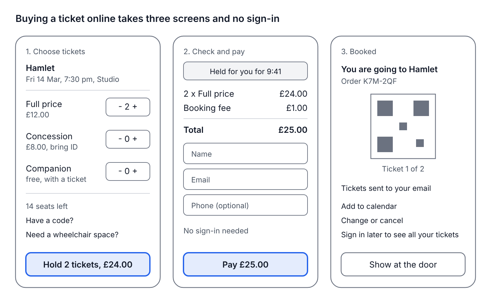
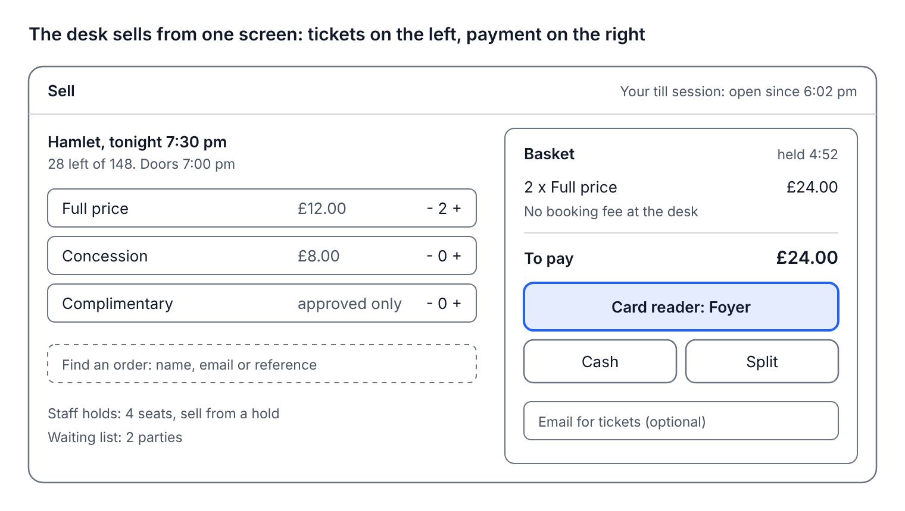
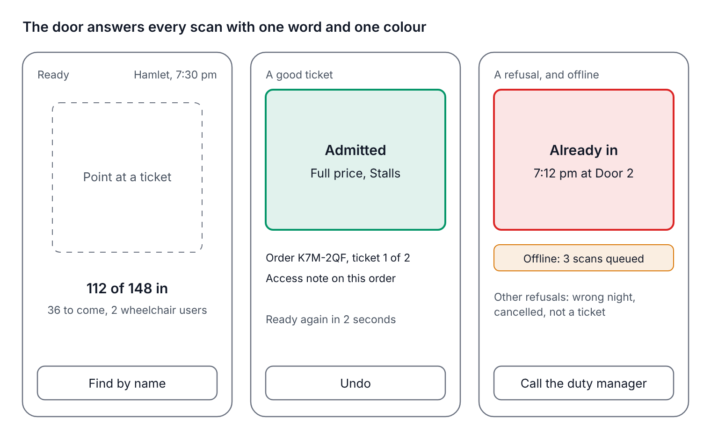
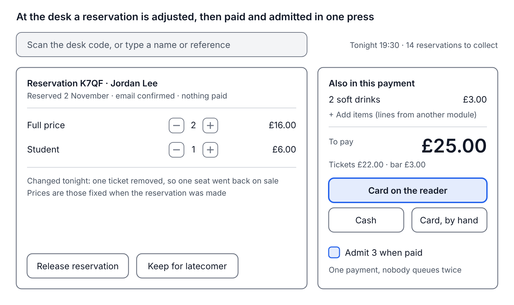
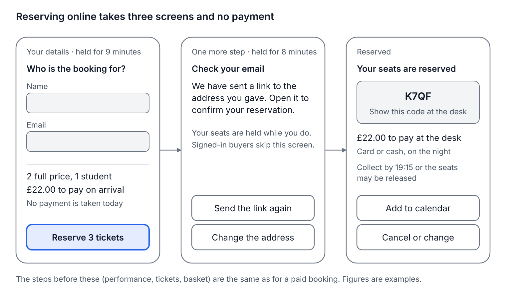

# 5. Screens

## Principles for these screens

- **The audience shell never mentions membership.** A buyer sees shows, tickets and their orders. A member who is signed in sees the same screens, with any member price already offered because the ticket type's requirement was checked against their account. A ticket type with a presentable requirement shows the source's own label and nothing more.
- **No account is needed to buy.** A guest gets their order by a link in a message. Signing in is offered after the sale, never before it.
- **Phone first for the audience and the door.** Checkout and the door are designed at phone width first. The desk is a console page designed for a laptop first and usable on a tablet (integration ruling R-22).
- **The price shown is the price paid.** Fees appear as soon as there is a basket, not at the last step.
- **Every money screen sends the total it showed.** If the server computes a different total, it refuses and shows both figures.

The wireframes show layout and wording, not visual design; workstream 6 owns the look. Example show names, prices and times are illustrations.

## Audience shell

| Screen | Route | What it does | Release |
| --- | --- | --- | --- |
| Booking action | part of the core's show and performance pages | The contribution to `core.booking-action`, one per performance, in the core's five states (part 4) | First |
| Choose tickets | `/book/<production>/<performance>` | Ticket rows with steppers first, then any pass on offer, then one line, "Have a pass or a promo code?", that opens the pass and promo code boxes. The button, "Continue with N tickets, total", can always be pressed and says what is missing; pressing it runs the claim batch and starts the hold. Check and pay then follows on the same address, under a marker of the two steps, exactly as in the booking drawer (Matt, 21 November 2026) | First |
| Choose seats | `/book/<production>/<performance>/seats` | "Best available" first, then the seat map, for allocated performances | Allocated-seating phase |
| Check and pay | second step of `/book/<production>/<performance>` and of the drawer; `/book/basket` | Countdown, lines, total, contact details, pay or reserve. `/book/basket` is no longer a step of its own: it is where a card payment on the provider's page comes back to, and where "Tickets held" in the public header leads while a basket is held | First |
| Paying | provider's page or embedded form | Card entry belongs to the provider; the platform never sees a card number | First |
| Check your email | `/book/confirm/<token>` | For a reservation by a buyer who is not signed in, when `box-office.reservations.confirm-email` is on (it ships off). The page says the show, the tickets, the amount, the address and until when they are held, above the button | First |
| Booked, or Reserved | `/book/done/<token>` | Reference, tickets or the desk code and amount due, calendar link, manage link | First |
| Payment did not complete | `/book/problem/<token>` | Says plainly what happened: declined (try again, seats still held), or still checking (we will tell you) | First |
| Manage booking | `/book/order/<token>` | View tickets, reissue, cancel a reservation; cancel or exchange paid tickets where the theatre allows | First |
| Join the waiting list | `/book/<production>/<performance>/waiting-list` | Party size and email | First |
| Waiting-list offer | `/book/offer/<token>` | "2 seats are held for you until 6:40 pm" and straight to Check and pay | First |
| Buy a pass | `/book/passes` | Season tickets and multi-show passes | Later |

Every public address sits under `/book`, which Foundations reserves, so no theatre page can collide with one. A performance's address has two segments, production then performance, as Interface's example has. The words `basket`, `confirm`, `done`, `problem`, `order`, `offer` and `passes` may not be a production's address.

*online checkout wireframe · 3 phone screens*

What the three screens must get right:

- **Choose tickets.** The button says what it will do and what it costs. "14 seats left" appears only at or below `box-office.availability.show-remaining-under`. A companion ticket cannot be added without a paid ticket. Pressing the button runs the claim batch, and that is the moment the hold starts; if the house filled in the meantime the screen says how many are left and offers the waiting list.
- **Check and pay.** The countdown is first seen here, is always visible, and is announced to screen readers at fixed points, not every second. With one minute left a button offers the one extension (part 3). When the countdown ends the screen says the seats were released and offers Try again, which claims afresh from the lines the browser remembered. The access-needs question is one optional field with a plain explanation of who will read it.
- **Booked.** Shown only after the order is confirmed in the database. If the provider sends the buyer back before its answer has arrived, the screen waits and polls rather than guessing.

## Account shell

| Screen | Route | What it does | Release |
| --- | --- | --- | --- |
| My tickets | `/account/tickets` | Upcoming and past orders for a signed-in person, each opening Manage booking | First |
| My passes | `/account/passes` | Passes held and uses left | Later |

## Console shell: box office

| Screen | Route | Ability | What it does | Release |
| --- | --- | --- | --- | --- |
| Sell | `/console/box-office/sell` | `box-office.order.sell` | The desk: pick a performance, add tickets, take payment; find and collect a reservation | First |
| Orders | `/console/box-office/orders` | `box-office.order.view`; export needs `box-office.order.export` | Search by name, email or reference; filter by show, performance, state and how it was sold | First |
| Order | `/console/box-office/orders/<id>` | `box-office.order.view` | Lines, tickets, payments, refunds, history; actions to resend, reissue, cancel, exchange, refund, each under its own ability | First |
| Door list | `/console/box-office/door-list/<performance>` | `box-office.ticket.admit` | Everyone expected, with admitted state and that an access note exists; printable. The fallback when the door has no connection | First |
| Performances | `/console/box-office/performances` | `box-office.performance.manage` | Every performance with its sale state, sold and free | First |
| Performance set-up | `/console/box-office/performances/<id>` | `box-office.performance.manage` | Bands and capacity, prices, on-sale window, limits, holds; a checklist of what blocks going on sale | First |
| Staff holds | within Performance set-up | `box-office.hold.manage` | Hold, label, release, sell from a hold | First |
| Waiting list | within Performance set-up | `box-office.waitlist.manage` | The queue, offers out, make an offer by hand | First |
| Ticket types and prices | `/console/box-office/pricing` | `box-office.pricing.manage` | Ticket types site-wide; a price grid per production | First |
| Promo codes | `/console/box-office/codes` | `box-office.promo.manage` | Create, limit, retire; uses so far | First |
| Complimentary tickets | `/console/box-office/comps` | `box-office.comp.request`, `.approve` | Request, approve, issue | First |
| Passes | `/console/box-office/passes` | `box-office.pass.manage` | Pass types and passes issued | Later |
| Seating plans | `/console/box-office/plans` | `box-office.plan.manage` | Draw and publish a plan | Allocated-seating phase |
| Sales report | `/console/box-office/reports/sales` | `box-office.report.view`; export needs `box-office.report.export` | By performance, ticket type and channel | First |
| Bulk cancellation | `/console/box-office/performances/<id>/change`, reached from the link in the change guard's refusal | `box-office.performance.manage` | Shows the tickets and money affected and records the decision the core's cancel, reschedule or move then runs: refund all, offer exchange, or keep | First |

*desk sale wireframe · 1 tablet screen*

What the desk must get right:

- **One screen, no pages.** A sale is three taps for the common case: add, add, Card reader.
- **Selling needs an open till session.** The first visit asks for the float; the bar across the top shows the session throughout.
- **The card button names the reader.** After it is pressed the screen says "Waiting for the reader" with a Cancel button, and nothing else can be sold on that reader. The sale completes only on the reader's answer. If no answer comes in time the screen says so honestly and offers "Check again" and "The reader says approved" (attested, recorded against the person), never a silent success.
- **Cash asks what was handed over** and shows the change.
- **Finding an order** from the same screen covers collection, reprints and "I've lost my email".
- **Complimentary tickets cannot be typed in.** The row opens the approved requests waiting to be issued.

## Live shell: the door

| Screen | Route | Ability | What it does | Release |
| --- | --- | --- | --- | --- |
| Door | `/live/door`, which opens tonight's performance, and `/live/door/<performance>` | `box-office.ticket.admit` | Scan, find by name, live counts. A Live page, reached from the Door tile on the Tonight hub | First |
| Access list | `/live/door/<performance>/access` | `box-office.order.view-access-note` | Who is coming tonight with access needs, what they are, and which wheelchair spaces, transfer seats and companion tickets are booked. Made for a phone, every opening recorded as a read. Reached from the door screen and from the access figures on Front of house's Tonight page | First |

*door scanning wireframe · 3 phone states*

What the door must get right:

- **One word and one colour** per scan, readable at arm's length in a dark foyer, and never colour alone: the word and an icon carry the meaning too. A sound per scan is a setting, `box-office.scanning.result-sound`, off by default.
- **The reason for a refusal is specific** (already in, with when and where; wrong performance, with which one; cancelled; not paid; not one of our tickets) so the steward can deal with it without a supervisor.
- **One override, and only one.** A member-price ticket whose requirement is not met shows "Admit anyway" to a holder of `box-office.ticket-type.override-requirement`, with a reason required; everyone else sees "Send to the desk". No other refusal can be overridden at the door (part 4, "The door").
- **Works offline** after the offline data has loaded, shows that it is offline, and shows how many scans are waiting to send. A ticket voided since the data was loaded and admitted anyway is flagged when the device reconnects.
- **An access note shows that it exists**, not what it says, until tapped by someone with `box-office.order.view-access-note`.
- **Find by name** for a buyer with no phone and no printout. It needs a connection unless the theatre has turned on `box-office.scanning.names-on-device`, and the screen says so when offline.

## Console shell: payments and finance

| Screen | Route | Ability | What it does | Release |
| --- | --- | --- | --- | --- |
| My session | `/console/payments/session` | `payments.session.open` | Open with a float; cash up with a count; variance reason | First |
| Sessions | `/console/payments/sessions` | `payments.session.view` | Every session, expected against counted | First |
| Needs attention | `/console/payments/attention` | `payments.attempt.reconcile` | Attempts with no answer, unfulfilled payments, failed refunds | First |
| Refunds | `/console/payments/refunds` | `payments.refund.approve` | Requests waiting, with who asked and why | First |
| Providers and readers | `/console/payments/providers` | `payments.provider.manage` | Add a provider, pair a reader, test mode, health | First |
| Ledger | `/console/finance/ledger` | `finance.ledger.view` | Postings with their entries; filter by account, production, performance, period; every row links to its source | First |
| Accounts | `/console/finance/accounts` | `finance.account.manage` | Chart of accounts; rename and recode | First |
| Periods | `/console/finance/periods` | `finance.period.close` | The close checklist, close, reopen with a reason | First |
| Production statement | `/console/finance/productions/<id>` | `finance.ledger.view` on that production | Income, fees and refunds for one production, for a visiting company's settlement | First |
| Reconciliation | `/console/finance/reconcile` | `finance.ledger.view` | Clearing account balance against provider payouts | First: totals. Later: line matching |
| Export | `/console/finance/export` | `finance.ledger.export` | CSV of postings for an accounting package | First |

## States every screen has

Each screen above is specified with its empty, loading, error and refused states. The ones that matter most here:

| Screen | State | Shows |
| --- | --- | --- |
| Choose tickets | Sold out while choosing | How many are left, and the waiting list |
| Check and pay | Hold expired | "Your seats were released" and a way back |
| Check and pay | Total mismatch | Both figures and "prices changed while you were booking" |
| Sell | No open session | Open one |
| Sell | Reader busy or offline | Which, and the other ways to pay |
| Door | Before doors | "Doors open at 7:00 pm"; a supervisor may start early |
| Periods | Close blocked | The list of what blocks it, each a link |

## Collecting a reservation at the desk

This is the screen for reserve now, pay on arrival (part 3). It is the console desk, laptop first, with a reservation loaded into it. The figures are examples.

*Desk · collecting a reservation, with bar items in the same payment*

The right-hand panel is where another module adds its lines through `payments.desk-basket`; with no such module switched on, the panel shows only the amount to pay. If the reader gives no answer the screen stays on this reservation as awaiting payment and offers Check again and Cancel; another method is offered only once the first attempt is known to have failed, so nobody pays twice.

For the buyer, reserving is the ordinary checkout with a different ending. The pay step is replaced by Reserve, and the email confirmation screen appears only when that setting is on and the buyer is not signed in.

*Public checkout · the last three screens when the theatre takes payment on arrival*

The "collect by" line appears only when the theatre has set a release time, and quotes it from the setting.

## How this part meets Interface's conventions

Read against the Interface specification's Key journeys and Page conventions, and settled with its thread and the integration rulings of 16 November.

| Convention (Interface) | This specification |
| --- | --- |
| Checkout in short steps: performance, tickets, basket, details, pay, confirmation; no account wall | The same steps. The hold starts on the press on Choose tickets and the countdown is first seen on the basket |
| The theatre takes no online payment: the journey ends in Reserve | The `reserved` state. With email confirmation on, a "check your email" step sits between details and the reserved confirmation |
| A warning with one minute left and a button to extend the hold, once | One extension by button, its length `box-office.baskets.extend-by`, never by editing |
| An expired basket is kept as a wish and "Try again" re-holds | The lines are remembered in the browser; nothing is held; Try again runs a fresh claim |
| Allocated seating picks "Best available" first, with "Choose my own seats" | The same, in the seating phase |
| Money screens show the expected total and refuse on a mismatch, showing both | The same rule on every money-taking service |
| The desk is a console page, laptop first | The same (R-22) |
| Desk: anonymous sale when no customer is chosen | An order with no account, desk only (R-15) |
| Desk: the reader does not answer | Check again, Cancel, or state the reader's own result. "Take cash instead" appears only once the first attempt is final, otherwise a customer can pay twice |
| Desk: complimentary tickets | Never typed in: the seller picks an approved request, and may start a request |
| Desk: pay with a pass or a voucher | Passes are later; there are promo codes, not vouchers |
| Desk: a prepaid order is collected | There is no collected state: Resend, Show, or Admit |
| The door is a Live page, dark, large targets, offline | `/live/door`, with the Door tile on the Tonight hub (R-22). Sound is off by default (R-29). One override, "Admit anyway", on one outcome (R-30) |
| The door shows an access note | Only that one exists: the note is special-category data and the door screen is seen by the queue |
| Refunding your own order is refused | A requester cannot approve their own refund above the stored limit, which ships at zero |
