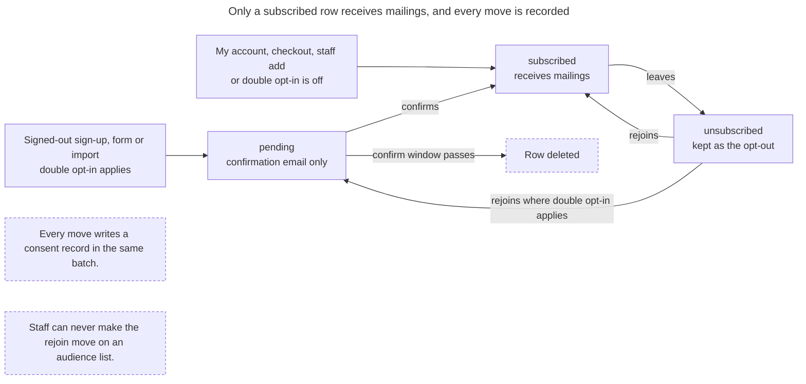
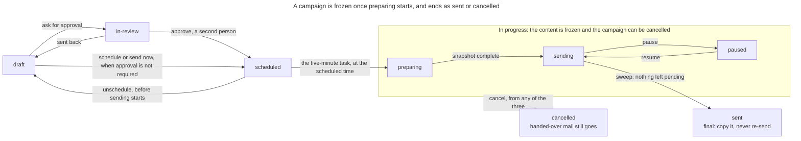
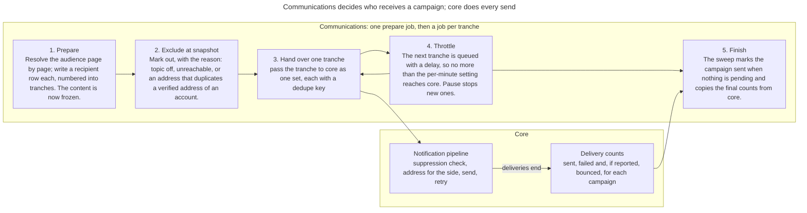

# 3. Rules and flows

Two records have a life cycle: a subscription and a campaign. Each move is guarded in the statement that makes it, writes an audit entry and announces its event in the same batch, as core domain's part 3 defines a guard.

**What is built when.** Every rule below about a subscription, consent, unsubscribing by the manage link and a notice is in the first release. A rule that applies only to a mailing (the bulk lane, the throttle, quiet hours, approval, pause and cancel, narrowing, the mail client's unsubscribe button) is in a later release and says "later". In the first release a campaign is always a notice.

## Consent basis

A list's basis decides what must exist before a mailing may reach a person.

| Basis | Allowed for | A person is sent a mailing when | Default |
| --- | --- | --- | --- |
| consent | Any list | Their subscription is subscribed, and a granted consent record names a wording | The only basis for an open audience list |
| existing-customer | An automatic audience list | The audience source includes them and they have not opted out. They were offered the opt-out when their details were taken | Off until the theatre turns it on. Later, with mailings |
| membership | A members' list | The audience source or a staff add includes them and they have not opted out | For lists such as "All current members" |

The system does not decide what the law allows a theatre to do. It makes the basis explicit on every list, shows it on the send confirmation, and keeps the evidence.

## Subscription

*Subscription states · 3 states, 7 moves*

The table gives each move with its trigger and its guard.

| From | To | Trigger | Guard |
| --- | --- | --- | --- |
| (none) | pending | Public sign-up, a form, or an import with reconfirm, where double opt-in applies | The list is active and open, or the actor holds `communications.subscriber.manage`. A wording exists |
| (none) | subscribed | The same sources where double opt-in does not apply; My account; checkout; a staff add | As above. Signed-in sources skip double opt-in because the address is already proved |
| pending | subscribed | The person follows the confirm link | The token matches its hash and has not expired |
| pending | (deleted) | The daily task, once `confirm_expires_at` has passed | None. A consent record with action expired is written |
| subscribed | unsubscribed | The manage link, the mail client's button, My account, staff, the topic switched off, a complaint | None. Always allowed, by anyone holding the link |
| unsubscribed | subscribed | The person rejoins by any route above | A new consent record. Staff cannot make this move for an audience list: only the person can |
| unsubscribed | pending | The person rejoins where double opt-in applies | As for (none) to pending |

Rules:

- **Every move writes a consent record** in the same batch: requested, granted, withdrawn or expired, with the source and the wording.
- **Double opt-in applies** to any route where the address has not been proved to this system: public sign-up, a form filled in signed out, an import marked reconfirm. It follows `communications.consent.double-opt-in` unless the list overrides it.
- **A sign-up never reveals whether an address is known.** The public route always answers "check your email". If the address is already subscribed, the email says so and offers the manage link.
- **Signed out, the subscriber is an address. Signed in, an account.** This module never creates an account. A signed-out subscription is an email-subject row; when its owner later proves that address, identity finds the row and nothing moves (identity's ruling of 16 November 2026).
- **Confirming does not verify the address for identity.** It shows that someone with the inbox agreed to receive mail, and nothing more. Only identity's own proof links accounts or signs anyone in.
- **One person, one copy.** A person may hold an account subscription and an email one on the same list. The snapshot removes the second (see Sending), and My account shows both so either can be left.
- **Only the person re-subscribes.** Staff may add someone to a staff-only list, and may add to an open audience list only with a statement of how consent was given. Staff can never reverse an unsubscribe on an audience list.
- **The topic is the master switch.** If a person turns off `communications.audience-mailings` or `communications.member-mailings` in core's preferences, every mailing on that side stops. Their subscriptions are left as they are, so turning it back on restores them. An email subject has no preferences row: "stop all" on the manage page unsubscribes that address from every list on that side.
- **A complaint unsubscribes from everything on that side.** Core suppresses the address and announces `core.delivery.complained` with the notification id; a listener here finds the recipient by that notification and marks the subscriptions of that account or address unsubscribed, reason complaint.
- **Pending is not consent.** A pending subscriber receives the confirmation message and nothing else.

### Signing up without an account

1. The visitor types an address into the sign-up component and ticks the box beside the wording. The route is public, rate-limited as `public-form` and protected by Turnstile.
2. One unit of work: insert the subscription as pending with the address as its subject, write a consent record (requested, wording id), and `notifyAddress('communications.subscription.confirm')` to that address.
3. The message carries a confirm link valid for `communications.consent.confirm-window`.
4. Following it sets the subscription to subscribed, writes the granted record, and shows the manage page for that subscription.
5. Not followed in time: the daily task deletes the pending row and writes expired. Nothing else was created, so nothing else needs clearing.

## Unsubscribing

- **The manage link is the way out in every release.** It is in the confirmation message and in each row of the export, and My account offers the same switches. Later, every mailing carries two routes out: the manage link in its footer, and the List-Unsubscribe and List-Unsubscribe-Post headers that give mail clients a one-click button (RFC 8058). Core adds the headers (request N3).
- **The one-click request, later, needs nothing but the token.** It is a POST to a public route, takes no cookie, and answers success whether or not the token is known.
- **The manage link opens a page, not an action.** A GET never unsubscribes, because mail scanners follow links. The page shows the list and one button.
- **It takes effect before the next tranche.** A tranche job re-checks subscription state in the statement that hands recipients over.
- **The page offers the alternatives without getting in the way**: the person's other lists on that side, and "stop all mailings", which switches the topic off.
- **A token is per subscription and never expires** while the row exists, so a link in a two-year-old email still works.

## Campaign

*Campaign states · 8 states, 11 moves*

The table gives who may make each move and its guard. A draft that was never scheduled may also be deleted. The moves through in-review and paused apply only to a mailing, later; a notice goes from draft to scheduled, preparing, sending and sent, or is cancelled.

| From | To | Who | Guard |
| --- | --- | --- | --- |
| (new) | draft | `communications.campaign.edit` | A mailing names an active list the actor may use. A notice names one audience source the actor may use |
| draft | in-review | `communications.campaign.edit` | Approval is required by the setting. The content checks pass |
| in-review | draft | `communications.campaign.edit` or `.approve` | None. The approver may send it back with a comment |
| draft or in-review | scheduled | `communications.campaign.send`; from in-review, `communications.campaign.approve` by someone other than the author | The content checks pass. The time is now or later. The sending domain is verified |
| scheduled | draft | `communications.campaign.send` | Sending has not started |
| scheduled | preparing | The five-minute task, at `scheduled_for` | Claimed by a conditional write, so two task runs cannot both start it. Not inside quiet hours unless it is a notice |
| preparing | sending | The prepare job | The snapshot is complete |
| sending | paused | `communications.campaign.send` | None |
| paused | sending | `communications.campaign.send` | None |
| preparing, sending or paused | cancelled | `communications.campaign.send` | None. Pending recipients become excluded with reason cancelled. What core already holds is still sent |
| sending | sent | The sweep task | No recipient is pending |
| draft | (deleted) | `communications.campaign.edit` | Never scheduled |

A notice is sent with `communications.notice.send` in place of `communications.campaign.send` in every row.

**The content checks**, run on leaving draft and again when sending starts:

- a subject, and a body that renders with no unknown block or merge field;
- every image has alt text;
- a mailing's list is active and has a wording for the campaign's locale, if consent-based;
- every audience source named is still contributed (its module is on);
- a notice has a reason, no promotional block, and its source is marked as allowed for notices.

Rules:

- **Content is frozen when preparing starts.** A notice has usually gone by the time a typo is seen, so the fix is a second notice. For a mailing, later, a typo found mid-send is fixed by pausing, cancelling the rest and sending a new campaign to those not reached, which the cancel screen offers.
- **Sent and cancelled are final.** A campaign is copied, never re-sent.
- **"Send now" is scheduling for now.** There is one path.
- **Approval, later and for mailings only, needs a second person** when it is on. The author cannot approve their own campaign.
- **A notice ignores quiet hours** and goes on the prompt lane (request N2), because "doors open an hour late tonight" cannot wait for morning.

## Sending

A campaign to 4,000 people is 4,000 core notifications, made in tranches so that no one unit of work is large and a failure repeats one tranche. In the first release every campaign is a notice, on the prompt lane, and step 4 does not apply.

*Sending a campaign · 5 steps in Communications, 2 parts of core*

Steps 3 and 4 repeat until every tranche is handed over.

1. **Prepare.** The job resolves the audience page by page and inserts recipient rows, numbering tranches of `communications.sending.tranche-size`. For a mailing: subscribed rows of the list (or the automatic source minus opt-outs), intersected with each include source, minus each exclude source. For a notice: the one source. A recipient is an account or an address, as its subscription or source gave it.
2. **Exclude at snapshot.** Each candidate is marked excluded, with its reason, if the topic is off for them or core says the account is unreachable. An address recipient is excluded as duplicate when it equals any verified address of an account recipient, checked with identity's `verifiedAddressesOf`, server side and never shown.
3. **Hand over.** A tranche job takes one tranche. In one unit of work it re-checks subscription state, passes the whole tranche to core as one set, and marks the rows handed. Both writes are set-wise, from one JSON parameter read with `json_each`, as Foundations requires of every fan-out; nothing loops over recipients. Each recipient carries the dedupe key `communications.campaign:<campaign>:<recipient>`. A tranche is never larger than `core.units.set-rows-limit`. A repeated job does nothing twice: the key and the row state both guard it.
4. **Throttle (mailings, later).** Tranches are queued with a delay so no more than `communications.sending.per-minute` are handed to core each minute. Core's own job sends each delivery, on the lane the type declares.
5. **Finish.** The sweep task moves the campaign to sent when nothing is pending, and copies final counts from core's `deliveryCounts` once every delivery has reached an end state or `communications.sending.results-after` has passed.

What core does with each notification is core's: the address for the side, the suppression check, the retry, the bounce. A recipient handed over but skipped by core shows in the results under core's reason.

- **Paused (later) means no new tranche starts.** A tranche in flight finishes.
- **A stuck campaign is found.** The sweep re-queues a tranche whose job died, and the health check reports a campaign in preparing or sending for longer than `communications.sending.stuck-after`.
- **The module switched off stops everything.** Scheduled campaigns stay scheduled and do not start. Core already skips deliveries whose type's module is off.

## Notices

- **A notice goes to an audience source, never to a list.** The source must declare `notices: true`. Box office's "ticket holders for a performance" does; "everyone who bought in the last two years" does not.
- **It is transactional in core's sense.** No topic, so it cannot be muted. That is why its ability is separate and its content is restricted.
- **No selling.** The production-card and performance-list blocks are refused. Buttons are allowed, because "see the new time" is a legitimate link.
- **A reason is recorded** and shown in the audit entry with the count of people reached.
- **It reaches guests.** A ticket holder with an unclaimed account is reached at the address the account was created with.

## Automatic lists (later)

- Membership is the audience source's answer at the moment of the snapshot. Nobody is "added".
- A person can opt out. The opt-out is a subscription row with state unsubscribed, and holds for as long as it exists.
- If the source's module is switched off, the list shows as unavailable and its mailings fail the content checks.

## Content

- **Markdown with blocks.** The body is markdown plus named blocks: button, image and divider in the first release; production card and performance list later, for mailings. A block names records by id; the renderer reads public data only, at the time sending starts.
- **Merge fields are few.** `first_name` with a required fallback, and the organisation's name. Nothing else about the person may appear in a body, so a mistake cannot leak a field.
- **The brand wraps it.** Core's email layout, header image and footer apply. To a mailing, later, the module adds the reason line ("You are receiving this because you joined Season news") and the manage link, and neither can be removed.
- **Preview is the real renderer.** The preview and the test send call the same resolver core calls for a delivery.
- **A test goes only to the person pressing the button**, as a transactional message marked "Test".

## Import (later)

1. Upload a CSV of addresses. The check job validates each row and reports counts without writing anything. Names in the file are ignored: this module holds none.
2. The person states how and when these people agreed, and chooses whether to ask them to confirm.
3. The import job works in pages on the bulk lane: insert the subscription with the address as its subject (pending if reconfirm) and write the consent record with source import and the statement. No account is created.
4. An address already unsubscribed from the list is left unsubscribed and counted as already. An import never reverses an unsubscribe.
5. A suppressed address is imported like any other and is skipped by core at send time. The import does not ask core about it, so an import can never be used to test which addresses are suppressed.
6. A members' list cannot be imported into: its subscribers are accounts.

## Retention

| What | Kept for | Then |
| --- | --- | --- |
| Recipient rows | `communications.campaigns.recipient-retention` after the campaign finishes | Deleted. The campaign's `result` keeps the counts |
| Consent records | `communications.consent.record-retention` after the subscription ends | Deleted |
| Import files | `communications.imports.file-retention` | Purged by core's file service |
| Pending subscriptions | `communications.consent.confirm-window` | Deleted |

## Rules that rest on core's delivery events

Cloudflare reports what happened to each message on a queue, and core turns that into `core.delivery.bounced`, `core.delivery.complained` and `core.delivery.failed`, each naming the notification. Four rules here rest on those events. The bounce event is proved end to end (proof P-COM-3 in part 8). The complaint event is documented by Cloudflare but not yet proved, so the one rule that needs it is written to do nothing if it never arrives.

| Rule | Rests on | State |
| --- | --- | --- |
| Results show bounced and failed | `core.delivery.bounced`, `core.delivery.failed` | Proved |
| A hard-bounced address is suppressed by core and shows as unreachable | `core.delivery.bounced` | Proved. The suppression is core's own, never Cloudflare's |
| The health check for failing confirmations | `core.delivery.bounced` | Proved |
| A complaint unsubscribes the person from everything on that side, and results show complained | `core.delivery.complained` | Not yet proved. Without the event the rule does nothing, the count stays at nought, and the manage link is unaffected |

Nothing about consent, unsubscribing, the snapshot or sending once depends on these events.

## What Cloudflare's email service allows

Read on 16 November 2026 from developers.cloudflare.com/email-service (pages dated July to November 2026), and tested the same day by proof P-COM-3 on a real sending domain. Where the proof and the documentation differ, the table says so and follows the proof. Email Sending is in beta.

| Fact | Source | What it means here |
| --- | --- | --- |
| Marketing email is not allowed. The FAQ asks "Can I use Email Service for marketing emails?" and answers "No. Email Service supports transactional email only." | reference/faq, 15 October 2026 | A mailing, as this module defines it, may not be sent through Cloudflare, so mailings are not in the first release (question 11 in part 9). Notices, confirmation messages and test sends are transactional and may |
| Six events for each sending domain arrive on a queue: delivered, deferred, bounced, failed, rejected, complained. Each has the message id and the recipient, and a bounce says whether it is hard or soft | reference/event-subscriptions; changelog of 15 July 2026; proof P-COM-3 | Core consumes them and announces `core.delivery.bounced`, `core.delivery.complained` and `core.delivery.failed`. Proved for a bounce: the event carries exactly the message id the send returned, angle brackets included, and arrives in under a second. Not yet proved for a complaint, which needs a real mailbox at a provider that reports them. This module takes ids only from core's events; the recipient and subject in Cloudflare's event are never stored here |
| Cloudflare keeps a suppression list of its own, scoped to the sending domain. The documentation says complaints and missing mailboxes stay on it with no expiry, other hard bounces for seven days and soft bounces for 24 hours. In the proof it was not prompt: four and a half minutes after a hard bounce the address was not on it, and two further sends were accepted and bounced again | concepts/suppressions; proof P-COM-3 | Cloudflare's list is never relied on. Core's own suppression, written when `core.delivery.bounced` or `core.delivery.complained` arrives and checked before every send, is what stops a repeat. Reach and counts read core's list |
| The documentation says a send to a suppressed recipient throws unless "drop suppressed recipients" is on for the domain. In the proof no send threw | api/send-emails/workers-api; proof P-COM-3 | Core sends one recipient per message, so one person never blocks another, and nothing here expects a throw |
| At most 50 recipients and 25 MiB per message. A daily quota starts low and grows with reputation; no figure is published | platform/limits, 30 October 2026 | One message per recipient is within the limits, and a notice is small. The defaults for `communications.sending.per-minute` and the daily limit are set from an account's real quota when mailings are built |
| Sending to anyone but your own verified addresses needs the Workers Paid plan | email-service overview | A forked theatre needs the paid plan before any public email, which is foundations' concern |
| A newly added sending domain refuses sends for about two minutes after it reads as ready | proof P-COM-3 | Core retries. The "sending domain not verified" banner in part 5 covers the wait |

Two consequences for sending. Outcomes arrive while a campaign is still going out, since a bounce comes back within a second, so the running tally on the campaign page counts each outcome as it lands and never assumes that handing over is finished first; the final counts are still copied once at the end. And no address is handed over twice in one campaign on the expectation that the provider will catch it: the snapshot holds one row per recipient and the dedupe key guards a repeated job.

Two rules follow for any sender, now or later.

- **A list unsubscribe is never pushed to Cloudflare's suppression list.** A suppression there blocks every message from the domain, and a person who leaves the newsletter must still receive their tickets. Subscription state here is what stops a mailing.
- **Each purpose has its own sending subdomain**, so the reputation of one cannot harm another and events can be told apart. Core owns the sender identities; this module asks for one that is separate from the address tickets come from.
