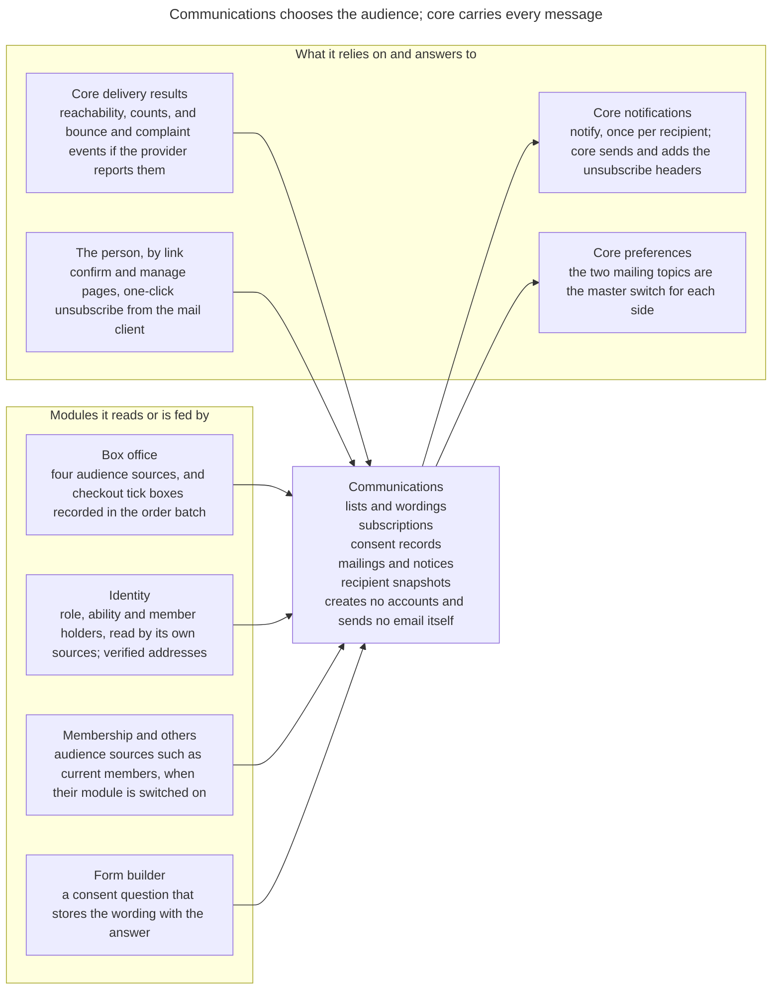

# 4. Interface to other modules

Communications meets other modules in four ways: it offers a point where they contribute audiences, it contributes to their points, it calls core's and identity's services, and it listens for a few events. It uses the foundations mechanisms and no others.

*Communications and its neighbours · 4 contributors, 3 core services, the person*

Every arrow is a name in the index below.

## Index of every `communications.*` name

| Kind | Names |
| --- | --- |
| Module | `communications`; requires `core`; uses `box-office`, `forms`, `membership`, `front-of-house`; switchable |
| Record types | `communications.list`, `communications.campaign` |
| Points offered | `communications.audience-source`, `communications.block`. Audience sources this module declares on its own point: `communications.list-subscribers`, `communications.campaign-recipients`, `communications.production-team`, `communications.role-holders`, `communications.ability-holders`, `communications.members` |
| Facts | none |
| Topics | `communications.audience-mailings`, `communications.member-mailings` |
| Notification types | `communications.mailing.audience`, `communications.mailing.member`, `communications.notice.audience`, `communications.notice.member`, `communications.subscription.confirm`, `communications.campaign.test`, `communications.campaign.finished`, `communications.campaign.review-requested`, `communications.import.finished` |
| Events | `communications.list.created`, `.list.archived`, `communications.campaign.scheduled`, `.campaign.started`, `.campaign.sent`, `.campaign.cancelled`, `communications.subscription.changed` (internal) |
| Jobs | `communications.prepare-campaign`, `communications.send-tranche`, `communications.check-import`, `communications.run-import`, `communications.export-subscribers` |
| Tasks | `communications.start-campaigns`, `communications.sweep-campaigns`, `communications.purge-expired` |
| File slots | `communications.campaign` / images, `communications.import` / source |
| Id prefixes | `cml`, `cwd`, `csub`, `ccon`, `cam`, `crcp`, `cmt`, `cimp`, `cseg` |
| Address prefix asked for | `/mailing` |
| Secrets and credentials | none. Sending uses core's verified domain |

## Record types

| Record type | Table | Parent | Owner column |
| --- | --- | --- | --- |
| communications.list | communications\_lists | none | none |
| communications.campaign | communications\_campaigns | communications.list for a mailing; none for a notice | created\_by, for drafts only |

A grant scoped to one list covers its subscribers and its mailings. That is how a theatre lets a youth-theatre coordinator run one list and see nobody else's.

## Points offered

Both work with nothing contributed.

### communications.audience-source (code)

A way of choosing people that another module understands. This is the only route by which a campaign reaches people outside its own list.

| A contributor supplies | Meaning |
| --- | --- |
| key | Named with the contributor's module id: `box-office.ticket-holders-of-performance` |
| side | `audience` or `members`. A source serves one side |
| parameters | A schema, each parameter a record picker or a number: a performance, a production, a number of months |
| notices | true if being in this source is itself a reason to be told something. Only such a source can receive a notice. Box office calls this purpose 'service' |
| ability | The ability a person needs, on the parameter record where there is one, to use the source |
| count(params) | How many subjects, for the composer |
| page(params, cursor) | `{ subjects, next }`, a page at a time, stable for the length of a snapshot. Each subject is `{ accountId }` or `{ email }` |

A resolver is a read. It returns subjects and nothing else: no name, and no address for an account.

Every source known on 16 November 2026. Communications declares the first six itself, under its own prefix, because the core never contributes to a module's point: where a source rests on core or identity, this module reads their fact or service. A switchable module contributes its own sources under its own prefix.

| Source | Key | Declared by | Side | Notices | Returns |
| --- | --- | --- | --- | --- | --- |
| Subscribers of a list | `communications.list-subscribers` | Communications | The list's | No | Accounts and email subjects with a subscribed row |
| Those sent an earlier campaign | `communications.campaign-recipients` | Communications | The campaign's | No | The recipients of that campaign, by outcome, for a follow-up or a correction. Later |
| A production's team | `communications.production-team` | Communications | members | Yes | Accounts, read from core's fact `core.production-team` |
| Holders of a role | `communications.role-holders` | Communications | members | No | Accounts with a live grant, read from identity's service for the holders of a role |
| Holders of an ability on a record | `communications.ability-holders` | Communications | members | No | Accounts, read from identity's service for the holders of an ability |
| Everyone who is a member | `communications.members` | Communications | members | No | Accounts for whom core's fact `core.member` is true |
| Ticket holders for a performance | `box-office.ticket-holders-of-performance` | Box office | audience | Yes | Accounts. Confirmed or reserved orders; cancelled and expired left out |
| Ticket holders for a production | `box-office.ticket-holders-of-production` | Box office | audience | Yes | Accounts |
| Booked in the last N months | `box-office.booked-recently` | Box office | audience | No | Accounts. N is capped by order retention |
| Waiting list for a performance | `box-office.waiting-list-of-performance` | Box office | audience | Yes | Email subjects |
| Current members by type; lapsed members | to come | Membership | members | Yes; No | Expected |
| On the rota for a performance | to come | Front of house | members | Yes | Expected |

Anonymous desk orders appear in no source.

Communications may read core's facts and identity's services because it requires core, and it asks only for account ids, as any source does. What each of those four sources returns is what Core domain and Identity agreed for it.

### communications.block (data)

A content block a body may use: a name, its properties, an email rendering and a plain-text rendering, and `promotional: true` or `false`. Communications ships button, image and divider in the first release, and production card, performance list and before-you-come later. Before-you-come is declared here, because the core contributes to no module's point, and is not promotional. It renders the whole of core's `beforeYouCome` read, which holds only what is safe in an inbox: age guidance, staging effects, whether the production page has content warnings (never their names or a count) and the page's address. It does not read `guidanceFor`, which includes the warnings. Box office could add a "book now" block. A block whose module is off renders nothing and fails the content checks, as a public component does.

## What Communications contributes to other points

| Point | Owner | Contribution |
| --- | --- | --- |
| core.notification-topic | Core | The two topics, one per side |
| core.notification-type | Core | The nine types below |
| core.file-slot | Core | The two slots in part 2 |
| core.file-access | Core | Import files: readable with `communications.subscriber.import` on the list |
| The manifest's `menu` field (a field, not a point) | Foundations | One console group: Notices and Lists in the first release, Mailings and Mailing templates later. Account and members' shells: none of its own (see `core.account-section`) |
| core.account-section | Interface | "Mailing lists" on the preferences page of each side |
| core.record-tab | Interface | "Mailings" on an account's console record: subscriptions and consent history. "Messages" on a performance and a production: notices about it |
| core.home-card | Interface | Scheduled and sending campaigns, for holders of `communications.campaign.read` |
| core.quick-action | Interface | "New notice"; later, "New mailing" |
| core.search-source | Interface | Lists and campaigns by name |
| core.public-component | Core | `CommunicationsSignup`: a sign-up box for one or more named lists |
| core.setup-step | Foundations | Optional: "Create a mailing list and its consent wording" |
| core.health-check | Foundations | Campaigns stuck; a consent list with no wording; an automatic list whose source is gone; confirmations failing |
| core.record-resolver | Foundations | Label, address and parent for both record types |
| core.erasure-handler | Foundations | None needed: column behaviours cover it |
| core.merge-handler | Identity | One step, `communications.settle-subscriptions`, run before the move stage: for each list on which both accounts hold a subscription it applies the stricter state to the survivor's row, sets the other row aside and writes one merge consent record (part 2). The move of communications\_subscriptions.account\_id then re-points what is left. Its undo, run after the move is reversed, returns the set-aside rows, lets every unsubscribe stand on both accounts, adds consent records and removes none, and returns a count of what stood |
| core.export-contributor | Identity | A person's subscriptions and consent records |
| core.privacy-record | Foundations | Three entries: subscriptions, consent records, campaign recipients |
| core.change-impact | Core | "1 scheduled notice about this performance" before a cancel or move |
| forms.field-type | Form builder | `communications.consent`: a tick box bound to a list, showing its current wording. Later |
| forms.outcome-action | Form builder | `communications.subscribe`: subscribe the respondent to a list. Later |
| box-office.checkout-consent | Box office (a code point, agreed) | One entry per list with offer\_at\_checkout. Later |

## Topics and notification types

| Type | Category | Side | Topic | Channels | Lane | Content |
| --- | --- | --- | --- | --- | --- | --- |
| communications.mailing.audience | Optional | Audience | communications.audience-mailings | email | bulk | From the campaign |
| communications.mailing.member | Optional | Members | communications.member-mailings | email, inbox | bulk | From the campaign |
| communications.notice.audience | Transactional | Audience | none | email | prompt | From the campaign |
| communications.notice.member | Transactional | Members | none | email, inbox | prompt | From the campaign |
| communications.subscription.confirm | Transactional | Follows the list | none | email | prompt | Shipped wording |
| communications.campaign.test | Transactional | Members | none | email | prompt | From the campaign |
| communications.campaign.finished | Optional | Members | core's staff topic | inbox, email | prompt | Shipped wording |
| communications.campaign.review-requested | Optional | Members | core's staff topic | inbox, email | prompt | Shipped wording |
| communications.import.finished | Optional | Members | core's staff topic | inbox | prompt | Shipped wording |

None may join a digest. Mailings have no coalescing window. The lane and content columns follow rulings N1 and N2. The first release declares five of the nine: the two notice types, `communications.subscription.confirm`, `communications.campaign.test` and `communications.campaign.finished`. The two mailing types, `communications.campaign.review-requested` and `communications.import.finished` are declared with the later stories that need them.

## Services Communications calls

| Service | From | For |
| --- | --- | --- |
| notify, notifyAddress | Core | Every message, to an account or to an address. A tranche is passed as one set, never one call per recipient. senderKey carries the campaign's sender |
| previewNotification | Core | The composer's preview |
| getBrand, getOrganisation | Core | The preview, the public pages |
| emailReachability(accountIds, side) | Core | Counts on a list and exclusions at snapshot. Per account: whether an email would go, and a reason code if not |
| deliveryCounts(subjectType, subjectId) | Core | A campaign's results, by delivery state |
| verifiedAddressesOf(accountId) | Identity | The duplicate check at snapshot, and finding a signed-in person's email-subject rows. Server side only |
| can, fact | Foundations | Every screen and route |
| files | Core | Images and import files |
| beforeYouCome(productionId, performanceId?) | Core | The before-you-come block: ageMin, ageRestricted, effects, notAtThisPerformance, hasContentWarnings, pageUrl, empty. Rendered whole, unfiltered. Later, with core's content warnings slice |

`findOrCreateAccount` and `addressFor` are not called. This module creates no account, and core resolves the delivery address.

## Services Communications exports

Named exports of `layers/communications/server/services.ts`. No first- or second-round module requires this module, so these are for later modules such as Fundraising. Each returns statements for the caller's unit of work.

| Service | Returns or does |
| --- | --- |
| subscribe(listKey, accountId, { source, wordingId, origin }) | Statements for the subscription and its consent record. Honours double opt-in |
| unsubscribe(listKey, accountId, { source }) | Statements for the move and its record |
| subscriptionState(listKey, accountId) | pending, subscribed, unsubscribed or none |
| listsOffered(side, where) | Active lists offered at signup or checkout, with their current wording |

## Events

Payloads carry ids, counts and times only.

| Event | When | Payload beyond the record id | Internal |
| --- | --- | --- | --- |
| communications.list.created, .archived | The move happens |  | false |
| communications.campaign.scheduled | Draft or in-review to scheduled | kind, the time | false |
| communications.campaign.started | Preparing to sending | kind, recipients\_total | false |
| communications.campaign.sent | Sending to sent | kind, counts | false |
| communications.campaign.cancelled | The move happens | counts so far | false |
| communications.subscription.changed | Any subscription move | list id, account id, new state | true |

The subscription event is internal because it is about a person, under the foundations ruling of 16 November 2026. A theatre that wants to mirror subscribers to another service uses the export.

| Listens for | From | Does |
| --- | --- | --- |
| core.delivery.complained | Core | Finds the recipient by the notification id and marks that subject's subscriptions on that side unsubscribed, reason complaint |
| `core.delivery.bounced`, `core.delivery.failed` | Core | Nothing to subscriptions: core suppresses a hard bounce itself. Listed because the campaign's live counts refresh on them |
| core.account.merged | Identity | Nothing by event: the staged merge runs this module's handler step and then the column declarations in part 2 |
| core.module.disabled | Foundations | For a module that contributed a source: nothing is changed. Lists and drafts using it show as unavailable |

No box office event is listened for. Consent at checkout arrives through the code point `box-office.checkout-consent`: this module's contribution supplies the questions (key, wording, never pre-ticked) and `record({ orderId, accountId, keys })`, which returns statements and neither reads nor commits. Box office adds them to its own batch when an order is first confirmed or first reserved, once. A key is the list's key and the wording's id. If `record` throws, the checkout fails with a plain message, because a consent lost silently is worse. Desk and phone sales ask no consent questions in the first release.

The form builder's outcome action works the same way: forms runs it in its own job with the answer as stored, wording id included.

## Routes

All under `/api/communications/`, written with `defineRoute`.

| Route | Access | Limit class | Purpose |
| --- | --- | --- | --- |
| POST /signup | Public, Turnstile | public-form | Request a subscription. Always answers the same |
| POST /confirm | Public, by token | public-form | Confirm a pending subscription |
| GET /manage/\<token> | Public, by token | public-form | The lists for that subscription's subject and side. Names nothing but the lists |
| POST /manage/\<token> | Public, by token | public-form | Leave a list, rejoin, or stop all |
| POST /unsubscribe/\<token> | Public, by token | public-form | The one-click target for mail clients. Later, with mailings |
| Everything else | By ability | default, write or export | The console and account screens in part 5 |

Pages: `/mailing/confirm/<token>` and `/mailing/manage/<token>`, in the public shell. A token page is marked `noindex` and sets no cookie.

## Jobs and tasks

| Name | Kind | Lane | Does |
| --- | --- | --- | --- |
| communications.prepare-campaign | Job | bulk; prompt for a notice | Builds the snapshot |
| communications.send-tranche | Job | bulk; prompt for a notice | Hands one tranche to core as one set |
| communications.check-import | Job | bulk | Validates a file and counts. Later |
| communications.run-import | Job | bulk | Writes subscriptions, a page at a time. Later |
| communications.export-subscribers | Job | bulk | Writes a CSV of a list's subscribed rows, with consent evidence and manage links, to a file with record access |
| communications.start-campaigns | Task, every 5 minutes |  | Starts scheduled campaigns that are due |
| communications.sweep-campaigns | Task, every 5 minutes |  | Re-queues dead tranches, finishes campaigns, copies results |
| communications.purge-expired | Task, daily at 03:00 |  | Pending subscriptions, old recipient rows, old consent records |

## Rulings of 16 November 2026

Nine requests went to the other workstreams through the integration thread. All nine are ruled, and parts 2 to 8 are written to the rulings. Three came back changed: N5, N6 and N7.

| No. | Asked of | Ruling | Part affected |
| --- | --- | --- | --- |
| N1 | Core | Yes. A notification type may declare a resolver. The payload carries ids only and core calls the resolver at send time for subject and body. A resolver failure is a failed attempt and is retried | 3, 4 |
| N2 | Foundations, core | Yes. A notification type declares lane `prompt` (default) or `bulk`, and core queues each send on its type's lane. Mailings declare bulk | 3, 4 |
| N3 | Core | Yes. Core adds `List-Unsubscribe` and `List-Unsubscribe-Post` to every email whose type is not transactional. The target defaults to core's preference link; a type may supply its own, as mailings do | 3 |
| N4 | Core | Yes. emailReachability, deliveryCounts, senderKey on notify, and internal events `core.delivery.bounced`, `core.delivery.complained` and `core.delivery.failed` with the notification id and account id. Core has added the delivery state complained and an index on (subject\_type, subject\_id) | 2, 3, 4 |
| N5 | Core, identity | Changed. The core never contributes to a module's point, so Communications declares the four sources itself (a production's team, role holders, ability holders, members) and reads core's facts and identity's services for them. Core domain and Identity agreed what each returns | 4 |
| N6 | Identity | Changed. No `communications` origin: this module creates no accounts. A signed-out subscriber is an email-subject row. A double opt-in is not proof of address. Identity added `verifiedAddressesOf` for the duplicate check, and hands the account section the account's verified addresses so a person can leave either kind of subscription | 2, 3, 5 |
| N7 | Box office | Changed. Four sources as listed. `box-office.checkout-consent` is a code point taking questions and `record` statements; no consent column on the order, no keys in any event, no `order.paid` event | 4 |
| N8 | Form builder | Yes. A contributed field type declares the shape of its answer; the wording id is stored beside the yes or no and reaches the outcome action as stored. The value is fixed with the response revision, and this module's field type supplies the label for results and exports | 4 |
| N9 | Foundations | Yes. Nine id prefixes registered. `/mailing` reserved; its routes take the `public-form` limit class. `uses` may name a module on the reserved list before it exists | 2, 4 |
| Side value | Identity, core | The value is `members`, not `member`, with `audience` as the other | 2, 4 |

Cross-module rulings of the same day that this specification also follows: navigation is the manifest's `menu` field, with console group names owned by the interface specification; a fan-out is written set-wise and never exceeds `core.units.set-rows-limit`, which governs the tranche hand-over in part 3; and core's event for a delivery that could not be made is `core.delivery.failed`.

## What others may rely on

- A module that contributes an audience source is never called outside a snapshot, a count or a preview, and is never asked for anything but subjects: account ids, or addresses where the source holds no account.
- Switching Communications off removes its screens, its sign-up component and its checkout entries, and sends nothing. Subscriptions and consent records are kept and return with it.
- Communications never sends a message core's pipeline has not recorded.
