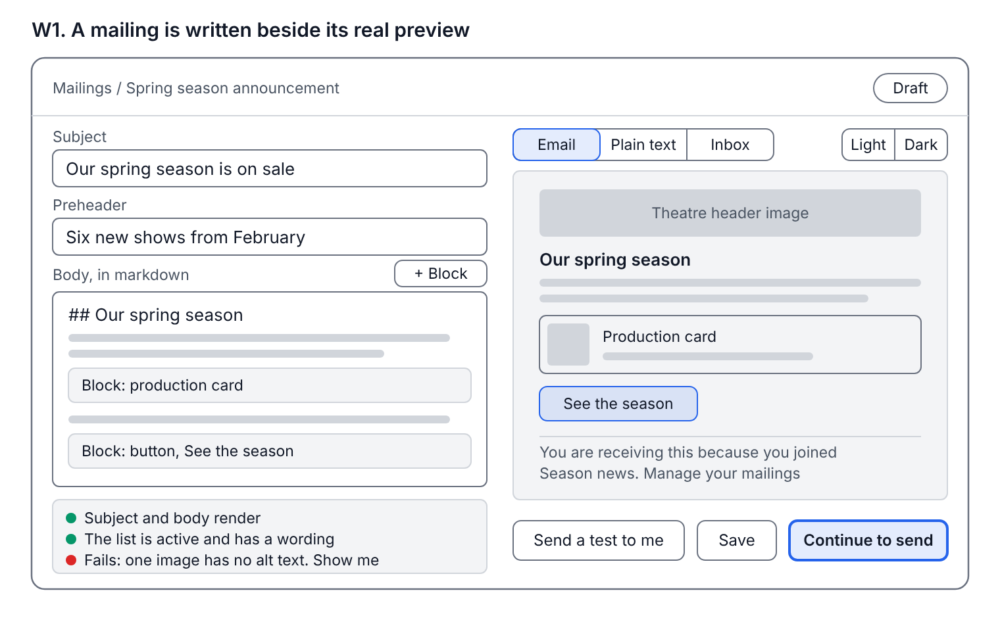
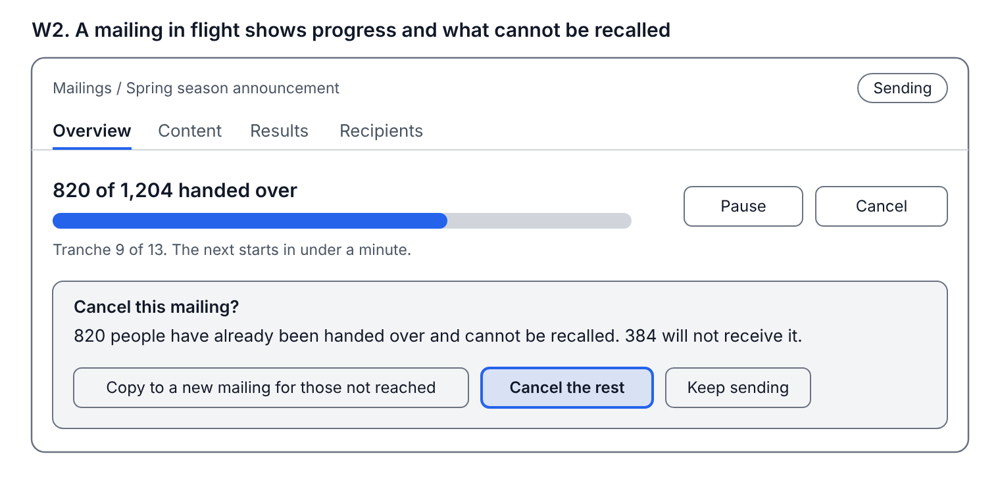
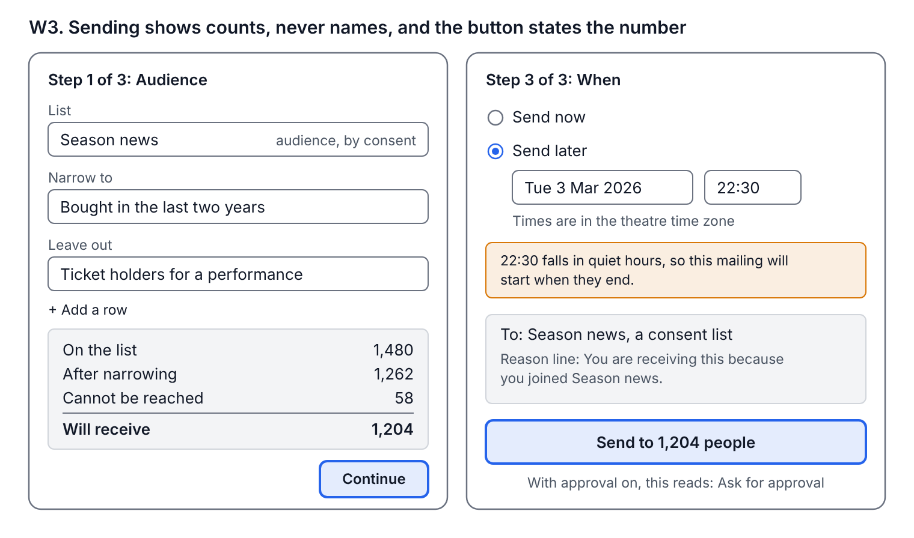
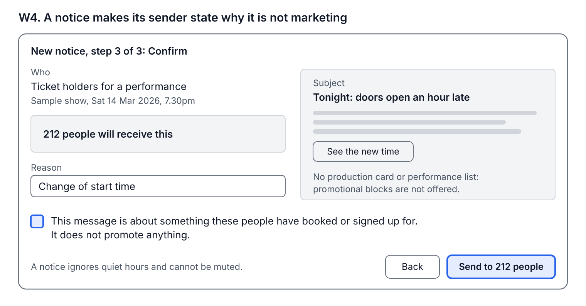
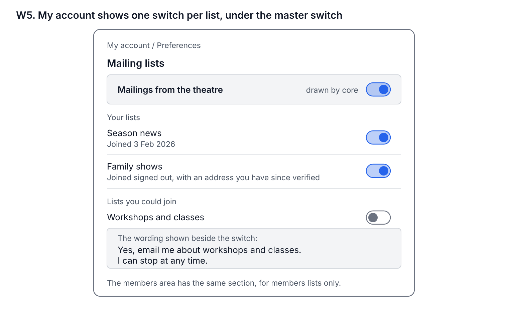
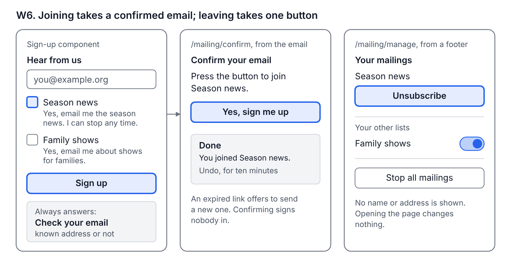

# 5. Screens

Seventeen screens: eleven in the console, two in the account and members' shells, three public, and one component for content pages. Each is one of the interface specification's page types and follows its page conventions; nothing here defines a new pattern.

**Which screens the first release builds.** S4 to S8, S11 to S16 and the sign-up component, with S2 as the editor and record of a notice. S1 Mailings, S3 Send a mailing and S10 Mailing templates come with mailings in a later release, and S9 with import; until then their menu entries are not shown. Wireframes W2 and W3 show later screens. W1 shows the editor a notice also uses, without the promotional blocks.

## Navigation

One console group, "Communications", declared in the manifest's `menu` field as Foundations defines it. The group's name and place in the console are the interface specification's. An entry shows only to someone holding its ability.

| Entry | Address | Ability (any of) | Count shown | Release |
| --- | --- | --- | --- | --- |
| Notices | /console/communications/notices | communications.notice.send, communications.campaign.read |  | First |
| Lists | /console/communications/lists | communications.list.read |  | First |
| Mailings | /console/communications/mailings | communications.campaign.read | Scheduled and sending | Later |
| Mailing templates | /console/communications/templates | communications.template.manage |  | Later |

Settings are drawn on the module's own generated settings page, `/console/communications/settings`, and nowhere else; the kit makes its navigation entry from the settings format in part 6. The account and members' shells gain no entry: the lists appear inside the existing preferences page.

## Console

| No. | Screen | Address under /console/communications | Page type | Ability | Release |
| --- | --- | --- | --- | --- | --- |
| S1 | Mailings | /mailings | List | communications.campaign.read | Later |
| S2 | Campaign | /notices/\<id> for a notice; /mailings/\<id> for a mailing | Record; Editor while draft | communications.campaign.read; .edit to change | First for a notice |
| S3 | Send a mailing | /mailings/\<id>/send | Steps | communications.campaign.send | Later |
| S4 | Notices | /notices | List | communications.campaign.read | First |
| S5 | New notice | /notices/new | Steps | communications.notice.send | First |
| S6 | Lists | /lists | List | communications.list.read | First |
| S7 | List | /lists/\<id> | Record | communications.list.read | First |
| S8 | Subscribers | /lists/\<id>/subscribers | List | communications.subscriber.read | First |
| S9 | Import subscribers | /lists/\<id>/import | Steps | communications.subscriber.import | Later |
| S10 | Mailing templates | /templates | List, opening an Editor | communications.template.manage | Later |
| S11 | Communications settings | /settings (the generated settings page) | Settings | communications.settings.manage | First |

### S1 Mailings (later)

Saved views: Drafts, Scheduled, Sending, Sent. Columns: name, list, state, when, recipients, a results bar once sent. Primary action: New mailing, which asks for a list and an optional mailing template. Empty state: one sentence on what a mailing is and the button; if there is no list yet, the button leads to New list.

### S2 Campaign: a notice now, a mailing later

While draft the page is an Editor: subject and preheader above, the markdown body on the left with a block menu, and a live preview on the right that switches between email, plain text and inbox, and between light and dark. A status strip shows the content checks as they pass or fail, each failure linking to its cause. Actions: Send a test to me, Save, Continue to send.

*W1 · S2 Mailing while draft, console at desktop width*

Wireframes W1 to W6 on this page sketch layout and wording with sample data. They are not visual designs: the look comes from the interface specification.

Once scheduled the page is a Record with tabs:

| Tab | Shows |
| --- | --- |
| Overview | State, the schedule, who wrote, approved and sent it, the audience in words |
| Content | The frozen subject and body, rendered |
| Results | Counts by outcome: handed over, sent, bounced, failed, excluded by reason, unsubscribed since |
| Recipients | Only with communications.subscriber.read, and audited as a read. Until then the tab shows counts and says why names are hidden |

A notice goes at once and shows its count when it has gone. Later, a mailing that is sending shows progress as a count and a bar, updated by the interface's live helper, with Pause and Cancel. Cancel says how many have already been handed over and cannot be recalled, and offers "copy to a new mailing for those not reached".

*W2 · S2 Mailing while sending, with the cancel confirmation open*

### S3 Send a mailing (later)

Three steps.

1. **Audience.** The list, then "narrow to" and "leave out" rows, each an audience source with its record picker. A running count: on the list, after narrowing, cannot be reached, will receive. Counts only.
2. **Check.** The content checks, the sender, the reason line as it will read, and the consent basis of the list in plain words.
3. **When.** Now, or a date and time in the theatre's time zone, with a warning if it falls in quiet hours. The final button states the number: "Send to 1,204 people". With approval on, it reads "Ask for approval".

*W3 · S3 Send a mailing, the first and last steps*

### S4 and S5 Notices

S4 lists notices with the record each concerns and the reason. S5 is three steps: who (one audience source that allows notices, and its record), what (subject and body, with promotional blocks absent from the menu), and confirm. The confirm step shows the count, the reason picker, and a sentence the sender must tick: "This message is about something these people have booked or signed up for. It does not promote anything." A notice is also started from the "Messages" tab on a performance or production, which fills in the first step.

*W4 · S5 New notice, the confirm step*

### S6 and S7 Lists

S6 columns: name, side, join mode, basis, subscribers, pending, last mailing. S7 tabs:

| Tab | Shows |
| --- | --- |
| Overview | Name, description, side, join mode, basis, where it is offered, counts by state, and how many cannot be reached |
| Consent wording | The current wording for each locale and every earlier version, with dates. Publish a new version |
| Mailings | Campaigns sent to this list. Later, with mailings |
| Subscribers | S8 |
| Activity | The audit entries for the list |

Side and basis cannot be edited after the first subscriber. Archiving a list asks for confirmation and says what stops: sign-up, checkout offer, new mailings.

### S8 Subscribers

A List page whose every load is an audited read. Columns: the person's name, or the address for someone who joined signed out, then state, source, since. Filters: state, source, cannot be reached. Row action: open the person's console record at its Mailings tab. Page actions: Add a person (asks for the statement on an open audience list), Export and, later, Import. Export makes the file for the theatre's own newsletter tool: one row for each subscribed person and no other, with the address, the source, the date, the wording version and that person's manage link. There is no "resubscribe" action for an audience list.

**Finding a person.** The search box on S8, and on the Recipients tab of S2, takes a name or an email address and narrows the rows already shown, two ways. Rows that belong to an account are found through identity's `findAccounts(text, list)`, exported from core's services: it answers a subquery of account ids that this module passes to the kit's account scope, it shows no name itself, it is guarded by `core.account.find`, and it writes one read audit entry per call that never holds the text typed. `communications.subscriber.read`, which guards both lists, implies `core.account.find` (part 6), so whoever may see the list may narrow it. This module never searches accounts itself. Rows with no account, which are people who joined signed out, are matched by this module on the address it stores for them, and only on the whole address. Choosing a person who is not yet on the screen, as "Add a person" does, is identity's person picker, `searchAccounts`, under `core.account.search`.

### S9 Import subscribers (later)

Steps: upload, review the check (rows, new, already on the list, invalid, cannot be reached, with a downloadable list of invalid rows), declare (the statement, and "ask everyone to confirm"), run. Progress is shown live, and the person may leave: a notification arrives when it finishes.

### S10 Mailing templates (later)

A list of templates by kind, each opening the same Editor as S2 without the audience. The module ships three: a newsletter, a single-show announcement and a plain notice.

## Account and members' shells

| No. | Screen | Where | Page type |
| --- | --- | --- | --- |
| S12 | Mailing lists (audience) | A section of /account/preferences, by `core.account-section` | Settings |
| S13 | Mailing lists (members) | The same section in the members' shell | Settings |

Each shows the topic's master switch that core already draws, and under it one row per list: the person's own subscriptions, then open lists on that side they could join. Joining shows the wording beside the switch. Lists the person joined while signed out, with any address now verified on the account, are shown too and can be left here. Automatic lists appear as "You receive this as a current member" with an opt-out. A person sees only lists of the side they are looking at, so an audience-only account never learns that members' lists exist.

*W5 · S12 Mailing lists in My account*

## Public

| No. | Screen | Address | Notes |
| --- | --- | --- | --- |
| S14 | Confirm | /mailing/confirm/\<token> | One sentence and a button. A link that no longer works offers to send a new one |
| S15 | Manage | /mailing/manage/\<token> | The list named in the email with "Leave this list", and "Stop all mailings". Below them, "Email me a link to my lists", which sends a preferences link; that page, /mailing/preferences/\<token>, shows the person's lists on that side and the open ones they could join. No name or address is shown on either |
| S16 | Done | Inline on S14 and S15 | States what changed. After leaving, it offers "Left by mistake? Email me a link to my lists" |

**`CommunicationsSignup`** is the public component for a content page or the footer: an address box, one tick box per named list with its wording, and a button. It always ends with "Check your email". Signed in, it becomes switches and needs no email.

*W6 · the sign-up component, S14 Confirm with S16 Done, and S15 Manage, at phone width*

## Contributed pieces on other screens

| Where | What |
| --- | --- |
| An account's console record | Tab "Mailings": subscriptions by list, and the consent history as a timeline with the wording of each entry |
| A performance and a production | Tab "Messages": notices about it, and New notice |
| Console home | A card of scheduled and sending campaigns |
| Checkout (box office), later | One tick box per list offered at checkout, drawn by box office from the contributed entries |
| A form (form builder), later | The consent question type |

## States every screen handles

Loading, empty, refused and error follow the interface conventions. Three are specific to this module:

| State | Shown as |
| --- | --- |
| Sending domain not verified | A banner on S1, S3 and S5 linking to core's Email screen in Admin. Send buttons are disabled |
| An audience source's module is off | The source shows as unavailable where it was used, and the campaign cannot leave draft |
| The module is switched off part-way through a campaign | On return, the campaign is still sending and resumes |

## Accessibility and wording

- Results are numbers with labels, never colour alone.
- The preview offers plain text, because every email is sent with a plain-text part.
- Buttons that send say how many people: the number is the confirmation.
- British English in every shipped string, through translation keys.
