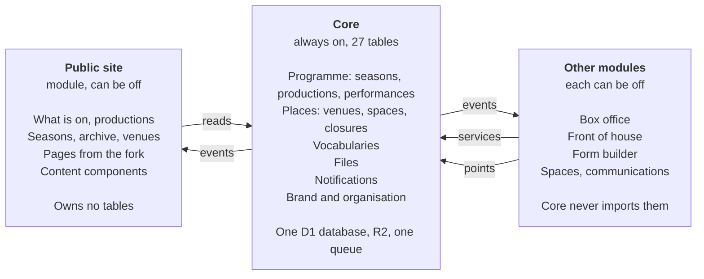

# Core domain and public site: specification

Nov 16, 2026 · @Matthew Adcock

Workstream 3 of the detailed-design stage for the open-source theatre platform. It specifies seasons, productions, performances, venues, files, notifications, the fork's content structure, the public components and in-app branding.

## Summary

This is the detailed design for the records every other module builds on, and for the public website. It covers roadmap phase 2, whose test is that a theatre can publish a season and a what's-on page with nothing else switched on.

**All nine questions were decided by Matt on 16 November 2026**, and nothing here now waits on him. He accepted seven as proposed and changed two:

1. **A show has two addresses.** `/whats-on/<slug>` while it is current and `/shows/<slug>` once it is past, each redirecting to the other, with a setting for whether past shows are public at all.
2. **Webhooks are in the first release**, with the rule that no personal data leaves in one.
3. **Also added at his request:** access features for venues and spaces from a set list, each shown as an icon with its label.

Among the seven accepted: core does not know whether a performance is on sale (Box office does), credits are public by default and a person can hide their own, and in-app branding stops at colour, grey tone, heading font, corners and logos.

What the design comes to:

- **Two modules.** Core, always on, to which this workstream adds 27 core-domain tables. The public site, which can be switched off and owns no tables.
- **Five things with a life cycle:** season, production, performance, file, delivery.
- **Five groups of services every module calls:** programme, vocabularies, files, notifications, and brand and organisation.
- **Vocabularies are core's**, by the integrating thread's ruling, so the form builder and every module share one way to keep an editable list of options.
- **Thirteen points** through which other modules join in without core knowing them, including the booking button, the impact shown before a cancellation, and the components a content page may use.
- **58 stories**, 44 for the first release, and **72 named test cases** that must never regress. Six of the stories and eight of the cases belong to the content warnings slice, which Matt accepted on 16 November 2026 and which is built after the work now in hand (parts 2 and 4, "Later slice").

It is aligned with the platform foundations draft: its names, its four ways for modules to talk, and its table, setting and ability layouts. Every request this workstream made of the foundations thread has been ruled on, and the rulings are recorded in parts 2 and 4. A consistency review on 16 November 2026 then brought every part into line with the other specifications and the integrating thread's rulings.

## At a glance

*The two modules this workstream specifies, and how others reach core. A module contributes to a point, such as the booking button, so core never needs to know which modules exist.*

## Status of the nine parts

| Part | State | Known gaps |
| --- | --- | --- |
| 1. Scope | Draft complete | None. Every assumption about another workstream is confirmed or ruled on. |
| 2. Data model | Draft complete | Rewritten on 16 November 2026 into the foundations table layout: table options, data classes, erasure behaviour and id prefixes for all 27 tables. Templates are split into drafts and published versions, as the ruling requires. The final table list is at the end of the tab. |
| 3. States and rules | Draft complete | Bounces are proved on a real sending domain. The complaint event is not yet proved. |
| 4. Interface to other modules | Draft complete | Service signatures are names and intent, not types. Workstream 2 has named its three services (addressFor, holdersOf, mergeAccounts). |
| 5. Screens | Inventory complete; three wireframes | The other screens are described, not drawn. Final layouts are workstream 6's. |
| 6. Settings and abilities | Draft complete | Every default is a proposal |
| 7. Stories | Draft complete |  |
| 8. Test plan | Draft complete |  |
| 9. Questions for Matt | All nine decided, 16 November 2026 |  |
| Sources | Complete for what was read | Five things not verified, listed there, including the complaint event |

No product code has been written. No other theatre has been consulted, so every default is one person's judgement.
