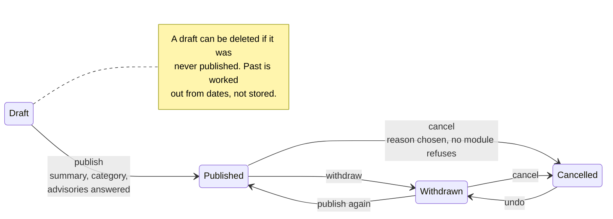
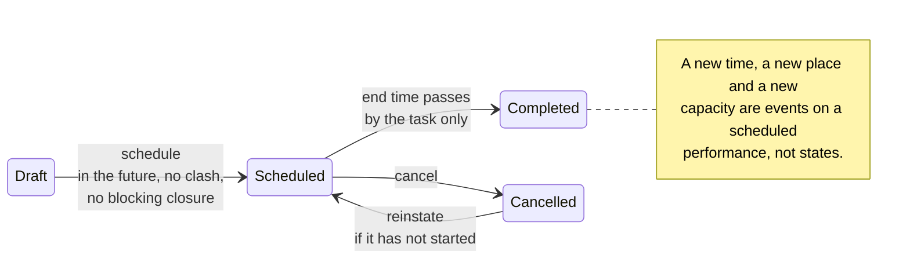
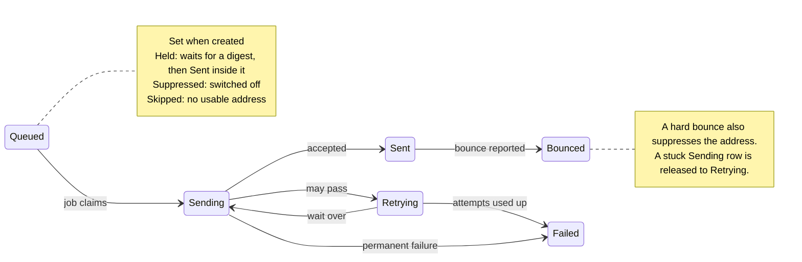

# 3. States and rules

## How to read this part

Each record with a life cycle gets a table of its moves. A **guard** is a condition checked in the same statement that makes the move, so two people pressing at once cannot both succeed. Every move writes an audit entry and announces its event in the same batch. A refused move tells the person which guard failed, in plain words.

Core holds five life cycles: season, production, performance, file and delivery. Venues, spaces, terms and senders only switch between active and retired.

## Season

| From | To | Who | Guard |
| --- | --- | --- | --- |
| (new) | Draft | `core.season.manage` | Name and slug are unique. `ends_on` is on or after `starts_on`. |
| Draft | Published | `core.season.manage` | Has a name and both dates. |
| Published | Draft | `core.season.manage` | No published production belongs to it. |
| Published | Archived | `core.season.manage`, or the daily task once `ends_on` has passed, if the setting allows | None. |
| Archived | Published | `core.season.manage` | None. |
| Draft | (deleted) | `core.season.manage` | No production belongs to it. |

A season may be one day long. Proscenium's check was `ends_on > starts_on`, which its known issues list as a fault.

Archived does not mean hidden. An archived season leaves the what's-on page and stays in the archive.

## Production

*A production's states. The table below gives who may make each move and its full guard.*

| From | To | Who | Guard |
| --- | --- | --- | --- |
| (new) | Draft | `core.production.create` | Has a title. The slug is unique among live slugs and past slugs. |
| Draft | Published | `core.production.publish` | Has a title, a summary and a category. Advisories are either listed or confirmed as none. Every public image has alt text. |
| Published | Withdrawn | `core.production.publish` | None. The person sees what is attached first (see "Changes with a wide reach"). |
| Withdrawn | Published | `core.production.publish` | Same as Draft to Published. |
| Published or Withdrawn | Cancelled | `core.production.cancel` | A reason is chosen. Any module may refuse through the change guard. The refusal shows its reason and, where the module asks one, the question that settles it; otherwise a link to where the matter is settled. |
| Cancelled | Withdrawn | `core.production.cancel` | None. Performances stay cancelled and are reinstated one by one. |
| Draft | (deleted) | `core.production.edit` on this record | Never published. No performance has left draft. No other module holds anything against it. |

Rules that are not moves:

- **Publishing a production does not publish its dates.** Each performance has its own state, so a theatre can announce a show before its dates are fixed.
- **Cancelling a production cancels every performance that has not started**, in the same batch, with the same reason. Only scheduled performances are cancelled. A draft performance stays a draft, and can be deleted.
- **"Past" is worked out, not stored.** A production is past when its last performance that was not cancelled has ended, or from the moment the production itself is cancelled, when it is shown as cancelled at its past address. It then moves from what's-on to the archive without anyone doing anything.
- **Changing the slug keeps the old one.** The old slug goes into `core_production_slugs` in the same batch and redirects for ever. A slug that has ever been used cannot be given to a different production.
- **Confirmed as none is its own answer.** A production with no advisories listed and no confirmation cannot be published, so silence is never mistaken for "nothing to warn about". Proscenium has the same rule (`warningsConfirmedNone`).

## Performance

*A performance's states. Core holds no on-sale state: Box office does, as Matt decided.*

| From | To | Who | Guard |
| --- | --- | --- | --- |
| (new) | Draft | `core.performance.schedule` | `ends_at` is after `starts_at`. The space belongs to the venue and is performable. |
| Draft | Scheduled | `core.performance.schedule` | Starts in the future. No overlap with another scheduled performance in an exclusive space. No blocking closure covers it. |
| Scheduled | Cancelled | `core.performance.cancel` | A reason is chosen. Any module may refuse through the change guard. The refusal shows its reason and, where the module asks one, the question that settles it; otherwise a link to where the matter is settled. |
| Cancelled | Scheduled | `core.performance.cancel` | Has not started. The overlap and closure guards pass again. |
| Scheduled | Completed | The five-minute task only | `ends_at` has passed. |
| Draft | (deleted) | `core.performance.schedule` | Has never been scheduled. |

Changes that are events and not states:

| Change | Guard | Announces |
| --- | --- | --- |
| New time | Same guards as scheduling. The person sees what is attached first. | `core.performance.rescheduled`, with the old and new times |
| New venue or space | Same. | `core.performance.moved` |
| New capacity | Not below what Box office says is already held or sold. | `core.performance.capacity-changed` |

Rules:

- **Core does not hold "on sale".** A scheduled performance is one the public can see. Whether it can be booked is Box office's to say. Matt decided this on question 1, and the paper's Part A says the same.
- **The overlap guard is on the statement.** The insert or update carries `where not exists (an overlapping scheduled performance in this space)`. Checking first and writing second would let two schedulers both win.
- **A closure warns or blocks.** A closure with `blocks_performances` set refuses the move. A public holiday shows a warning and lets it through.
- **The operating day is stored.** `operating_day` is worked out from `starts_at`, the theatre's time zone and the day start (the foundations settings core.locale.time-zone and core.locale.day-start), so a show at 00:30 belongs to the night before. If either setting changes, a job works it out again for every performance that has not completed.
- **Completed is final.** Nothing moves a performance out of Completed. Other modules use the event to close their own records for the night.

## File

| From | To | Trigger | Guard |
| --- | --- | --- | --- |
| (new) | Pending | The file service gives out an upload | The slot exists on the owner's record type. The person may edit the owner. The declared size is within the slot's limit. |
| Pending | Ready | The check job | The bytes match an accepted type. The size is within the limit. Cleaning succeeded. |
| Pending | Rejected | The check job, or the hourly sweep for an upload that never arrived | None. The stored bytes are removed. |
| Ready | Deleted | The person, the owner's deletion, or a replacement in a single-file slot | None. `purge_after` is set from the retention setting. |
| Deleted | Ready | `core.file.manage` | `purge_after` has not passed. The slot still has room. |
| Deleted | (purged) | The daily task | `purge_after` has passed. The bytes are removed, then the row. |

Rules:

- **Only a Ready file is ever served.** A Pending file has no public address.
- **Replacing is two steps in a fixed order.** The new file becomes Ready and takes the slot, and only then is the old one marked Deleted. A failure in between leaves an extra file, never a missing poster. Proscenium's image helper makes the same choice.
- **Stored bytes with no row are found and removed** by a weekly task that lists the bucket against the table, after a safety delay so an upload in flight is not caught.
- **Erasure skips the wait.** A file removed because a person was erased is purged at once.

## Delivery

*One delivery of one notification by one channel.*

| From | To | Trigger | Guard |
| --- | --- | --- | --- |
| (new) | Queued | `notify()` in the caller's batch | The channel is allowed for the type and the person has not switched it off. |
| (new) | Held | `notify()` | The person takes this topic as a digest. |
| (new) | Suppressed | `notify()` | The person switched the channel off for this topic. Never for a transactional type. |
| (new) | Skipped | `notify()` | No verified address, the address is on the suppression list, or the type's module is off. |
| Queued or Retrying | Sending | The send job | It claims the row with a conditional write, so two copies of the job cannot both send. |
| Sending | Sent | The send job | The provider accepted it. |
| Sending | Retrying | The send job | A failure that may pass, and attempts remain. `next_attempt_at` follows the back-off setting. |
| Sending or Retrying | Failed | The send job | A permanent failure, or attempts are used up. |
| Held | Sent | The digest task | It is carried inside a digest, recorded in `rolled_into_id`. |
| Sent | Bounced | The provider reports a bounce | A hard bounce also adds the address to the suppression list. Cloudflare reports it on the email events queue (part 4). |

Two late moves come from what Cloudflare reports after it has accepted a message, and the diagram above shows only the common path:

| From | To | Trigger | Guard |
| --- | --- | --- | --- |
| Sent | Complained | Cloudflare reports that the recipient marked the message as spam | The address joins the suppression list with the reason `complaint`. `core.delivery.complained` is announced. |
| Sent | Failed | Cloudflare reports a failure of its own after accepting the message | None. Shown on the delivery-health screen. |

Bounced, Complained and Failed are final. A repeat or a late report changes nothing.

Rules:

- **The message is recorded before it is sent.** `notify()` adds rows to the caller's batch. If the booking is not saved, no receipt exists. If it is saved, the receipt exists even if the queue loses the message, because a task every five minutes re-queues anything left Queued too long.
- **A message reaches the person, not the alias.** A record keeps the account it was made on (R-34), which a merge may since have folded into another. `notify()` writes the notification to the survivor, and the send job reads the survivor's address, so a pass or booking held on a merged account still reaches its holder.
- **A transactional message cannot be muted.** It has no topic, so no preference can match it. The paper and Proscenium's decision 0013 both require this.
- **A stuck Sending row is released.** If a send job dies mid-flight, the sweep returns the row to Retrying after ten minutes. The provider is given the delivery's id so a repeat is recognised where the provider supports that.
- **Failed is loud.** A Failed delivery of a transactional type announces `core.delivery.failed`, appears on the delivery-health screen, and can be retried by hand.
- **Every send goes through the same pipeline.** There is no second route for reports or one-off messages. Proscenium's known issues record a report that bypassed the retry sweep by using a different function.
- **Messages that repeat are joined.** Notifications with the same `coalesce_key` inside the type's window become one message that says how many, borrowed from Flytower's quiet periods.

## Vocabulary terms, venues and spaces

| Record | Retire or archive | Bring back | Delete |
| --- | --- | --- | --- |
| Term | Always allowed. It leaves pickers and stays on old records. | Always allowed, if the label is still unique. | Only if nothing has ever pointed at it. |
| Venue | Refused while a future scheduled performance uses it. | Always allowed. | Only if it has never had a performance. |
| Space | Same as venue. | Always allowed. | Same as venue. The last space of a venue cannot be deleted. |
| Sender identity | Refused for `default`. Routing that pointed at it falls back to `default`. | Always allowed. | Never, once used. |

## Changes with a wide reach

Before a person cancels, withdraws, reschedules or moves something public, they see what depends on it and must confirm. Proscenium calls this the blast radius. Here it is two points that other modules fill:

- **`core.change-impact`** (data). Each module returns counts in plain words for a given record and change: "42 tickets across 31 orders", "6 volunteers on the rota". Core shows them all on the confirmation.
- **`core.change-guard`** (code). A module may refuse the change with a reason: "Refund or move the 42 tickets first". Core runs every guard inside the batch and stops on the first refusal. A refusal may carry a link to the module's own screen where the matter is settled, or one question with its options and the module's own route to post the answer to, such as Box office's choice between refunding and exchanging the tickets of a performance about to be cancelled. The window making the change asks the question and posts the answer to that route, under the module's own ability, before it makes the change. Core never stores or interprets the answer (integration ruling R-11, as amended on Matt's approval of 21 November 2026).

With no other module switched on, both points are empty and the change goes straight through.

## Branding rules

- **The accent colour is never used raw.** It makes a ramp of shades, and for each of light and dark mode the system picks the shade nearest the chosen colour that reaches 4.5 to 1 against the background. The brand screen shows the result before saving.
- **Status colours are fixed.** Success, warning and danger do not follow the brand, so a red brand cannot make a danger button look ordinary.
- **Uploads are cleaned before they are stored.** An SVG is rebuilt from a list of safe elements, and one with a DOCTYPE is refused. A raster image is re-encoded with its metadata removed.
- **Saving the brand asks for a fresh passkey check**, because the brand appears on the sign-in screen.
- **A save changes everything at once.** One batch updates the settings, attaches the files, raises the revision number and announces `core.branding.changed`.

The first four follow Flytower's branding, which is in use.

## Public site rules

- **Only published things are public.** A draft production, a draft performance and a draft season return "not found" on every public route, feed and data endpoint, not "forbidden".
- **A public page shows a change within a minute.** Pages are cached against a revision number that every relevant event raises.
- **What changes by the second is not cached.** Availability and the booking button's state are fetched by the page after it loads.
- **A setting quoted on a page is always live.** A page quoting a setting that does not exist, or one not marked as quotable, fails the build.
- **A site that is not ready asks search engines to stay away.** Until setup is complete, every page carries `noindex`.

## Later slice: publishing asks two questions

With the content warnings slice (part 2, "Later slice"), the publish rule above changes in one respect. Where it now needs advisories listed or confirmed as none, it will need two answers: staging effects listed or confirmed as none, and content warnings listed or confirmed as none. The refusal names whichever is missing. Once a production is published, neither answer can be emptied. Until the slice is built, the single answer stands.
