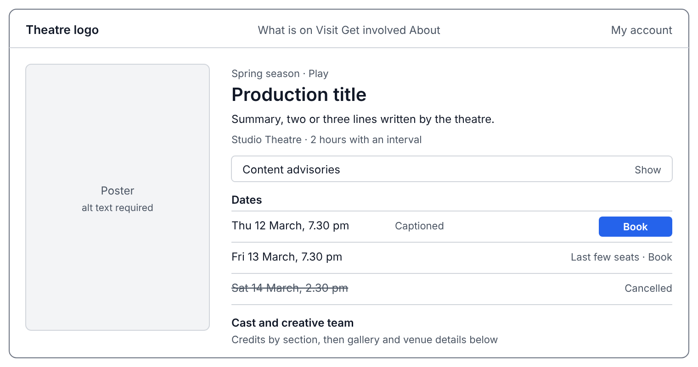
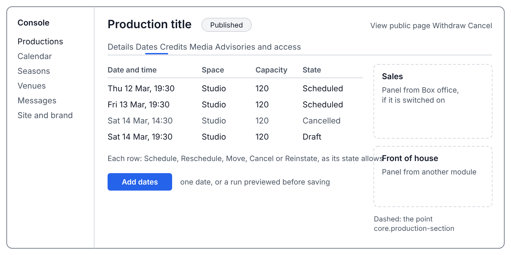
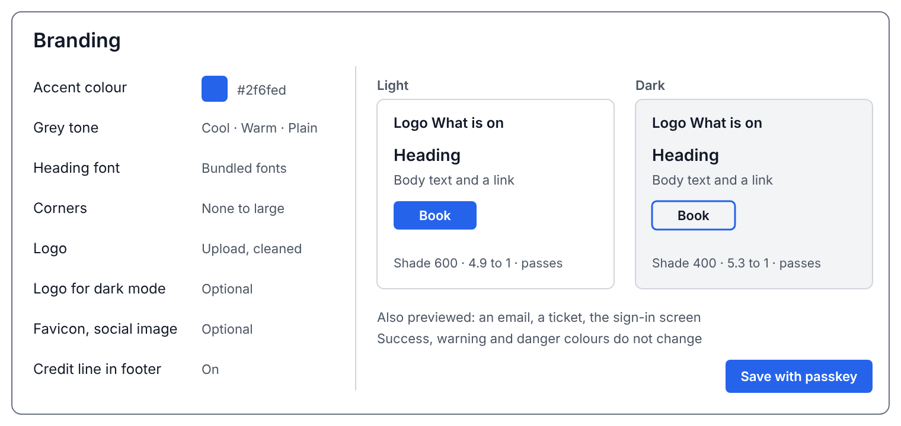

# 5. Screens

## How to read this part

The inventory lists every screen this workstream adds, the shell it sits in, and who sees it. Wireframes follow for the three that matter most. Layout rules, empty states, loading and errors follow workstream 6's page conventions and are not repeated here.

"Who sees it" names an ability. A person without it does not see the screen or its link.

## Public shell

| Screen | Address | Who sees it | Shows |
| --- | --- | --- | --- |
| Home | `/` | Everyone | The theatre's own page from `site/content/index.md`. The starter uses `hero` and `whats-on`. |
| What's on | `/whats-on` | Everyone | Published productions with a scheduled performance still to come, soonest first. Filter by category, season, venue and month. |
| Production | `/whats-on/<slug>` while current, `/shows/<slug>` once past | Everyone | See the wireframe. |
| Season | `/seasons/<slug>` | Everyone | One published or archived season's productions |
| Archive | `/shows` | Everyone | Past productions by year, with search across title, company and credited names |
| Venue | `/venues/<slug>` | Everyone | Address, map link, getting here, access, photos, what is on there |
| News | `/news`, `/news/<slug>` | Everyone | Posts from `site/content/news/` |
| Content page | Any other address | Everyone | A page from `site/content/` |
| Not found |  | Everyone | A plain message, a search of what's on, and a link home. An old slug never lands here: it redirects. |

A cancelled performance stays on its production page, struck through and marked "Cancelled", until its date passes. People who planned to come need to see it.

## Account, both sides

Core contributes these to the point `core.account-section`, which the interface specification owns. The content is core's and the frame around it is the interface's. A person who is both audience and member sees Inbox and Notification preferences twice, once per side, never mixed.

| Screen | Who sees it | Shows |
| --- | --- | --- |
| Inbox | Any signed-in person | Messages for this side, newest first. Unread count on the shell's bell. Opening one marks it read. "Mark all read" and archive. |
| Notification preferences | Any signed-in person | One row per topic on this side, one column per channel, and a choice of at once, daily or weekly. Transactional messages are listed as "always sent" with no switch, so nobody hunts for one. |
| My credits | A member with at least one linked credit, on the members' side | Each production the person is credited on, with the printed name and role, and a choice for each of public, members only or hidden. Nothing else about a credit can be changed here. |

Proscenium's inbox has no unread count and never marks a message read, by its own list of known issues. Both are in the first release here.

## Console: programme

| Screen | Who sees it | Shows |
| --- | --- | --- |
| Productions | `core.production.view` | A table: title, season, state, next performance, performances count. Filters for state, season, category. "New production". |
| Production | `core.production.view` on it | See the wireframe. The page follows the interface specification's Record convention. Tabs: Overview, Details, Dates, Credits, Media, Advisories and access, then any tab another module adds through `core.record-tab`, such as Box office's tickets or the form builder's custom fields. |
| Add dates | `core.performance.schedule` | Two ways in one dialog: a single date, or a run (first date, last date, days of the week, times). A run shows every date it will create, with clashes and closures marked, before anything is saved. A long run is created by a job, and the dialog shows its progress (C-04). |
| Calendar | `core.production.view` | Month, week and day views of performances and closures, by venue and space. Drag to reschedule a draft; a scheduled performance opens the reschedule dialog instead. |
| Seasons | `core.season.manage` | A list with dates and states. Edit, publish, archive. |
| Change confirmation | Whoever makes the change | For cancel, withdraw, reschedule and move: what will change, each module's impact line, the reason picker, and any refusal with its reason. |

## Console: places

| Screen | Who sees it | Shows |
| --- | --- | --- |
| Venues | `core.venue.manage` | Venues with their spaces nested. Add, edit, archive. |
| Venue | `core.venue.manage` | Address, public text, access text, photos, and its spaces with capacity and kind |
| Closures | `core.closure.manage` | A list and a small calendar. Add a closure for the theatre, a venue or a space. Public holidays shown, greyed, from the feed. |

## Console: site and brand

| Screen | Who sees it | Shows |
| --- | --- | --- |
| Branding | `core.branding.edit` | See the wireframe. |
| Organisation | `core.organisation.edit` | Name, time zone, language, currency and day start, which are foundations settings shown on this page, with core's contact details, social links, legal name and year end. Changing the time zone or day start shows how many performances will be recalculated. |
| Site readiness | `public-site.readiness.view` | A checklist: pages still marked as placeholder, missing brand items, images without alt text, components whose module is off, settings a page quotes that are still unset, whether search engines are being turned away. Each line links to where it is fixed, or names the file to edit. |
| Vocabularies | `core.vocabulary.manage` | Every vocabulary, grouped by module, with "New vocabulary" for a list of the theatre's own. Inside one: terms in order, drag to reorder, rename, retire, merge, with a count of records using each. |
| Files | `core.file.manage` | Every file: preview, owner, slot, size, state. Filter by owner type and state. Restore a deleted file before its purge date. Storage used. |

## Console: messages

| Screen | Who sees it | Shows |
| --- | --- | --- |
| Message types | `core.template.edit` | Every declared type, grouped by module: category, side, channels, whether the wording is the shipped default or the theatre's own |
| Template editor | `core.template.edit` | Subject and body beside a live preview with sample data, in the brand. The variables available, each insertable. "Send me a test". Save as draft, publish, revert to the shipped wording. Past versions. |
| Senders | `core.sender.manage` | Sender identities and which topics use which. Whether the sending domain is verified. |
| Delivery log | `core.delivery.read` | Deliveries, newest first: type, channel, state, time. The recipient shows only to someone who may see that person. Filter by state, type and date. Retry a failed one. |
| Delivery health | `core.delivery.read` | Counts for the last day and week: sent, retrying, failed, bounced. Anything stuck. The suppression list, with "lift" for an address suppressed by mistake. |

## Console: webhooks

| Screen | Who sees it | Shows |
| --- | --- | --- |
| Webhooks | `core.webhook.manage` | Each webhook with its format, state and last success. Pause and resume. |
| Webhook editor | `core.webhook.manage` | Name, address, format, and an event picker that offers only events not marked internal. The secret, shown once. Rotate the secret. "Send a test". |
| Webhook delivery log | `core.webhook.manage` | Deliveries for one webhook, newest first: event, state, attempts, the receiver's status. Retry a failed one. |

## First-run setup steps this workstream adds

The foundations specification owns the Setup screen and its own steps, which include the theatre's name, time zone, language and currency. Core adds these through `core.setup-step`:

| Step | Asks for | Can be skipped |
| --- | --- | --- |
| Your look | Accent colour and logo, with the live preview | Yes: the neutral default stays |
| Your first venue | Name and capacity | Yes |
| Your year | The day the theatre's year ends | Yes: year-end expiry is not offered until it is set |
| Your sender | The address messages come from, with the domain check | No, once any module that sends is on |
| Email outcomes | The clicks in the Cloudflare dashboard that subscribe the theatre's queue to bounces, complaints, failures and rejections | Shown once the sending domain is verified. A health check warns until it is done. |

No step asks for a type of theatre, and none loads sample data. A demo mode is not scheduled, as the paper now says.

## Wireframes

These show what is on each screen and roughly where. They are not visual designs: spacing, type and components are workstream 6's.

### Public production page

*Public production page. The booking action on each date comes from the point core.booking-action, so it is Box office's button when that module is on, the external link when it is not, and absent when there is neither.*

Each date has its own booking action. Where a production has only one date, the page also shows that action once at the top. The interface specification's booking journey follows the same rule.

### Console production page

*Console production page, Dates tab. The dashed panels are contributed by other modules and are absent when those modules are off.*

### Branding

*Branding. The contrast figures are illustrative. The preview is what the theatre will get, in both modes, before anything is saved.*
