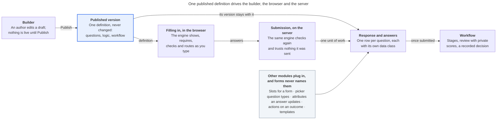

# Form builder: detailed specification

Nov 16, 2026 · @Matthew Adcock

Workstream 5 of the detailed-design stage. This document specifies the form builder, including forms with a review step, which replace a dedicated proposals module. Each of the nine parts has its own tab.

## At a glance

*how the parts fit · 7 parts, 5 kinds of plug-in*

An author publishes a version; the browser and the server both run the same engine over it; the stored response keeps its version and moves through the workflow.

## The design in ten decisions

| # | Decision | Why |
| --- | --- | --- |
| 1 | A form version is one immutable definition; editing happens in a draft version and reaches people only on Publish | A response always knows exactly which form it answered, and a half-made edit never reaches a respondent |
| 2 | One engine, with no platform dependencies, runs unchanged in the browser and on the server, and a shared case set proves they agree | "Checked in both places" becomes a tested fact, and the server never trusts the browser |
| 3 | Logic lives on the item it affects (show when, require when, where a page goes next) and reads as a sentence | The reference project's separate rule list is the hardest part of it to use, and the paper forbids a rule table |
| 4 | Logic is data: conditions and a fixed list of functions, never script | It can be checked before publishing, shown as words, and run safely on the server |
| 5 | Each answer is its own row with its own data class | Erasure, retention, encryption and filtering work per question, exactly as on built-in data |
| 6 | Every question has a lasting identity across versions, and its type never changes | Results span versions, and changing a form cannot silently reinterpret old answers |
| 7 | Other modules connect through five kinds of declaration: slots, picker types, bindable attributes, outcome actions and templates | Forms never names another module, and any module can use forms without forms changing |
| 8 | Custom fields are a form in "record" mode, attached to a slot on a record type | One mechanism to learn, as the paper asks |
| 9 | A workflow is stages the theatre names, each of one of six fixed kinds, with review as a stage that hides scores and locks out conflicts | Proposals need no module of their own, and reports can understand any theatre's workflow |
| 10 | Counted limits (a cap, one response each, limited options) are database constraints inside the same unit of work as the submission | The last place is taken once, with no check in application code to race |

## How to read this document

| Tab | Holds |
| --- | --- |
| 1. Scope | What is in and out, how a proposals round is covered, and what is assumed of other workstreams |
| 2. Data model | The definition format, sixteen tables for the first release and one for later, each column with its class and erasure behaviour |
| 3. States and rules | The life of a form, a version and a response; workflow and review rules; the engine's rules |
| 4. Interface to other modules | Points, slots, services, events, facts and jobs |
| 5. Screens | Twenty-one screens, the builder in detail, and two wireframes |
| 6. Settings and abilities | Twenty settings and fourteen abilities |
| 7. Stories | Forty-three stories with acceptance criteria: 31 in the first release and 12 later |
| 8. Test plan | Twenty-seven named cases that must never regress |
| 9. Questions for Matt | Ten choices, all decided, and the few points still open with other workstreams |
| Sources and prior art | What was read, and what was taken or left from each |

## Status

Second draft, 16 November 2026: Matt's decisions and every ruling from the other workstreams are folded into the body of each tab, and the screens are checked against the interface specification's page conventions. The 25 findings of the consistency review (W-169 to W-193) and integration's rulings on them were worked through the same day. No product code has been written.

| Item | State |
| --- | --- |
| Aligned with foundations (workstream 1) | Yes: points and contributions, units of work, per-row data classes, naming, settings format, always-on, public components, erasure in append-only tables |
| Aligned with interface (workstream 6) | Yes: the Editor layout, side-by-side rows and where review and "My forms" live. Tab 5 maps every screen to a page type, and its two departures (forms longer than five pages, and the builder locking where a form page would merge) are accepted as conventions |
| Aligned with identity (workstream 2) | Yes: the conflict lockout is a guard inside forms, grants stop at the form, and signed-out responses are keyed to an email address. Tabs 2, 3, 4, 6, 7 and 8 carry these rulings in their tables and rules |
| Aligned with core domain (workstream 3) | Yes: vocabularies, files, the notification-type point and the record types that slots refer to |
| Waiting on box office and payments (workstream 4) | Nothing for the first release. Payment from a form and questions at checkout are later stories whose design is agreed in outline |
| Decided by Matt | All ten questions in tab 9, as recommended, on 16 November 2026 |
