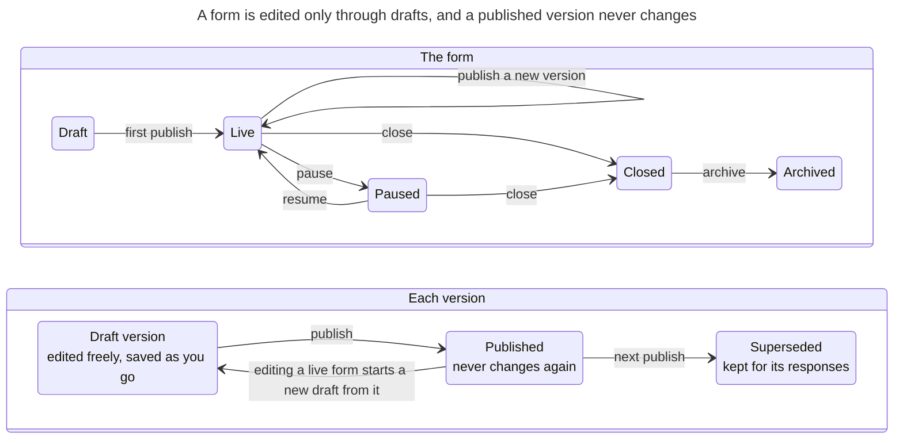
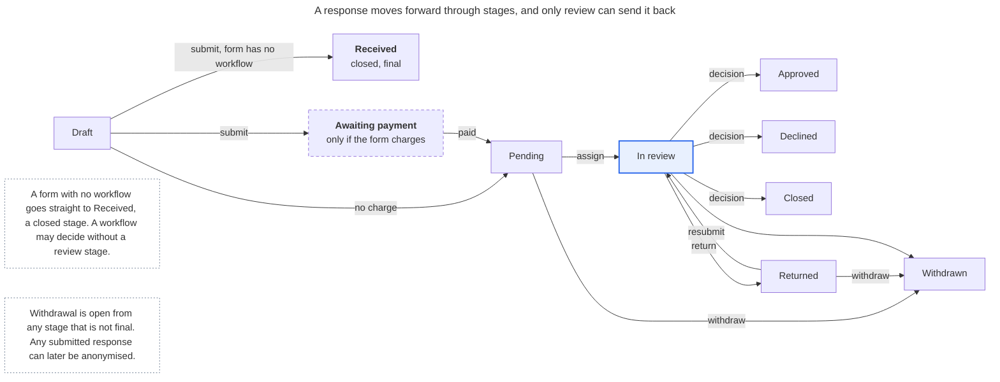

# 3. States and rules

Three records have a life cycle: the form, its versions, and each response. Every change of state is one D1 batch that also writes its audit entry, and every guard is checked on the server where the write happens.

## The form and its versions

*life cycle of a form and of each version*

The form's status says whether it takes responses; a version's state says whether its definition can still change.

| Change | Guard |
| --- | --- |
| Create a form | Ability `forms.form.create` |
| Edit the draft version | Ability `forms.form.edit` on this form. The save states the draft version's `edit_revision`; a stale one is refused and the editor is shown who saved last |
| Publish | Ability `forms.form.publish`. The definition has no errors in the problems list. A form with a personal, free-text or special question has a retention period. The draft version differs from the live version |
| Publish a breaking change | As publish, and the person has confirmed the impact statement, which names each retired question and the number of answers it holds |
| Pause, resume | Ability `forms.form.publish`. Pausing stops new responses; draft responses in progress are kept |
| Close | Ability `forms.form.publish`. No new responses or submissions; staff work on existing responses continues |
| Archive | The form is closed and no response is short of a final stage |
| Delete | Only a form that was never published. A published form is archived, and its responses leave by retention |

Rules for versions:

- **A published version never changes.** Fixing a typing error is a new version, published in one step.
- **A question's type never changes.** To change it, retire the question and add another. Its old answers stay readable under the retired question.
- **A question's data class can be raised, never lowered.** Raising it reclasses the stored answers in the same batch.
- **Publishing classifies every change** as safe, caution or breaking, and stores that with the version.

| Impact | Examples | What happens to responses in progress |
| --- | --- | --- |
| Safe | Wording, help text, order, a new optional question, a new option | Draft responses move to the new version unchanged |
| Caution | A new required question, an option removed, tighter validation, a changed condition | Draft responses move to the new version and are checked again when next opened; the person is told what needs attention |
| Breaking | A question retired, a page with answers removed | Draft responses move and lose the retired answers after a notice; the publisher confirms first |

A submitted response stays on the version it answered, always. A response returned for changes is revised on its own version, so the applicant is never asked new questions mid-review.

## The response

*The life cycle of one response*

A response only moves backwards when a reviewer returns it for changes, and it can be withdrawn from any stage that is not final. A form with no workflow has one stage, Received, which is closed and final, so retention starts at once.

A response has a coarse `state` the platform fixes and, once submitted, a `stage` the theatre defines. Every stage has one of six kinds, so other modules and reports can reason about a workflow they have never seen.

| Stage kind | Meaning | Final |
| --- | --- | --- |
| `pending` | Received, waiting for someone | No |
| `in_review` | With reviewers | No |
| `returned` | Sent back to the submitter for changes | No |
| `approved` | Decided in favour | Yes |
| `declined` | Decided against | Yes |
| `closed` | Finished with no decision to make, the default for a simple form | Yes |

| Change | Guard |
| --- | --- |
| Start a draft response | The placement is active and open, and the person is in its audience. Where one response each applies, the person has none |
| Save a draft response | The person owns the draft response or is a co-author the submitter added. Nothing is validated except size |
| Submit | The placement is still open. The server rebuilds visibility from the answers and its own facts, discards hidden answers, validates, recalculates, and checks the cap and limited options by database constraint. Sent totals are compared where money is involved |
| Submit on someone's behalf | Ability `forms.response.manage`; recorded in `entered_by` |
| Pay | Forms owns the payment as a part of a Payments intent. When Payments settles the intent it calls forms' settlement handler inside its own unit of work, and the handler moves the response from `awaiting_payment` to `submitted`. After the first release (FB-508) |
| Move between stages | The transition exists from the current stage, and the actor satisfies its "who may" rule. A transition to `approved` or `declined` requires a reason when the form says so |
| Decide your own response | Refused. Nobody moves a response they submitted, whatever their abilities |
| Return for changes | A transition whose target stage is of kind `returned`. The submitter may then edit; resubmitting creates revision n + 1 and moves to the stage the transition names. A respondent who answered signed out has no account to find the response through, so the notice they are emailed carries a fresh single-use link to it |
| Edit after submitting | Only as the placement allows: never, until it closes, or when returned. Each edit is a new revision |
| Withdraw | The submitter, while no final stage is reached. Frees the one-each key, the cap count and any limited option |
| Anonymise | The retention sweep once `retention_due_at` has passed, or erasure of the person |

A form in `record` mode (custom fields) has a simpler life: one response per record, created on first save, with state `submitted` and stage kind `closed` throughout. Each save is a new revision, and the guard is the host module's own edit ability for that record.

## Workflow rules

A workflow is part of the form definition, so it is versioned with it.

- **Stages** have a key, a name, a kind, and what the submitter is told their status is. A theatre may hide the real stage name from submitters.
- **Transitions** have a key, a from and a to stage, a label, and a "who may" rule: an ability, the holders of a role, the assigned reviewers, the submitter, or the system on a timer or an event.
- **On entering a stage**, the form can send a notification, apply bindings, run an outcome action, request payment, or ask for review. These are queued and retried; the stage change itself never waits on them.
- **The default workflow** is one stage, Received, of kind `closed`. A theatre that wants no workflow never sees one.
- **A workflow can change in a new version.** A response keeps the workflow of its own version. If a later version removes a stage, responses in that stage stay there and staff see the old transitions.

## Review rules

- **Criteria.** The form defines up to a setting's limit of criteria, each with a name, guidance, a whole-number scale and an optional weight.
- **Assignment.** Reviewers are the holders of a role, named people, or both. Forms asks identity for the role's holders when the response enters review; identity defines no groups, so forms has none. An assignment row is made per reviewer per response when the response enters review.
- **Private until released.** A reviewer sees only their own scores and comment until the round is released. Release is a transition a chair performs; from then the panel sees all scores: every reviewer assigned to that response in that round, the chair and whoever decides. A reviewer locked out by a conflict stays locked out. The form may instead allow open review from the start.
- **Never shown to the submitter.** Scores and reviewer comments never reach the submitter through the platform: not in their view and not in their download of their own answers. Matt decided this on 16 November 2026; a data-protection request may still oblige a theatre to disclose them, and the site owner's documentation says so.
- **Declared conflict.** A reviewer may declare a conflict on a response. Their assignment becomes `conflicted`, and from that moment they cannot open that response's answers, scores, comments or messages. The declaration is recorded; its reason is not required.
- **Automatic conflict.** A reviewer is conflicted without declaring it when they submitted the response, are a co-author of it, or are named in a person question the form marks as "people involved".
- **Lockout is enforced on read**, on the server, on every route that returns anything about that response, including lists, search, exports and totals that would reveal a single score. It is a guard in forms' own service that runs after the platform's authorisation, because identity ruled that roles, facts and ownership only ever allow. It applies to every role, the Owner included.
- **A summary** shows, per response, the number of reviews, the mean and spread per criterion and the weighted total. It appears to the panel only after release.
- **The decision** is a transition by someone with `forms.response.decide`, with a reason for the record and a separate message to the submitter. The reason is never sent to the submitter automatically.

## The logic engine

One package with no dependencies on the platform, run unchanged in the browser and in the Worker. It takes a definition, the answers so far and the server's facts, and returns what is visible, what is required, what is invalid, the calculated values and the next page.

### Order of evaluation

1. Resolve facts about the respondent and attributes of the attached record. The server resolves them and sends the results to the browser; the browser never supplies them.
2. Apply prefill to questions that have no answer yet.
3. Work out calculations in dependency order.
4. Decide visibility, page by page in order. An item inside a hidden page or group is hidden.
5. Treat the answer to every hidden question as empty, and repeat steps 3 and 4 until nothing changes. The publish checks guarantee this settles.
6. Decide which visible questions are required.
7. Validate the visible answers.
8. Follow routing from the current page.

### Conditions

| Question type | Comparisons offered |
| --- | --- |
| Text, email, phone | is, is not, contains, does not contain, starts with, is answered, is empty |
| Number, money, rating, calculation | is, is not, more than, at least, less than, at most, between, is answered, is empty |
| Date, time | is, is before, is after, is on or before, is on or after, is within a number of days of, is answered, is empty |
| Single choice, yes or no | is, is not, is any of, is answered, is empty |
| Multiple choice | includes, does not include, includes any of, includes all of, has at least n chosen, is empty |
| Repeating group | has at least n entries, has no entries |
| Fact or record attribute | By the type its owner declares |

- Text comparisons ignore case and surrounding spaces. Everything else is strict about type: a number is never compared with text.
- A comparison with an empty answer is false, except `is empty` and `is not`.
- A condition may refer only to a question on the same or an earlier page, a calculation, a fact or a record attribute. Inside a repeating group it may refer to questions in the same entry.
- Dates are compared in the theatre's time zone through the platform's calendar helper. "Today" is the server's operating day at submission.

### Routing

- Each page has an ordered list of routes and a default, the next page. The first route whose condition is true wins.
- A route may only go forward, to a later page or to an ending. Loops cannot be written, so every path ends.
- An ending either submits or stops without submitting. A stopping ending explains why in the theatre's words, and stores nothing.

### Calculations

- A calculation is an expression tree built from a fixed set of functions: add, subtract, multiply, divide, round, minimum, maximum, sum and count over a repeating group, days between two dates, add days to a date, choose by condition, and join text.
- There is no free-form code and nothing that reads the clock, the network or randomness. The same inputs always give the same value.
- Money is integer minor units throughout; division rounds half up to a whole minor unit, once, at the end.
- A calculation with an empty input is empty, unless the function says otherwise (sum and count treat empty as nothing).
- The server recalculates on submission and ignores any value the browser sends.

### Validation

- Each rule carries the theatre's own message, with a sensible default. Rules: required, length, number range and whole numbers, date bounds (fixed or relative to today), number of choices, number of entries, a pattern from a short list of named patterns, file type and size.
- A free pattern (regular expression) is available to holders of `forms.form.edit` only where a setting allows it, and is checked for run-time safety at publish.
- The same rules run in both places from the same definition. The server's answer is the one that counts.

### Checks before publishing

The builder lists these as problems, and an error blocks publishing.

| Check | Severity |
| --- | --- |
| A condition, route or calculation refers to something that does not exist or comes later | Error |
| Calculations depend on each other in a circle | Error |
| A page or question can never be reached or shown | Warning |
| A required question is hidden by a condition that can never be false | Warning |
| Two questions share a key, or a choice has no options | Error |
| A picker's module is switched off, or a bound attribute no longer exists | Error |
| A personal, free-text or special question on a form with no retention period | Error |
| A special question on a form anyone may answer without signing in, where the setting forbids it | Error |
| A binding on an anonymous form | Error |
| The definition is over the size or count limits in settings | Error |
| A label has no text, or an image has no description | Error |

### One engine, proved

A shared set of cases, each a definition with answers and facts and the expected outcome, runs against the engine in the Worker runtime and in a browser on every change. A difference between the two fails the build.
