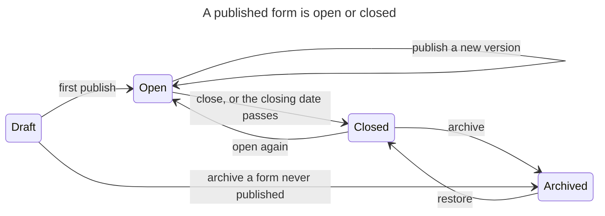

# Changes agreed on 21 November 2026

Matt read the proposals of the interface review (the forms part) and approved all of them on
21 November 2026. Where this page and an earlier part disagree, this page wins. Nothing here changes
the definition format, the stored data or any ability.

## What changed

| # | Change | Replaces or adds to |
| --- | --- | --- |
| 1 | **One form, three tabs.** Build, Responses and History are tabs of the one form, in the same place on each, and each keeps its own address. From the forms list a published form opens on its responses and a draft opens to be built; somebody who reads responses and may not edit sees Responses alone | Part 5, screens 3, 9 and 10; change 9 of 17 November |
| 2 | **The first publish shares the form.** The publish dialog of a form's first version asks who can answer (anyone with the address, only people signed in, or nobody yet) and gives the form its link in the same step; the share dialog then opens with the address ready to copy. "Nobody yet" is for a form made only to be attached to another module's record | FB-301, "a form is offered nowhere until this is saved" |
| 3 | **Open or closed.** A published form is open or closed, and nothing is paused. One control in the builder says which, changes it, and holds the date the form closes by itself. The "Taking responses" switch and the closing date leave the share dialog. A form attached to another module's record keeps both on its own terms there | Part 3, the form's life cycle; FB-301 |
| 4 | **Version history is the History tab.** It is no longer reached from the More menu | Part 5, screen 9 |
| 5 | **The two ends of a form are on the canvas.** A Start card before the first page holds the introduction; an End card after the last holds the wording of the Send button and the thank-you message. Both are edited in the details panel, saved with the draft and published with it. They leave the form's settings | Part 5, the builder; form settings |
| 6 | **Endings and calculations are added from the Add menu,** under More. The outline lists each only once the form has one | Part 5, the outline |
| 7 | **A question's export name is under Advanced** in its details | Part 5, the details panel |
| 8 | **Plainer names.** The question type "Record from a source" reads "From our records", and "Form as JSON" reads "Export or import" | Changes 4 and 5 of 17 November (the names only) |

## Open or closed, as built

*life cycle of a form from 21 November 2026*

- **Stored statuses are unchanged.** Open is the status `live`; `paused` stays in the schema for forms
  paused before this change and is never written again. No migration was needed.
- **`POST /api/forms/forms/:id/status` no longer takes `paused`** (a 422, as for any other value it
  does not know). A paused form can be opened or closed from where it is, and reads as closed in the
  builder and the forms list.
- **Opening a form opens its own link.** Going to `live` sets the form's own link back to `active`
  if the old switch had paused it, in the same batch, so a form cannot look open and still refuse
  answers. Links on other modules' records are not touched.
- **The closing date** is still the link's `closes_at`, written through `PUT …/link` with the rest
  of the link's terms left as they were. A form whose date has passed reads as closed and says when
  it closed; clearing or moving the date opens it.
- **Reminders** are unchanged: none is sent for a form that is closed.

| Change | Guard |
| --- | --- |
| Close, open again | Ability `forms.form.publish`. Closing stops new responses and submissions; staff work on existing responses continues |
| Set or clear the closing date | Ability `forms.form.publish`. The date must be after the opening date, where there is one |

## Sharing on the first publish, as built

Publishing is still `POST …/publish`; the dialog then calls `PUT …/link` with the audience chosen
and no dates, cap or one-each rule. If the link is refused the form is still published and is shown
as not shared, with Share to finish the job, as before. Later publishes do not touch the link.

## Additive fields

- `GET /api/forms/forms/:id` returns `canRead`: whether this person may read the form's responses.
- `GET /api/forms/forms/:id/responses` returns `form.published` and `form.canEdit`.
- `GET /api/forms/forms/:id/versions` returns `form.mode` and `form.canRead`.

They decide which tabs are drawn. No request changed shape, apart from `paused` leaving the status
address.

## Tests

- `layers/forms/tests/integration/life.test.ts`: a form is closed and opened again, pausing is
  refused, and a form paused before the change opens with its link.
- `tests/e2e/forms-closing.spec.ts` closes and opens from the control; `forms-answering`,
  `forms-stages`, `forms-review` and `forms-closing` publish and find the form already shared;
  `forms-versions` reaches History by its tab; `forms-calculations` adds a calculation from the Add
  menu; `forms-builder` and `forms-sources` use the new names.
