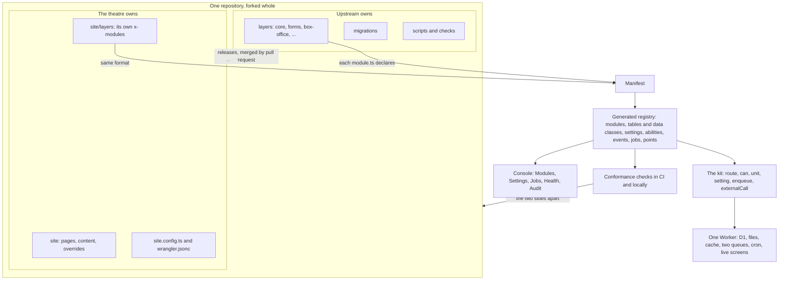

# Proscenium foundations

Nov 16, 2026 · @Matthew Adcock

Workstream 1 of the detailed-design stage. It specifies the ground every other workstream builds on: the repository and its owned paths, the module manifest, the settings, ability and data-class registries, the upstream-merge workflow, CI and the test harness, with three technical proofs.

## Where to find things

| Tab | What it holds |
| --- | --- |
| **Formats (draft for alignment)** | The manifest and the three registry formats on one page, with the change log. Start here if you write a module. |
| Module manifest · Settings registry · Abilities registry · Data-class registry | Each format in full |
| Worked example | A small module (lost property) written in every format |
| 1. Scope | What foundations is, what it is not, and the six principles |
| 2. Data model | The twelve `core_` tables foundations owns |
| 3. States and rules | Modules, migrations, units of work, events, jobs and external calls, with diagrams and numbered rules |
| 4. Interface to other modules | The kit, foundations' points, and the index of every `core.*` and `forms.*` name |
| 5. Screens | Setup, Modules, Settings, Jobs, Credentials, Updates and health, Audit |
| 6. Settings and abilities | Foundations' own, in the registry formats |
| 7. Stories | Thirty-four stories with acceptance criteria |
| 8. Test plan | The three tiers, the conformance checks every module gets for nothing, foundations' own cases |
| **9. Questions for Matt** | Seven questions, each with options and a recommendation |
| Design (and its three sub-tabs) | How it is built: repository and owned paths, upstream merges, CI and test harness |
| Proofs | The three technical proofs: method, results, findings |
| Sources | Where every claim about another system comes from |

## Status

| Item | State |
| --- | --- |
| Manifest and registry formats | Written, shared with all five other workstreams, amended from their feedback, accepted by the integrating thread |
| Nine-part specification | Complete |
| Design tabs | Complete |
| Proof 1, owned paths | **Passed.** Four upstream releases merged into a theatre fork with no conflict in any owned path. |
| Proof 2, one-step deploy | **Passed locally.** A real deploy on an account is question 5. |
| Proof 3, local tests | **Passed.** Matt decided that Linux alone is the supported system for tests, so this proof is closed. |
| Waiting on Matt | Six of the seven questions in tab 9 (question 4 is decided). None blocks another workstream; work proceeds on the recommended answers. |

Three things the proofs changed in the design: the theatre's `site/` folder is the Nuxt project itself and all upstream code lives in layers; the lockfile is the one shared file and is resolved mechanically; and a contended write is guarded by a statement that fails on purpose inside the batch, because a D1 batch can roll back but cannot branch.

## At a glance

A module declares itself once. The build turns every declaration into one registry. The registry drives the checks that keep modules honest, the kit that modules are written with, and the console screens that let a theatre run the system. Upstream and the theatre never edit the same file, so releases merge cleanly.

## What the other workstreams must do to align

1. Name everything by the naming rules: tables `<module>_<plural>`, settings `<module>.<group>.<name>`, abilities `<module>.<record>.<verb>`, events `<module>.<record>.<past participle>`, routes under `/api/<module>/`.
2. Give every table the heading line (realm, subject, append-only, retention) and every column a class and an erasure behaviour.
3. Write through the unit of work only; guard every contended write; call outside services only through `externalCall`.
4. Declare every route's ability, or mark it public.
5. Keep settings site-wide; put anything that varies by record on the record.
6. Reach another module only through its services (if required), or a point, an event or a fact (if merely used), and work when a used module is off.
7. Put no personal data in an event payload or in audit detail.
8. Register any new `core.*` or `forms.*` name in the index in part 4.

All five have confirmed alignment; later rulings are listed at the end of the Formats tab.
