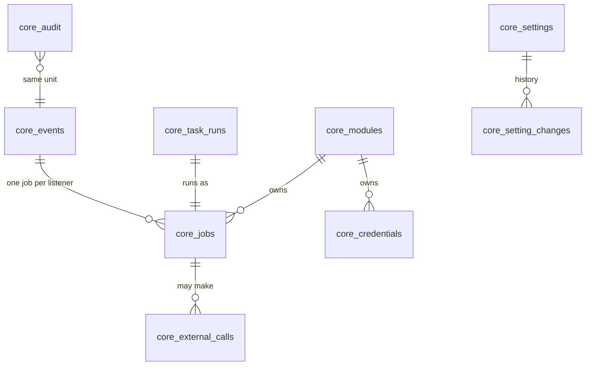

# 2. Data model

## The tables foundations owns

Twelve tables, all prefixed `core_`. None holds a theatre's content; they hold the state of the system itself. Each is described with the heading line every workstream uses: realm, subject, append-only, retention. Ids are sortable text ids made by `col.id()` unless stated.

| Table | Purpose | Realm | Subject | Append-only | Retention |
| --- | --- | --- | --- | --- | --- |
| `core_modules` | Which switchable modules are on | system | none | no | for ever |
| `core_settings` | The current value of every setting that differs from its default | system | none | no | for ever |
| `core_setting_changes` | Every change to a setting | system | none | yes | 7 years |
| `core_migrations` | Which migrations have been applied | system | none | yes | for ever |
| `core_events` | Announced events waiting to be delivered (the outbox) | system | none | no | 30 days after delivery |
| `core_jobs` | Every job, listener delivery and task run, with its state | system | none | no | 30 days after finishing; dead-lettered rows 180 days |
| `core_task_runs` | One row per scheduled task per due time, so a task runs once | system | none | no | 90 days |
| `core_external_calls` | The attempt and outcome of every call to an outside service | system | none | yes (outcome is a second row) | 2 years |
| `core_audit` | Who did what to which record, and what allowed it | system | none (actor is a `col.account` with role actor) | yes | 7 years, a setting |
| `core_credentials` | Encrypted credentials for outside services entered in the console | system | none | no | until replaced |
| `core_idempotency_keys` | Remembered responses for repeated requests | system | none | no | 48 hours |
| `core_guard` | Empty. Target of the deliberate failure that aborts a batch | system | none | no | never holds a row |

## Columns

### core\_modules

| Column | Class | Notes |
| --- | --- | --- |
| `module_id` | internal | Primary key. The manifest id. |
| `enabled` | internal | Boolean. A module with no row is off. Always-on modules have no row. |
| `enabled_at`, `disabled_at` | internal | Timestamps |
| `changed_by` | internal | `col.account`, role actor |
| `manifest_seen` | internal | The manifest `since` version last loaded, so first-enable steps run once |

### core\_settings and core\_setting\_changes

| Column | Class | Notes |
| --- | --- | --- |
| `key` | internal | Primary key in `core_settings`. `<module>.<group>.<name>`. |
| `value` | internal, or personal when the setting is declared `sensitive` | JSON, validated against the declared kind on write |
| `updated_at`, `updated_by` | internal |  |

`core_setting_changes` adds `id`, `old_value`, `new_value`, `reason` (class freeText, redacted on the actor's erasure) and `at`. A sensitive setting's values are stored there as the word `changed`, never the value. A setting with no row has its default; a key present in the table but absent from every manifest is kept and shown on the health screen as orphaned, never deleted silently.

### core\_migrations

`owner` (`upstream` or `site`), `name`, `checksum`, `applied_at`, `duration_ms`, `release` (the product version that applied it). Primary key (`owner`, `name`). A checksum that no longer matches the file stops the runner with a named error.

### core\_events

`id`, `name` (`<module>.<record>.<past participle>`), `record_type`, `record_id`, `payload` (JSON of ids and public or internal values only: **no personal data in an event payload**, a listener reads the record), `announced_at`, `unit_id`, `dispatched_at` (null until every listener has a job). Written inside the same batch as the change it announces.

### core\_jobs

| Column | Notes |
| --- | --- |
| `id` |  |
| `kind` | `job`, `listener` or `task` |
| `name` | The manifest name, for example `box-office.send-tickets` |
| `module_id` | So a module's jobs stop being run when it is switched off |
| `lane` | `prompt` or `bulk` |
| `payload` | JSON, ids only |
| `dedupe_key` | Optional. Unique with `name` while the job is not finished. |
| `state` | `queued`, `running`, `done`, `failed`, `dead`, `cancelled` |
| `attempts`, `max_attempts` |  |
| `run_after` | For delay and back-off |
| `last_error` | Class internal. The error's code and message, never a payload dump. |
| `created_at`, `started_at`, `finished_at` |  |

### core\_task\_runs

`task` (manifest name), `due_at`, `started_at`, `finished_at`, `outcome`. Primary key (`task`, `due_at`): the scheduler claims a run by inserting the row, so two overlapping cron invocations cannot both run it.

### core\_external\_calls

`id`, `module_id`, `purpose` (for example `payment.refund`), `reference` (the record it concerns), `idempotency_key` (the key sent to the provider), `phase` (`attempt` or `outcome`), `result` (`succeeded`, `failed`, `unknown`), `provider_reference`, `at`. An attempt row with no outcome row is a call whose result is unknown; a task reconciles those.

### core\_audit

| Column | Class | Notes |
| --- | --- | --- |
| `id`, `at` | internal |  |
| `actor_account_id` | personal | `col.account`, role actor, on merge move. Null for the system. |
| `actor_name` | personal, anonymise | The name as it was then. Erasure replaces it with the theatre's term for a former member; this is the one update the append-only trigger permits. |
| `actor_kind` | internal | `person`, `system`, `job`, `setup` |
| `action` | internal | `create`, `update`, `delete`, `state`, `grant`, `sign-in`, `export`, `erase`, `read` |
| `ability` | internal | The ability checked, if any |
| `allowed_by` | internal | The grant or fact that passed the check, written by the route wrapper |
| `module_id`, `record_type`, `record_id` | internal |  |
| `detail` | internal | JSON of field names and non-personal values. **No personal free text**: a lint rejects a freeText or personal column's value here. |
| `request_id`, `unit_id` | internal | Ties the row to the request and the batch |

### core\_credentials

`module_id`, `name`, `ciphertext`, `key_version`, `set_at`, `set_by`, `last_used_at`, `expires_at`, `hint` (last four characters). Encrypted with a key derived from the Worker secret `CORE_ENCRYPTION_KEY`; the value is never returned to a browser after it is saved. Primary key (`module_id`, `name`).

### core\_idempotency\_keys

`key`, `account_id` (or the session id for a guest), `route`, `request_hash`, `status`, `response` (JSON), `created_at`. Primary key (`key`, `route`). A repeat with the same key and a different request hash is refused.

## What is deliberately not a table

- **The registries.** Settings definitions, abilities, record types, facts, data classes and module manifests are code, read at build time into one generated registry. Only values and state are stored.
- **Rate-limit counters.** Counted outside D1 so that an attack cannot spend the database's write allowance.
- **Health results.** Computed when the screen is opened.
- **Nuxt Content's tables** (`_content_*`). Owned by Nuxt Content, rebuilt on each deploy, ignored by the migration runner and by the data-class lint.

## Relations

