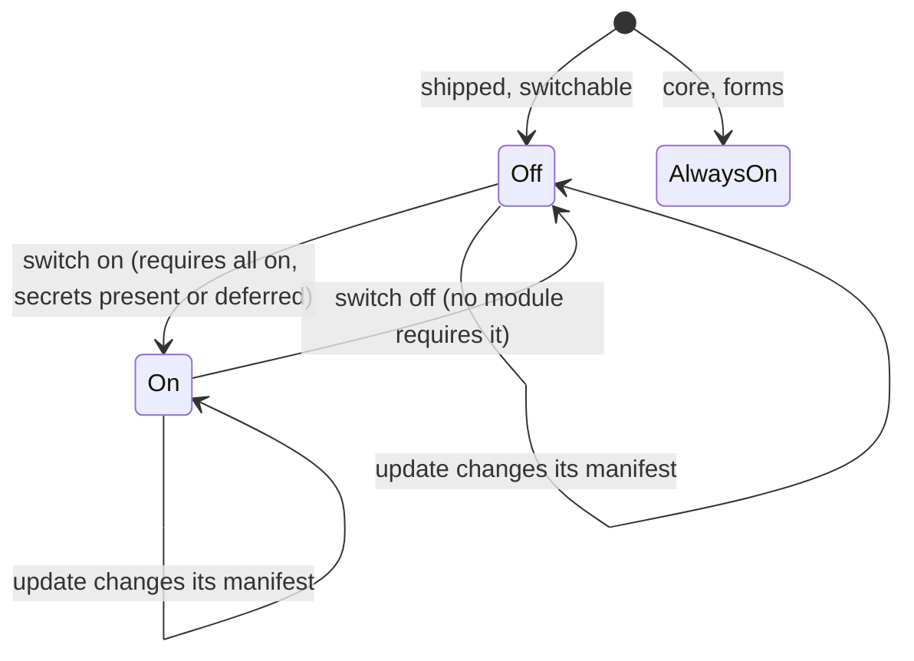
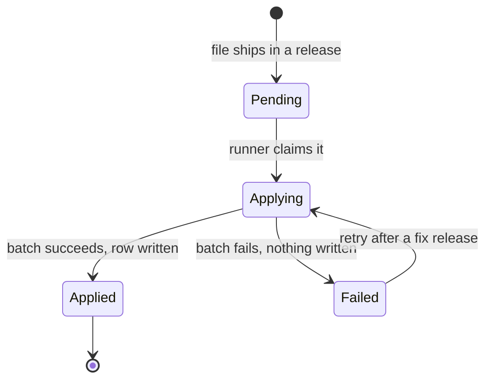
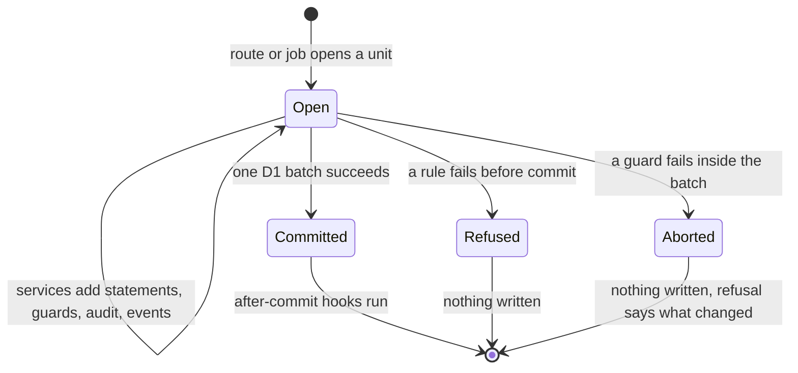
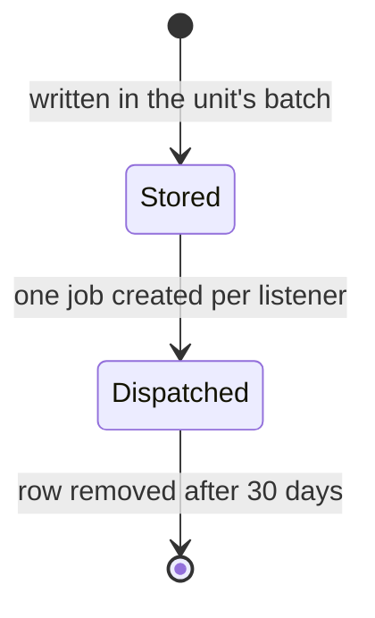
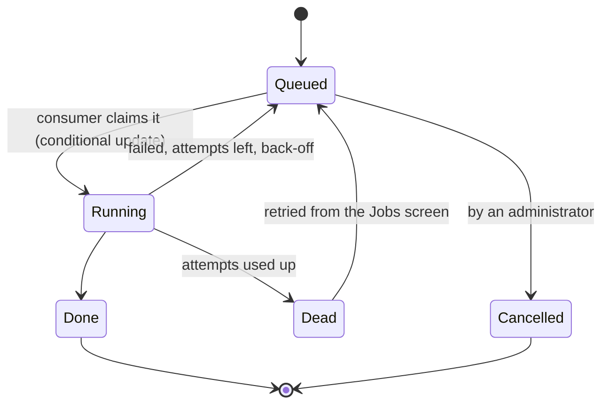
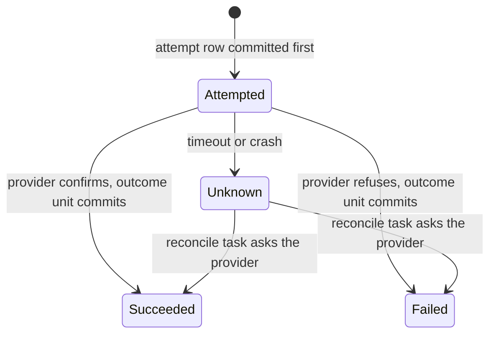

# 3. States and rules

## How to read this part

Six things in foundations have states: a module, a migration, a unit of work, an announced event, a job, and an external call. Each has a diagram and the rules that the diagram cannot show. A rule is numbered so a test can cite it.

## 1. A module: off, on, and what stops the switch

- **M1.** Switching on needs every module in `requires` to be on. The screen offers to switch them on together and names them.
- **M2.** Switching off is refused while another module that is on lists it in `requires`. The refusal names those modules.
- **M3.** A module in another's `uses` may be on or off. A soft link never calls the other module's services: it runs only through a point, an event or a fact, and when the other module is off the point has no contributions from it, the fact grants nothing and the event never arrives. In CI each module in `uses` is switched off in turn and the using module's suite must still pass.
- **M4.** Switching off **never deletes data**. Tables, settings values, files and audit rows stay. Its routes answer 404, its navigation and contributions disappear, its jobs stop being claimed (queued ones wait), its tasks stop being scheduled, its listeners stop receiving events (events announced meanwhile are not replayed), its public components render nothing.
- **M5.** Switching on again resumes queued jobs and restores everything in M4. Nothing is re-seeded.
- **M6.** The first time a module is switched on, its presets are offered, its secrets marked `always` are checked, and its setup steps join the setup checklist. A missing `always` secret blocks the switch; a `when-used` secret does not, and the feature that needs it refuses with `core.not-configured` until it is set.
- **M7.** The switch is an audited action needing `core.module.switch`, risk privileged, so a strong session and a fresh sign-in.
- **M8.** A module's migrations are applied whether it is on or off, so switching on is instant and never runs schema changes.

## 2. A migration: generated, applied once, never edited

- **G1.** Migrations run inside the application: at first-run setup, and after an update when an administrator presses Apply on the Updates screen or, if `core.updates.apply-migrations` is `automatic`, on the first request after deploy. While migrations are pending, every route except health, sign-in and the Updates screen answers 503 with a plain page. The platform takes no backup of its own, before a migration or at any other time (Matt, 16 November 2026); a theatre relies on the history Cloudflare keeps for its database.
- **G2.** Upstream's journal is applied first and completely, then the theatre's (`site/migrations/`). A theatre migration may refer to upstream tables; never the reverse.
- **G3.** Each migration is one D1 batch with its ledger row, so it is applied whole or not at all. A migration too large for one batch is split into several migrations by the generator.
- **G4.** An applied migration's file never changes: the runner compares checksums and stops with the file's name if one differs.
- **G5.** Within a major version, migrations only add (tables, columns with defaults, indexes). Removing or renaming waits for a major version and follows expand, migrate, contract over two releases.
- **G6.** A migration that would rebuild an append-only table is refused by the generator's lint.
- **G7.** Only one runner runs: it claims by a conditional insert into `core_migrations` of a lock row, released on finish and expiring after ten minutes.

## 3. A unit of work: all or nothing

- **U1.** One request or one job has at most one unit, and it commits once, as one `db.batch`. Services add statements to the unit they are given; a service never commits.
- **U2.** A contended write is a conditional statement plus `.expect(rows)`. If the row count differs at commit, a guard statement fails and D1 rolls the whole batch back (proved, see Proofs).
- **U3.** `unit.audit()` and `unit.announce()` add rows to the same batch, so there is never a change without its audit row or an event without its change.
- **U4.** Reads happen before the unit is built; the unit does not read. A decision based on a read is protected by a guard on the write, not by trusting the read.
- **U5.** Work that must not be undone by a failure after it (sending a message, calling a provider) is not done in a unit. It is a job announced by the unit, or an external call (section 6).
- **U6.** A unit has a limit on statements (a setting of the kit, not of the theatre). Work over the limit must be a job that proceeds in chunks, each its own unit, each safe to repeat.

* **U7.** A fan-out is written set-wise, never one statement per row. Every row of the set travels in one JSON parameter, and each table is written by one `INSERT ... SELECT` that reads it with `json_each`, so the cost in statements does not grow with the number of rows and no statement nears D1's limit on bound parameters. The kit provides the helper, unit.insertSet(table, rows), which returns the ids in order, so a module does not write `json_each` by hand. Ids are made by the kit before the unit is built and travel in the JSON, because the unit does not read (U4). Proved locally by core domain on 16 November 2026: fifty notifications in five statements.
* **U8.** `unit.announce()` and `unit.audit()` each take one row or a set. A set of any size is one statement, written as U7 describes, and each event in it is dispatched and delivered as its own event. The caller passes the set it read before building the unit; the guards on the change (U2) make that set true or roll everything back, so the writer never selects from the rows just changed.
* **U9.** One set carries at most `core.units.set-rows-limit` rows, 500 as shipped and never settable above 2,000, and its JSON parameter is at most 1 MB whatever the row count, because row width varies by table; whichever is met first refuses the set. Measured on a real D1 database on 16 November 2026: a full unit (set, guard, events, jobs and audit, with real indexes and triggers) took 386 ms at 500 rows, 514 ms at 2,000 and 1.1 s at 8,000, and the limit that binds is D1's 2 MB maximum string, which the byte guard keeps at half. That run went through D1's HTTP API, so the Worker's own time and memory to build the parameter are still to be measured at the first deployed site, which is why the default stays at 500. It is a setting of the kit beside `core.units.statement-limit` (50), stated once here and cited by modules. A larger set is refused with `core.unit.too-large`, and the work becomes a job in chunks as U6 says.

## 4. An announced event: stored with the change, delivered at least once

- **E1.** After commit the Worker dispatches at once; a task sweeps for any event left `Stored` (a crash between commit and dispatch), so delivery does not depend on the request surviving.
- **E2.** Delivery is at least once and unordered. A listener must be safe to run twice and must read current state, not trust the payload.
- **E3.** A listener runs as a job in the prompt lane, in its own unit, with the system as actor and the original actor recorded.
- **E4.** Events are facts in the past tense. A listener cannot veto. Anything that must be able to stop an action is a point of kind code that the acting module calls before it commits (for example `core.delete-guard`).
- **E5.** A listener of a module that is off receives nothing and is not caught up later.

* **E6.** Every event is deliverable to an outgoing webhook unless its declaration says `internal: true`. A webhook receives the event's name, time, ids and the record's public title only. Delivery is a job in the bulk lane, so a slow receiver cannot delay anything inside the system.
* **E7.** A payload never holds a name, an address, free text or any value from a column classed personal, freeText or special. Listeners and webhooks both rely on this; a conformance check enforces it.

## 5. A job: queued, retried, and never silently lost

- **J1.** The row in `core_jobs` is the truth; the queue message is only a prompt to look at the row. A message for a row that is not `Queued` is acknowledged and ignored, so a duplicate message cannot run a job twice at once.
- **J2.** Two lanes, each its own queue: `prompt` for work a person is waiting on (a ticket email), `bulk` for everything else (imports, mass mailings). A long bulk run cannot delay a prompt job.
- **J3.** Back-off doubles from 30 seconds; five attempts by default; a manifest may lower or raise it per job.
- **J4.** A dead job appears on the health screen and the Jobs screen with its error. The platform's dead-letter queue catches only messages the consumer could not even read, and those raise a health warning.
- **J5.** A scheduled task is a job created by the scheduler. The one cron trigger fires every minute; the scheduler inserts a `core_task_runs` row for each task that is due and creates its job. A missed minute is caught up at the next; a task that is still running is not started again.
- **J6.** Task times (`dailyAt`, `weeklyOn`) are wall-clock times in the theatre's time zone, which is unset until setup; until it is set, tasks run to UTC and no domain date is computed. The zone is `core.locale.time-zone`.
- **J7.** A job handler receives ids, opens its own unit, and must be safe to repeat.

## 6. An external call: recorded before it is made

- **X1.** `externalCall({ attempt, call, outcome })` is the only code that may call an outside service that moves money or sends something irreversible. It commits the attempt (with the key sent to the provider), makes the call, then commits the outcome as a second unit.
- **X2.** The same key is sent on every retry, so the provider treats a repeat as the same request.
- **X3.** An attempt with no outcome after five minutes is `Unknown`. The module that made it must declare a reconcile handler; a lint fails a module that uses `externalCall` without one.
- **X4.** Nothing is shown to a person as done until the outcome unit has committed.

## Rules that have no diagram

- **R1. One permission check.** `can(actor, ability, record?)` is the only function that answers whether someone may do something. The route wrapper calls it from the route's declaration; pages call the same function to decide what to show. A route with no `ability` must say `public: true` (anyone) or name the ability 'signed-in' (any signed-in person), or the build fails. There is no ability named 'public'.
- **R2. A refusal always has the same shape**: `{ code, reason, remedy?, fields? }`, with a stable code (`<module>.<what>`) and a sentence a person can act on.
- **R3. Settings are read through `useSetting(key)`**, which validates and falls back to the default. A value outside its declared limits can never be saved; a limit tightened by an update leaves the old value in place, flagged on the health screen, until an administrator changes it.
- **R4. A setting marked `quotable` can be quoted on a public page** with `:setting{name="…"}` and is rendered live. CI fails on a token whose name does not exist or is not quotable. Sensitive settings can never be quotable.
- **R5. Settings are site-wide.** Anything that varies by venue, production or performance is a field on that record whose default comes from a setting (question 1 for Matt).
- **R6. Idempotent routes**: a route declared `idempotent` requires a key from the client and replays the stored response for a repeat within 48 hours.
- **R7. Every date a rule depends on is a local date in the site's time zone**, stored with `col.localDate`, never derived from a UTC timestamp in a query.
