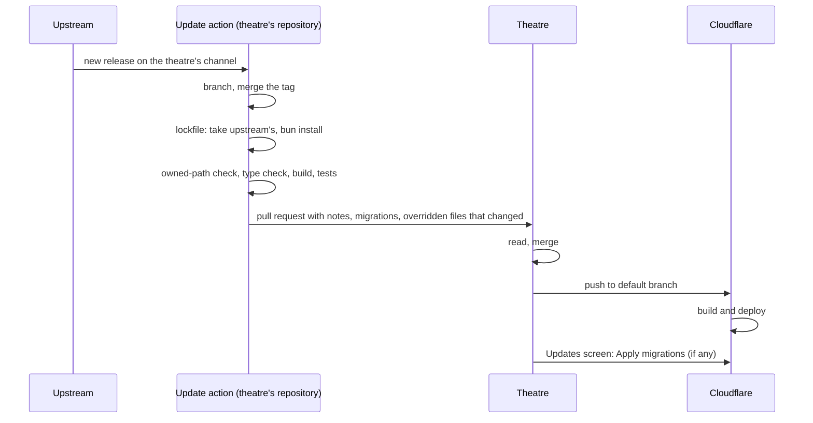

# Upstream merges

## Receiving a release should be boring

A theatre's copy is a fork. Everything here exists so that taking a new release is reading its notes and pressing merge. Questions 2, 3 and 7 for Matt decide the defaults; this tab is written to the recommended answers.

**Two ways to get a copy, proved on 16 November 2026.** The Deploy to Cloudflare button makes a repository with a fresh history: one commit, no shared commits with upstream, and not a GitHub fork. Such a copy is linked to upstream once, by `scripts/link-upstream`: it reads the release version the copy was made from (every release records it in `package.json`), fetches that tag and records it as a parent with a merge that changes no file. After that every release merges in the ordinary way. The update action runs the link by itself the first time it finds no shared history; a theatre merging by hand runs the script once. A theatre that prefers GitHub's Sync fork control forks on GitHub and imports the fork in the Cloudflare dashboard instead, which needs no link. The button must therefore always copy a tagged release, so upstream's default branch holds nothing but releases.

## Branches and releases upstream

| Thing | Meaning |
| --- | --- |
| `main` | Always the latest stable release, and nothing else. A fork's default branch tracks it, so GitHub's Sync fork control also works. |
| `next` | Where development lands. Beta releases are tagged from it. |
| Tags `v1.4.0`, `v1.5.0-beta.2` | Releases. Semantic versioning: patch fixes, minor adds, major may break. |
| Release notes | Written for a theatre administrator first (what is new, what you must do), contributors second. Generated from pull request labels, edited by a person. |
| `breaking` marker | A release that needs action carries it in its notes and in a machine-readable file (`docs/releases/<version>.json`) that the update action and the Updates screen read. |

A theatre deploys from its own default branch. It chooses the stable or beta channel in `site.config.ts`. Flytower's Stable and Beta channels are the model.

## The update, step by step

1. **Notice.** A scheduled workflow in the theatre's repository compares the running version with the newest release on its channel, once a day. The Updates screen in Site administration makes the same comparison and links to the pull request.
2. **Merge on a branch.** `git merge <tag>`. By the ownership rule the only possible conflict is the lockfile.
3. **Lockfile.** Take upstream's `bun.lock`, run `bun install`. The theatre's extra packages, listed in `site/package.json`, are added back. Proved twice.
4. **Check.** Owned paths, types, build, and the test tiers.
5. **Pull request.** Title is the version. Body: the release notes, whether there are migrations, whether it is breaking and what to do, and any file the theatre overrides whose upstream original changed in this release.
6. **Merge and deploy.** The theatre merges; Workers Builds deploys the default branch.
7. **Migrations.** If the release has any, the site shows the maintenance page until an administrator presses Apply (or at once, if set to automatic).

If the merge conflicts anywhere but the lockfile, the action does not guess. It opens the pull request as a draft that names each conflicting file and says the file is upstream's and where the theatre's change should live.

A theatre that skips several releases gets one pull request to the newest, and migrations apply in order. Skipping across a major version is refused by the action, which offers the last release of the old major first.

## What upstream promises (question 7)

**Decided by Matt on 16 November 2026: this promise starts at version 1.0.** Before 1.0 any release may break, and its notes and the machine-readable release file say what broke and what to do. Everything below describes 1.0 onwards.

Within a major version:

- **Database**: migrations only add. Nothing a theatre's own module reads is removed or renamed.
- **Manifest and kit**: nothing removed, nothing changes meaning.
- **Settings and abilities**: a key is never reused for a different meaning. A renamed key carries `replaces`, and its value and grants move with it.
- **Published components and routes under `/api/`**: names and inputs kept; additions only.
- **Events and points**: names and payload fields kept; additions only.
- **Not promised**: the look of screens, unpublished components, internal files, the exact text of labels.

A major version lists every break with the action to take, ships a check that reports which of them affect this fork, and is released at most once a year. The previous major receives security fixes for six months.

## Things that go wrong, and what happens

| Situation | Result |
| --- | --- |
| The theatre edited an upstream file | The check failed when they did it. If they overrode the check, the merge conflicts in that file and the draft pull request explains. |
| The theatre listed a file in `overrides.json` and upstream changed it | A real conflict, expected. The pull request shows both versions; the theatre re-applies its change or drops the override. |
| A release's migration fails on this theatre's data | Nothing is applied (one batch). The site stays on the maintenance page; the screen names the migration and the error; redeploying the previous version restores service, because the schema has not changed. |
| The theatre's own module breaks against a new release | Type check or tests fail in the pull request, before anything is live. |
| GitHub has disabled the scheduled workflow (it does so in forks until enabled, and after long inactivity) | The Updates screen in Site administration still shows that a release is waiting and how to enable the action or merge by hand. |
| The theatre never updates | Nothing breaks. The Updates screen shows how far behind it is and flags security releases. |

**No backup of its own.** The platform takes no backup, before a migration or at any other time (Matt, 16 November 2026). Cloudflare keeps its own history of the database for up to 30 days, and a theatre that must go back uses that in the Cloudflare dashboard; the platform has no restore feature. One step goes with it: before such a restore the theatre notes, from the data-request queue, the account ids of every erasure completed since the point it is going back to, and runs those erasures again afterwards, because the record of an erasure lives in the same database and is lost with it (Identity, part 3).

## Giving back

A fix a theatre makes to upstream's code belongs upstream. `docs/contributing.md` shows how to open it as a pull request to `next` from a branch that excludes `site/`. The AGPL requires a theatre that changes upstream's code to offer its source to its users; a public fork already does, and the footer link to the source is on by default.
