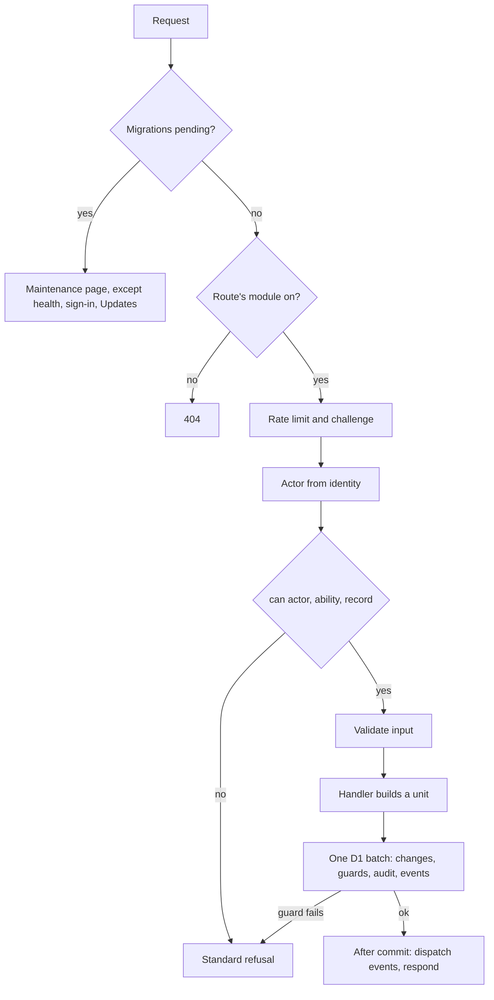

# Design

## How foundations is built

The nine numbered tabs say what foundations must do. This tab and its three sub-tabs say how: the choices of structure and tooling that a builder needs and a reader of the specification does not. Where a choice came from one of the three proofs, it says so.

| Sub-tab | Settles |
| --- | --- |
| Repository and owned paths | The folder layout, who owns what, how a theatre overrides and extends, the owned-path check |
| Upstream merges | Branches, releases and channels, the update action, the lockfile, what a breaking change is |
| CI and test harness | The tools, the commands, the workflows, how tests reach D1 locally |

## The runtime in one page

- **One Worker.** Nuxt 4 on Nitro's Cloudflare module preset. The Worker's entry is foundations' own file so that queue, cron and live-screen handlers can acknowledge and retry properly; everything else is passed to Nitro. Mailflare needed the same and is the source of the pattern.
- **Bindings**, declared once by upstream in `nuxt.config.ts` with no identifiers: `DB` (D1), `FILES` (R2), `CACHE` (KV), `JOBS_PROMPT` and `JOBS_BULK` (the two job queues, each with a dead-letter queue), EMAIL\_EVENTS (a queue that receives email outcomes from Cloudflare), `LIVE` and RATE\_LIMITS (one Durable Object class each: live updates, and the shared rate-limit counter), and one cron trigger every minute. A module never adds a binding.
- **The registry is generated at build.** A build step reads every `module.ts` under `layers/` and `site/layers/`, checks them, and writes one typed registry (modules, tables, settings, abilities, facts, events, jobs, points). Runtime code reads the registry; nothing scans the file system in the Worker.
- **Schema and migrations.** `defineTable` produces the Drizzle schema; Drizzle Kit generates migrations into `migrations/` (upstream) or `site/migrations/` (theatre). A build step bundles them so the in-app runner can apply them from inside the Worker.
- **Public pages** are Nuxt Content collections stored in D1 at build, using the built-in SQLite connector so nothing native is compiled.
- **Cache discipline.** KV holds only things that can be rebuilt (rendered settings, the registry's switched-on set, rate-limit fallbacks). Nothing in KV is ever the only copy of a fact.

## Request path

## Decisions and their reasons

| Decision | Reason | Alternative rejected |
| --- | --- | --- |
| `site/` is the Nuxt project; all upstream code is in layers | Proof 1: the project always overrides its layers, an extended layer does not | Theatre as an extended layer (its files lost to upstream's) |
| One always-on module, `core` | Identity, domain and interface cannot be switched off and depend on each other in both directions | Several always-on modules with circular requirements |
| Registries are code, values are data | A setting that exists only in a database cannot be type-checked, linted or documented | Settings defined in the database |
| The job row is the truth, the queue message a prompt | Queues deliver at least once; the row makes a duplicate harmless and gives the Jobs screen something to show | Trusting queue delivery alone |
| One cron trigger and an in-app scheduler | Cron triggers are limited per Worker and a module must not need its own | A trigger per task |
| Migrations applied by the app | The deploy step stays a plain `wrangler deploy`, which is what makes one-step deploy possible; Mailflare does the same | Migrations in a deploy script |
| Guard by deliberate failure inside the batch | Proof 3: D1 batches roll back on error but cannot branch | Read-then-write, which races |
| Bindings with no identifiers or fixed names | Proof 2: provisioned on first deploy, named after the Worker, so nothing account-specific is in the repository | Identifiers in config, as Mailflare has, which every fork would have to edit |
