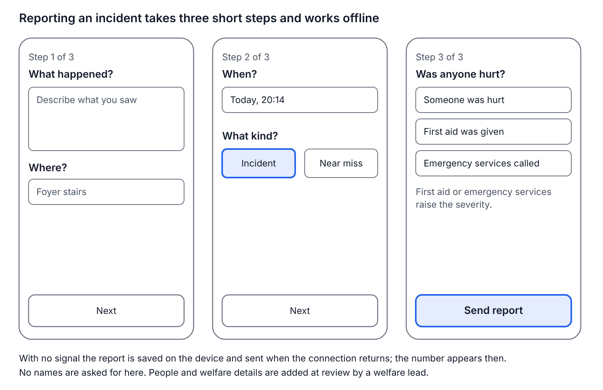

# 5. Screens

Screens are described in words in this draft, by the page types of the Interface conventions. Two wireframes are drawn, added after Matt accepted part 9 on 16 November.

## Wireframes

*Tonight, front of house section · lead's view on a phone*

Someone on shift who is not leading sees the same screen without the dashed buttons, the money figures or the arrived toggles. The numbers are sample values.

*Report an incident · three steps*

The report asks only for what makes a useful record; category, people and follow-up actions wait for review. The wireframe shows the first design: since 21 November 2026 the report is one page, described under "Live mode" below.

## Members' area

Navigation entry "Shifts", shown to anyone who holds `front-of-house.shift.sign-up` or for whom `front-of-house.rostered` holds.

| Screen | Address | Type | What it shows and does |
| --- | --- | --- | --- |
| Shifts, tab "My shifts" | `/members/front-of-house` | List | Coming shifts first, then past. Each row: performance, duty, call time, state. Total hours this year at the top |
| Shifts, tab "Open shifts" | `/members/front-of-house?view=open` | List | Published shifts with a place free, grouped by date, with "cover needed" ones first. Filters: production, duty. A shift the person is not eligible for is shown with the reason and the remedy, not hidden |
| Shift | `/members/front-of-house/shifts/[id]` | Record | Performance, venue, duty and its description, call time and end, briefing, who else is on (names only, to members, and never the viewer's own name). Primary action depends on state: "Sign up", "Withdraw", "I can't do this" (with the notice rule explained before confirming), "Take this shift" for cover, "I'm here" inside the window |

Shifts is one page with two tabs, and the tab is kept in the address. Someone with nothing coming up lands on "Open shifts"; everyone else on "My shifts". The old address `/members/front-of-house/open` redirects to the tab, so links in earlier emails still work.

Empty states say what to do: "No shifts are open yet. You'll get an email when the next rota goes up" with a link to notification choices.

## Console

Group "Front of house", in the place the conventions fix for it.

| Screen | Address | Type | What it shows and does |
| --- | --- | --- | --- |
| Rota | `/console/front-of-house/rota` | List | Performances by date with a bar per duty: places filled of places wanted. Filters: production, venue, "unfilled only". Saved views. Bulk action "Apply rota template" and "Publish". A performance in a space the theatre does not manage is marked "Not our space" and skipped by the bulk action; shifts can still be added to it from its own Rota tab |
| Performance rota | Tab "Rota" on the performance record | Record tab | Each shift with its people and their states. Add a person (search by name or email with identity's person picker, searchAccounts, eligibility shown), confirm or decline requests, approve a release, remove, change places and times. "Publish all" |
| Incidents | `/console/front-of-house/incidents` | List | Number, date, kind, severity, state, venue. Default view "Awaiting review". Filters: state, severity, category, venue, date. No free text in the list |
| Incident | `/console/front-of-house/incidents/[id]` | Record | Sections: what happened; people (welfare details behind a "Show" that is audited); actions; log. Primary action "Close"; "Change severity"; "Add action" |
| Night reports | `/console/front-of-house/night-reports` | List | Performance, state, signed off by, exceptions count, incidents count |
| Night report | Tab on the performance, and `/console/front-of-house/night-reports/[id]` | Record | Timings, figures by section, people by duty, checklists with exceptions, incidents by number (a link only for those who may open them), notes, addenda. "Sign off" while a draft; "Add addendum" after. Prints on one sheet |
| Volunteer hours | `/console/people/volunteer-hours`, in the console's People group | List | Person, shifts worked, hours, no-shows, for a date range. Export. It is about people, not about a night, so it sits with People; `/console/front-of-house/hours` redirects to it |
| Duties | `/console/front-of-house/duties` | List and Form | Name, description, lead, default call and stay, requirements (chosen from what `core.requirement` offers). Archived duties sit under a folded "Archived" divider with "Restore" |
| Rota templates | `/console/front-of-house/rota-templates` | List and Form | Name, venue, default, and lines of duty and places. Archived templates under "Archived" with "Restore" |
| Checklists | `/console/front-of-house/checklists` | List and Form | Name, moment, venue, items in order (drag, or move up and down by keyboard). An item used by a run is archived, not deleted. Archived checklists under "Archived" with "Restore" |
| Emergency cards | `/console/front-of-house/emergency-cards` | List and Form | One per venue; body, preview as it appears in live mode, "I have reviewed the whole card" |
| Settings | `/console/front-of-house/settings` | Settings | Generated from part 6 |

Archiving a duty, a rota template or a checklist asks nothing first: the toast that says it is done carries Undo, and the archived list carries "Restore" for later. Restoring brings the record back as it was, with two exceptions: a duty or template is refused while a live one holds its name (`front-of-house.duty-name-taken`, `front-of-house.template-name-taken`), and a restored template is never the default until someone makes it so again.

The incident form for a reviewer carries a standing line above each free-text box: "Write what happened, not who is to blame. Put names in People, not here."

## Live mode

Reached from the Tonight hub, the on-shift bar, or the console for a manager. With exactly one performance tonight, `/live/front-of-house` opens its board straight away; the list of performances is shown only when there is a choice to make, or none. Dark, no chrome, 48-pixel targets, the status strip of the conventions.

| Screen | Address | Type | What it shows and does |
| --- | --- | --- | --- |
| Tonight board | `/live/front-of-house/[performance]` | Live | Top: performance, time to curtain, the next timing as one large button ("Open the house"). Then tiles: People (arrived of expected, tap for the list and check-in), Checklists (done of total, exceptions in amber), Figures (contributed). There is no Incidents tile: reviewing incidents is console work, and the night's count is in the night report. "I'm here" is offered only until the person has arrived, by tapping it or by working (part 3, "Arriving once"). Foot: "Report an incident", "Emergency card". Someone leading also sees "Extend tonight" and "Night report" |
| People | `/live/front-of-house/[performance]/people` | Live | By duty: name, state, "Arrived" toggle for someone leading. Shows "not arrived" flags |
| Checklist | `/live/front-of-house/[performance]/checklists/[id]` | Live | One item per row: a large tick, "Problem" (opens reason and note), "N/A". Reading items show a number pad. Progress at the top; "Complete" when every required item has an entry. There is no "Start" step: the first answer starts the run |
| Report an incident | `/live/front-of-house/incident` | Form | One page. At the top the only thing a report must have, what happened, then incident or near miss, first aid, emergency services, "This is serious" and what was done straight away. Below, "When and where" (now, unless changed) and "Who was involved" (optional). "Send the report" stays at the foot of the screen throughout; pressed with nothing written it shows the message on the field. Then "Sent" with the number |
| Emergency card | `/live/front-of-house/emergency/[venue]` | Live | The card, large type, kept on the device |
| Night report | `/live/front-of-house/[performance]/report` | Steps | For someone leading: resolve people, review warnings, add notes, sign off |

## What each viewer meets

| Viewer | Sees |
| --- | --- |
| Member, no shift | "Shifts" in the members' area if they may sign up |
| Volunteer with a shift later today | A card on the members' home: duty, call time, briefing |
| Volunteer on shift | Tonight first in the account menu; the on-shift bar; the board without money figures or the People toggles |
| Leading the shift | The same, plus check-in, timings, extend, and the night report |
| Front-of-house manager | The console group; any performance's board at any time |
| Welfare lead | Incidents in the console, with people and welfare details |

## Offline

| Screen | Offline |
| --- | --- |
| Tonight board | Shows the last figures with their age; writes queue |
| Checklist | Fully usable; entries queue |
| Report an incident | Fully usable; the report queues and shows as saved on the device |
| Emergency card | Fully usable once opened on the device |
| Sign-off | Not offered offline: it needs the server's view of the night |

## Accessibility and wording

- State is never shown by colour alone: amber and red tiles carry a word and an icon.
- Every live-mode action is reachable by keyboard and labelled for a screen reader; the checklist announces progress.
- The words are the glossary's: duty (never role), shift, place, cover, Tonight board. On screen there is one word, Tonight (Interface's ruling of 16 November). "Tonight board" is this document's own name for the front of house section of Tonight, headed "Front of house", and is never shown to anyone. A duty manager with a standing ability and no shift can open Tonight too, without the on-shift bar.
