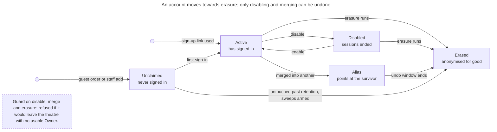
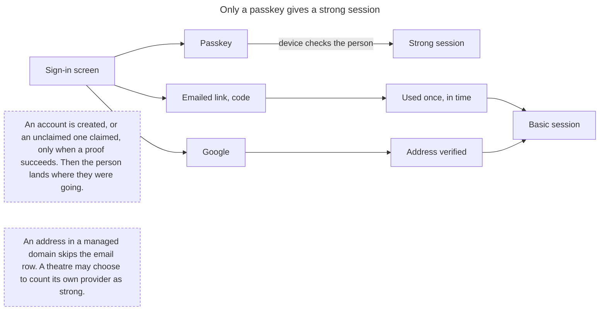
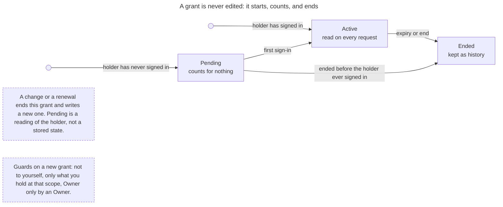
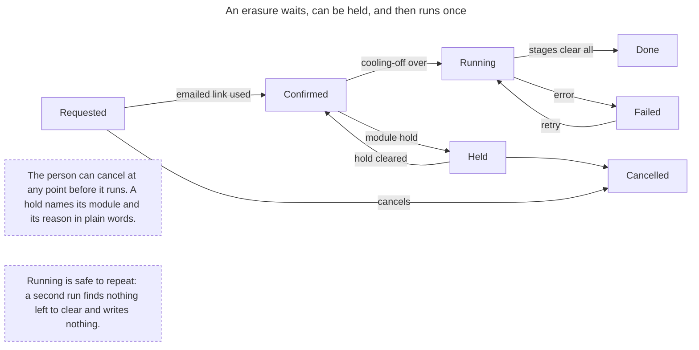

# 3. States and rules

Six records have a life cycle: the account, the address, the session, the grant, the merge and the data request. Every change below is one database batch with its audit entry inside it, and every guard is checked on the server where the write happens.

Where a rule below says a write happens once or not at all (a sign-in link used once, an account claimed, one live grant per account, role and scope, a stage of a merge), the unit learns the outcome from the kit's guard passing, never from a count of rows changed. The database's count includes rows written by triggers and search indexes, so it may be tested for being above nought and for nothing more exact.

## The account

*account life cycle · 5 states*

None of these states is stored as a status: each is read from a fact on the row, so two of them can never disagree. Undoing a merge returns an alias to active while the undo window lasts.

| Change | Who may | Guard | What happens |
| --- | --- | --- | --- |
| Created unclaimed | Guest checkout, staff adding someone, a record made by address | No account holds the address | Account and address in one batch; the unique address is the conditional write |
| Created claimed | A new person using a sign-in link, or Google | The token or the provider proved the mailbox | Account, verified address and session in one batch |
| Claimed | Whoever proves the address: a sign-in link, an invite link, or Google asserting that address | The account is unclaimed and live | `first_signed_in_at` set; address verified; pending grants become live with nothing further written |
| Disabled | Staff with the disable ability | Not their own account; never the last usable Owner | Sessions ended; sign-in refused with a plain reason; nothing deleted |
| Enabled | Staff with the disable ability | The account is disabled | Sign-in works again; sessions are not restored |
| Merged away | See Merge | See Merge | Becomes an alias of the survivor |
| Anonymised | The erasure batch, or the retention sweep | See Erasure | Becomes a tombstone, for good |

- **A disabled account keeps its tickets.** Disabling stops sign-in, not the door: a ticket bought before still admits.
- **An unclaimed account can do nothing by itself.** It has no session, receives only messages about the thing that made it (an order confirmation, an invitation), and is hidden from the directory unless searched for.
- **Nothing can be written back over a tombstone**, and a session that outlived its account ends at its next request.

## An address

| Change | Guard | What happens |
| --- | --- | --- |
| Added by the person | The address is on no account; the session was re-asserted recently | Row unverified; a verification link goes to it; nothing else is ever sent there until verified |
| Added, but another account holds it | That account is unclaimed | Verifying the link claims it: the unclaimed account is merged into the person's own, with no further step |
| Added, but another account holds it | That account is claimed | The person is offered a merge, which needs proof of both accounts (see Merge) |
| Verified | The link or code was used in time | `verified_at` set |
| Made the audience or members' address | The address is verified | The account's pointer changes; a notice goes to the old and the new address |
| Removed | Not the last verified address; not the audience address; recent re-assertion | Row deleted; notice to the removed address |
| Unverified for too long | Past the address-expiry setting | Row deleted by a sweep |

- **An** address the person added themselves and has not verified cannot be used to sign in and receives only its own verification message. The address an unclaimed account was created with is different: it receives service messages about the thing that made the account, and nothing else.
- **A managed-domain address** (a theatre's own Workspace, for instance) can be verified only by its provider. No link is ever emailed to it for sign-in.

## Signing in

*sign-in flow · 3 methods, 2 assurance levels*

Every method ends in a session, and the method decides its assurance. A basic session can do everything an audience member or ordinary member needs; privileged work asks for a passkey.

1. The screen offers a passkey first, and an address field. A browser that holds a passkey for the site offers it in the field itself.
2. An address on a managed domain is sent to that domain's provider and nowhere else.
3. Any other address is emailed a link and a six-digit code. The answer on screen is identical whether or not the address is known.
4. The link works in any browser. The code works only in the browser that asked, up to the attempt limit. Opening the link uses nothing: the landing page waits for the person to press Sign in, because mail security scanners (Microsoft 365's among them) open every link in a real browser before the person sees the email, and a link used on load would be spent, with its code, by the scanner. The landings for verifying an address and confirming an erasure wait for a press for the same reason.
5. A link or code used for an unknown address creates the account. Used for an unclaimed account, it claims it.
6. The session opens at **basic** assurance for a link, a code or an ordinary provider, and at **strong** for a passkey.
7. A person who signed in without a passkey is offered one, once, and can decline. A person who holds an ability that needs strong assurance cannot decline: they are taken to create one before the console opens.

| Rule | Statement |
| --- | --- |
| Same answer | Requesting a link never reveals whether an address has an account. The only thing the screen reveals is whether a domain is managed, which is public. |
| Single use | A token, a code and a recovery code are each spent by a conditional write. A second use is refused. |
| Disabled | A disabled account is told it is disabled and who to contact, only after it has proved the mailbox. |
| Provider match | A provider sign-in joins an existing account only when the provider states the address is verified and the address is already verified on the account, or the account is unclaimed. Otherwise the person signs in to their account first and links the provider from inside. |
| Limits | Link requests are limited per address and per network address; code attempts per token. Turnstile guards the request always, through core's bot challenge declared on the route. |

## A session

| Change | Guard | What happens |
| --- | --- | --- |
| Opened | A sign-in succeeded | Row written with the methods used and the assurance reached |
| Raised to strong | A passkey assertion inside the session; or a provider the theatre has marked as strong | `assurance` and `reasserted_at` updated; audit entry |
| Re-asserted | A passkey, or the strongest method the account has, inside the re-assertion window | `reasserted_at` updated. It is not a new sign-in. |
| Ended by the person | Their own session, or "everywhere else" | Row ended; the browser is signed out at its next request |
| Ended by staff | The revoke ability; not their own account | All of the account's sessions ended |
| Ended by the system | A sign-in method was removed, the account was disabled, merged or erased | Every session except the one that made the change is ended |
| Expired | Past `expires_at`, or unused for longer than the idle setting | Treated as ended; the sweep deletes it later |

- **Every signed-in request reads its session row.** There is no window in which an ended session still works.
- **Assurance belongs to the session, not the account.** A passkey sitting on another device proves nothing about who is using this browser.
- **Three things need a fresh re-assertion:** changing sign-in methods or addresses, any ability its module flags as sensitive, and confirming a merge or an erasure. The person is asked in place, in a dialogue, and carries on where they were.

  **How the dialogue confirms.** Any request refused as not fresh opens the dialogue where the person is and repeats the request once they have confirmed; there is no separate page. The method must be as strong as the session. A strong session confirms with a passkey, or by signing in again with the provider when that provider counts as strong; an emailed code is never offered to it, so a stolen session and a compromised mailbox together still cannot reach a sensitive action. A basic session with no passkey on the account is sent a six-digit code at the account's audience address and types it into the dialogue. The code is single-use, short-lived, tied to the session that asked, limited in attempts, and sent as a sealed variable. Confirming sets `reasserted_at` only: it never raises assurance, so a basic session stays basic.
- **What counts as fresh** is set by the re-assertion window setting.

## Recovery

| Situation | Route back |
| --- | --- |
| Lost a passkey, hold no sensitive ability | Sign in by emailed link; add a new passkey from the account page. |
| Lost every passkey, hold a sensitive ability | Use a recovery code, which opens a session good for one thing: creating a new passkey. |
| No passkey and no codes | A member of staff with the recovery ability issues a single-use enrolment link, valid for a day. Both people are notified, and it is audited. |
| The only Owner is locked out | Whoever controls the theatre's Cloudflare account sets a one-time secret on the Worker. The site then offers an owner-recovery screen that accepts it once, creates a passkey for an existing Owner, and tells every Owner. Removing the secret closes the screen. |
| Lost access to every address | Staff, having satisfied themselves who it is, add a new address on the person's behalf; it is verified in the usual way. |

Recovery codes are offered to anyone and required of nobody except Owners, who are shown them at setup and must type one back.

## A grant

*grant life cycle · 3 states*

Ending is the only change a grant row ever takes, which is what lets the history answer who could do what on any past date.

| Change | Guard | What happens |
| --- | --- | --- |
| Granted | The granter holds the grant-management ability at that scope or wider | Row written; the holder is told |
|  | The granter is not the holder | Refused: nobody grants themselves a role |
|  | The granter holds every ability in the role, at that scope | Refused otherwise: you can give only what you have |
|  | The role needs a managed identity and the account has one | Refused otherwise, naming what is missing |
|  | The session is strong and freshly re-asserted | The dialogue asks for it |
| Granted to an address with no account | As above, plus the ability to add accounts | An unclaimed account, the grant and both audit entries in one batch; an invitation is sent |
| Pending becomes live | The account is claimed | Nothing is written. Pending is a reading, not a state. |
| Lapses | `expires_at` passes | Nothing is written. The holder and the granter's role are warned beforehand. |
| Renewed | Same guards as granting | The old row ends as replaced; a new row starts |
| Ended | The grant-management ability at that scope; or the holder giving it up | `ended_` columns set |
| Any change that would leave no usable Owner |  | Refused. Usable means claimed, enabled, holding a passkey, and the grant live. |

- **A pending grant is not held by anybody.** It is listed apart, never counted as a holder, and never satisfies the last-Owner guard.
- **A role's abilities can be edited at any time**, and the change applies to every holder at once. Adding an ability to a role needs the editor to hold that ability.
- **Archiving a role** ends its live grants as role\_archived.

## How authority is worked out

One function answers every "may this person do this?" in the platform. It takes the actor, an ability and, where there is one, the record acted on.

1. **No session, or an ended one:** no.
2. **Assurance:** if the ability needs strong and the session is basic, the answer is "not yet", with the reason "use your passkey". When the account has no way to sign in strongly at all (no passkey, and no authenticator app where the theatre accepts one), there is nothing stronger to ask for, so the answer says that instead: `core.access.two-step-not-set-up`, "This needs two-step sign-in", with the same status. It is never "You do not have permission": a route that makes its own check and would answer `core.access.denied` answers the sign-in refusal when that was what stood in the way. Every screen that shows the refusal offers "Set it up", which opens Sign-in in My account; an act refused this way says so in a dialogue over the page; and the console and Admin say it before the person tries, with "Set it up" or, where a passkey exists and was not used, "Confirm it is you" (Matt, 21 November 2026).
3. **Owner:** a live Owner grant answers yes.
4. **Grants:** a live grant of a role holding the ability answers yes if its scope covers the target. Site covers everything; module covers that module's records; record covers that record and what its module says hangs off it.
5. **Derived authority:** each source a module registered is asked. A source answers from a fact in its own tables: tonight's confirmed shift, a current training record, a place on a production's team.
6. **Ownership:** where the ability's entry says the record's owner holds it, the owner does.
7. **Otherwise no**, and the refusal carries what would have allowed it.
8. **Freshness:** if the ability needs a fresh re-assertion and the session has none, the answer is "confirm it is you".

- **The same function draws the interface.** A button is shown when the function says yes or "not yet", and hidden when it says no.
- **Self-dealing is a separate check at the write.** An approval names whose record it is, and the function refuses when that person is the actor, whatever they hold.
- **Acting for somebody is the actor's authority, not the subject's.** The write records both people.
- **An override is recorded when it acts.** A source can mark its answer as an override; the audit entry is written by the write that relied on it.

## The two experiences

| Question | Answer | Read from |
| --- | --- | --- |
| Does this person get the audience experience? | Always | Nothing |
| Does this person see the members' area? | When they have at least one standing | A live grant of a role marked as opening the members' area; or any standing source a module registered (a current membership, a confirmed shift, a place on a production) |
| Does this person see the console? | When the resolver says yes to at least one ability that belongs to a console screen | The navigation entries each module declares |
| Is the members' area switched on at all? | The members' area setting | A theatre with paid staff and no members turns it off; the console still works |

These rules keep the two sides apart, and each is a test in the test plan.

1. **Signing up asks for a name and an address, and nothing else.** No member question appears on any audience screen.
2. **A person with no standing is never sent a members' navigation entry**, in the page or in any response that describes them.
3. **A person with a standing sees exactly one extra entry** on the public site: the members' area, under the theatre's own name for it.
4. **A members' address that somebody without a standing opens** answers exactly as a missing page does, and no link is offered.
5. **Standing is read at the request.** When the last standing ends, the members' area is gone at the next page load, and nothing on the audience side changes.
6. **Member benefits reach the audience side as answers, not as navigation.** A member sees a member price because box office called requirements.check, not because they switched mode.
7. **Each side has its own address and its own consent.** A members' notice is never sent on the strength of audience consent, or the reverse.
8. **Staff see a person through the side their ability belongs to.** A box-office ability shows orders and the audience address; a training ability shows records and the members' address. Neither shows the other's.

## Merge

A merge joins two accounts that are one person. The survivor keeps its id; the merged-away account becomes an alias. A merge happens in two stages, because the rows to move grow with every module and one unit of work has a limit on its statements (`core.units.statement-limit`). The first stage settles who the person is, at once. The second moves rows in the background, and nobody has to wait for it.

| Started by | Proof needed |
| --- | --- |
| A claim | The person verified an address that an unclaimed account holds. Nothing more. |
| The person | A strong, fresh session on one account, and a confirmation link used from the other account's verified address. |
| Staff | The merge ability, a strong and fresh session, and a preview that both accounts' rows are counted on. |

1. **Refuse first.** If either account is a tombstone, is already an alias, or is the actor's own (for staff), nothing is written.
2. **Preview.** The screen shows, per module, how many rows will move and which conflicts were settled how.
3. **Stage one: settle, in one unit.** The merge is recorded, addresses and sign-in methods move, the merged-away account's sessions end, and it gains `merged_into_id`. Only identity's own tables are touched, so the size of this unit never grows with the modules installed. From this commit every read resolves the merged-away account to the survivor, the person signs in as the survivor, and the merge is announced.
4. **Stage two: move, by a job.** The job `core.merge-move` takes the modules in registry order. Each module's `move` columns are re-pointed in that module's own units of work, and each `handler` runs in a unit of its own. A unit lists the rows it is about to move in the merge's items and then moves them, so the record and the move commit together. Every statement is safe to repeat: it moves only rows still pointing at the merged-away account, and lists a row only once. A job that fails is run again from the start and does no harm. When every module is done, a last unit sets `completed_at`. A merge still moving after an hour is picked up by the daily sweep and shown as "still moving" under Merges, where staff can run it again.
5. **Tell both.** Every verified address on both accounts is told, with a link to report a mistake.
6. **Undo.** Until `undo_until` (counted from stage one), and once the merge is complete, staff can reverse it, in the opposite order. First `undo_started_at` is set and the same job moves the listed rows back, module by module, while the alias still stands, so readers see no change. A last unit then clears the alias, returns the addresses and sign-in methods, and marks the merge undone; that is the moment the two accounts part. Rows created since the merge stay with the survivor.
7. **Close.** When the window passes on a complete merge, the items are deleted and the merged-away account's row is anonymised. It stays an alias for ever, so append-only history still resolves. A merge that is not complete is never closed.

- **Which account wins:** the one the person is signed in to; for staff, the claimed one; if both are claimed, the older.
- **The survivor's values win** for name, phone and the two address pointers. Nothing is blended.
- **The merge asserts its own completeness.** Each module's last unit checks that none of that module's `move` columns still points at the merged-away account, and fails otherwise. `completed_at` is set only after every module has passed.

  **What a reader sees while rows are moving: the whole person, already.** Every read of rows by account, and every condition on a statement that counts or claims by account, uses the kit's account scope: the survivor and every account that is an alias of it, written as a subquery. A row not yet moved is therefore found exactly as an `alias` row is, and a limit per person counts both accounts' rows from stage one. Every new write names the survivor. Nothing on a screen tells the person a merge is in progress, because nothing is missing.

  **An alias always points at the final survivor.** `merged_into_id` is indexed and never forms a chain. When an account that already has aliases is itself merged away, stage one re-points those aliases at the new survivor in the same unit and lists them in the merge's items, so an undo's last unit returns them. The account scope is therefore one level deep. Each `move` column takes two statements whatever the number of rows (one lists the rows, one rewrites them, and the closing check is a guard on the statement), so a module is split across units only when its count of `move` columns passes the limit. A module that declares no `onMerge` for a column means `alias`, and the kit's check asks for a one-line reason beside every `move`.

  **Within a module, handlers run before its moves.** Stage one touches identity's tables only, so a handler finds its module's rows exactly as they were before the merge, each still carrying the id of the account that owned it, and is given both ids. Only when all of a module's handlers have finished are its `move` columns re-pointed. A handler may answer "not yet" when a row is in the middle of something (a payment in hand, say): that module's handlers and moves wait, the job carries on with the other modules and comes back with a growing pause, and the merge stays "still moving" without having failed. Nothing is wrong for readers meanwhile, because the alias stands. A handler whose change cannot be reversed by putting listed values back, such as a total that has since grown, supplies its own undo statements, under the same rules: one unit, safe to repeat.

  In the kit's words: a handler that must wait answers with `job.defer(code)`. A deferral is counted in `core_jobs.deferrals`, is not a failed attempt and never makes the job dead. A merge still waiting after a day raises a health warning that names the module, so a stuck merge is seen by somebody. A handler lists a row it sets aside with `onClose` of `delete` (the default) or `keep`, which gives the item kinds `set-aside` and `set-aside-keep`. A handler's undo answers `{ notRestored, reason }`: how many things could not be put back and a fixed reason code, which is the count the Merges screen and the audit entry show.

  An undo runs each module's steps in the exact reverse order: its `move` columns are pointed back first, and its handlers' undo statements run after. A handler's undo therefore finds each row back with the account that first owned it, and a rule of one row per person is never broken on the way.

  **What a handler owes on undo.** An undo gives each account back what it held at the merge, so far as that still exists. It never reverses anything that has happened since, and it never leaves a person less protected than they chose to be. Four rules follow.
  - **Set aside, do not delete.** A row a handler removes from use because both accounts had one (a second application, a second response, a clashing place) is marked as set aside by the merge and kept until the undo window closes. At the close the module decides what becomes of it: deleted, which is the usual answer, or kept under the module's own retention where the row is a record in its own right, such as a submitted form response. On undo it goes back to the account it came from, in the state it had.
  - **The stricter choice stands.** An unsubscribe, a withdrawal of consent, a suppression or a block that the merge carried from one account to the other stays on both after an undo, as does any made since. Consent history is append-only: an undo writes a new entry and removes none.
  - **Nothing is taken back from somebody else.** If a place, a shift or a seat the handler freed has since gone to another person, or its date has passed, it is not restored. Money paid and messages sent stand.
  - **Say what could not be put back.** A handler's undo returns a count, with a reason, of what stood. Staff see it on the Merges screen before they confirm the undo and after it, it is in the audit entry, and both people are told.

  A module may let convenience data of no consequence stand, such as display preferences, if its specification says so. Anything else that is to stand must be named in the module's specification and shown in the merge preview.

  **`alias` is the default; `move` must be earned.** A column is declared `move` only where the stored id itself has to be the survivor's: it is part of a unique rule (one row per person), or the row is the person's own living record that other tables key to. Everything else is `alias`: who did something (sold by, approved by, written by), and every reference in an append-only table, which cannot be updated in any case. Where both accounts may hold a row that a unique rule allows once, the column is `handler`, and the handler says which row stays. Room under the statement limit is never a reason to choose one over the other.

## Export and erasure

*erasure request · 7 states*

An export request uses the same row and the same path without the cooling-off or the holds.

| Change | Guard | What happens |
| --- | --- | --- |
| Export requested | The person, freshly re-asserted; or staff with the data-request ability | A queued job gathers every row the registry classes as theirs into one file, held privately; the person is sent a link that needs sign-in |
| Erasure requested | The same | State requested; a confirmation link goes to the audience address |
| Confirmed | The link was used | Cooling-off starts; `not_before` set; the person can still cancel from their account or from the email |
| Held | A module raised a hold | State held, with the hold codes shown to staff and a plain explanation to the person |
| Run | Cooling-off over; no holds | A chain of stages, each one unit of work inside the statement limit: first the account is locked (disabled, sessions and live grants ended); then each module's erasure handler; then every reference handled as declared, a share at a time; last, addresses deleted and `anonymised_at` set |
| Cancelled | Before the run starts | State cancelled; nothing else changes |

- **Holds are declared by modules, never improvised.** Examples other workstreams are expected to register: money still owed either way, a ticket for a performance not yet over, an open incident the person is named in, the last usable Owner.
- **A hold delays, it does not refuse.** The request stays open, staff see why, and it runs when the hold clears. `respond_by` is shown on the queue so a held request cannot be forgotten.
- **Erasure is anonymisation.** Sales, attendance and safety records stay as rows about nobody.
- **Free text about the person in other people's records** is each module's to declare. Identity's own tables hold none.
- **Erasure runs in stages, and is all or nothing to the person.** One batch would grow with every module that holds personal data, and a unit of work has a fixed statement limit, so the run is a chain of jobs, each one unit. The first stage locks the account, so the person is out from that moment and cannot sign in; the last makes the tombstone and takes the lock off. Rows still reached by the plan when the last stage starts (written while the run went on) send the run round again, up to three passes. A run whose job died part-way is started again by the hourly review. Staff cannot enable or merge an account while it is being erased.
- **The run asserts its own completeness**, as merge does: each share checks its own tables, and the last stage's last statement checks that nothing the plan reaches is still set.
- **A second run is harmless.** Every stage only touches what is still there to erase, and erasing a tombstone succeeds and changes nothing, so a retried job never fails for having worked.
- **Earlier states of the database.** The platform takes no backups of its own (decided by Matt, 16 November 2026). Cloudflare keeps its own history of the database, which holds earlier states for up to 30 days and then ages out. If a theatre ever restores its database from that history, every erasure completed after the restore point must be run again. This is a known limit: the erasure record in `core_data_requests` holds no personal data but lives in the same database, so a restore also loses the record of those erasures. Before restoring, the theatre must note the account ids of erasures completed since the restore point from the data-request queue, and run them again afterwards. The privacy page says this.

## Emergency contacts

Members' side only. An audience member never sees the words, and has nothing stored.

| Matter | Rule |
| --- | --- |
| Who can hold them | An account with a standing. Up to three contacts: a name, a phone number and an optional relationship. They are optional; a module that needs one before an activity asks through `core.requirement`. |
| Where the person edits them | "Member details" in the members' area. Without a standing the screen answers as a missing page and the write is refused on the server. |
| What the person confirms | That they have told the contact their details are held here. The screen asks them to check the details when a year has passed since the last change. |
| Who may read them | Somebody holding `core.emergency-contact.read` over that account: the welfare lead by role, and whoever the theatre maps the ability to by fact, such as the person leading tonight's shift (front of house's fact front-of-house.leading-shift on a performance), which the theatre must confirm because the ability is privileged. Nobody holds it by default except the welfare lead. An Owner does not hold it by being an Owner. |
| How a read happens | One person at a time, from that person's page, after choosing a reason from a fixed list (an emergency now, an incident, a welfare follow-up, a check before an activity). Strong session; no fresh check, so an emergency is not slowed. There is no list of contacts for a team or a night. |
| What a read leaves | An audit entry of kind read with the reader, the reason code and what allowed it. The person sees every read in "Member details": when, in what capacity, and why. |
| When the last standing ends | Reads stop at once, because the person is no longer on the members' side. The rows are kept for `core.emergency-contacts.keep-after-standing` (30 days) so a gap between two memberships loses nothing, then deleted by the daily sweep. |
| Class and storage | Personal, about a third person. Plain columns, not a special column. |
| Download, merge, erasure | In the person's own download. Rows move on merge. Deleted in the erasure batch. |

## The access scheme

A person's access needs are held because they applied to the theatre's access scheme and the theatre accepted them (Matt, 16 November 2026). It is audience side, open to anybody with an account, member or not, and it is its own part of the core, not a switchable module. There is no ticking of needs at checkout: a buyer who is not on the scheme books as anybody does, and the checkout points to the scheme.

### Applying

| Matter | Rule |
| --- | --- |
| Where it starts | The theatre's public page `/access` says how the theatre supports people and carries an "Apply" button. The same button is in My account. Both lead to the application form, which needs a signed-in account; a person without one signs in or signs up on the way and lands back on the form. |
| Asking by email or phone | Staff who run the scheme use "Invite to apply": they give a name and address, the platform finds or makes the account and emails a single-use link that signs the person in and opens the form. |
| When a person cannot use the form | Staff may fill it in for them, by phone or in person. The application is marked as made by staff, and the person is told at their address and can correct it. |
| What the form asks | Ticks against the vocabulary `core.access-need`, each with an optional note of up to 200 characters; how many essential companions they need (none, one or two); and anything else the theatre should know. Barriers, never diagnoses. No document is uploaded. |
| What applying agrees to | That the people who run the scheme may read the application, and that the box office may use it for the person's bookings. Other uses stay off until the person switches them on (see Sharing). |

### Deciding

| State | Meaning | Who moves it on |
| --- | --- | --- |
| Submitted | Waiting for the theatre | A reviewer accepts, rejects or asks for more |
| More information asked | The reviewer has written to the person with a question | The person answers, which makes it Submitted again, or withdraws |
| Accepted | The person is on the scheme and can book with their arrangements, including companion tickets up to the number accepted | A reviewer may later mark it verified, or end it; the person may change or withdraw it |
| Rejected | Not accepted, with a reason the person is given | The person may apply again |
| Withdrawn | The person left the scheme; the needs are deleted | The person may apply again |

- **Accepted is enough to book.** Verified is a separate mark on an accepted application, not a further state.
- **Verified** means a reviewer has seen evidence, in person: a Nimbus Access Card, another document, or the theatre's own knowledge of the person. The platform records which of those, when and by whom, and stores no copy and no card number. A theatre that wants free companion tickets to wait for it turns on `core.access-scheme.companions-need-verified`; by default accepted is enough.
- **A reviewer** holds `core.access-scheme.review`. They may accept fewer companions than were asked for, and say why. They cannot review their own application.
- **Every decision tells the person**, by email and in My account, in plain words. A rejection or a request for more carries the reviewer's message.
- **Changing an accepted application** sends the change for review. What was accepted stays in force until the change is decided, so nobody loses their arrangements by correcting a detail.
- **Review date.** An accepted application is looked at again after `core.access-scheme.review-after` (three years by default): the person is asked to confirm it is still right. Nothing lapses without a person deciding.
- **Nothing is public.** No screen, search or list shows that a person is on the scheme, except to a reviewer and to staff reading for a purpose below.

### Storage and sharing

| Matter | Rule |
| --- | --- |
| What is stored | The application: ticks against the core vocabulary `core.access-need`, each with an optional note, and the number of essential companions. The vocabulary describes barriers, never diagnoses, and a theatre can edit it. Each entry has a short label naming the barrier and a one-line description in plain words, shown under it on the form. It is seeded with nine entries, in our own wording: standing or queueing, crowds and busy spaces, steps and stairs, walking distances, getting to a toilet quickly, hearing what is said (information shown or written), seeing or reading information (information read out or described), needs a companion to help, and something else. The categories follow those of the Nimbus Access Card (see Sources); no Nimbus wording or symbols are used. A record stores the entry's id, never its label. |
| Class and storage | Special category, because a need can reveal health. One special column under `CORE_ENCRYPTION_KEY`. It cannot be searched, filtered or listed. |
| Who writes it | The person, through the application form, or staff on their behalf as above. An unclaimed account has none until its owner signs in. |
| Who it is shared with | The scheme's reviewers and the box office purpose `box-office.booking`, which applying agrees to and the form says so. Every other purpose is off until the person switches it on. Each purpose is declared by a module through `core.access-purpose`, with a plain sentence saying who will see the needs and why. An audience member sees audience purposes only, and a members' purpose appears only while they have a standing. In the first release the only members' purpose is the welfare lead's; production teams do not read access needs (Matt, 16 November 2026). |
| What a purpose receives | Only the vocabulary entries it declared it uses, and the note only if it declared that. A course does not learn where somebody likes to sit. |
| How a module reads | Through one service, `accessNeedsFor(actor, accountId, purpose, record?)`. It answers only when the person has switched that purpose on, the purpose's module is enabled, and the actor holds the ability the purpose names. Otherwise it answers nothing, and does not say which test failed. |
| The person's own use | The person reading their own accepted application, for example at checkout so that the companion tickets they are entitled to are offered, needs no switch: it is their own record. |
| What a read leaves | An audit entry of kind read with the reader, the purpose and the record. The person sees every read by staff in "Access needs". |
| Copies | A module that must honour a need later, such as a booking, copies what it received onto its own record at that moment, declares that column special category with its own retention, and no longer depends on the profile. Changing or clearing the profile does not change a booking already made, and the screen says so. |
| Switching a purpose off | Stops further reads at once. It does not withdraw copies already on a booking; the person changes those on the booking. The box office purpose cannot be switched off while on the scheme; leaving the scheme withdraws the application. |
| Download, merge, erasure | In the person's own download with the decisions made and their sharing choices. On merge the survivor's application stays; if only the merged-away account has one, it moves. Deleted in the erasure batch, with the choices. A rejected application is deleted `core.access-scheme.keep-rejected` after the decision (90 days), and a withdrawn one at once. |

The nine seeded entries have the keys `standing`, `crowds`, `level-access`, `distance`, `urgent-toilet`, `essential-companion`, `visual-information`, `audible-information` and `other`. Two more are seeded for box office and front of house, outside the Access Card's categories: `wheelchair-stays` (uses a wheelchair and stays in it) and `wheelchair-transfers` (uses a wheelchair and transfers to a seat). They allocate nothing; they tell the house team whether a space is needed or a chair needs storing.

**How the form asks** (Matt, 17 November 2026). Seven entries are tick boxes. The other four are asked in the form's own words and stored as entries, so a purpose reads them like any other:

- **Wheelchair.** A separate tick box, "I use a wheelchair", outside the list. Once ticked, it asks "At a performance, would you rather: stay in my wheelchair, or move to a seat", one answer, stored as `wheelchair-stays` or `wheelchair-transfers`. An application holds at most one of the two; both together are refused. It is a question of its own rather than a follow-up to standing or distance, because many people who find standing or walking hard do not use a wheelchair, and a wheelchair user may tick neither. If a theatre retires one of the two, the tick box alone means the other; if it retires both, the question is not asked.
- **Companion.** `essential-companion` is set by the server whenever the person asks for one or two companions, so the list does not ask the same thing twice.
- **Something else.** `other` is set by the server whenever "Anything else" has text.

The server only adds these two; it never removes an entry the person sent. Leaving the companions at none, or "Anything else" empty, on a later change leaves them out because the form no longer sends them. Labels and descriptions changed after release reach a theatre's existing list only where it has not renamed the entry (migration `access-need-wording`).

Four limits, agreed with box office:

- **Being on the scheme reserves nothing.** Level access is not a wheelchair space: a space is a ticket with its own capacity, booked through box office. Box office decides which ticket types ask for the scheme, through `core.requirement`.
- **Only an accepted application is read.** A module's read answers nothing while an application is submitted, rejected or withdrawn, exactly as it does for a person who never applied.
- **A sale with no person holds no needs.** An order with no account never carries access needs. A buyer who has not signed in is not on the scheme for that order; the checkout says how to apply.
- **Needs travel as data only where they are protected.** No entry or note goes into an event, a job payload or a log, in identity or in any module that reads them. Figures passed between modules are counts per need with no names.

## Retention of unused accounts

| Sweep | Acts on | Default |
| --- | --- | --- |
| Unclaimed | An unclaimed account with no order, record, grant or booking newer than the setting core.retention.unclaimed-after | Off until armed |
| Dormant | A claimed account with no sign-in and no activity for the dormant-days setting, after two warnings | Off until armed |
| Tokens, challenges, ended sessions | Rows past their time | Always on |

A sweep that anonymises accounts ships computing what it would do and reporting the count. An Owner arms it, the arming is audited, and each run is capped. People with a standing, a live grant or an erasure hold are never swept.
