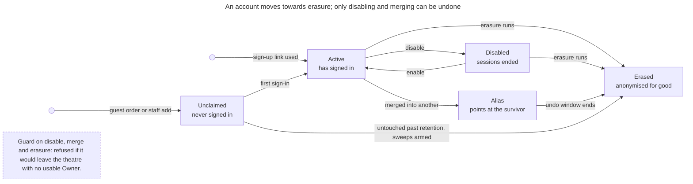
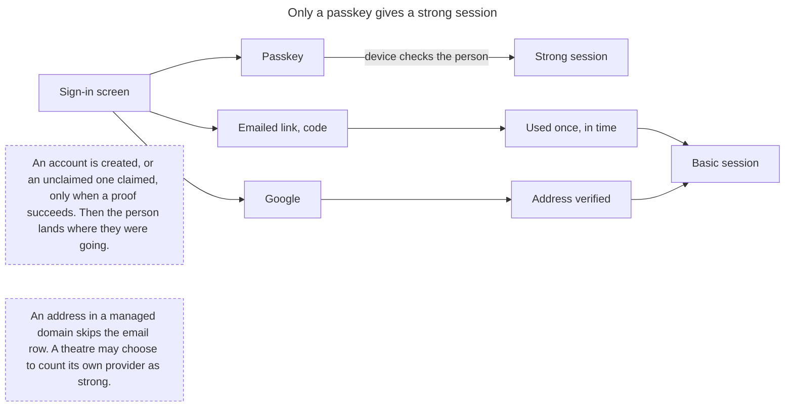
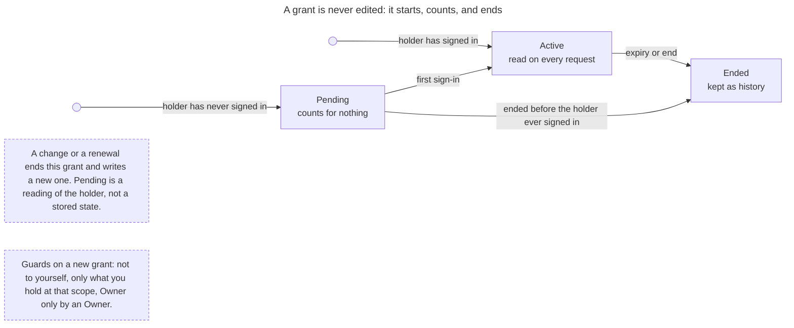
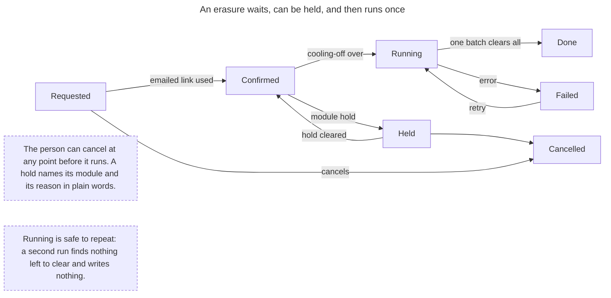

# 3. States and rules

Six records have a life cycle: the account, the address, the session, the grant, the merge and the data request. Every change below is one database batch with its audit entry inside it, and every guard is checked on the server where the write happens.

## The account

*account life cycle · 5 states*

None of these states is stored as a status: each is read from a fact on the row, so two of them can never disagree. Undoing a merge returns an alias to active while the undo window lasts.

| Change | Who may | Guard | What happens |
| --- | --- | --- | --- |
| Created unclaimed | Guest checkout, staff adding someone, a record made by address | No account holds the address | Account and address in one batch; the unique address is the conditional write |
| Created claimed | A new person using a sign-in link, or Google | The token or the provider proved the mailbox | Account, verified address and session in one batch |
| Claimed | Whoever proves the address: a sign-in link, an invite link, or Google asserting that address | The account is unclaimed and live | `first_signed_in_at` set; address verified; pending grants become live with nothing further written |
| Disabled | Staff with the disable ability | Not their own account; never the last usable Owner | Sessions ended; sign-in refused with a plain reason; nothing deleted |
| Enabled | Staff with the disable ability | The account is disabled | Sign-in works again; sessions are not restored |
| Merged away | See Merge | See Merge | Becomes an alias of the survivor |
| Anonymised | The erasure batch, or the retention sweep | See Erasure | Becomes a tombstone, for good |

- **A disabled account keeps its tickets.** Disabling stops sign-in, not the door: a ticket bought before still admits.
- **An unclaimed account can do nothing by itself.** It has no session, receives only messages about the thing that made it (an order confirmation, an invitation), and is hidden from the directory unless searched for.
- **Nothing can be written back over a tombstone**, and a session that outlived its account ends at its next request.

## An address

| Change | Guard | What happens |
| --- | --- | --- |
| Added by the person | The address is on no account; the session was re-asserted recently | Row unverified; a verification link goes to it; nothing else is ever sent there until verified |
| Added, but another account holds it | That account is unclaimed | Verifying the link claims it: the unclaimed account is merged into the person's own, with no further step |
| Added, but another account holds it | That account is claimed | The person is offered a merge, which needs proof of both accounts (see Merge) |
| Verified | The link or code was used in time | `verified_at` set |
| Made the audience or members' address | The address is verified | The account's pointer changes; a notice goes to the old and the new address |
| Removed | Not the last verified address; not the audience address; recent re-assertion | Row deleted; notice to the removed address |
| Unverified for too long | Past the address-expiry setting | Row deleted by a sweep |

- **An** address the person added themselves and has not verified cannot be used to sign in and receives only its own verification message. The address an unclaimed account was created with is different: it receives service messages about the thing that made the account, and nothing else.
- **A managed-domain address** (a theatre's own Workspace, for instance) can be verified only by its provider. No link is ever emailed to it for sign-in.

## Signing in

*sign-in flow · 3 methods, 2 assurance levels*

Every method ends in a session, and the method decides its assurance. A basic session can do everything an audience member or ordinary member needs; privileged work asks for a passkey.

1. The screen offers a passkey first, and an address field. A browser that holds a passkey for the site offers it in the field itself.
2. An address on a managed domain is sent to that domain's provider and nowhere else.
3. Any other address is emailed a link and a six-digit code. The answer on screen is identical whether or not the address is known.
4. The link works in any browser. The code works only in the browser that asked, up to the attempt limit.
5. A link or code used for an unknown address creates the account. Used for an unclaimed account, it claims it.
6. The session opens at **basic** assurance for a link, a code or an ordinary provider, and at **strong** for a passkey.
7. A person who signed in without a passkey is offered one, once, and can decline. A person who holds an ability that needs strong assurance cannot decline: they are taken to create one before the console opens.

| Rule | Statement |
| --- | --- |
| Same answer | Requesting a link never reveals whether an address has an account. The only thing the screen reveals is whether a domain is managed, which is public. |
| Single use | A token, a code and a recovery code are each spent by a conditional write. A second use is refused. |
| Disabled | A disabled account is told it is disabled and who to contact, only after it has proved the mailbox. |
| Provider match | A provider sign-in joins an existing account only when the provider states the address is verified and the address is already verified on the account, or the account is unclaimed. Otherwise the person signs in to their account first and links the provider from inside. |
| Limits | Link requests are limited per address and per network address; code attempts per token. Turnstile guards the request always, through core's bot challenge declared on the route. |

## A session

| Change | Guard | What happens |
| --- | --- | --- |
| Opened | A sign-in succeeded | Row written with the methods used and the assurance reached |
| Raised to strong | A passkey assertion inside the session; or a provider the theatre has marked as strong | `assurance` and `reasserted_at` updated; audit entry |
| Re-asserted | A passkey, or the strongest method the account has, inside the re-assertion window | `reasserted_at` updated. It is not a new sign-in. |
| Ended by the person | Their own session, or "everywhere else" | Row ended; the browser is signed out at its next request |
| Ended by staff | The revoke ability; not their own account | All of the account's sessions ended |
| Ended by the system | A sign-in method was removed, the account was disabled, merged or erased | Every session except the one that made the change is ended |
| Expired | Past `expires_at`, or unused for longer than the idle setting | Treated as ended; the sweep deletes it later |

- **Every signed-in request reads its session row.** There is no window in which an ended session still works.
- **Assurance belongs to the session, not the account.** A passkey sitting on another device proves nothing about who is using this browser.
- **Three things need a fresh re-assertion:** changing sign-in methods or addresses, any ability its module flags as sensitive, and confirming a merge or an erasure. The person is asked in place, in a dialogue, and carries on where they were.
- **What counts as fresh** is set by the re-assertion window setting.

## Recovery

| Situation | Route back |
| --- | --- |
| Lost a passkey, hold no sensitive ability | Sign in by emailed link; add a new passkey from the account page. |
| Lost every passkey, hold a sensitive ability | Use a recovery code, which opens a session good for one thing: creating a new passkey. |
| No passkey and no codes | A member of staff with the recovery ability issues a single-use enrolment link, valid for a day. Both people are notified, and it is audited. |
| The only Owner is locked out | Whoever controls the theatre's Cloudflare account sets a one-time secret on the Worker. The site then offers an owner-recovery screen that accepts it once, creates a passkey for an existing Owner, and tells every Owner. Removing the secret closes the screen. |
| Lost access to every address | Staff, having satisfied themselves who it is, add a new address on the person's behalf; it is verified in the usual way. |

Recovery codes are offered to anyone and required of nobody except Owners, who are shown them at setup and must type one back.

## A grant

*grant life cycle · 3 states*

Ending is the only change a grant row ever takes, which is what lets the history answer who could do what on any past date.

| Change | Guard | What happens |
| --- | --- | --- |
| Granted | The granter holds the grant-management ability at that scope or wider | Row written; the holder is told |
|  | The granter is not the holder | Refused: nobody grants themselves a role |
|  | The granter holds every ability in the role, at that scope | Refused otherwise: you can give only what you have |
|  | The role needs a managed identity and the account has one | Refused otherwise, naming what is missing |
|  | The session is strong and freshly re-asserted | The dialogue asks for it |
| Granted to an address with no account | As above, plus the ability to add accounts | An unclaimed account, the grant and both audit entries in one batch; an invitation is sent |
| Pending becomes live | The account is claimed | Nothing is written. Pending is a reading, not a state. |
| Lapses | `expires_at` passes | Nothing is written. The holder and the granter's role are warned beforehand. |
| Renewed | Same guards as granting | The old row ends as replaced; a new row starts |
| Ended | The grant-management ability at that scope; or the holder giving it up | `ended_` columns set |
| Any change that would leave no usable Owner |  | Refused. Usable means claimed, enabled, holding a passkey, and the grant live. |

- **A pending grant is not held by anybody.** It is listed apart, never counted as a holder, and never satisfies the last-Owner guard.
- **A role's abilities can be edited at any time**, and the change applies to every holder at once. Adding an ability to a role needs the editor to hold that ability.
- **Archiving a role** ends its live grants as role\_archived.

## How authority is worked out

One function answers every "may this person do this?" in the platform. It takes the actor, an ability and, where there is one, the record acted on.

1. **No session, or an ended one:** no.
2. **Assurance:** if the ability needs strong and the session is basic, the answer is "not yet", with the reason "use your passkey".
3. **Owner:** a live Owner grant answers yes.
4. **Grants:** a live grant of a role holding the ability answers yes if its scope covers the target. Site covers everything; module covers that module's records; record covers that record and what its module says hangs off it.
5. **Derived authority:** each source a module registered is asked. A source answers from a fact in its own tables: tonight's confirmed shift, a current training record, a place on a production's team.
6. **Ownership:** where the ability's entry says the record's owner holds it, the owner does.
7. **Otherwise no**, and the refusal carries what would have allowed it.
8. **Freshness:** if the ability needs a fresh re-assertion and the session has none, the answer is "confirm it is you".

- **The same function draws the interface.** A button is shown when the function says yes or "not yet", and hidden when it says no.
- **Self-dealing is a separate check at the write.** An approval names whose record it is, and the function refuses when that person is the actor, whatever they hold.
- **Acting for somebody is the actor's authority, not the subject's.** The write records both people.
- **An override is recorded when it acts.** A source can mark its answer as an override; the audit entry is written by the write that relied on it.

## The two experiences

| Question | Answer | Read from |
| --- | --- | --- |
| Does this person get the audience experience? | Always | Nothing |
| Does this person see the members' area? | When they have at least one standing | A live grant of a role marked as opening the members' area; or any standing source a module registered (a current membership, a confirmed shift, a place on a production) |
| Does this person see the console? | When the resolver says yes to at least one ability that belongs to a console screen | The navigation entries each module declares |
| Is the members' area switched on at all? | The members' area setting | A theatre with paid staff and no members turns it off; the console still works |

These rules keep the two sides apart, and each is a test in the test plan.

1. **Signing up asks for a name and an address, and nothing else.** No member question appears on any audience screen.
2. **A person with no standing is never sent a members' navigation entry**, in the page or in any response that describes them.
3. **A person with a standing sees exactly one extra entry** on the public site: the members' area, under the theatre's own name for it.
4. **A members' address that somebody without a standing opens** answers exactly as a missing page does, and no link is offered.
5. **Standing is read at the request.** When the last standing ends, the members' area is gone at the next page load, and nothing on the audience side changes.
6. **Member benefits reach the audience side as answers, not as navigation.** A member sees a member price because box office called requirements.check, not because they switched mode.
7. **Each side has its own address and its own consent.** A members' notice is never sent on the strength of audience consent, or the reverse.
8. **Staff see a person through the side their ability belongs to.** A box-office ability shows orders and the audience address; a training ability shows records and the members' address. Neither shows the other's.

## Merge

A merge joins two accounts that are one person. The survivor keeps its id; the merged-away account becomes an alias.

| Started by | Proof needed |
| --- | --- |
| A claim | The person verified an address that an unclaimed account holds. Nothing more. |
| The person | A strong, fresh session on one account, and a confirmation link used from the other account's verified address. |
| Staff | The merge ability, a strong and fresh session, and a preview that both accounts' rows are counted on. |

1. **Refuse first.** If either account is a tombstone, is already an alias, or is the actor's own (for staff), nothing is written.
2. **Preview.** The screen shows, per module, how many rows will move and which conflicts were settled how.
3. **One batch.** Every `move` reference is re-pointed, every `handler` supplies its statements, addresses and sign-in methods move, the merged-away account's sessions end, and it gains `merged_into_id`.
4. **Record.** Each moved row is listed in the merge's items, in the same batch.
5. **Tell both.** Every verified address on both accounts is told, with a link to report a mistake.
6. **Undo.** Until `undo_until`, staff can reverse it: the listed rows move back and the alias is cleared. Rows created since stay with the survivor.
7. **Close.** When the window passes, the items are deleted and the merged-away account's row is anonymised. It stays an alias for ever, so append-only history still resolves.

- **Which account wins:** the one the person is signed in to; for staff, the claimed one; if both are claimed, the older.
- **The survivor's values win** for name, phone and the two address pointers. Nothing is blended.
- **The batch asserts its own completeness.** Its last statement checks that no `move` reference to the merged-away account remains, and the whole batch fails otherwise.

## Export and erasure

*erasure request · 7 states*

An export request uses the same row and the same path without the cooling-off or the holds.

| Change | Guard | What happens |
| --- | --- | --- |
| Export requested | The person, freshly re-asserted; or staff with the data-request ability | A queued job gathers every row the registry classes as theirs into one file, held privately; the person is sent a link that needs sign-in |
| Erasure requested | The same | State requested; a confirmation link goes to the audience address |
| Confirmed | The link was used | Cooling-off starts; `not_before` set; the person can still cancel from their account or from the email |
| Held | A module raised a hold | State held, with the hold codes shown to staff and a plain explanation to the person |
| Run | Cooling-off over; no holds | One batch: every reference handled as declared; addresses, sign-in methods, sessions, tokens, contacts and access profile deleted; grants ended; `anonymised_at` set |
| Cancelled | Before the batch runs | State cancelled; nothing else changes |

- **Holds are declared by modules, never improvised.** Examples other workstreams are expected to register: money still owed either way, a ticket for a performance not yet over, an open incident the person is named in, the last usable Owner.
- **A hold delays, it does not refuse.** The request stays open, staff see why, and it runs when the hold clears. `respond_by` is shown on the queue so a held request cannot be forgotten.
- **Erasure is anonymisation.** Sales, attendance and safety records stay as rows about nobody.
- **Free text about the person in other people's records** is each module's to declare. Identity's own tables hold none.
- **The batch asserts its own completeness**, as merge does: its last statement checks that no Personal column of the account is still set.
- **A second run is harmless.** Erasing a tombstone succeeds and changes nothing, so a retried job never fails for having worked.
- **Earlier states of the database.** The platform takes no backups of its own (decided by Matt, 16 November 2026). Cloudflare keeps its own history of the database, which holds earlier states for up to 30 days and then ages out. If a theatre ever restores its database from that history, every erasure completed after the restore point must be run again. This is a known limit: the erasure record in `core_data_requests` holds no personal data but lives in the same database, so a restore also loses the record of those erasures. Before restoring, the theatre must note the account ids of erasures completed since the restore point from the data-request queue, and run them again afterwards. The privacy page says this.

## Retention of unused accounts

| Sweep | Acts on | Default |
| --- | --- | --- |
| Unclaimed | An unclaimed account with no order, record, grant or booking newer than the setting core.retention.unclaimed-after | Off until armed |
| Dormant | A claimed account with no sign-in and no activity for the dormant-days setting, after two warnings | Off until armed |
| Tokens, challenges, ended sessions | Rows past their time | Always on |

A sweep that anonymises accounts ships computing what it would do and reporting the count. An Owner arms it, the arming is audited, and each run is capped. People with a standing, a live grant or an erasure hold are never swept.
