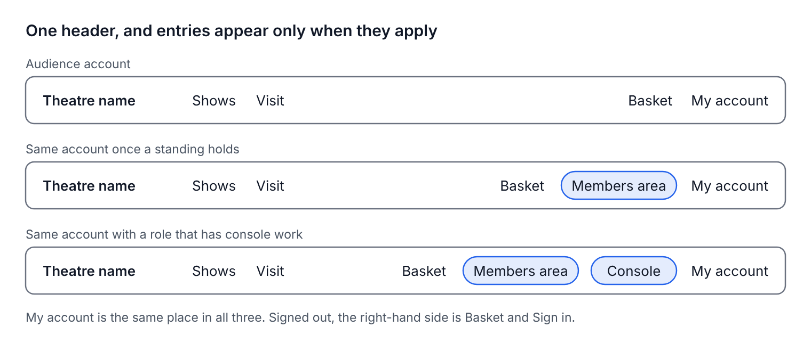
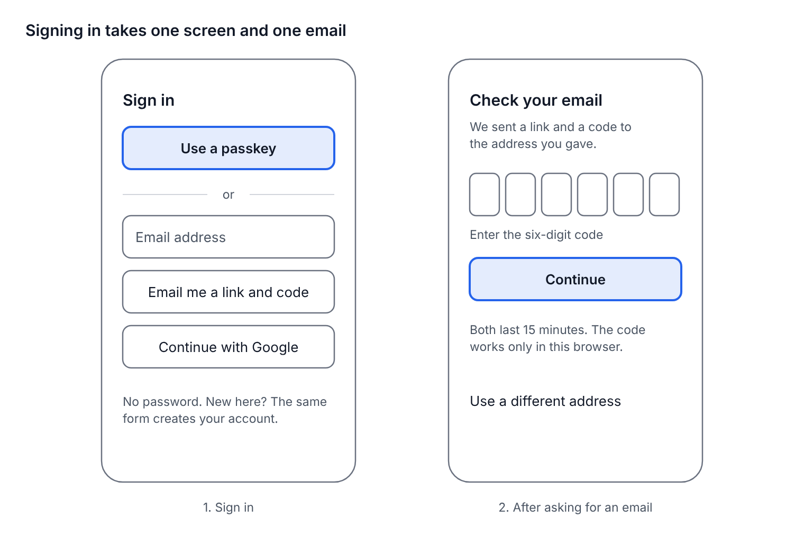
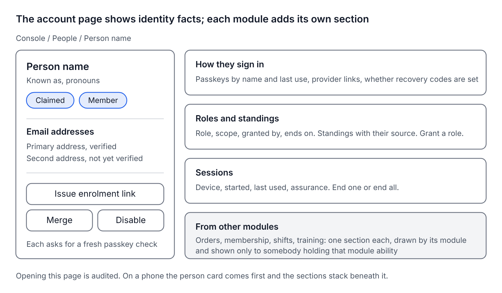

# 5. Screens

Identity has 33 screens: 9 for getting in, 7 in "My account", 3 in the members' area, 9 in the console and 5 in Site administration. Three are drawn here because they carry the audience and members' separation; workstream 6 owns how every screen finally looks.

## The header is where the two sides meet

*wireframe · the header for an audience member, a member and staff*

An audience member's header has no gap, greyed entry or hint where the members' entry would be. On a phone the same entries sit in the menu in the same order.

- The account menu holds the same audience entries for everybody.
- A person with a standing sees one more entry, named by the theatre. A person with a console ability sees a second.
- Nothing else on a public page changes with who is signed in, apart from prices and booking rights that a member is entitled to.

## Getting in

Public shell. Every screen works on a phone and with a screen reader, and none asks a member question.

| Screen | Purpose | Who sees it | Release |
| --- | --- | --- | --- |
| Sign in | Offer a passkey; take an address; send a managed-domain address to its provider | Anyone signed out | First |
| Check your email | Say a link and a code were sent; take the code; offer to send again after a pause | Anyone who asked for a link | First |
| Link landing | Finish a sign-in from the email; explain plainly when a link is spent, expired or opened for a different purpose, and offer a new one | Anyone opening a link | First |
| Your name | Ask a new person for their name, once, after their first link | A person whose account was just created | First |
| Add a passkey | Offer a passkey after a link sign-in; skippable unless a sensitive ability is held | A signed-in person without one | First |
| Welcome, you were invited | Say who invited them and to what, then sign them in | The holder of an invite link | First |
| Use a recovery code | Take a code and lead straight to adding a passkey | Anyone signed out | First |
| Owner recovery | Take the one-time secret and create a passkey for an Owner | Only while the recovery secret is set | First |
| Confirm it is you | A dialogue, not a page: re-assert with a passkey or the strongest method held, then continue the action | Anyone taking a sensitive action | First |

*wireframe · sign in and check your email, on a phone*

The second screen is the same whether or not the address has an account. The Google button appears only when the theatre has turned it on.

## My account

Public shell, audience side. Other modules add their own sections here through the Interface's point `core.account-section`: box office adds tickets and orders.

| Screen | Purpose | Who sees it | Release |
| --- | --- | --- | --- |
| Overview | The sections available, and anything needing attention such as an unverified address | Any signed-in person | First |
| Your details | Name, preferred name, pronouns, phone, language | Any signed-in person | First |
| Email addresses | Add, verify and remove addresses; choose the address for tickets and receipts | Any signed-in person | First |
| Signing in | Passkeys with their labels and last use; linked Google account; recovery codes | Any signed-in person | First |
| Where you are signed in | Each session with its device and last use; end one, or all the others | Any signed-in person | First |
| Access scheme | Before applying: what the scheme is and an "Apply" button. The form: ticks with optional notes, companions, who will read it. Afterwards: the application's state in plain words, the reviewer's message, change or leave, switches for other purposes, and every read by staff. The public page `/access` is the theatre's own content and carries the same button. | Any signed-in person | First |
| Your data | Download your data; ask for your account to be erased; see a request's progress; cancel it | Any signed-in person | First |

## Members' area

Members' shell. Shown only to a person with a standing.

| Screen | Purpose | Who sees it | Release |
| --- | --- | --- | --- |
| Member details | The address for member notices; up to three emergency contacts and the list of who has read them; any member fields the theatre added | A person with a standing | First |
| What you can do | Every ability the person holds and why: which role until when, which fact, on which record. Also grants that have lapsed. | A person with a standing | First |
| Link another account | Start a merge with an account they also own | Any signed-in person; linked from Email addresses too | Later |

## Console: People

Console shell. Each row names the ability that shows it.

| Screen | Purpose | Ability | Release |
| --- | --- | --- | --- |
| Accounts | Search and filter everyone; unclaimed and anonymised accounts hidden unless looked for, with a count of what is hidden | `core.account.read` | First |
| Account | One person, in sections by side (see the wireframe) | `core.account.read`; each section also needs its own ability | First |
| Add someone | Name and address, optionally a role; creates an unclaimed account and sends an invitation | `core.account.create` | First |
| Merge accounts | Choose the second account, see the preview, confirm | `core.account.merge` | First |
| Merges | Recent merges, with undo while the window is open | `core.account.merge` | First |
| Who holds what | Every live, pending and soon-to-lapse grant; filter by role, scope and module; grant, renew and end | `core.grant.read`; `core.grant.manage` to change | First |
| Data requests | Exports and erasures with their state, holds and respond-by date | `core.data-request.manage` | First |

*wireframe · a person's page in the console*

Identity draws the left card and the first three sections. The tinted section is the `core.account-section` point, so a module that is switched off leaves nothing behind.

## Site administration

The fourth shell, at `/admin`, holds what is set up once for the whole installation (Matt, 16 November 2026; Interface specifies the shell and its addresses). The console keeps the theatre's daily business with people. Five of identity's screens live here. Granting a role to a person stays in the console under "Who holds what"; defining what a role contains is here.

| Screen | Purpose | Ability | Release |
| --- | --- | --- | --- |
| Roles | Every role, how many hold it, presets not yet used | `core.role.read` | First |
| Role | Name, description, expiry rule, abilities grouped by module with what each brings; who holds it | `core.role.manage` to edit | First |
| Facts | Each declared fact with the abilities mapped to it, edited the same way as a role | `core.role.manage` to edit | First |
| Sign-in settings | Methods, managed domains, session times, generated from the settings registry | `core.identity-settings.manage` | First |
| Retention | What each sweep would do today; arm or disarm it (the arm control alone needs `core.retention.arm`, held only by Owners) | `core.identity-settings.manage` | Later |

All five declare menu `admin` and the group `access` (label "Access"), in this order: Roles at `/admin/roles`; Role at `/admin/roles/<role>`, reached from Roles with no menu entry of its own; Facts at `/admin/facts`; Sign-in at `/admin/sign-in`; Retention at `/admin/retention` when it ships. The shell needs no ability of its own: a holder of `core.role.read` or `core.identity-settings.manage` sees Site administration in the account menu and only the entries they may open, and anybody else gets page not found at `/admin`. A role's "who holds this" link crosses to the console's People group.

## Rules for these screens

1. **The account page in the console is assembled from sections, and each section belongs to a side.** A member of staff sees only the sections their abilities open. The page never shows an empty frame for a section they cannot see.
2. **A button for a sensitive action is shown and asks for confirmation in place.** It is never hidden merely because the session is not yet strong or fresh.
3. **A person is chosen, never typed.** Every screen that names somebody uses the person picker. Typing an address is offered only when the picker finds nobody.
4. **Every refusal says why and what would help**: "Only an Owner can end an Owner's role", "Add a passkey to use this".
5. **Anything staff do to an account tells the person**, at every verified address, unless it is the erasure they asked for.
6. **The role editor ticks and locks abilities that come with one already ticked**, marks abilities that amount to full control, and switches off any the editor does not hold. This pattern is Flytower's (see Sources).
7. **"What you can do" and the console's "Who holds what" read from the same resolver** as the server's checks, so they cannot disagree with it.

Two further console screens run the access scheme, both needing `core.access-scheme.read`. "Access scheme" is the queue: open applications oldest first with how long each has waited, those due a review, and "Invite to apply"; it shows names and states only. "Application" is one person's application: what they asked for, the history of decisions, and the actions accept, reject, ask for more, verify and apply on their behalf, each needing `core.access-scheme.review`. They sit under People in the console's navigation.

On a person's page in the console, "Emergency contacts" (members' side) is closed until asked for: it appears only to a holder of `core.emergency-contact.read` and only for a person with a standing, and opening it asks for a reason and records the read. The page shows nothing about the access scheme unless the viewer holds `core.access-scheme.read`, or holds `core.access-profile.read` and the person switched on the welfare purpose; otherwise the section is absent, not empty. Box office and front of house see access needs on their own booking and house screens, from the copy on the booking, not here.

## Addresses

Interface fixes the prefixes: a person's own sections sit under `/account/` on the audience side and `/members/account/` on the members' side, so the two mirror each other; identity's console screens sit under `/console/people`; site administration under `/admin`. The words after the prefix are identity's.

| Screen | Address |
| --- | --- |
| My account: Overview | `/account` |
| Your details | `/account/details` |
| Email addresses | `/account/email` |
| Signing in | `/account/sign-in` |
| Where you are signed in | `/account/sessions` |
| Access scheme | `/account/access` |
| Your data | `/account/data` |
| Member details | `/members/account/details` |
| Emergency contacts (part of Member details, and linkable) | `/members/account/emergency-contacts` |
| What you can do | `/members/account/abilities` |
| Link another account (later) | `/members/account/link` |
| Accounts | `/console/people` |
| Account | `/console/people/<account>` |
| Add someone | `/console/people/new` |
| Merge accounts | `/console/people/merge` |
| Merges | `/console/people/merges` |
| Who holds what | `/console/people/grants`; grants about to lapse with `?lapsing=1` |
| Data requests | `/console/people/data-requests` |
| Access scheme (queue) | `/console/people/access-scheme` |
| Application | `/console/people/access-scheme/<account>`, since an application is keyed by its account |

A form that belongs to a screen sits beneath it: the person's application form is `/account/access/apply`, and applying on somebody's behalf is `/console/people/access-scheme/<account>/apply`. The getting-in screens keep the addresses the sign-in flow already uses and are not menu entries. Site administration's addresses are given above.

## Navigation entries

| Entry | Shell | Shown by |
| --- | --- | --- |
| My account | Public, account menu | `signed-in` |
| Members' area | Public, account menu | Any standing |
| Console | Public and members', account menu | Any ability with a console entry |
| People: Accounts, Who holds what, Data requests, Access scheme | Console | The abilities above |
| Roles and facts; Sign-in settings; Retention | Site administration | `core.role.read` for roles and facts; `core.identity-settings.manage` for the other two |

## Setup steps

Foundations owns the first-run sequence and the setup code that guards it. Identity contributes the steps below to that sequence through the setup-step point; creating the first Owner is the security rule and cannot be skipped or reordered.

| Step | Required | Does |
| --- | --- | --- |
| Create the first Owner | Yes | Name, address, passkey, recovery codes typed back; writes the setup grant |
| Add a second Owner | No, recommended | Invites another person as Owner so one lost device cannot lock the theatre out |
| Choose how people sign in | No | Email link on or off; Google; a managed domain |
| Choose roles | No | Applies the preset's roles, which can be renamed straight away |
| Members' area | No | On or off, and what the theatre calls it |
