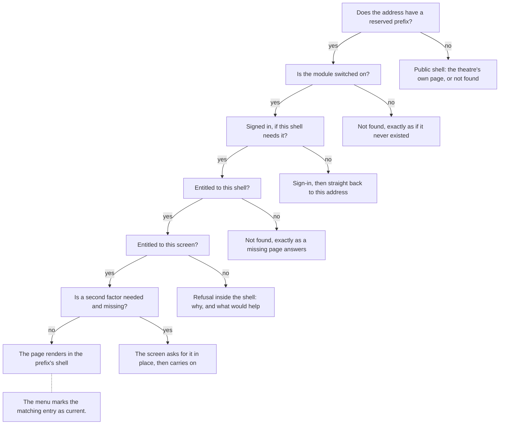
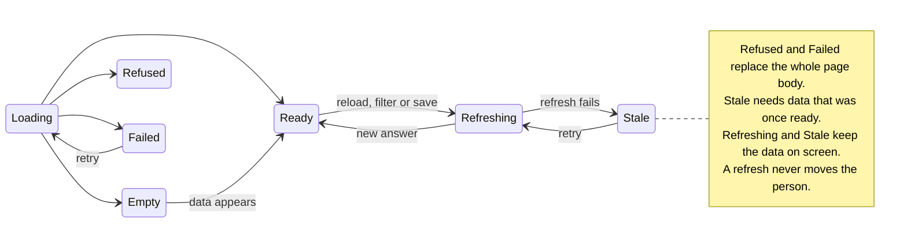
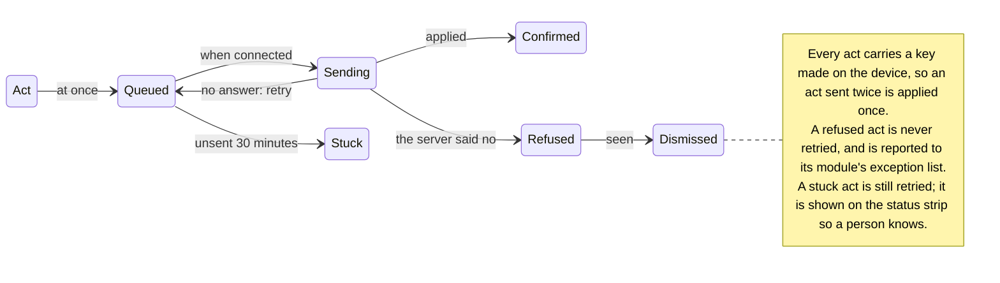

# 3. States and rules

The interface has four life cycles of its own: which shell a request reaches, the state of a page's data, the life of a write made offline, and a form being saved. Each is drawn with the rule that guards every change.

## Which shell a request reaches

*How a request reaches a shell, or is refused*

| Step | Rule |
| --- | --- |
| Address has a reserved prefix | The prefix alone picks the shell. No page chooses its own layout |
| Module is off | The address answers "not found", exactly as if it never existed |
| Not signed in, and the shell needs it | Sent to sign-in with the address kept, and returned to it afterwards |
| Signed in but not entitled to the shell | The address answers "not found", exactly as a missing page does, so nothing reveals that the shell exists. No empty shell is ever shown |
| Entitled to the shell but not to this screen | Refused inside the shell, with why and what would let them through |
| Ability held but a second factor is needed | The screen asks for it in place; the link was never hidden |
| Entitled | The page renders; the menu marks the matching entry as current |

- Entitlement to the members' area is workstream 2's fact `core.member`. Shells never test it or any role directly: the header and menus are drawn only from what `describeViewer` returns (the name, the sides open, the navigation entries allowed), and the members' entry takes its label from `core.members-area.name`. The public shell's bundle carries no members' or console screens. Entitlement to the console is holding any ability that a console entry names. Entitlement to live mode is being able to work tonight.
- The check runs on the server for every request and every data route. The page runs the same check only to decide what to draw.
- Losing entitlement while a page is open (a shift ends, a membership lapses) takes effect on the next request: the screen shows the refusal and a way back, and nothing the person typed is sent.

## The state of a page's data

*The states of a page's data*

| State | What is on screen | Leaves when |
| --- | --- | --- |
| Loading | The frame and a skeleton | The first answer arrives |
| Ready | The data | A reload, a filter change, or a save |
| Empty | The empty state for this list, or for this filter | Data appears or filters change |
| Refreshing | The data, with a quiet progress mark; nothing is cleared | The new answer arrives |
| Stale | The data, with "Last updated 19:42" and a retry | A refresh succeeds |
| Refused | Only the refusal | The person leaves, or gains what was missing |
| Failed | Only the reason and a retry | A retry succeeds |

- **Failed and refused replace the page body.** A half-filled page is never shown.
- **Stale is allowed only when data was once ready.** A first load that fails is failed, not stale.
- **An empty filter is not an empty list.** "No orders match these filters. Clear filters" differs from "No orders yet".
- **A refresh never moves the person**: scroll position, selection and open panels survive it.

## A write made on a live screen

*The life of a queued write*

| Change | Rule |
| --- | --- |
| Act to queued | The screen answers at once from its device copy, and the act joins the queue with a key made on the device |
| Queued to sending | Immediately when connected; otherwise when the connection returns, oldest first |
| Sending to confirmed | The server applied it, or recognises the key as already applied. The device copy is corrected from the answer |
| Sending to queued | No answer, or a server fault. Retried with growing gaps; never dropped |
| Sending to refused | The server understood and said no (ticket already refunded, shift ended). Never retried |
| Refused to dismissed | The person, or the duty manager, has seen it. A refusal is also reported to the module's own exception list |
| Queued to stuck | Unsent after 30 minutes of being connected (a setting), and still retried. Shown in red on the status strip. An entry that reaches 48 hours old, foundations' idempotency window, is never sent again: it stays stuck until the person checks the record and dismisses it or does it again by hand |

- **The server decides.** The device's answer is a prediction. When they differ, the server's stands and the difference is shown, not hidden.
- **Only acts a module marks as safe to queue can be queued.** Admitting a ticket and ticking a checklist line are. Taking a card payment is not: a live screen that needs the server says so and waits.
- **The queue has a ceiling** (200 acts, a setting). At the ceiling the screen keeps working and warns plainly.
- **Sign-out with unsent acts** asks first and says how many.
- **A second device** scanning the same thing offline is not prevented, because it cannot be. It is reconciled on the server and reported, as journey 4 describes.
- **Time is the device's time of the act**, sent with it. The server records both that and when it arrived.

## A form being saved

| State | What the person sees | Leaves when |
| --- | --- | --- |
| Untouched | The form, save bar quiet | A field changes |
| Changed | Save bar active; leaving asks once | Save, discard, or undo back to untouched |
| Invalid | Errors beside fields and a summary; focus on the first | Every error is fixed |
| Saving | Button shows progress; fields locked | The server answers |
| Saved | A confirmation, then back where they came from | Immediately |
| Refused | The refusal panel above the form; what was typed is kept | The person changes something or leaves |
| Conflict | Both versions of each changed field, and a choice | A choice is made |
| Failed | "Not saved", the reason, Retry; what was typed is kept | Retry succeeds |

- **Validation runs the same schema twice**: in the browser to be quick, on the server to be right. A server validation error is shown exactly as a browser one.
- **A save is sent once.** The button cannot be pressed twice and the request carries a key, so a retry after a dropped connection cannot create two records.
- **Conflict is detected by version.** A save carries the version it started from; the server refuses a stale one.
- **Nothing typed is ever lost to an error.** The same holds when a save needs a fresh identity check: the check opens as a dialogue over the form, and on success the same submission completes without the person pressing save again.

## The on-shift bar and Tonight

| Condition | Account menu shows Tonight | On-shift bar shows | Sign-in lands on |
| --- | --- | --- | --- |
| Confirmed shift, inside its window | Yes, first | Yes | Tonight hub |
| Standing ability to work a night, no shift | Yes, first | No | Where they started |
| Shift later today, window not open | No | No; members' home shows it as a card | Where they started |
| Neither | No | No | Where they started |

The window, and the grace either side of it, are owned by the `front-of-house` module, which is specified in the later round; the values here are this document's assumption until then. Front of house sets the window to open 30 minutes before call time and close 60 minutes after the shift ends, both settings. The on-shift bar is a contribution to the point `core.on-shift-bar` (a performance id, a label key with its parameters, and an until time), so when that module is off the bar is simply absent. Tonight is one surface with one name on screen: modules contribute tiles and sections to it through `core.tonight-tile`, each naming an ability exactly as a navigation entry does, and front of house's board is its section of Tonight, not a second screen. A queued act that arrives after the window closes is refused with `front-of-house.shift-ended`, which is the Refused state above: shown, reported and never retried. Whether someone is a member now is workstream 2's fact to name. Every screen reads the one answer, so no two screens can disagree about whether someone is on shift.
