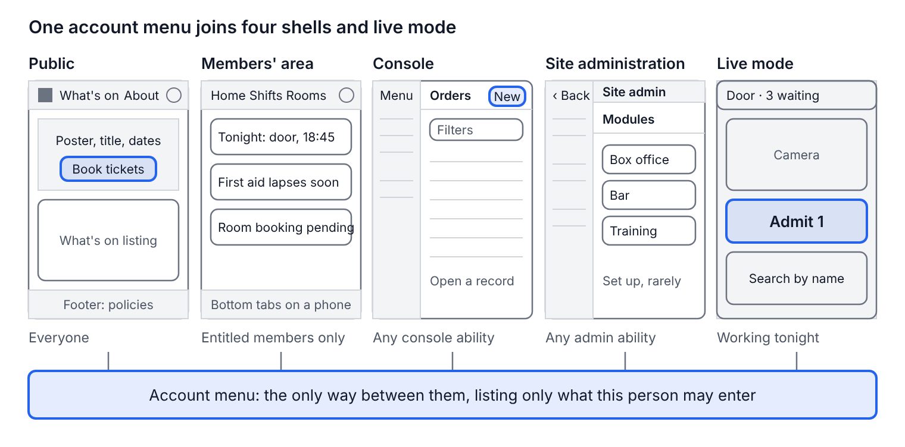

# Shells and navigation

Proscenium has four shells, one per relationship a person has with the theatre, plus a chrome-free live mode for work done standing up. A person only ever sees the shells they are entitled to, and one account menu joins them. The fourth shell, site administration, was added on 16 November 2026 at Matt's decision: it separates running the installation from the day-to-day work of the console, as Mailflare separates its admin area. It replaces the earlier ruling of three shells and the console's System group.

## The four shells

|  | Public | Members' area | Console | Site administration |
| --- | --- | --- | --- | --- |
| For | Anyone: finding a show, buying, managing their own tickets | A member's own things: shifts, training, rooms, notices | Work done for the theatre: selling, approving, reporting, and each module's own settings | Running the installation: modules, branding, email sending, credentials, updates, health, audit |
| Who sees it | Everyone, signed in or not | Only a person with a current membership, role, shift or production place | Only a person holding at least one console ability | Only a person holding the ability of at least one site administration entry |
| Tone | A customer of the theatre | A colleague in the theatre | An operator at a desk | The person who looks after the system |
| Intensity | Expressive: brand colour, display font, posters | Calm | Calm and dense | Calm and dense |
| Frame | Header, page, footer | Top bar with section links; bottom tab bar on a phone | Collapsible sidebar, page header, command palette | The console's frame with its own sidebar, a header that reads "Site administration" and a link back to the console |
| Designed for | Phone first | Phone first | Laptop first, usable on a phone | Laptop first, usable on a phone |
| Rendered | On the server, for search engines and social cards | In the browser | In the browser | In the browser |
| Who may restyle it | The theatre, in its site folder | Nobody; branding only | Nobody; branding only | Nobody; branding only |

*W1 · the four shells, live mode and the account menu*

Each frame is recognisable at a glance, which matters most for a person who uses more than one. Site administration shares the console's frame on purpose and is told apart by its named strip, its "Back" row and its own sidebar. Larger drawings of each are in the Wireframes sub-tab.

### Public shell

- **Header:** logo and name, What's on, the theatre's own content links, basket (only when it holds something), account menu or "Sign in".
- **Footer:** the theatre's links, contact, policies, an optional credit line. One shape for everybody; a link that needs sign-in sends the visitor through sign-in and on to where they meant to go.
- **My account** lives here, not in its own shell: tickets, orders, passes, vouchers, saved details, preferences, and identity's access scheme (apply, see the state of an application, and what it unlocks, such as a companion ticket). Nobody ticks access needs while buying. Emergency contacts are not here: they are a section of the members' area only. It is the audience experience, so it carries no member vocabulary at all.
- **Booking** (choose, basket, checkout, confirmation) uses the public header in a reduced form: logo, a step indicator and the basket timer. Nothing in it leads away from paying.
- The layout and any page can be replaced by a file of the same path in the theatre's site folder. The booking flow and My account are platform pages a theatre styles through branding, not by override.

### Members' area

- **Top bar:** logo, the area's name, up to six section links, notifications bell, account menu. On a phone the section links become a bottom tab bar of four plus "More".
- **Home** is a list of what needs the member next: tonight's shift, a training record about to lapse, a booking awaiting approval. Modules contribute cards; the page is never a grid of module logos.
- **Sections come from modules.** With only Front of house switched on, the bar reads Home, Shifts. Nothing is shown for a module that is off.
- It is deliberately not a sidebar. A member who also has console access must be able to tell at a glance which of the two they are in.
- A theatre with no membership never switches the members' area on, and every trace of it disappears.

### Console

- **Sidebar:** theatre mark, then one group per module in a fixed order that does not vary by viewer. Inside a group, everyday work comes first and set-up second, under those two labels. A group with nothing the viewer may open is absent, not greyed.
- **Page header:** sidebar toggle, page title, the page's one primary action, search, help for this screen.
- **Console home** is a work queue: things awaiting this person (refunds to approve, bookings to confirm, failed sends), then today's performances. Modules contribute the cards.
- **Command palette** (Ctrl or Cmd K): go to any screen the viewer may open, find a person, an order or a production, run a common action.
- **There is no System group.** Screens that run the installation are in site administration, below. The console keeps each module's own settings page at `/console/<module>/settings`, because hold times, prices and rotas are operational.
- On a phone the sidebar becomes a drawer and tables become stacked cards. Every console screen works on a phone; none is designed there first.

### Site administration

Integration ruling R-33, which replaces R-31. Drawn as W9 in the Wireframes sub-tab.

- **The rule:** the console runs the theatre; site administration runs the installation. A screen belongs here when it changes how the installation is set up and is touched rarely. It stays in the console when someone uses it while running shows. So giving a person a role is console work and deciding what a role contains is here; message wording and the delivery log are console work and the sender and its health are here.
- **Who may enter:** the shell has no ability of its own. A person sees it when they hold the ability of at least one of its entries, and sees only those entries. Moving a screen here changed no ability. Anyone else who types an `/admin` address gets "page not found", the same guard order as the console.
- **Frame:** the console's frame, so nothing new is learnt: sidebar, page header with one primary action, command palette, generated settings pages.
- **Told apart from the console** in five ways, none of which is colour alone: a strip above the page header reads "Site administration" at every width; the top of the sidebar is "Back to console" where the console shows the theatre's mark; the sidebar has its own groups and none of the console's; there is no Tonight and no work queue; and the browser tab's title starts "Site administration". The theatre's brand colour is not used here, so its buttons are neutral.
- **Home** is Overview at `/admin`: first what needs attention (an update ready to apply, a sending domain not verified, failed jobs, a credential about to lapse), then the state of the installation. Modules contribute its cards through `core.home-card` with `menu: 'admin'`.
- **Moving between the two:** the account menu's Site administration entry, from anywhere. "Back to console" at the top of the sidebar, shown to a holder of any console ability; anyone else sees "Back to the site". A module's console settings page says "Some of this module's settings are in Site administration" with a link, when it has site-wide settings the viewer may open. The console's sidebar carries no link here. The command palette offers the screens of both to a person entitled to both, each named with its shell.
- **Narrow layout:** as the console. Below 1024 pixels the sidebar is a drawer and tables are cards; the strip stays and carries the drawer's toggle. Every screen works on a phone; none is designed there first.
- **A module's site-wide settings:** a module's settings stay in the console by default. A setting may declare `scope: 'site'` (the default is `'module'`), and it is then shown at `/admin/settings`, grouped by module, in place of the module's page at `/console/<module>/settings`. The key and the ability that guards it do not change. `/admin/settings` still searches every setting and links out to a module's page for the module-scoped ones.
- **Updates and the maintenance state:** foundations' Updates screen is at `/admin/updates`, seen with `core.health.view` and applied with foundations' migrations ability. A newer release shows as a card on Overview that links to it. After a deploy whose database changes are waiting to be applied, only Updates, Health and sign-in answer: every other address, `/admin` and Overview included, shows foundations' plain maintenance page, which links an administrator to `/admin/updates`. **No backups screen:** the platform takes no backups.

Groups and entries, in the platform's fixed order. A group's id is what an entry names; a group with nothing the viewer may open is absent.

| Group (id) | Entry | Address | Owner |
| --- | --- | --- | --- |
| none | Overview | `/admin` | interface |
| Theatre (`theatre`) | Organisation | `/admin/organisation` | core domain |
|  | Branding | `/admin/branding` | core domain |
|  | Vocabularies | `/admin/vocabularies` | core domain |
|  | Navigation | `/admin/navigation` | interface |
|  | Site readiness | `/admin/site-readiness` | core domain |
| Modules and settings (`modules`) | Modules | `/admin/modules` | foundations |
|  | Settings | `/admin/settings` | foundations |
| Access (`access`) | Roles, and one role | `/admin/roles`, `/admin/roles/<role>` | identity |
|  | Facts | `/admin/facts` | identity |
|  | Sign-in | `/admin/sign-in` | identity |
|  | Retention (a later release) | `/admin/retention` | identity |
| Email (`email`) | Senders | `/admin/email` | core domain |
|  | Delivery health | `/admin/email/health` | core domain |
| Connections (`connections`) | Credentials | `/admin/credentials` | foundations |
|  | Webhooks | `/admin/webhooks` | core domain |
| Upkeep (`upkeep`) | Updates | `/admin/updates` | foundations |
|  | Jobs | `/admin/jobs` | foundations |
|  | Health | `/admin/health` | foundations |
|  | Audit log | `/admin/audit` | foundations |

Staying in the console: every module's own work and its settings page; core's Programme screens, Files, message types, the template editor and the delivery log; identity's People group (accounts, adding and merging, who holds what, data requests and the access scheme). The old `/console/system/...` addresses redirect to their `/admin` ones. A theatre's own module may add an entry to one of these groups, or declare a group of its own placed `before` or `after` one.

### Live mode

Live mode is a layout, not a shell. It has no navigation of its own because a person in it is doing one job: scanning the door, running the till, watching tonight.

- Full screen, dark by default, every control at least 48 by 48 pixels.
- A thin status strip: what this screen is, which performance, the connection state, how many actions are waiting to send, and a way out.
- It opens from a tile on the Tonight hub, which is offered wherever a person who can work tonight looks: first in the account menu, as a bar across the public site and members' area while they are on shift, and as the landing page after sign-in during their shift.
- Desk sales belong to the console, because they are done sitting down: the desk is laptop first and usable on a tablet, with the sidebar collapsed. The door, the till, the tonight board and checklists belong to live mode.

## Moving between shells

The account menu is the one component every shell renders, so it is the only way between them.

| Entry | Shown when | Goes to |
| --- | --- | --- |
| Tonight | The person can work tonight (a confirmed shift in its window, or a standing ability) | The Tonight hub |
| My account | Signed in (the menu itself shows only then; a visitor sees "Sign in") | Tickets and orders in the public shell |
| Members' area | The person is entitled to it | Members' home |
| Console | The person holds any console ability | Console home |
| Site administration | The person holds the ability of at least one site administration entry | The first site administration screen they may open |
| Notifications | Signed in | The inbox of the side the person is on: the audience inbox under My account from the public shell, the member inbox in the members' area from there, from the console and from site administration |
| Appearance, language | Signed in | A small menu |
| Sign out | Signed in | The public home |

There are two inboxes, as core and identity decided, and they never mix: a person who is both audience and member has one on each side. The menu's one Notifications entry, and the bell in the members' top bar, open the inbox of the current side.

- An audience member's menu is therefore short: My account, Notifications, the appearance and language choices, and Sign out. They are never shown a locked or greyed members' entry.
- The current shell's own entry is marked, not removed, so the menu does not rearrange as a person moves.
- A deep link into a shell the person is not entitled to answers "page not found", the same answer at every members', console and site administration address, so it does not confirm that the shell exists. Inside a shell the person may enter, an address whose ability they lack shows the refusal page, which says why and what would let them through. A hidden link is tidiness, never enforcement.

## Where a person lands

1. A link with a destination always wins: after sign-in the person arrives where they were going.
2. Otherwise, a person on shift lands on the Tonight hub.
3. Otherwise they land where they started signing in: the public home from the public site, members' home from a members' link.
4. A theatre can change the default for members to members' home.

## Addresses

Each shell owns a reserved prefix and everything else belongs to the theatre's own pages.

| Prefix | Shell | Example |
| --- | --- | --- |
| `/` and anything not reserved | Public: the theatre's content pages | `/about` |
| `/whats-on`, `/shows` | Public: core's listing and production pages. A production is at `/whats-on/<slug>` while current and `/shows/<slug>` once past | `/whats-on/hamlet` |
| `/book` | Public, booking flow | `/book/<performance>`, where the segment is box office's address for one performance |
| `/account` | Public, My account | `/account/tickets` |
| `/files`, `/mailing` | Public: the public site's files, and communications' confirm and manage pages reached by token. `/forms` is reserved the same way for the form builder's public forms |  |
| `/members` | Members' area | `/members/shifts` |
| `/console` | Console | `/console/box-office/orders` |
| `/live` | Live mode | `/live/door` |
| `/sign-in`, `/setup` | Centred single-task layout |  |
| `/api` | No shell: the routes |  |

`/admin` is reserved as well, for site administration (for example `/admin/modules`). With it, this is the whole reserved list, the same as foundations', together with anything starting with an underscore.

**Core's and identity's own screens** have no module segment of their own to use, so they take a fixed word. In the console it is the group's id: identity's People screens are under `/console/people` (accounts at `/console/people`, one account at `/console/people/<account>`, who holds what at `/console/people/grants`) and core's Programme screens under `/console/programme`. A person's own account sections are under `/account/<section>` on the audience side and `/members/account/<section>` on the members' side, so "What you can do" is `/members/account/abilities`. The words after these prefixes are their owner's to choose and are listed in the owner's own Doc.

**Which shell a screen belongs to** (ruled 16 November 2026). The shell follows whose business the screen does, never what guards it. A screen where a person deals with their own things belongs in the members' area (or My account, for an audience member) even when an ability guards it. A screen where a person acts on the theatre's behalf, on other people's records or on set-up, belongs in the console. A screen that runs the installation itself, not the theatre's work, belongs in site administration. A screen for one job during a performance is a Live page. So the bar's own-tab screen is `/members/bar/tab` and a trainer's own sessions are under `/members/training/teaching`, while the bar's stock and tabs for everyone, and the training programme and everyone's records, are under `/console`. A module whose ability opens a members' screen must also declare a standing for it, so that the members' area opens for its holder.

**Forms have two homes each, by the same rule** (agreed with workstream 5). My forms, a person's own drafts and responses, is a `core.account-section` on each side: under My account for an audience member and in the members' area for a member, each hidden while the person has nothing there. The review queue is in the members' area for a member reviewing as one of a panel (their own task, `/members/forms/reviews`) and in the console for the person who runs a form and sees every response (`/console/forms/...`).

- Within a shell the next segment is the module, so a module's pages sit together and a module that is switched off takes its whole subtree with it.
- The prefix decides rendering, caching, security headers and the guard in one route rule each, which is what Part B asks for.
- A theatre's content page can never collide with a platform page, now or after an update, because the reserved list is short and fixed. The build refuses a content page under a reserved prefix.
- This departs from today's Proscenium, which names the domain first (`/rooms` and `/rooms/manage`). That suits one theatre with a fixed set of modules; it does not suit a fork whose owner adds pages at the root. Matt accepted this as question 2.

## How navigation is built

- **One declaration.** A module's manifest lists its destinations: which shell, which group, the label, the icon, the address and the ability needed. Nothing else registers a link.
- **The same declaration drives the guard.** The route guard resolves the current address against the declarations and checks the ability it finds, so a deep link and the menu agree by construction.
- **Filtered by ability, shaped by posture.** The viewer's abilities, including those derived from facts such as tonight's shift, decide what is listed. The order never changes with the viewer.
- **Counts are opt-in.** A destination may name a count (refunds awaiting approval). Counts load after the page, never block it, and are announced to screen readers as part of the link's name.
- **A theatre may reorder and rename members' sections and hide a destination** in settings. It cannot show a destination to someone who lacks the ability.
- **Group order in the console** is set by the platform: Tonight, Programme, Box office, Front of house, Bar, Room bookings, Training, Membership, People, Money, Communications, Forms, Reports. Room bookings is the label of the spaces module's group (its id and its address `/console/spaces` keep the name spaces). Programme is core's group (productions, calendar, seasons, venues and places, files). People is identity's (people and roles). Money holds Payments and Finance. Core's message screens sit under Communications, a group core declares so that it is there while the communications module is off. Forms is the form builder's. There is no System group: those screens are in site administration, whose own sidebar order is also set by the platform. A theatre's own module declares where it sits relative to these.

The formats are in tab 4. They follow workstream 1's manifest, in which a navigation entry is a contribution to the core's navigation point.

## Where this comes from

| Idea | Source | What changes here |
| --- | --- | --- |
| Posture picks the shell; one declaration drives menu and guard; filtering is never enforcement | Proscenium decision [0040](https://github.com/newtheatre/proscenium/blob/main/docs/decisions/0040-navigation-is-shaped-by-posture-and-filtered-by-ability.md) | Four shells and a mode, with site administration split from the console; the declaration comes from module manifests instead of one file; shell-first addresses |
| A console group splits into everyday and set-up | Proscenium decision [0082](https://github.com/newtheatre/proscenium/blob/main/docs/decisions/0082-a-console-group-splits-into-every-day-and-set-up.md) | Kept as is |
| Tonight is offered wherever a person who can work tonight looks | Proscenium decision [0094](https://github.com/newtheatre/proscenium/blob/main/docs/decisions/0094-tonight-is-offered-wherever-a-person-who-can-work-tonight-looks.md) | Kept; the fact comes from workstream 2's derived authority |
| The members' surface is calm | Proscenium decision [0084](https://github.com/newtheatre/proscenium/blob/main/docs/decisions/0084-the-member-shell-is-calm-and-its-headings-say-so.md) | Kept, and the audience account is moved out of it into the public shell |
| A sidebar shell whose navigation the page chooses, with one page header component | Mailflare [dashboard layout](https://github.com/MattA-Official/mailflare/blob/nuxt/app/layouts/dashboard.vue) and [Navbar](https://github.com/MattA-Official/mailflare/blob/nuxt/app/components/app/Navbar.vue) | Used for the console and for site administration, which follows Mailflare's separate admin area |
| A separate public layout beside the signed-in one | Flytower panel layouts (`default`, `centered`, `public`) | Several signed-in surfaces instead of one |
