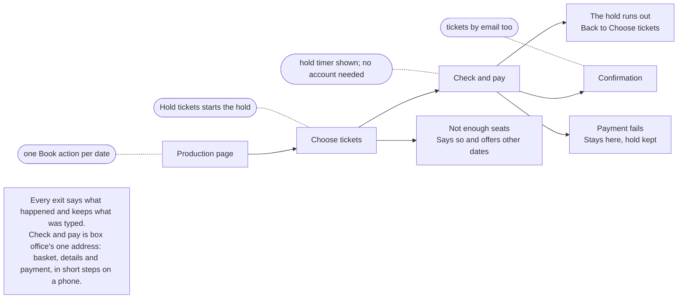

# Key journeys

Ten journeys decide whether the interface works. The first five are box office, because that is the module that matters most; the rest prove the shells, the account model and setup. Each names the person, the shell, the device it is designed on, and what happens when it goes wrong.

The rules behind each step (prices, holds, eligibility, refunds) belong to the workstream that owns the module. This tab fixes only what the person sees and does.

| # | Journey | Person | Shell | Designed on | Wireframe |
| --- | --- | --- | --- | --- | --- |
| 1 | Buy a ticket | Audience member, not signed in | Public | Phone | W3 |
| 2 | Buy as a member | Member | Public | Phone | W3 |
| 3 | Sell at the desk | Box-office volunteer | Console | Laptop | W4 |
| 4 | Scan at the door | Front-of-house volunteer | Live | Phone | W5 |
| 5 | Refund or exchange | Box-office staff | Console | Laptop | W6 |
| 6 | Put a production on sale | Officer | Console | Laptop | W2, W6 |
| 7 | Join as a member | Existing customer | Public, then members' area | Phone | W7 |
| 8 | Work tonight | Member on shift | Members' area, then live | Phone | W7, W5 |
| 9 | Set the site up | Site owner | Setup, then console | Laptop | W8 |
| 10 | Change a policy number | Officer | Console | Laptop | W8 |

## 1. Buy a ticket

The target: from a production page to a confirmed ticket in under two minutes on a phone, without creating an account.

*Buying a ticket as a guest*

1. **Production page.** Dates are listed with availability in words ("Good availability", "Last few", "Sold out"). Each date has its own Book action; a single production-level button shows only when there is one date.
2. **Choose a performance**, if there is more than one. Skipped when the visitor came from a specific date.
3. **Choose tickets.** General admission: a stepper per ticket type, with each price and who qualifies. Allocated seating: "Best available" is chosen for them, with "Choose my own seats" opening the plan. A wheelchair space, a transfer seat and a companion ticket are listed as ordinary ticket types where box office offers them; a space that can no longer get its seats says it is no longer available, and companions stop at the person's allowance. The running total is always visible.
4. **Basket.** Pressing "Hold tickets" at step 3 claims the tickets, so the hold starts there and its timer is first seen here, in the header in words ("Held for 9 minutes"). Where a theatre has extras switched on they appear here once; a donation or a programme are examples only, and box office's first release has none. Steps 4 to 6 are box office's one address, `/book/basket` ("Check and pay"): short steps on a phone, one page on a laptop.
5. **Your details.** Name and email. "Sign in for a faster checkout" is a quiet link, never a wall. Any questions the theatre attached to the ticket type come here. There is no access-needs field: a signed-in buyer on identity's access scheme sees one line saying their needs are carried onto the booking, and anyone else books normally and is pointed to the application.
6. **Pay.** The total is stated on the button ("Pay £24.00"). The provider's form sits inside the page.
7. **Confirmation.** The tickets, with their codes, on the page at once. They are also emailed. "Add to calendar" and "Save tickets offline" where available; wallet passes are not scheduled. An offer to keep this order in an account, which is one tap because the email is already verified by the receipt link.

| If | The person sees |
| --- | --- |
| The chosen seats were taken a moment ago | "Those seats have just gone." The nearest alternative is offered; nothing else is lost |
| The hold is about to expire | A warning with one minute left and a button to extend, once |
| The hold expired | The basket is kept as a wish, the seats are released, and "Try again" re-holds if they are still free |
| Payment is declined | The provider's reason in plain words, the basket and hold intact, "Try another card" |
| The connection drops during payment | "We are checking whether your payment went through." Then a definite answer: paid, with tickets, or not paid, with the basket intact. Never "something went wrong" |
| The performance is sold out | A waiting-list form in place of the ticket stepper |
| The theatre takes no online payment | The same journey ends in "Reserve" with pay-at-the-desk instructions |

## 2. Buy as a member

The same seven steps and the same screens. Three things differ, and none of them is a switch the member operates.

- Member prices are already applied at step 3, with a line saying why ("Member price").
- Step 5 is pre-filled and collapsed to one line.
- The confirmation goes to the address the member chose for tickets, which may be a personal one.

Nothing in the journey mentions shifts, training or the members' area. The only member element on any screen is the account menu's "Members' area" entry.

## 3. Sell at the desk

The target: a walk-up sale in under 30 seconds, with a queue waiting.

1. **Desk screen** opens on tonight's performance, with the next performances one tap away. Sold, held and remaining are shown as numbers, with people sold and seating units used shown separately where a wheelchair space removes seats.
2. **Add tickets** with large steppers per type; keyboard shortcuts for the three most common types.
3. **Customer** is optional: search by name, email or order code, or leave blank for an anonymous sale. Finding a customer shows their entitlements (member price, and a promo code if they have one; passes come in a later release).
4. **Take payment:** card on the reader or cash, in one payment that can also carry another module's lines such as bar items. The expected total is on screen in large figures; the reader's result comes back onto the screen. A complimentary ticket is never typed in at the desk: the Complimentary row opens the approved requests waiting to be issued, the seller picks one, and "Request approval" is always offered beside it.
5. **Done:** print, email or show a code. The screen resets for the next customer with one key.

| If | The person sees |
| --- | --- |
| The reader does not answer | The sale stays open as "Awaiting payment" with Check again, Cancel, or recording the reader's own result. "Take cash instead" appears only once the attempt is known to have failed, so nobody can pay twice |
| The reader's amount differs from the expected total | The sale is refused and both figures are shown |
| A customer collects a prepaid order | Search finds the order; the actions are Resend, Show or Admit (there is no collected state). A reserved order is paid at the desk first, and its code scanned at the door before then answers "Not paid. Send to the desk" |
| A complimentary ticket is wanted and no approved request exists | An empty list that says a second person must approve, and "Request approval". Nobody issues one on the spot, whatever they hold |
| Someone else sells the last seat first | "Just sold. 0 left." The basket keeps the rest |

## 4. Scan at the door

The target: one ticket a second, with no signal.

1. **Tonight hub** shows a Door tile for whoever is on the door. Opening it loads tonight's ticket list onto the phone and says so ("312 tickets ready. Works offline").
2. **Scan.** The camera fills the top of the screen. Each scan answers with a full-width band: green tick "Admit 1", amber "Already admitted at 19:12, front door", red cross "Wrong night: Friday".
3. **The band carries what the door needs**: ticket type, seat, and a mark that an access note exists. The note's text is never on the band, because it is sensitive and the queue can see the screen; every scanner sees the mark, which carries no detail. A scanner holding `box-office.order.view-access-note` opens the order's needs on a deliberate tap, and each opening is an audited read; anyone else sees "Ask the front-of-house manager" and the tap does nothing. Offline the mark still shows and the tap says it needs a connection, because the detail is never in the offline data. The same ability opens the access list, a phone-first Live page at `/live/door/<performance>/access`, reached from the door screen and from front of house's access figures on Tonight.
4. **Search by name** is one tap away while connected, for a customer with no code. Offline it works only where box office's setting `box-office.scanning.names-on-device` is on, which it is not by default; otherwise the screen says name search needs a connection and offers a typed code.
5. **The counter** shows admitted against sold. It is live across doors when connected, and marked "this phone only" when not.

| If | The person sees |
| --- | --- |
| There is no signal | "Offline. 14 scans waiting to send." Scanning carries on from the phone's copy |
| Two doors scan the same ticket while offline | Both admit. When they reconnect the second is flagged to the duty manager as a duplicate; nobody at the door is asked to resolve it |
| A ticket was refunded after the list was loaded | When online, refused. When offline, admitted and flagged on reconnect; the list's age is always shown |
| The camera is refused or broken | The screen opens on a typed code, with name search where it is available |
| The phone sleeps or the tab closes | Reopening resumes with the queue intact |

## 5. Refund or exchange

1. **Find the order** from the command palette, the orders list or the customer's record.
2. **Order record:** what was bought, how it was paid, what has happened since. Primary action depends on state: Refund, Exchange, Resend tickets.
3. **Choose what to refund** by ticket, with the amount worked out and editable only where the rules allow.
4. **Reason**, from the theatre's list.
5. **Confirm:** the dialog states the amount, the method it returns by, and that the seats go back on sale.
6. **Outcome** on the record: the refunded lines are marked and their tickets are void, while the order stays Confirmed (or becomes Cancelled when every line has gone); or "Sent for approval" with who and when. There is no "Refunded" order state: the states are box office's.

| If | The person sees |
| --- | --- |
| The refund needs approval | The same form, ending in "Send for approval". The approver gets a card on their console home |
| The person approving is the one who asked for the refund | Refused above the limit, which ships at zero, with who else can approve. Asking for a refund of your own order is allowed; approving your own request is not |
| The provider refuses | The reason, and the order unchanged |
| An exchange costs more | The difference as a new payment step; less, as a part refund |

## 6. Put a production on sale

1. **New production** from the console: title, type, dates. A short form in a panel.
2. **Production record** opens on core's Overview tab with a checklist: add dates, set prices, add a poster, publish the page, open sales. Core's other tabs are Details, Dates, Credits, Media, and Advisories and access.
3. **Dates** tab (core's): add one performance or generate a run (every evening Wednesday to Saturday), each with space and capacity.
4. **Tickets** tab (box office's, added through `core.record-tab`): choose ticket types and prices, with a preview of what a customer will see.
5. **Publish** makes the public page visible. **Open sales** is a separate, confirmed act with a time, so a page can be announced before booking opens.

Each checklist line links to its tab and ticks itself. The public page preview is one click from every step.

## 7. Join as a member

1. A signed-in customer follows "Get involved" on the public site to the theatre's joining form.
2. The form knows who they are and asks only what it does not have.
3. Any fee is paid in the same checkout the box office uses.
4. If the theatre verifies members, the page says what happens next and when.
5. Once entitled, "Members' area" appears in their account menu and a one-time welcome takes them there. Their ticket history is where it always was.

If they sign in with a second address the system already knows, it offers to link the two accounts, in workstream 2's words and on its screen.

## 8. Work tonight

1. **Members' home** shows the shift as its first card from the morning of the show.
2. From when the shift's window opens (30 minutes before call time by default) until it closes (60 minutes after the shift ends), a bar across every page reads "You are on shift. Open Tonight".
3. **Tonight hub** shows the tiles this shift allows: Door, Checklist, Incident. A tile the person lacks training for is shown with why.
4. Each tile opens a live screen. Leaving returns to the hub.
5. After the night, the shift moves to their history with its hours.

## 9. Set the site up

1. **Setup** on a fresh deployment is foundations' screen and this journey only draws it. The sequence is stated once, in foundations' part 5, and fits the Steps page's five because checking and preparing the database share the first step: Check and prepare, then Create the Owner (identity's passkey and recovery codes).
2. **Then** The theatre (name, time zone, currency, language), Starting point (one of the three presets, or empty; no sample data), and the Checklist built from `core.setup-step`. Brand colour and logo are not a wizard step: "Your look" is core's `core.setup-step` on the checklist, with a live preview of all three shells, and can be skipped.
3. **Console home** opens with a setup card per module switched on, each a short steps page that can be finished later.
4. A "Before you go live" checklist lists placeholder content not yet replaced and settings still at their defaults.

## 10. Change a policy number

1. Settings search for "cancel" finds box office's setting for how late a buyer may cancel (`box-office.cancellations.until-before`). The labels and figures in this journey and in W8 are examples; the real keys are in each module's tab 7.
2. The setting shows its value, its default, and that two public pages quote it.
3. Saving states the change in words ("From 24 hours to 48 hours") and asks for confirmation because it is quoted publicly.
4. The public pages show the new number at once. The audit entry is linked from the setting.
