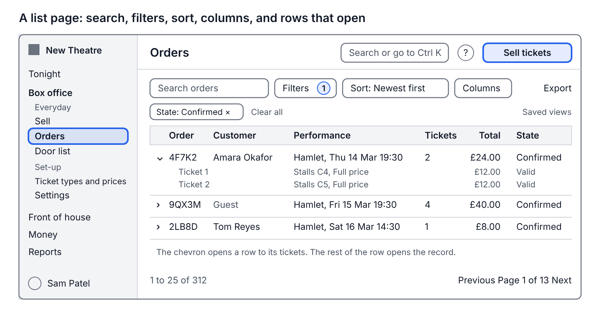
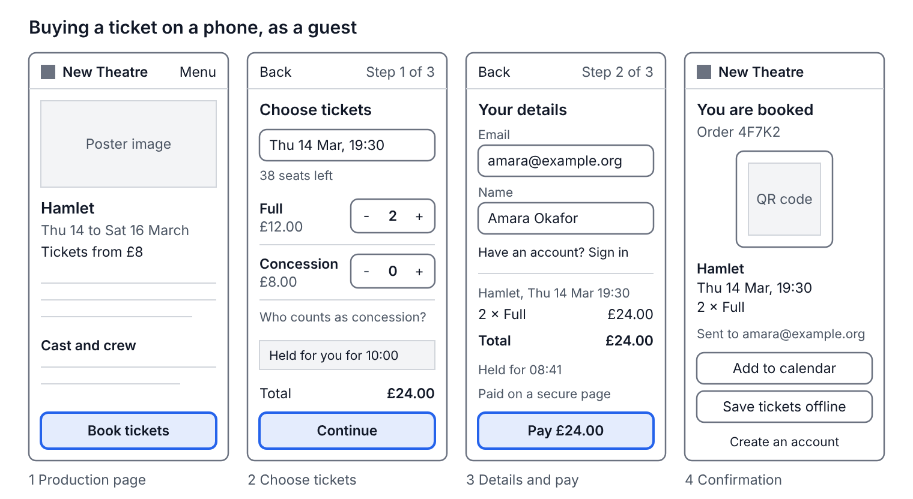
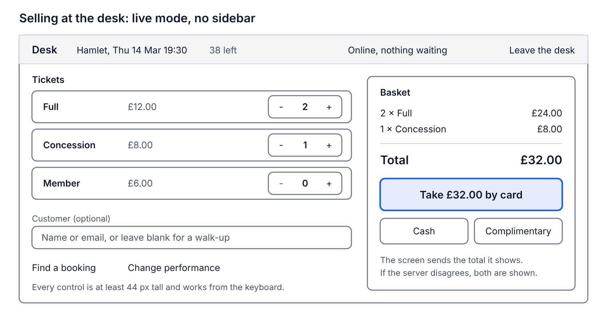
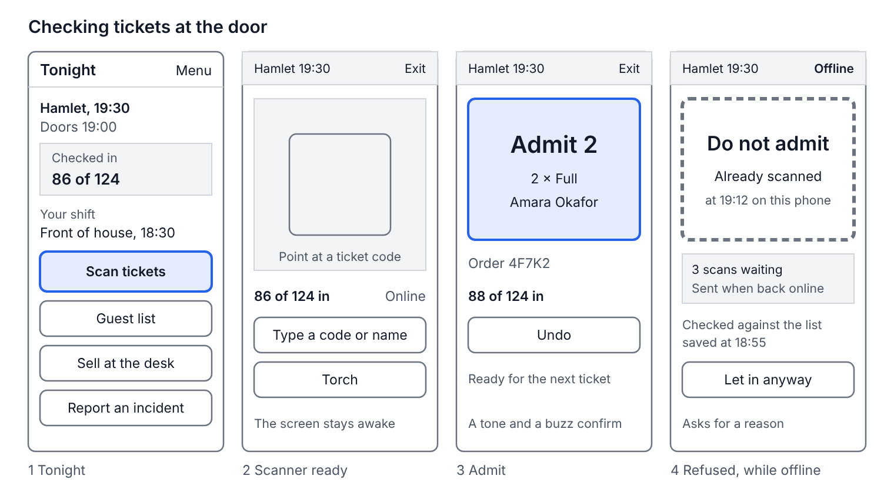
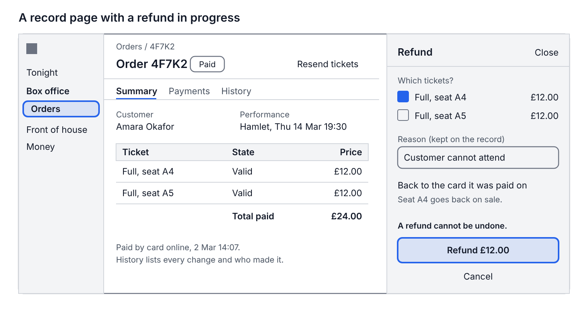
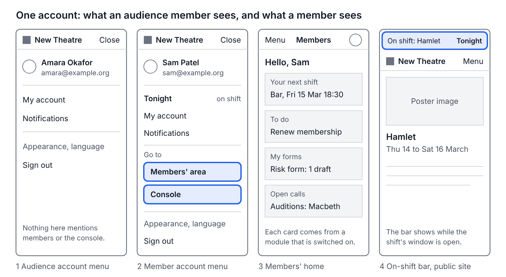
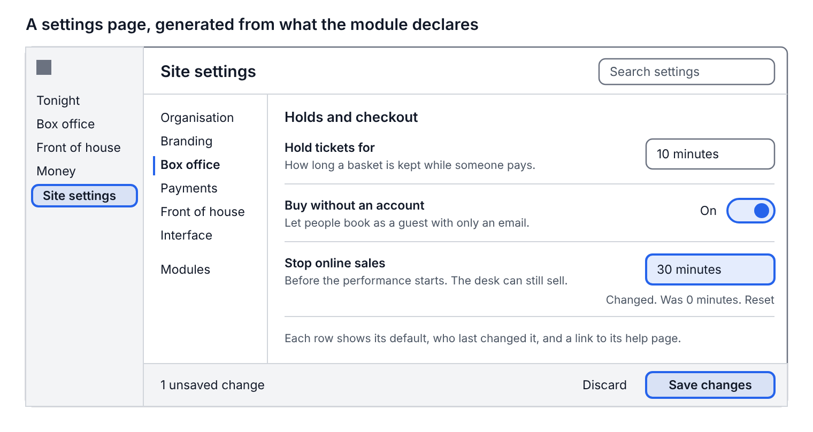
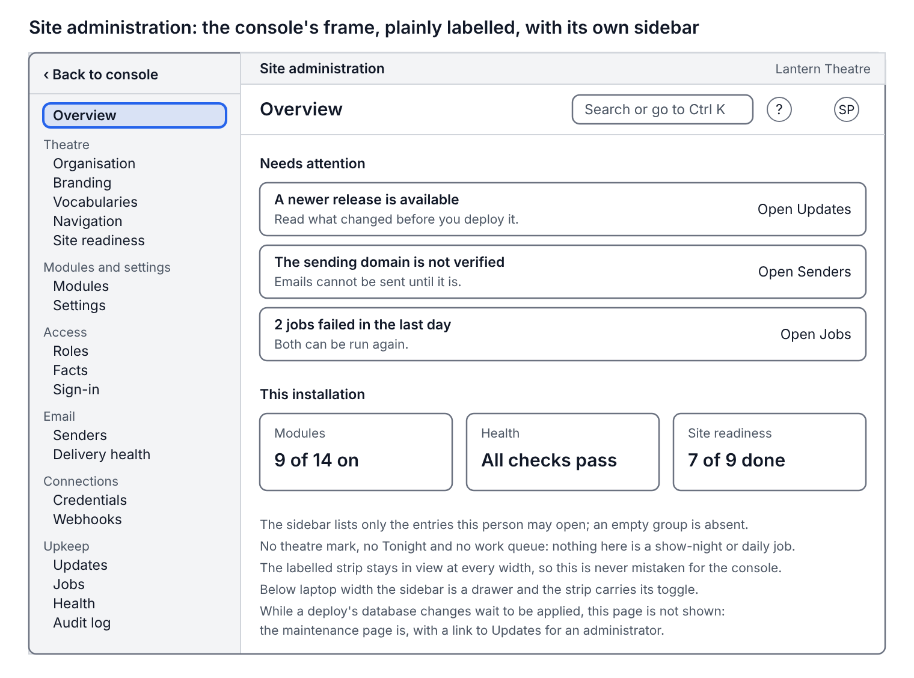

# Wireframes

Eight wireframes show the frames and the screens the box-office journeys depend on. They fix layout, order and wording, not colour or typeface: the theatre's branding supplies those. The blue outline marks each screen's one primary action.

W1, the four frames side by side, is in the Shells and navigation sub-tab. Labels in every drawing can be edited in place, and each part can be commented on.

## W2. A list in the console

*W2 · console list page, laptop width*

Every list in the console has this frame. The sidebar shows only groups this person may open, with everyday work above set-up. The header carries the title, search, help and the page's one primary action. The toolbar is always search, Filters, Sort and Columns, in that order; filters in use show as chips, and all of it lives in the address, so this exact view can be sent to a colleague. The first row is opened by its chevron to show its tickets as sub-rows. Below laptop width the sidebar becomes a drawer and each row becomes a card showing order, customer and status. W2 uses box office's own words: an order's states are Basket, Awaiting payment, Confirmed, Reserved, Expired and Cancelled (a ticket is valid, void or admitted; there is no "Paid" or "Refunded" state), and its menu entries are Sell, Orders, Door list, Ticket types and prices, and Settings. W6 still shows example statuses and labels; it draws the frame of a record, not box office's real words.

## W3. Buying a ticket on a phone

*W3 · buying a ticket, phone width*

The booking flow is a Steps page inside the public shell, with the theatre's navigation removed from step 1 onwards so nothing competes with the one button at the bottom. The hold is claimed when "Hold tickets" is pressed on Choose tickets, and its timer is first seen on Check and pay; in its last minute one button extends it once. No account is needed; the sign-in link on Check and pay is an offer, and the confirmation offers an account afterwards. Paying happens in the provider's own form, which is why it has no wireframe here; where that form sits is box office's and the payment module's decision. Where the theatre allows reserving, Check and pay offers "Reserve and pay on arrival" beside paying now, and the confirmation then says what is owed and when the reservation lapses. Those rules are the box office's; the steps and the frame do not change.

## W4. Selling at the desk

*W4 · desk sale in the console, laptop or tablet width*

The desk is a console page, not a Live page: it is reached from Sell in the Box office group, drawn laptop first and usable on a tablet, with the sidebar collapsed so the sale has the whole width. The header always says which performance is being sold and whether the reader is connected. A walk-up sale is two taps on a stepper and one on the payment button. Which payment buttons appear is decided by the payment module's settings, not by this layout; Complimentary opens the approved requests waiting to be issued and never issues one on the spot. The basket is a list of lines that any module may add to, so a drink sits beside the tickets and one payment covers them all. A reserved order opened through Find a booking loads into the same basket to be paid. The "Sell at the desk" tile on Tonight (W5) is a link to this console page for a person who holds the selling ability; it does not open a live screen.

## W5. Scanning at the door

*W5 · checking tickets, phone width*

Tonight is the home of anyone working a performance and offers only what their shift allows. The scanner is a Live page. Its answer fills the top of the screen in words, with a vibration and, where the theatre has switched the result sound on, a tone, so nobody has to judge a colour in a dark foyer. A refusal says why and when, and what the door may do next is box office's rule, drawn exactly: an already admitted ticket offers only undoing a mis-scan, with a reason; wrong performance, void or refunded, unknown code and bad signature offer nothing; not paid says "Not paid. Send to the desk". The one override is "Admit anyway" on a member-price ticket whose requirement is not met at the entry recheck, shown only to a holder of `box-office.ticket-type.override-requirement`, with a reason from the theatre's list, audited, and refused on the person's own order; anyone else sees "Send to the desk". The sound is box office's setting `box-office.scanning.result-sound`, off by default. Offline, the phone checks against the list it saved and says how old that list is; the scans it is holding are counted on screen until they send.

## W6. A record, with a panel open

*W6 · order record with the refund panel, laptop width*

A Record page keeps the thing being looked at on the left and puts a short task in a panel on the right, so the person never loses their place. The refund button names the amount, the consequence is stated above it, and the reason is required because it is kept. On a phone the panel is a full-screen sheet. A person without the refund ability does not see the action at all.

## W7. One account, two experiences

*W7 · one account, two kinds of person, phone width*

This is the answer to the complaint that audiences and members share one muddled account. Everyone has the same account and the same menu. An audience member's menu has My account, Notifications and Sign out, with the appearance and language choices, and no hint that anything else exists. A member's menu gains a short list of places to go, and only the places their abilities open. The on-shift bar is the one piece of members' furniture allowed on the public site, and only while the shift's window is open: from 30 minutes before call time to 60 minutes after the shift ends, by default.

## W8. A settings page nobody had to build

*W8 · generated settings page, laptop width*

No module draws its own settings screen. It declares each setting with a label, a sentence of help, a type and a default, and its page at `/console/<module>/settings` is built from those declarations, in sections. Changes are collected and saved together from the bar at the bottom, and a changed row says what it was before. A setting the module declares as site-wide is not on this page: it is in site administration at `/admin/settings`, and the page says so with a link. The sections and the three settings shown are examples; the real list belongs to the box office workstream.

## W9. Site administration

*W9 · site administration, laptop width*

Site administration is the console's frame with three things changed so that nobody mistakes one for the other: a strip that names it at every width, "Back to console" where the theatre's mark would be, and its own sidebar of install-level screens. Its home is not a work queue but a short list of what needs attention and the state of the installation. The groups and addresses are listed in Shells and navigation. The cards and figures drawn are examples.

## What the wireframes do not show

- The seating plan, the calendar and the form editor. Each is a custom component and belongs to its own workstream.
- Laptop versions of the public screens and phone versions of the console screens. The rules for both are in Page conventions.
- Colour, type and imagery.
