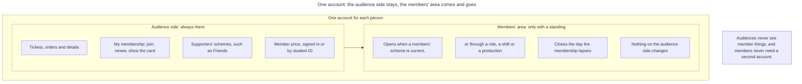
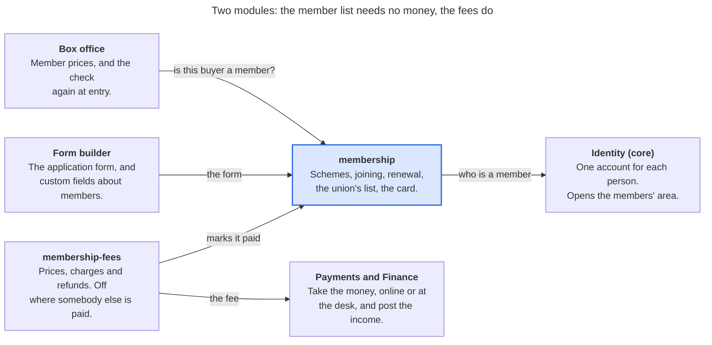

# Membership: specification

Nov 16, 2026 · @Matthew Adcock

The second-round specification for membership. It covers two modules: `membership` (schemes and their lengths, joining, renewal, verification, the standing fact and the requirement source that member pricing reads) and `membership-fees` (prices, charges and refunds through Payments). One scheme can be held for several lengths, a verification list carries end dates and needs no accounts, a reference such as a student ID can stand in for signing in at the checkout where a scheme allows it, and a member price is checked again at entry. Nothing is waiting on a decision; tab 9 records the thirteen that were made.

*one account · two sides*

*module map · 2 modules, 4 neighbours*

Diagrams and wireframes are in the tabs they belong to: the data model in tab 2, the states and the joining flow in tab 3, the routes to a member price in tab 4, and five wireframes in tab 5.

## The design in one page

- **One account, always.** A membership is a row that points at the account a person already has. Joining never creates an account and never asks for a second sign-in. A guest who once bought a ticket joins with the same account, and their orders stay where they were.
- **Membership starts on the audience side.** "Membership" is a section of My account, so anyone can find how to join. The members' area appears only while a person holds a current membership of a scheme on the members' side, and disappears at the next page load after it ends.
- **A scheme says which side it is on.** A members' scheme ("Student member", "Company member") gives a standing and opens the members' area. A supporters' scheme ("Friend of the theatre") gives benefits such as a ticket price and never opens the members' area.
- **Joining is a form, a check and a payment, in that order, and any of the three may be absent.** The application is a form from the form builder in the form slot `membership.application`. The check is a contribution to the point `membership.verifier`: by staff, by a verified email domain, or against an uploaded list such as a students' union's. The payment is a charge owned by `membership-fees`, settled through Payments in the same batch that makes the membership active.
- **Current is read, never stored.** A membership is current when it is active and today falls inside its dates. Nothing has to run for a membership to lapse, so the members' area cannot outlive it.
- **Other modules never name Membership.** Box office asks the core point `core.requirement`, to which Membership contributes one source. Identity sums the standing into `core.member`. The form builder lists Membership's facts for conditions.
- **Free membership needs no payment module.** `membership` requires only the always-on core and forms. Fees are a second, small module that requires `membership`, `payments` and `finance`, because Foundations allows no either-or dependency.

## How to read this document

| Tab | Holds |
| --- | --- |
| 1. Scope and glossary | What is in and out, the first release, and the words this specification owns |
| 2. Data model | Nine tables in the Foundations column layout, with id prefixes |
| 3. Rules and flows | States, the date rules, joining, verification, payment, renewal, ending, merge and erasure |
| 4. Interface to other modules | Services, points, facts, events, jobs, and what each other module must do to fit |
| 5. Screens | Every page by shell and page type, with five wireframes |
| 6. Settings and abilities | 20 settings, 19 abilities, record types, facts and preset mappings |
| 7. Stories | MEM-01 to MEM-58: 49 in the first release, nine of them the gate, and 9 later, with a cut order |
| 8. Tests | Named cases by tier, and the never-regress list |
| 9. Decisions | The thirteen decisions Matt made, each with its reason and where it is written |

## What it rests on

Written against the Foundations formats and rulings as they stood on 16 November 2026, the Identity specification (the account is the person; `core.member`; standings), the Form builder specification (form slots, outcome actions, `addResponse`), the Box office, payments and ledger specification (`createIntent`, `payments.settlement`, `core.requirement`, BO-20), the Interface conventions and the glossary rulings in the design paper. What it relies on from each of them is listed in tab 4 under "What this specification relies on".
