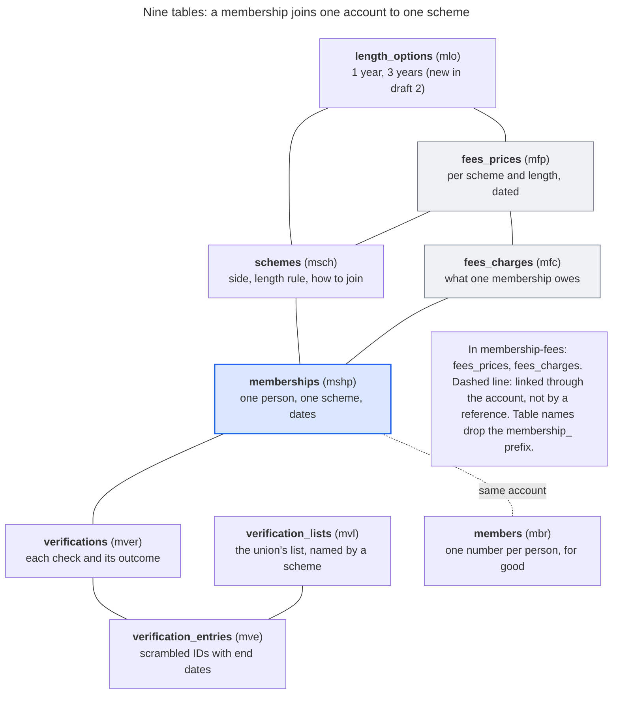

# 2. Data model

Nine tables: seven in `membership` and two in `membership-fees`. Every table is written in the Foundations column layout, every id is `<prefix>_<26 characters>`, and a person is always an account id. The one exception is a verification list entry, which stands for somebody who may have no account and may keep the name on the issuer's file.

## Tables and id prefixes

All time-sorted, and registered in Foundations' index of prefixes.

| Table | Prefix | Holds | Record type |
| --- | --- | --- | --- |
| `membership_schemes` | `msch` | The schemes a theatre offers | `membership.scheme` |
| membership\_length\_options | mlo | The lengths a scheme can be held for, such as 1 year and 3 years | none; part of membership.scheme |
| `membership_memberships` | `mshp` | One person's holding of one scheme for one span | `membership.membership` |
| `membership_members` | `mbr` | One row per person who has ever held a membership: their member number | none |
| `membership_verifications` | `mver` | Each verification outcome for a membership | none |
| `membership_verification_lists` | `mvl` | An uploaded list a scheme checks against | `membership.verification-list` |
| `membership_verification_entries` | `mve` | The entries of a list, stored as keyed hashes | none |
| `membership_fees_prices` | `mfp` | The fee for a scheme, with its history | `membership-fees.price` |
| `membership_fees_charges` | `mfc` | What one membership owes, and the payment intent opened for it | `membership-fees.charge` |

## How the tables relate

- A scheme has many memberships. A membership belongs to one scheme and one account.
- A membership may name the membership it renews (`renews_id`), which gives a person's unbroken history.
- A membership may name the form response that applied for it. `forms` is in `requires`, so the reference is allowed.
- A membership has zero or more verifications, newest last. A verification may name the list entry that matched.
- A scheme has zero or more prices over time; at most one is in force on a date. A membership has at most one charge that is not void.
- A charge names the payment intent opened for it. `payments` is in the fees module's `requires`.

*data model · 9 tables*

## membership\_schemes

**`membership_schemes`**: realm operational; subject none; no retention; not append-only; id prefix `msch`.

| Column | Type | Constraints | Class | On erasure | Notes |
| --- | --- | --- | --- | --- | --- |
| `id` | id | primary key | internal | keep |  |
| `key` | text | not null, unique, kebab-case | public | keep | Used in the join address. Fixed once the scheme has left draft |
| `name` | text | not null, up to 80 characters | public | keep | "Student member" |
| `summary` | text | up to 500 characters | public | keep | Shown where schemes are listed. Longer copy belongs on the theatre's own content page |
| `side` | text | one of `members`, `audience`; not null | internal | keep | Fixed once any membership exists. See rule S2 |
| `state` | text | one of `draft`, `open`, `closed`, `archived`; not null | internal | keep | Part 3 |
| `join_mode` | text | one of `apply`, `staff-only`; not null | internal | keep | `staff-only` suits honorary and life schemes |
| `length_rule` | text | one of `fixed`, `rolling`, `indefinite`; not null | internal | keep |  |
| `fixed_end_month` | integer | 1 to 12; set exactly when `length_rule` is `fixed` | internal | keep |  |
| `fixed_end_day` | integer | 1 to 31, valid for the month; 29 February refused | internal | keep |  |
| `rollover_days` | integer | 0 to 180; default 0 | internal | keep | Fixed-date schemes only |
| `renewal_opens_days` | integer | 0 to 180; default from `membership.renewal.opens-before` | internal | keep | 0 means renewal is not offered |
| `grace_days` | integer | 0 to 90; default from `membership.renewal.grace` | internal | keep |  |
| `verifier` | text | null, or the id of a contribution to `membership.verifier` | internal | keep | Null means nothing is checked |
| `verifier_config` | JSON | checked against the verifier's own schema | internal | keep | Email domains, or the id of a verification list. Never a secret |
| `reverify_on_renewal` | boolean | not null, default true | internal | keep |  |
| `needs_approval` | boolean | not null, default false | internal | keep | True requires an attached form with a decision stage |
| `requires_payment` | boolean | not null, default false | internal | keep | True refuses joining while nothing answers the point `membership.charge` |
| `voting` | boolean | not null, default false | internal | keep | Whether holders count for `membership.voter` |
| `position` | integer | not null | internal | keep | Order in lists |
| `created_at` | timestamp | not null | internal | keep |  |
| `updated_at` | timestamp | not null | internal | keep |  |
| accepts\_reference | boolean | not null, default false | internal | keep | Whether a reference (an entry on the scheme's reference list, such as a student ID, or a holder's member number) meets this scheme's requirement when presented in place of signing in. Rules V8 to V19 |
| holder\_may\_end | boolean | not null; default from membership.ending.by-holder | internal | keep | Whether a holder may end their own membership. Off where another body owns the membership, as a students' union does |

The length itself is not a scheme column: every scheme that is not indefinite has one or more rows in membership\_length\_options. A scheme has no money column. Its fee lives in the fees module, so `membership` never references Finance.

## membership\_length\_options

**`membership_length_options`**: realm operational; subject none; no retention; not append-only; id prefix `mlo`. It lets one scheme be held for different lengths ("1 year" and "3 years") at different prices.

| Column | Type | Constraints | Class | On erasure | Notes |
| --- | --- | --- | --- | --- | --- |
| `id` | id | primary key | internal | keep |  |
| `scheme_id` | ref `membership_schemes` | not null | internal | keep |  |
| `name` | text | not null, up to 40 characters | public | keep | "1 year", "3 years". Shown only when the scheme offers more than one |
| `count` | integer | not null, 1 to 120; unique with `scheme_id` | internal | keep | Scheme years for a `fixed` scheme, months for a `rolling` one |
| `state` | text | one of `offered`, `withdrawn`; not null | internal | keep | A withdrawn option takes no new joiners. It is never deleted once a membership names it |
| `position` | integer | not null | internal | keep | Order where the choice is shown |
| `created_at` | timestamp | not null | internal | keep |  |

A scheme with one option never shows a choice: the person simply joins. An `indefinite` scheme has no options. Opening a scheme is refused without at least one offered option (rule S4).

## membership\_memberships

**`membership_memberships`**: realm by row, from the column `realm`; subject `account_id`; retention `membership.retention.ended-after`, counted from `ends_on` or `ended_at`, whichever is later; not append-only; id prefix `mshp`.

| Column | Type | Constraints | Class | On erasure | Notes |
| --- | --- | --- | --- | --- | --- |
| `id` | id | primary key | internal | keep |  |
| `account_id` | account, subject | not null; on merge `move` | internal | keep | Moved, because the unique rule of one pending application per person per scheme would otherwise break, and one person's memberships of a scheme must count once (rule D4). The merge handler settles a clash of pending applications before the move (rule X2). Every read by account uses the kit's account scope, so nothing is missed while a merge is part done |
| `scheme_id` | ref `membership_schemes` | not null | internal | keep |  |
| length\_option\_id | ref membership\_length\_options | nullable | internal | keep | The length chosen. Null for an indefinite scheme, or when the end date came from a list entry or was set by hand |
| `realm` | text | one of `member`s, `audience`; not null | internal | keep | Copied from the scheme's side when the row is written |
| `state` | text | one of `pending`, `active`, `declined`, `expired`, `ended`; not null | internal | keep | Part 3 |
| `origin` | text | one of `applied`, `added`, `renewed`, `action`; not null | internal | keep | `action` is the form builder's outcome action |
| `renews_id` | ref `membership_memberships` | nullable | internal | keep | The membership this one follows |
| `response_id` | ref `forms_responses` | nullable | internal | keep | The application, when there was a form |
| `starts_on` | local date | null while pending | internal | keep |  |
| `ends_on` | local date | nullable; on or after `starts_on` | internal | keep | Null for an indefinite scheme |
| `needs_verification` | boolean | not null | internal | keep | Copied from the scheme when the row is written, so a later change to the scheme does not move the goalposts |
| `needs_approval` | boolean | not null | internal | keep |  |
| `needs_payment` | boolean | not null | internal | keep |  |
| `verified_at` | timestamp | nullable | internal | keep |  |
| `approved_at` | timestamp | nullable | internal | keep |  |
| `paid_at` | timestamp | nullable | internal | keep | Set by the fees module's settle handler through a membership service |
| `activated_at` | timestamp | nullable | internal | keep |  |
| `expires_at` | timestamp | set while pending | internal | keep | When an unfinished application expires |
| `ended_at` | timestamp | nullable | internal | keep |  |
| `end_reason` | text | one of `by-holder`, `by-staff`, `refunded`, `superseded`, `erased`; set exactly when state is `ended` | internal | keep |  |
| `added_by` | account, actor | nullable; on merge `alias` | internal | keep | Staff who added the member directly |
| `ended_by` | account, actor | nullable; on merge `alias` | internal | keep |  |
| `note` | text | up to 1,000 characters | free text | redact | A staff note, never shown to the holder's peers |
| `last_reminder` | text | nullable; one of `window-open`, `final`, `lapsed` | internal | keep | Makes the reminder task safe to run twice |
| `lapse_announced_at` | timestamp | nullable | internal | keep | Makes the lapse event fire once |
| `created_at` | timestamp | not null | internal | keep |  |
| `updated_at` | timestamp | not null | internal | keep |  |

Indexes and constraints that carry rules:

| Constraint | Rule it enforces |
| --- | --- |
| Unique on (`account_id`, `scheme_id`) where `state = 'pending'` | One open application per person per scheme (J3) |
| Unique on `renews_id` where `state` in (`pending`, `active`) | A membership is renewed once (R3) |
| Check: `state = 'active'` implies `starts_on` is set and each needed requirement has its timestamp | No membership is active with a requirement unmet (A1) |
| Check: `ends_on` is null or `ends_on >= starts_on` | Dates are in order |
| Index on (`account_id`, `state`, `starts_on`, `ends_on`) | The standing is one indexed read per request |
| Index on (`scheme_id`, `state`, `ends_on`) | Lists, counts and the reminder task |

On erasure the row is kept with its dates and scheme, so counts by year stay true, and the account id then points at a tombstone. The note is redacted. An active membership is ended with reason `erased` in the same batch, through `core.erasure-handler`.

## membership\_members

**`membership_members`**: realm members; subject `account_id`; no retention (the row lives as long as the account); not append-only; on erasure keep the row, so its number is never issued again; id prefix `mbr`.

| Column | Type | Constraints | Class | On erasure | Notes |
| --- | --- | --- | --- | --- | --- |
| `id` | id | primary key | internal | keep |  |
| `account_id` | account, subject | not null, unique; on merge `handler` | internal | keep | `handler`, because a person has this row once only and it is the living record a member number hangs on. When two rows meet in a merge, the lower number survives (rule X2) |
| `number` | integer | not null, unique, at least 1 | internal | keep | Never reused, even after erasure |
| `first_joined_on` | local date | not null | internal | keep | "Member since" |
| `created_at` | timestamp | not null | internal | keep |  |

The number is given in the same batch as the first activation. The next number is one more than the table's highest, read and written in one statement, and rows are never deleted, so no separate counter table is needed and the unique index settles a race. A supporters' scheme gives a number too; the prefix shown beside it is a setting.

## membership\_verifications

**`membership_verifications`**: realm by parent, through `membership_id`; subject through `membership_id`; retention as its membership; append-only except erasure; id prefix `mver`.

| Column | Type | Constraints | Class | On erasure | Notes |
| --- | --- | --- | --- | --- | --- |
| `id` | id | primary key | internal | keep |  |
| `membership_id` | ref `membership_memberships` | not null | internal | keep |  |
| `verifier` | text | not null | internal | keep | The contribution id that ran |
| `outcome` | text | one of `passed`, `failed`, `needs-staff`; not null | internal | keep |  |
| `reason` | text | a reason code from the verifier | internal | keep | Such as `no-address-at-domain`, `entry-already-used` |
| `entry_id` | ref `membership_verification_entries` | nullable | internal | keep | The list entry that matched |
| `decided_by` | account, actor | nullable; on merge `alias` | internal | keep | Set when a person decided. `alias`, because the table is append-only |
| `note` | text | up to 500 characters | free text | redact | The one erasable column |
| `created_at` | timestamp | not null | internal | keep |  |

## membership\_verification\_lists

**`membership_verification_lists`**: realm operational; subject none; no retention; not append-only; id prefix `mvl`.

| Column | Type | Constraints | Class | On erasure | Notes |
| --- | --- | --- | --- | --- | --- |
| `id` | id | primary key | internal | keep |  |
| `name` | text | not null, up to 80 characters | internal | keep | "Students' union members 2026 to 2027" |
| `key_kind` | text | one of `email`, `reference`; not null | internal | keep | What each entry is. Rule V4 |
| `entry_count` | integer | not null, at least 0 | internal | keep | Kept by the upload job |
| `valid_until` | local date | nullable | internal | keep | After this date the list matches nothing and its entries are deleted |
| `uploaded_by` | account, actor | not null; on merge `alias` | internal | keep |  |
| `uploaded_at` | timestamp | not null | internal | keep | Of the latest upload |
| `created_at` | timestamp | not null | internal | keep |  |
| reference\_label | text | up to 120 characters; required when key\_kind is reference | public | keep | The whole phrase shown as the field's label, naming the scheme and the issuer: "NNT member? Enter your University of Nottingham student ID". Never a bare noun (rule V13) |
| reference\_noun | text | up to 40 characters; required when key\_kind is reference (lists made before it read "reference") | public | keep | The short noun that messages use in a sentence ("student ID"): "Your student ID is 8 digits", "That student ID has already been used". Messages never splice the whole reference\_label in (rule V13) |
| reference\_shape | text | nullable; one of digits, letters-and-digits, with a minimum and maximum length | internal | keep | What a well-formed reference looks like. Used only to tell a mistyped reference from one that is well formed but not on the list (rule V15). Not a free pattern |

## membership\_verification\_entries

**`membership_verification_entries`**: realm operational; subject { unlinked: 'staff' } (an entry is a person who may have no account, whom only staff can find, with membership.verification-list.manage as the ability to search and redact); holder\_name erased membership.verification.names-keep-for after ends\_on; the row's retention `membership.verification.list-keep-for`, and sooner when the list's `valid_until` passes; not append-only; id prefix `mve`.

| Column | Type | Constraints | Class | On erasure | Notes |
| --- | --- | --- | --- | --- | --- |
| `id` | id | primary key | internal | keep |  |
| `list_id` | ref `membership_verification_lists` | not null | internal | keep |  |
| `key_hash` | text | not null; unique with `list_id` | personal | clear | A keyed hash of the trimmed, lower-cased address or reference. The plain value is never stored |
| ends\_on | local date | nullable | internal | keep | When this person's entitlement ends, from the file's second column. After it the entry matches nothing. A membership verified by the entry takes this as its end date (rule D9) |
| holder\_name | text | nullable; up to 120 characters | personal | erase | The name on the issuer's file, kept so staff can compare it with the person presenting the reference (rule V18). The one column of an entry that is not a hash. Shown only to staff, one entry at a time, as an audited read |
| `used_by` | ref `membership_memberships` | nullable | internal | keep | `The membership that claimed the entry. A reference entry is claimed by one account only (rule V4); until then, and after, it can still be presented at a checkout where the scheme allows it (rule V8)` |
| `created_at` | timestamp | not null | internal | keep |  |

The table holds personal data about people who may have no account, so the data request screen lists it as a manual step: a member of staff searches the list by name or number and redacts the row. When an entry has been claimed by a membership, erasing that account redacts the entry too, through Membership's erasure handler.

The uploaded file has up to three columns: the address or reference, the date the entitlement ends, and the holder's name. A students' union's export of names, student IDs and end dates loads as it stands. It is read by a bulk job, hashed row by row with the secret `MEMBERSHIP_LIST_KEY`, and deleted from the file store when the job ends. Staff see the list's name, date and count, never its contents as a list. The table declares retention because it holds a personal column with no subject, as the Foundations check requires. A hash of an address is still personal data, which is why the class is personal and the table is swept.

## membership\_fees\_prices

**`membership_fees_prices`**: realm operational; subject none; no retention; append-only (a price is replaced, never edited, so a past charge always shows the price it was made at); id prefix `mfp`.

| Column | Type | Constraints | Class | On erasure | Notes |
| --- | --- | --- | --- | --- | --- |
| `id` | id | primary key | internal | keep |  |
| `scheme_id` | ref `membership_schemes` | not null | internal | keep |  |
| length\_option\_id | ref membership\_length\_options | nullable; unique with scheme\_id, applies\_to and from\_date | internal | keep | The length this price is for: £10 for 1 year, £25 for 3 years. Null means every length. A price for the chosen length wins over a null one |
| `amount_minor` | minor units | not null, at least 1 | internal | keep | A free scheme has no price row |
| `currency` | currency | not null; the site's currency | internal | keep |  |
| `tax_code_id` | ref `finance_tax_codes` | not null | internal | keep | Finance's default for membership, changeable |
| `applies_to` | text | one of `join-and-renew`, `join`, `renew`; not null | internal | keep | Lets a renewal cost less than joining |
| `from_date` | local date | not null; unique with `scheme_id` and `applies_to` | internal | keep | The price in force is the latest `from_date` not after today |
| `set_by` | account, actor | not null; on merge `alias` | internal | keep |  |
| `created_at` | timestamp | not null | internal | keep |  |

## membership\_fees\_charges

**`membership_fees_charges`**: realm by parent, through `membership_id`; subject through `membership_id`; retention `membership-fees.retention.charges`; not append-only; id prefix `mfc`.

| Column | Type | Constraints | Class | On erasure | Notes |
| --- | --- | --- | --- | --- | --- |
| `id` | id | primary key | internal | keep |  |
| `membership_id` | ref `membership_memberships` | not null | internal | keep |  |
| `price_id` | ref `membership_fees_prices` | not null | internal | keep |  |
| `amount_minor` | minor units | not null, at least 1 | internal | keep | Copied from the price when the charge is made |
| `currency` | currency | not null | internal | keep |  |
| `tax_code_id` | ref `finance_tax_codes` | not null | internal | keep |  |
| `state` | text | one of `open`, `paid`, `void`, `refunded`, `part-refunded`; not null | internal | keep | Part 3 |
| `intent_id` | ref `payments_intents` | nullable | internal | keep | The open or settled intent. Payments allows one open intent per owner |
| `channel` | text | one of `online`, `desk`; nullable | internal | keep | Of the payment that settled it |
| `refunded_minor` | minor units | not null, default 0, at most `amount_minor` | internal | keep |  |
| `posting_id` | ref `finance_postings` | nullable | internal | keep | The income posting |
| `paid_at` | timestamp | nullable | internal | keep |  |
| `created_at` | timestamp | not null | internal | keep |  |
| `updated_at` | timestamp | not null | internal | keep |  |

| Constraint | Rule it enforces |
| --- | --- |
| Unique on `membership_id` where `state` is not `void` | A membership is charged once (P2) |
| Check: `state = 'paid'` implies `intent_id` and `paid_at` are set | A paid charge always names its payment |

A charge holds no card detail and no name. Its retention setting must be at least Finance's retention for postings, and a cross-setting rule in tab 6 says so.

## What is deliberately not stored

| Not stored | Why |
| --- | --- |
| Whether a membership is current or lapsed | Derived from the state and the dates at each read (rule D1), so it cannot be stale |
| A "member" flag on the account | The standing is a fact Identity reads at the request |
| A member's name, address, course or year | Name and address are Identity's. Anything else a theatre wants to hold about its members is a custom field, in the form slot `membership.member-fields` |
| The contents of a verification list | References and addresses are kept only as keyed hashes, so an uploaded union list cannot be read back out. A name is kept in the clear for staff, one entry at a time |
| A history table of state changes | The core audit log records every change with its actor, and the requirement timestamps record when each step was met |
