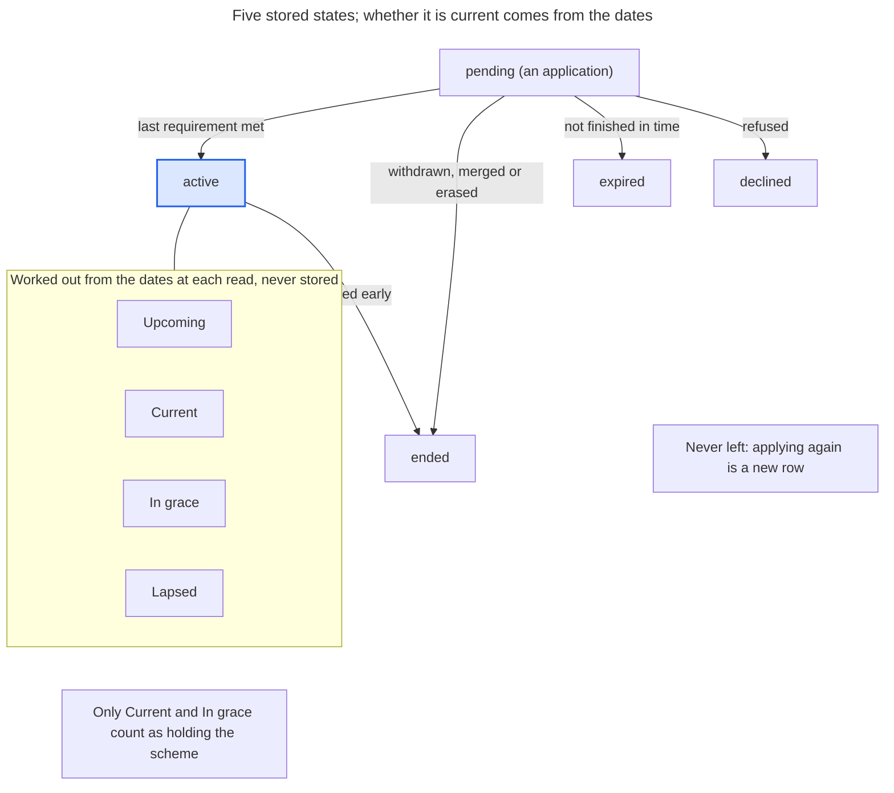
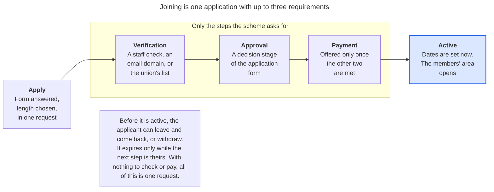

# 3. Rules and flows

A membership has five stored states and its currency is worked out from its dates each time it is read. Every change of state is one guarded update inside one unit of work, with its audit entry and event in the same batch.

## States of a scheme

| State | Meaning | May go to |
| --- | --- | --- |
| `draft` | Being set up. Not listed, not joinable | `open`, deleted |
| `open` | Listed and joinable (or addable by staff, for `staff-only`) | `closed` |
| `closed` | No new joiners. Existing memberships run on and may renew | `open`, `archived` |
| `archived` | Hidden from lists. Existing memberships run to their end and may not renew | `closed` |

- **S1.** A scheme is deleted only while it is a draft with no memberships. After that it is closed or archived, never deleted.
- **S2.** A scheme's side cannot change once any membership exists. Changing it would silently give or take the members' area for everyone holding it. A theatre closes the scheme and opens another.
- **S3.** Changing a scheme's length rule, verifier, approval or payment requirement affects memberships written afterwards. A pending application keeps the requirements copied onto it, and an active membership keeps its dates.
- **S4.** Opening a scheme is refused when it is not indefinite and has no offered length option, when it needs approval and has no attached form with a decision stage, when its verifier's module is off or its configuration is invalid, or when it requires payment and has no price in force.
- **S5.** A scheme that requires payment cannot be joined while nothing answers the point `membership.charge` (the fees module is off). The join button says the scheme is not available online, and staff can still add a member directly. Fees are never silently waived.

## States of a membership

| State | Meaning | Entered by | May go to |
| --- | --- | --- | --- |
| `pending` | An application with at least one requirement unmet | Applying, renewing, a form's outcome action | `active`, `declined`, `expired`, `ended` |
| `active` | Every requirement met. Has dates | The last requirement being met, or staff adding a member | `ended` |
| `declined` | Verification failed for good, or the application was declined at a form's decision stage | Staff, or the form's decision | none |
| `expired` | The application was not finished in time | The daily sweep | none |
| `ended` | Stopped early, with a reason | The holder, staff, a full refund, a merge, an erasure | none |

*membership states · 5 stored, 4 derived*

Terminal states are never left. A person whose application was declined or expired applies again and gets a new row.

## What is derived from an active membership

- **D1.** With `today` as the kit's `today()` in the theatre's time zone, and `grace` the scheme's grace days:

| Derived status | Condition |
| --- | --- |
| Upcoming | `today < starts_on` |
| Current | `starts_on <= today` and (`ends_on` is null or `today <= ends_on + grace`) |
| In grace | Current, and `today > ends_on` |
| Lapsed | `ends_on` is set and `today > ends_on + grace` |

- **D2.** Nothing is written when a membership lapses. The standing, the eligibility rule and every fact read D1 at the request. A daily task announces the lapse for listeners and sends the reminder, and if that task never ran the membership would still have lapsed.
- **D3.** All dates are local dates. A membership that ends on 31 July is current for the whole of 31 July in the theatre's time zone.
- **D4.** A person holds a scheme currently when they have at least one current membership of it. Two current memberships of one scheme (the old one in grace and its renewal) count once.

## Setting the dates

- **D5.** Dates are set at activation, not at application, so a slow approval does not eat into the membership.
- **D6.** For a first membership or one after a lapse, `starts_on` is the activation date. For a renewal made while the earlier membership is current, `starts_on` is the day after the earlier `ends_on`, so no day is paid for twice and none is lost.

| Length rule | `ends_on` |
| --- | --- |
| `fixed` | The next occurrence of the scheme's end month and day on or after `starts_on`. If that is within the scheme's rollover days of `starts_on`, one year later. An option of N scheme years ends N less one years after that date |
| `rolling` | `starts_on` plus the chosen option's months, less one day. A start on the 31st into a shorter month ends on that month's last day |
| `indefinite` | Null. The membership ends only when somebody ends it |

Example, fixed-date scheme ending 31 July with 60 rollover days: joining on 10 October 2026 runs to 31 July 2027. Joining on 20 June 2027 runs to 31 July 2028.

- **D7.** Staff adding a member may set either date by hand, with `ends_on` not before `starts_on`. This is how a mid-year correction or a backdated membership is recorded, and the audit entry holds both the calculated and the chosen dates.

* **D8.** A scheme that is not indefinite offers one or more length options (`membership_length_options`). The applicant chooses one when applying, and the choice is copied onto the membership; with a single option nothing is asked. For a `fixed` scheme an option counts scheme years, and for a `rolling` scheme it counts months. So "£10 for 1 year or £25 for 3 years" is one scheme with two options and two prices, and "every membership resets at the start of September, whenever it was bought" is a `fixed` scheme ending 31 August with one option.
* **D9.** Where the list entry that verified a membership carries its own end date, the membership ends on that date and `length_option_id` is null. The other body's record wins, so the theatre's copy never outlasts the union's.
* **D10.** A member of staff passing an application sees the length the applicant chose and may change it, or set the end date, before passing. This is how a committee member who has looked the applicant up on the students' union's website records what the union shows.

Example, `fixed` scheme ending 31 July, joining on 10 October 2026: the 1 year option runs to 31 July 2027 and the 3 years option to 31 July 2029.

## Joining

*joining · one application, up to three requirements*

The journey for a scheme with `join_mode` `apply`. Steps 3 to 5 exist only when the scheme asks for them.

1. **Find the scheme.** Schemes that are open are listed on My account, Membership, and wherever the theatre places the public component `MembershipSchemes`. Signed-out visitors see them when `membership.join.public-listing` is on.
2. **Sign in.** The join route is declared `signed-in`. A visitor is sent through sign-in and returned to the same scheme. Signing in with the address they once bought tickets with claims that account, so their history is already there.
3. **Answer the application form**, if one is attached in the form slot `membership.application`. The form is rendered by `FormsSlot` and checked by `checkAnswers`.
4. **Verification** runs as part of submitting (rules V1 to V7).
5. **Payment**, when the scheme requires it (rules P1 to P8).
6. **Active.** The page shows the membership, its dates and the card. If the scheme is a members' scheme, the members' area entry is in the header from this response onwards.

- **J1.** Applying is one unit of work: the membership row in `pending`, the form response through `addResponse`, the first verification row, the charge through the point `membership.charge`, the audit entry and the event. If any part refuses, nothing is written.
- **J2.** If every requirement is already met at the end of that unit (a free scheme with no check, or a check that passes at once), the same unit activates the membership. A person joining a free, unchecked scheme is a member in one request.
- **J3.** One open application per person per scheme, by unique index. A second attempt returns the first.
- **J4.** Applying is refused, with a remedy, when the person already holds the scheme currently and is outside its renewal window (the remedy says when renewal opens), when the scheme is not open, or when it is `staff-only`.
- **J5.** An application has an `expires_at`, set from `membership.applications.expire-after`. A daily task moves an application past it to `expired`, voids its charge and cancels its open payment intent. An application waiting on staff (verification or approval) does not expire while it waits; the clock runs only while the next step is the applicant's.
- **J6.** A person may withdraw their own application at any time before it is active. It moves to `ended` with reason `by-holder`, and the form response is withdrawn with `withdrawResponses`.
- **J7.** Joining never asks for a name, an address or a password. Those are the account's. The form slot's `features` forbid a payment question, because payment is the fees module's step.

## Requirements and activation

- **A1.** A membership becomes `active` in the unit of work that sets its last outstanding requirement timestamp, by one conditional update: `... set state = 'active', starts_on = ?, ends_on = ?, activated_at = ? where id = ? and state = 'pending' and` every needed timestamp is set. The unit expects one row to change.
- **A2.** The three requirements are independent and may be met in any order, with one exception: payment is not offered until verification and approval are met. Nobody is asked to pay for a membership they may be refused.
- **A3.** The first activation of any membership for an account writes its `membership_members` row and number in the same unit.
- **A4.** Activation announces `membership.membership.started` and sends the welcome notification on the side the scheme is on.
- **A5.** A membership on an unclaimed account (a person staff added by address) is active and dated like any other. Its holder sees the members' area the first time they sign in, because that sign-in claims the same account.

## Verification

- **V1.** A scheme names at most one verifier. A verifier is a contribution to the point `membership.verifier` and returns `passed`, `failed` or `needs-staff`, with a reason code. Every outcome is a row in `membership_verifications`.
- **V2.** `passed` sets `verified_at`. `needs-staff` leaves the application pending and puts it in the staff queue. `failed` leaves it pending with the reason shown to the applicant and a way to try again (add and verify another address, for instance); staff may also decline it.
- **V3.** Staff with `membership.membership.verify` may pass or decline any application waiting on verification, whatever the verifier, with a note. Nobody verifies their own application: the ability is declared `owner: 'refuses'`.

| Shipped verifier | Passes when | Otherwise |
| --- | --- | --- |
| `membership.staff` | A person with the ability says so, having seen the application form's answers | `needs-staff` at once |
| `membership.email-domain` | The account has a verified address at one of the scheme's listed domains | `failed` with the remedy "add and verify an address at one of these domains" |
| `membership.list` | A verified address of the account matches an entry of the scheme's list (key kind `email`), or a reference the applicant typed matches an entry no other account has claimed (key kind `reference`) | `failed`, or `needs-staff` when the scheme is set to send misses to staff |

- **V4.** An `email` list is matched only against addresses the account has verified, so typing somebody else's address proves nothing. A `reference` list (a membership number issued by another body) cannot be proved by the system, so each entry may be claimed by one account only: the entry records which membership claimed it, and a claim from a second account returns `needs-staff` with reason `entry-already-used`.
- **V5.** A verifier reads the account through Identity's services and never sees or stores the address itself beyond the comparison. The list verifier compares hashes.
- **V6.** At renewal the verifier runs again when the scheme says `reverify_on_renewal`. A student who has left is not renewed on last year's check.
- **V7.** A verifier whose module is switched off returns nothing. The application waits as `needs-staff`, in line with the Foundations rule that a missing contributor never throws.

### A reference without an account

Where another body runs the membership (a students' union, a parent society), the theatre wants its own record and the member price without making every member create an account first. A scheme may therefore accept a reference in place of signing in. The same mechanism serves a theatre that issues its own memberships, through the member number.

- **V8. What a reference is.** A scheme with `accepts_reference` on lets a reference meet its requirement for somebody who is not signed in as a holder. A reference is either an entry on one of the scheme's reference lists (for a students' union, a student ID) or the member number of somebody who currently holds the scheme ("M-00412"). It is off unless the scheme turns it on.
- **V9. What it gives.** A presented reference gives the benefit and nothing else: no account, no membership row, no member number, no standing and no members' area. Somebody who wants those signs in and joins; a reference on the list then verifies them at once and the entry is claimed (V4).
- **V10. Handling the typed value.** A presented value is hashed with the list's key as it arrives and compared; a member number is looked up directly. The plain value is never stored, and never reaches the audit log, an event or a job. The answer is met until the entry's or the membership's end date.
- **V11. Evidence.** Every met answer carries evidence, an opaque id the host keeps with what it sold so the same entitlement can be judged again later without the reference being typed. One membership has one evidence by either route: where a list entry exists (claimed by a membership or not), the evidence is the entry's id; otherwise it is the membership's id. A check met by account returns the same evidence that person's reference would. It does not change when an entry is claimed later, and importing a list again keeps the id of every entry whose reference is unchanged. An evidence id is not a secret and proves nothing by being held: it is judged afresh at every check.
- **V12. Where the field appears.** The field belongs to the ticket type that carries the requirement and appears only once somebody chooses that type, online and at the desk, whenever the check by account does not answer met. A standard, student or concession ticket never shows it; proof for a concession stays a matter of showing evidence in person. A signed-in holder is never asked for their own.
- **V13. Its wording.** The field must never read as a general request for a student ID. Its label is the list's `reference_label`, a whole phrase written by the theatre that names the scheme and the issuer ("NNT member? Enter your University of Nottingham student ID"), never a bare noun. Saving a list without one is refused. For member numbers the label is built from the scheme's name ("Friends member? Enter your member number").
- **V14. One reference, one ticket.** Each ticket of such a type is met on its own, so one order may hold member tickets for several people. A signed-in holder's own membership meets one ticket. Every further ticket asks for one reference, labelled as another person's ("Booking for another NNT member? Enter their University of Nottingham student ID"). A buyer with no membership enters one reference per ticket. Each ticket keeps its own evidence and is checked at the door on its own.
- **V15. A miss.** When the value is well formed by the list's `reference_shape` but matches nothing, the message speaks of the membership, not the ID ("We could not find an NNT membership for that ID. Have a membership? Contact us"), linking to `membership.help.link`. When it is not well formed, the message says what one looks like. A miss reads the same whether or not the value exists on another list or belongs to somebody else, a hit says only that the price applies and until when, and no answer to a buyer ever carries a name.
- **V16. What bounds misuse.** A reference is not a secret: anybody who knows a student ID can type it. Three things bound that. The kit rate limits every check that carries a typed value, by session and by network address; Membership does no limiting of its own. The host limits how many tickets one holder may have for one performance, counted by evidence so that the account route and the reference route count as one (Box office's `max_per_holder`, default 1). And a ticket bought by reference is always checked again at entry; the host may not switch that check off for these tickets. A theatre that needs more certainty leaves `accepts_reference` off, and its members sign in.
- **V17. When somebody else used it.** A holder who finds their one ticket already taken by somebody who typed their reference is told to contact the theatre, with the same help link. Staff see the earlier ticket against the membership, with when the reference was presented, and Box office's own rules let them void it or allow another. The earlier ticket in any case meets the check at the door, where its buyer cannot show the card.
- **V18. Names.** A list entry may keep the holder's name (`holder_name`), so that staff can tell whether the person in front of them is the member. It is shown to staff only: on the list check, on an application being checked, and at the door or desk when a ticket bought by reference is looked at, where it is compared with the card or ID shown. It never travels in a requirement answer. Importing a list again replaces the names, removing an entry removes its name, and a name is erased `membership.verification.names-keep-for` (12 months) after the entry's end date. For a reference that is a member number, the name is the holder's account name.
- **V19. Managing a list by hand.** Staff with `membership.verification-list.manage` may add one entry (a reference or address, an end date and a name), remove one by typing it, and search the list by name or number to redact a row. Staff with `membership.verification-list.check` may type a reference and be told whether it is on the list, until when, and in whose name. Neither shows the list.

## Approval

- **AP1.** Approval is a decision stage of the attached application form, run by the form builder: reviewers, conflicts and messages are all the form builder's. Membership has no approval screen of its own.
- **AP2.** Membership listens for `forms.response.decided`. For a response in the form slot `membership.application`, an outcome of approved sets `approved_at`; declined moves the application to `declined`. The listener guards on the event id.
- **AP3.** A scheme that needs approval cannot be opened without such a form (S4).

## Payment

These rules belong to `membership-fees`. With that module off, no scheme can require payment online and none of this exists.

- **P1.** A charge is made when the application is written, for the price in force that day (`join` or `renew` as fits, for the length chosen), and is `open` until paid or void. The price is copied onto the charge, so a later price change never alters what somebody was quoted.
- **P2.** One charge per membership that is not void, by unique index.
- **P3.** Paying opens a payment intent with `createIntent`, owner `membership-fees.charge`, for the charge's amount. Online, the fees module calls Payments' collect with its part, on the channel `online`. At the desk it contributes a panel to `payments.desk-basket` (rule P8). Payments allows one open intent per owner, so a second "Pay now" reuses or replaces the first.
- **P4.** The fees module contributes a handler to `payments.settlement`. Its `settle(uow, intent)` runs in Payments' own batch and adds: the charge to `paid`, the income posting through Finance's `postEntries`, and `markPaid(uow, membershipId)` from the membership module, which sets `paid_at` and activates under A1. Money, ledger and membership change together or not at all.
- **P5.** `cannotSettle(intent)` answers true when the charge is void or the membership is declined, expired or ended. Payments then marks the intent unfulfilled and refunds it by its own rules. A payment that lands after an application expired is never kept.
- **P6.** Income is posted in full on the day the charge is paid, to the system account `membership-fees.income`. It is not spread across the membership's months.
- **P7.** A refund is asked for with `requestRefund` and follows Payments' own approval rule (two people). The handler's `refunded(uow, refund)` adds the reversing posting and updates the charge. A full refund ends the membership with reason `refunded` when `membership-fees.refunds.end-on-full-refund` is on; a part refund leaves it running.
- **P8.** At the desk, staff with `membership-fees.payment.take` take the fee through the panel the fees module contributes to `payments.desk-basket`, inside the seller's open till session, by any method the desk offers, alone or with tickets in one payment. The panel's prepare returns the owner and amount, and its release is idempotent. The settle handler is the same; if any part of a shared payment refuses, nothing settles.
- **P9.** Staff adding a member directly choose one of: take payment now (P8), send the person a link to pay (the membership waits as pending), or mark the fee as waived with a reason. A waiver sets `paid_at`, voids the charge and is audited; it needs `membership-fees.charge.waive`.

## Renewal

- **R1.** A current membership may be renewed from the day its renewal window opens (`ends_on` less the scheme's `renewal_opens_days`) until the end of its grace. Renewing is applying again, with `renews_id` set and origin `renewed`.
- **R2.** A renewal made in that window starts the day after the earlier membership ends (D6). A person renewing after the lapse starts today, still linked by `renews_id` so "member since" is unbroken.
- **R3.** A membership is renewed once, by unique index. Pressing renew twice returns the first renewal.
- **R4.** Renewal reuses the application form only if the scheme's form says so (the form builder's prefill carries last year's answers). Verification runs again under V6. Approval is not asked for again unless the scheme sets it.
- **R5.** A renewal is into the same scheme. Moving to a different scheme is joining that scheme; the old membership runs to its end or is ended by the holder.
- **R6.** A closed scheme may still be renewed. An archived one may not.
- **R7.** An indefinite membership is never renewed and receives no reminders.

| Reminder | Sent | To |
| --- | --- | --- |
| Renewal is open | The day the window opens, or `membership.reminders.first` before the end, whichever is later | The holder, on the scheme's side |
| Last reminder | `membership.reminders.final` before the end | The holder |
| Lapsed | The day after the end of grace, when `membership.reminders.after-lapse` is on | The holder, always on the audience side, because the members' area is gone |

- **R8.** Reminders are sent by a daily task. Each is recorded in `last_reminder` in the same unit that queues it, so a task run twice sends once. A holder who has already renewed gets none.
- **R9.** Reminders are service messages about something the person holds. They are transactional in core's sense and have no marketing preference switch.

## Ending

| Who | How | Reason | Effect |
| --- | --- | --- | --- |
| The holder | Where the scheme allows it (holder\_may\_end): "End my membership" on My membership, with a confirmation that says what they lose and whether any fee is returned | `by-holder` | Ends today. No refund by itself |
| Staff with `membership.membership.end` | From the membership's record, with a required note | `by-staff` | Ends today or on a chosen date not in the past |
| A full refund | P7 | `refunded` | Ends in the refund's batch |
| A merge | X2 | `superseded` | The duplicate ends |
| An erasure | X4 | `erased` | Ends in the erasure batch |

- **E1.** Ending is a guarded update from `active` or `pending`. An ended membership is never reopened; staff add a new one, with dates set by hand if the ending was a mistake.
- **E2.** Ending a membership ends nothing else. A renewal already made stays, and staff are warned of it.
- **E3.** The members' area follows from D1 at the next request. No session is ended and nothing on the audience side changes.
- **E4.** Ending a membership changes no ticket. Membership answers for whatever instant it is asked about. When to ask is the host's choice for each ticket type. Box office asks when the ticket is bought and, by default, again at entry (tab 4), where a membership that has since ended is not met and Box office's door rule decides what follows.

## Staff adding a member

- **G1.** Staff with `membership.membership.add` pick a person with Identity's person picker, or enter a name and address, which calls `findOrCreateAccount`. No second account is ever made for an address.
- **G2.** The membership is written `active` at once with `origin` `added`: verification and approval are taken as given by the member of staff, and the audit entry says so. Payment follows P9.
- **G3.** A person cannot add a membership to their own account. The ability is declared `owner: 'refuses'`.
- **G4.** `staff-only` schemes can be entered no other way. Honorary and life memberships are an indefinite, free, `staff-only` scheme.

## Merge, claim and erasure

- **X1.** A membership follows the account. When an unclaimed account is claimed, nothing moves, because it is the same row.
- **X2.** When two accounts merge, the merge handler moves the loser's memberships to the survivor. Where both hold a pending application for one scheme, the survivor's is kept and the other ends as `superseded`. Where both hold active memberships of one scheme, both are kept: D4 counts them once and the later end date wins. The two `membership_members` rows become one, keeping the lower number and the earlier first-joined date.
- **X3.** Undoing a merge inside Identity's undo window reverses X2 from the merge's item rows.
- **X4.** Erasure of an account ends its active and pending memberships with reason `erased`, redacts notes, and keeps the rows with their scheme and dates for counts. The member-number row is kept with its number so the number is never issued again; the account it points at is by then a tombstone.
- **X5.** Membership contributes no erasure hold. Money still in flight is held by Payments' own contribution.

## Switching the modules off

| Switched off | Effect |
| --- | --- |
| `membership` | Refused while the fees module is on, which requires it. Otherwise its facts grant nothing: nobody has a standing from a membership, so people with no other standing lose the members' area at the next request. Member prices stop being offered. Data is kept. Switching it on restores everything, because currency is derived |
| `membership-fees` | Allowed while `membership` stays on, because `membership` does not require it. Schemes that require payment stop being joinable (S5). Paid charges and their postings are untouched. Open payment intents are cancelled by the expiry sweep |

Because switching off `membership` removes access for real people, the module switch shows the number of people who would lose the members' area before it is confirmed, through `switchOff.impact()`, the manifest entry Foundations added for this. It returns short counted statements such as "214 people lose the members' area", which the Modules screen shows before the administrator confirms.

## Invariants

Each has a test in tab 8 that must never regress.

| Id | Invariant |
| --- | --- |
| I1 | No membership is `active` with a needed requirement unmet |
| I2 | A person without a current membership of a members' scheme, and with no other standing, receives no members' navigation entry in any response |
| I3 | A supporters' scheme never yields a standing |
| I4 | A pending, declined, expired, ended or lapsed membership yields no fact and no eligibility |
| I5 | A paid charge has exactly one income posting, and a membership activated by payment has exactly one paid charge |
| I6 | No flow in either module creates a sign-in, and none creates an account except through `findOrCreateAccount` |
| I7 | A member number is never issued twice |
| I8 | An event of either module carries ids only, and every event about a membership is internal |
| I9 | A verification list cannot be read back: no route returns an entry's reference or address, and an entry's name is returned only to staff, one entry at a time, as an audited read |
| I10 | A presented reference yields a met requirement and nothing else: no account, membership, member number, standing or members' navigation entry. Its plain value is in no table, log or event |
