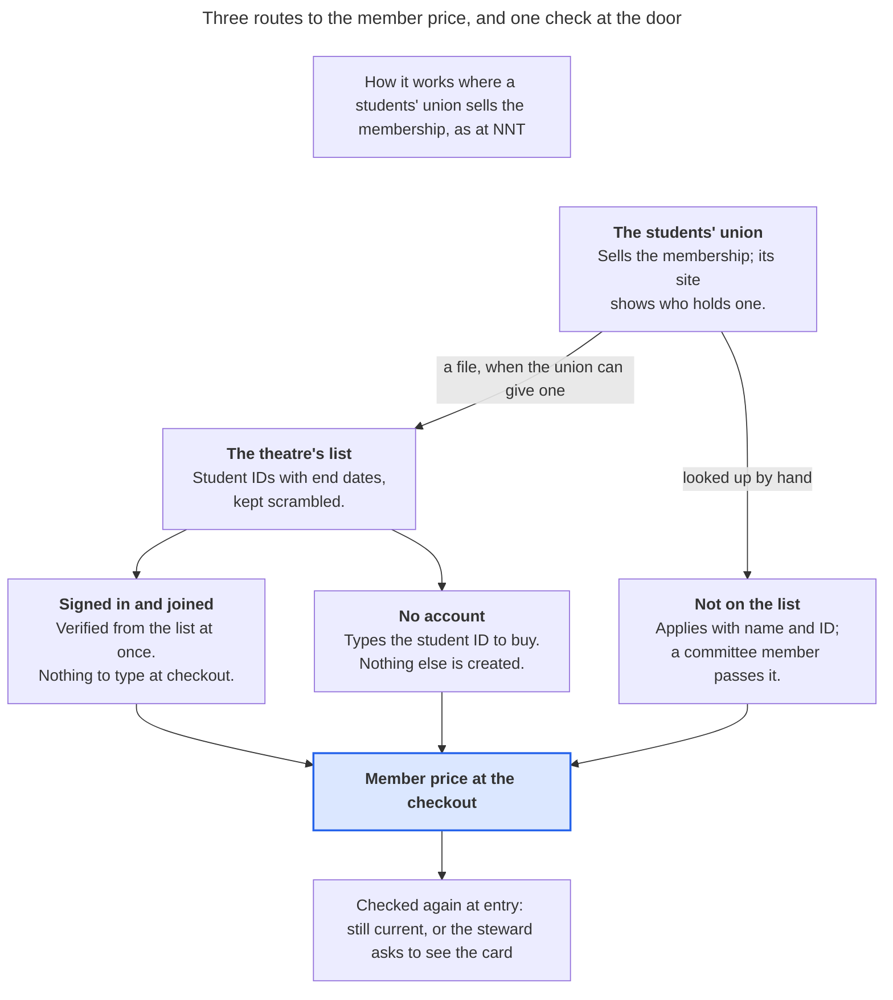

# 4. Interface to other modules

Other modules meet Membership through four facts, one requirement source and two points. No module names Membership in its code, and Membership names only the modules it requires.

## Dependencies

| Module | requires | uses | Why |
| --- | --- | --- | --- |
| `membership` | `forms` | `communications`, box-office, front-of-house | Calls `addResponse` and `withdrawResponses`, and places `FormsSlot`. Contributes a requirement source to the core, which Box office reads without naming Membership. To the modules it only uses it contributes and never calls: an audience source to Communications, the card's code kind to Box office's door, and ability mappings to Front of house's on-shift fact. With any of them off, that contribution is simply absent |
| `membership-fees` | `membership`, `payments`, `finance` | none | Calls `createIntent`, `requestRefund` and `postEntries`; calls Membership's `markPaid`; contributes to `payments.settlement` and `membership.charge` |

No loop: `membership` never imports the fees module. It reaches it through its own point `membership.charge`, in the way Payments reaches Box office through `payments.settlement`.

## Facts

All four are resolved by one indexed read of `membership_memberships` under rule D1. A resolver is a pure read, as Foundations requires, and none is cached beyond the request.

| Fact | On | Standing | True when | For |
| --- | --- | --- | --- | --- |
| `membership.holder` | none (site-wide) | Yes | The account has a current membership of any members' scheme | The members' area, through `core.member`. A theatre may also map abilities to it |
| `membership.supporter` | none (site-wide) | No | The account has a current membership of any supporters' scheme | Conditions and ability mappings on the audience side. Never a standing |
| `membership.scheme-holder` | `membership.scheme` | No | The account has a current membership of that scheme | "Life members may book the studio": an ability mapped to the fact on one scheme. The form builder's "membership type" condition |
| `membership.voter` | none (site-wide) | No | The account has a current membership of a scheme marked `voting`, activated at least `membership.voting.qualifying-period` ago | A ballot or a form restricted to voting members. No voting feature is specified; the fact is what one would read |

`membership.scheme-holder` is not a standing in its own right, so a supporters' scheme can never open the members' area through it. The standing comes only from `membership.holder`.

## The requirement source (member pricing, BO-20)

Membership contributes one source, `membership`, to the core point `core.requirement`. A host such as Box office stores a reference as plain text on a ticket type, calls the kit's `requirements.options`, `requirements.describe`, `requirements.check` and `requirements.holder`, and never learns what the reference means. No host names Membership.

| Part of the source | What Membership supplies |
| --- | --- |
| References | `membership:<scheme id>` for one scheme (the scheme's scoped id, `msch_...`), and `membership:any` for a current membership of any scheme |
| `options(query)` | "Any current membership", then the schemes that are open or closed whose name matches the query. Archived schemes are not offered for new use |
| `describe(refs)` | For each reference a short public label: "Members", "Friends of the theatre". A reference to an archived or deleted scheme describes itself as "A membership no longer offered". Where the scheme has `accepts_reference` on, the description also says `presentable: { label, shape }`, from rules V12 and V13 |
| `check(accountIds, refs, at, record?, presented?)` | For each account and reference: `met` when that account holds, on the local date of `at`, a current membership matching it (rules D1 to D4), with `until` set to the last instant it stays current (the end date plus grace, or none for an indefinite membership). Otherwise `not-met`. `presented` carries `{ ref, value }` (a reference somebody typed) or `{ ref, evidence }` (what an earlier answer returned), judged under rules V8 to V11. With an account and a presented value together, the account is judged first. The `record` argument is ignored |
| An answer | `evidence` on every met answer (rule V11). On a not-met answer a translated `reason` for the person ("Not a member", "Membership ended on 31 July", "A different membership is needed") and, for a presented value, the help link of rule V15. On every answer a `summary` for staff, one short translated sentence holding no name and no typed value: "Member: current until 31 July 2027", "Membership ended on 31 July: ask to see their card"; for an answer met by evidence alone it ends "ask to see the card". No `quantity`: how many tickets one holder may have is the host's limit |
| `checkAbility` | `membership.card.check`, declared `audit: 'read'`. A check about the actor's own account is answered as usual; a check about another account (a seller serving a customer, a steward at the door) reaches Membership only when the actor holds it |
| `holder(evidence)` | The name to compare with the card shown: the list entry's `holder_name`, or the holder's account name where the evidence is a membership. Guarded by `membership.verification-list.check`, declared `audit: 'read'`. Hosts reach it only through the kit's `requirements.holder(ref, evidence)`, live, never offline; the name is in no answer, summary, event or job |

The two sides need no reference of their own, because any declared fact answers as a requirement: `fact:membership.holder` is "any members' scheme" and `fact:membership.supporter` is "any supporters' scheme". `fact:membership.voter` serves a form or ballot restricted to voting members.

How the point's terms fall for membership:

1. **The buyer, not the actor.** The account checked is the account an order is for. At the desk that is the customer, not the member of staff.
2. **No account is unmet** unless a presented reference is accepted.
3. **Judged at the instant given.** Membership answers for whatever instant it is asked about and keeps no memory of having been asked.
4. **The host owns the consequence and any override.** A desk or door override of an unmet membership is Box office's, audited with who allowed it. Membership records nothing about it.
5. **Quantity is the host's.** Membership counts nothing and limits nothing. Box office's `max_per_holder` on the ticket type counts by evidence.
6. **While Membership is switched off** the kit reports `unavailable` and the host chooses, through the required `whenUnavailable` argument. A requirement that grants a benefit, such as a member price, is withheld, so Box office does not offer that ticket type. Switching Membership off never gives the member price to everybody.

### A reference without an account

Rules V8 to V19 in tab 3 are Membership's side. The host's side, which is Box office's and is specified there:

- The ticket type that carries a presentable requirement stays listed for a buyer whose account does not meet it, and shows the field of rule V12 once chosen, with Membership's label printed unchanged. One field per ticket (rule V14).
- Box office passes the typed value to `requirements.check` and stores only the returned evidence on the ticket, beside the account where there is one (`requirement_ref`, `requirement_account_id`, `requirement_evidence_id`).
- It limits tickets per holder per performance with `max_per_holder` (default 1), counted by evidence.
- On a not-met answer it shows Membership's reason and help link unchanged.

*member price · 3 routes, 1 check at entry*

### Checking again at entry

A member price is checked when the ticket is bought and again at entry. The door is a Live page of Box office's (`/live/door`); the check at entry and what follows a failure are its story BO-45. Membership's part is to answer.

- A ticket type with a requirement has Box office's `recheck_at_entry`, on by default. For a ticket met by evidence alone the check is always made and cannot be switched off (rule V16).
- At a scan Box office calls `requirements.check` with what the ticket kept and prints Membership's `summary` unchanged under the result. For a ticket met by evidence alone it also calls `requirements.holder` and shows "Card should be in the name of ...".
- Not met does not admit: the person is sent to the desk to pay the difference, or a holder of `box-office.ticket-type.override-requirement` chooses "Admit anyway" with a reason. Unavailable admits and lists the ticket as unchecked on the night's report.
- Offline, the door shows the last stored summary with its time, or "Ask to see the card"; it never has a name.

### The membership card

The card on My membership (MEM-51) carries a code in Box office's door code format, `mem.<key id>.<code>.<signature>`. Membership holds no signing key: the kit owns the keys and the code is signed under Box office's purpose `box-office.door-code`, kept for 48 months so that a key outlasts a 36-month card. Membership contributes to the point `box-office.door-code` the kind `mem`, the ability `membership.card.check` and `resolve(code)`, which returns a headline and one line (the same summary as a check). Scanning a card never admits anybody and writes no scan row; offline it shows "Genuine card, not checked". If an administrator retires a signing key, every card signed with it stops being genuine, so My membership always shows the card with a code signed by the current key, and a holder who saved or printed an old one opens the page again.

## Points Membership offers

| Point | Kind | A contribution is | Empty means |
| --- | --- | --- | --- |
| `membership.verifier` | code | A way of checking entitlement to a scheme: `configSchema` (what a scheme stores for it), `verify(context)` returning `passed`, `failed` or `needs-staff` with a reason key, and a setup component for the scheme screen | Schemes can only be unchecked or checked by staff by hand. Membership contributes `staff`, `email-domain` and `list` itself, so it is never empty in practice |
| `membership.charge` | code | Something that collects a fee for a membership: `priceFor(schemeId, kind, on)`, `open(uow, membership)` adding a charge to the caller's unit of work, `void(uow, membershipId)`, and `status(membershipId)` | Every scheme is free, and a scheme that requires payment cannot be joined (rule S5). `membership-fees` is the one shipped contributor |

`verify(context)` receives the account id, the scheme's verifier configuration, the application's response id and whether this is a renewal. It may read; it writes only by returning statements for the caller's unit of work (the list verifier marks an entry spent this way). A theatre's own verifier, such as one that asks a students' union's membership service, is a contribution from a module under `site/layers/x-*/` and uses `externalCall` for the outside request.

## Form slots, outcome action and custom fields

Contributed to the form builder's points.

| Point | Contribution | Detail |
| --- | --- | --- |
| `forms.slot` | `membership.application` | Mode submission. Subject `membership.scheme`. Scope: one scheme. Respondent: the acting person. Limit 1. Attach ability `membership.scheme.manage`. Features: pages and a decision stage allowed; payment questions forbidden |
| `forms.slot` | `membership.member-fields` | Mode record. Subject `membership.membership`. Scope: all memberships of one scheme, or all schemes. Respondent: the holder and staff. Limit 1. This is where a theatre keeps "course and year" or "emergency skills", as custom fields it defines itself |
| `forms.outcome-action` | `membership.start-membership` | Input: the scheme. When a response reaches the chosen stage, starts an application for the respondent with origin `action`, or adds an active membership when the scheme has no outstanding requirement. Safe to run twice: it guards on the response id |
| `forms.template` | `membership.simple-application` | A starting application form: confirm details, agree to the constitution or code of conduct |

Membership contributes nothing to `forms.bindable`. It holds no columns such as course or year; anything a theatre wants to record about members is a custom field in `membership.member-fields`.

The form builder's open point "charges from a form" is not needed here. A membership fee is charged by the fees module after the form, not by the form.

## Services

A service that writes adds statements to the caller's unit of work and never commits.

### `#modules/membership`

| Service | Kind | Does |
| --- | --- | --- |
| `currentMemberships(accountId, on?)` | read | The account's current memberships: scheme id, side, dates, whether in grace |
| `holdsScheme(accountId, schemeId, on?)` | read | Rule D4 for one scheme |
| `membershipSummary(filter)` | read | Counts by scheme, state and derived status. Ids and numbers only |
| `markVerified(uow, membershipId, verification)` | write | Adds a verification row, sets `verified_at`, activates under A1 if that was the last requirement |
| `markPaid(uow, membershipId)` | write | Sets `paid_at`, activates under A1. Called by a contributor to `membership.charge` from inside Payments' settle batch |
| `endMembership(uow, membershipId, reason)` | write | The guarded ending of rule E1 |

Only a module that lists `membership` in `requires` may call these, which today is the fees module alone. Everything else reads facts.

### `#modules/membership-fees`

No public services. Its whole interface is its two contributions.

## What Membership calls

| Module | Service | When |
| --- | --- | --- |
| Identity (core) | `findOrCreateAccount` | Staff add a member by address (G1) |
| Identity (core) | `searchAccounts`, `accountLabel`, `canonicalAccount` | The person picker; showing a holder's name; reading after a merge |
| Identity (core) | `addressFor(accountId, side)` | Addressing a notification on the scheme's side |
| Identity (core) | hasVerifiedAddressAt, verifiedAddressDigests | The email-domain and list verifiers |
| Core domain | The notify service, inside the unit of work | Welcome, action needed, renewal reminders, lapsed |
| Core domain | `files` | The uploaded verification list, deleted once hashed |
| Form builder | `slotForms`, `checkAnswers`, `addResponse`, `withdrawResponses`, `responseStatus`, `recordFields`, `fieldColumns` | The application step, withdrawing, custom fields in the members list and its export |
| Payments (fees module) | `createIntent`, `cancelIntent`, `startAttempt`, `intentStatus`, `methodsFor`, `requestRefund` | Paying online and at the desk; refunds |
| Finance (fees module) | `postEntries`, `reversePosting`, `accountFor('membership-fees.income')` | The income posting and its reversal |

## Contributions to other modules' points

| Point | From | Contribution |
| --- | --- | --- |
| `core.requirement` | membership | `The requirement source`, above |
| `payments.settlement` | fees | Handlers for the owner `membership-fees.charge`: `settle`, `cannotSettle`, `refunded` (rules P4, P5, P7) |
| `membership.charge` | fees | The fee collector |
| `core.account-section` | membership | "Membership" on the audience side of My account, shown to everyone signed in while any scheme is open or they hold any membership. On the console's account page: a person's memberships, shown with `membership.membership.view` |
| `core.navigation` | membership | Console group "Membership": Members, Applications (with a count of those waiting on staff), Schemes, Verification lists. Nothing in the `members` shell |
| `core.home-card` | membership | For the holder: "Your membership ends on 31 July. Renew". For staff: applications waiting |
| `core.record-tab` | membership | "Membership" on the console page of an account |
| `core.public-component` | membership | `MembershipSchemes`: the open schemes with their summaries, fees and a join button, for a theatre's own "Join us" page |
| `core.notification-type` | membership | `membership.welcome`, `membership.action-needed`, `membership.declined`, `membership.renewal-open`, `membership.renewal-final`, `membership.lapsed`, `membership.ended`; staff: `membership.application-waiting` |
| `core.setup-step` | both | Membership: create the first scheme (required), choose how members are verified. Fees: set a price, confirm the income account and tax code |
| `core.health-check` | both | Applications waiting on staff for more than seven days; a scheme whose verifier's module is off; a verification list past its date still in use; the reminder task last ran. Fees: charges paid with no posting (expect zero); memberships active by payment with no paid charge (expect zero) |
| `core.record-resolver` | both | Titles and links for a scheme, a membership (its title is the scheme's name and the member number, never the person's name), a verification list, a price and a charge |
| `core.merge-handler` | membership | Rule X2 |
| `core.erasure-handler` | membership | Ends live memberships in the erasure batch (rule X4). Columns are handled by the registry |
| `core.privacy-record` | membership | An entry for verification lists: what an uploaded list is, that references and addresses are kept only as hashes, that a name may be kept for staff to see, and for how long |
| `core.change-impact` | membership | For closing or archiving a scheme: how many current holders and open applications it has |
| `core.search-source` | membership | Members by name or number, for holders of `membership.membership.view` |
| communications.audience-source | membership | Current holders of a scheme as an audience. The source is membership.scheme-holders and returns account ids only. Everyone with the members' standing is already Communications' own source, communications.members |

## Events

Payloads are ids only. Every event about a membership or a charge is `internal: true`, because Foundations rules that anything about a person's standing stays inside the system. The scheme events are not internal: a scheme has no subject.

| Event | When | Payload | Internal |
| --- | --- | --- | --- |
| `membership.scheme.opened`, `.closed` | A scheme's state changes | scheme id | No |
| `membership.membership.applied` | An application is written | membership id, scheme id | Yes |
| `membership.membership.started` | A membership becomes active | membership id, scheme id, account id | Yes |
| `membership.membership.declined`, `.expired` | An application ends without a membership | membership id | Yes |
| `membership.membership.ended` | Ended early | membership id, scheme id, account id, reason | Yes |
| `membership.membership.lapsed` | Announced once by the daily task after the end of grace | membership id, scheme id, account id | Yes |
| `membership-fees.charge.paid`, `.refunded` | A charge changes | charge id, membership id | Yes |

| Event heard | By | Reaction |
| --- | --- | --- |
| `forms.response.decided` | membership | Rule AP2 |
| `forms.response.withdrawn` | membership | Ends the pending application it belongs to |
| `core.account-email.verified` | membership | Re-runs a failed email-domain or list check for the account's open applications, so verifying the right address completes the join without a second visit |
| `core.account.merged` | membership | Nothing: the merge handler already ran in the merge's batch |
| `payments.intent.expired` | fees | Clears the charge's intent so "Pay now" opens a fresh one |

## Jobs and scheduled tasks

| Name | Kind | Does |
| --- | --- | --- |
| `membership.send-reminders` | task, daily at 09:00 | Rule R8 |
| `membership.announce-lapses` | task, daily at 02:00 | Announces `lapsed` once per membership past its grace |
| `membership.expire-applications` | task, daily | Rule J5 |
| `membership.sweep-lists` | task, daily | Deletes entries of lists past `valid_until` |
| `membership.load-list` | job, bulk lane | Reads an uploaded file, hashes each row, replaces the list's entries keeping the id of every entry whose reference is unchanged, deletes the file. Written set-wise |
| `membership.build-export` | job, bulk lane | The members export, stored through Files |

All are safe to run twice: each is a guarded update or records what it has done on the row.

## Secrets and credentials

| Secret | Needed | For |
| --- | --- | --- |
| `MEMBERSHIP_LIST_KEY` | when-used | The key for hashing verification-list entries. Needed only by the list verifier, which stays unavailable until it is set |

## Routes that are not behind an ability

| Route | Declared as | Protection |
| --- | --- | --- |
| `GET /api/membership/schemes` | public | Read rate limit. Returns open schemes only, and nothing when `membership.join.public-listing` is off |
| `POST /api/membership/applications` and its children | signed-in | Write rate limit; idempotent. Ownership of the membership for every later step |
| `GET /api/membership/mine` | signed-in | The caller's own memberships |

## What this specification needs from the others

Every item is agreed with the thread that owns it and written in that specification.

| From | What Membership relies on |
| --- | --- |
| Foundations | The nine id prefixes; the module ids `membership` and `membership-fees` with their table prefixes; the points `membership.verifier` and `membership.charge`; the four facts; five record types. `switchOff.impact()` in the manifest. `core.requirement` with presented values, evidence, summary, `checkAbility` and `holder`; the kit's rate limit on typed values (class `presented-value`). The data subject form `{ unlinked: 'staff' }`. The kit's signing service |
| Identity | `hasVerifiedAddressAt(accountId, domains)` and `verifiedAddressDigests(accountId, keyName)`: keyed digests (HMAC-SHA-256 of the trimmed, lower-cased address) under `MEMBERSHIP_LIST_KEY`, for verified addresses only, never the address itself. Membership checks again on `core.account-email.verified` and `core.account-email.removed`. `membership.holder` is the standing `core.member` expects; `membership.supporter` is no standing. The preset role `membership-officer` takes the abilities in tab 6 and holds no grant, merge or data-request abilities |
| Box office | Member pricing through `core.requirement`: the buyer's account, checked when the ticket type is added, again before the order is confirmed or reserved, and again at entry (BO-45). `requirement_ref`, `requirement_account_id` and `requirement_evidence_id` on the ticket; `recheck_at_entry` and `max_per_holder` on the ticket type; the presented-value field inside the ticket type; the Live door page; the point `box-office.door-code`; "Admit anyway" under `box-office.ticket-type.override-requirement` |
| Payments | An owner `membership-fees.charge`; `collect` online with the fees module's part; a panel in `payments.desk-basket` from a non-ticket owner (`prepare` returns the owner and amount, `release` is idempotent), paid inside the seller's till session alone or with tickets; `settle` may call Membership's `markPaid` inside its batch |
| Finance | The system account `membership-fees.income`, declared through `finance.system-account`, with the no-tax code. Recognising a fee in full when paid |
| Form builder | The slots `membership.application` and `membership.member-fields`, the outcome action and the template. Its stories FB-501 (slots), FB-502 (the slot renderer), FB-503 (record mode, for the membership record only) and FB-506 (the outcome-action mechanism) are in the first release for this. FB-510 (module templates) is later, so the application template is later too |
| Interface | The console group "Membership" in the fixed order; `core.account-section`; `core.home-card`; `core.record-tab` |
| Front of house | The fact `front-of-house.on-shift`, which grants `membership.card.check` and `membership.verification-list.check` to a steward on shift, so no role is needed at the door |
| Communications | The point `communications.audience-source` |
