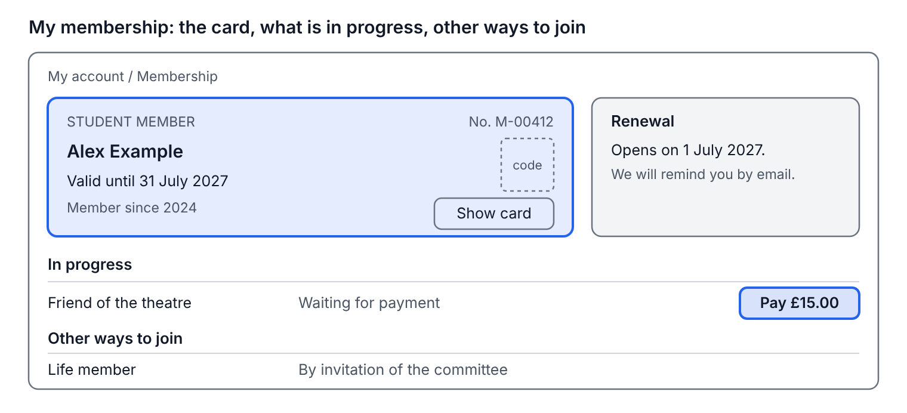
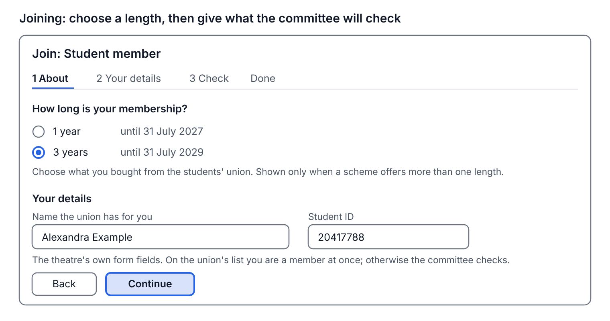
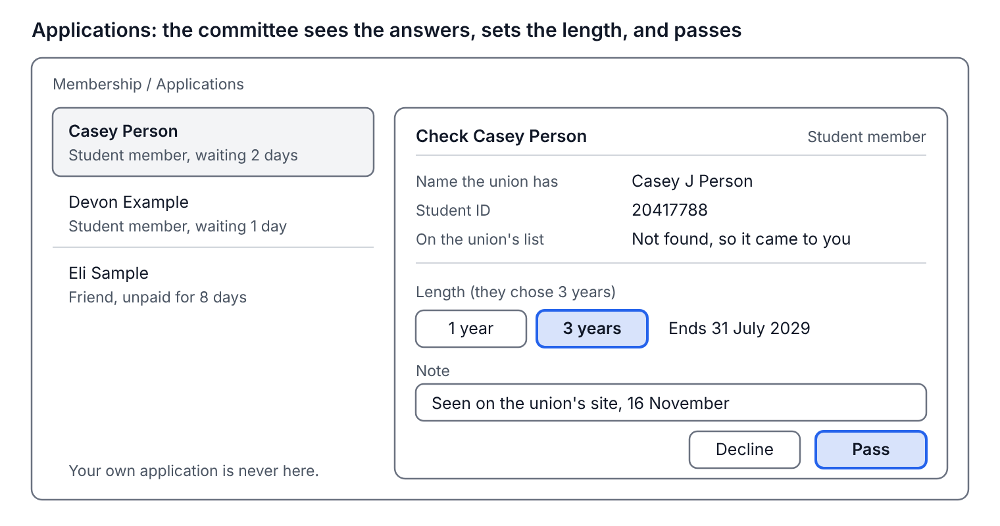
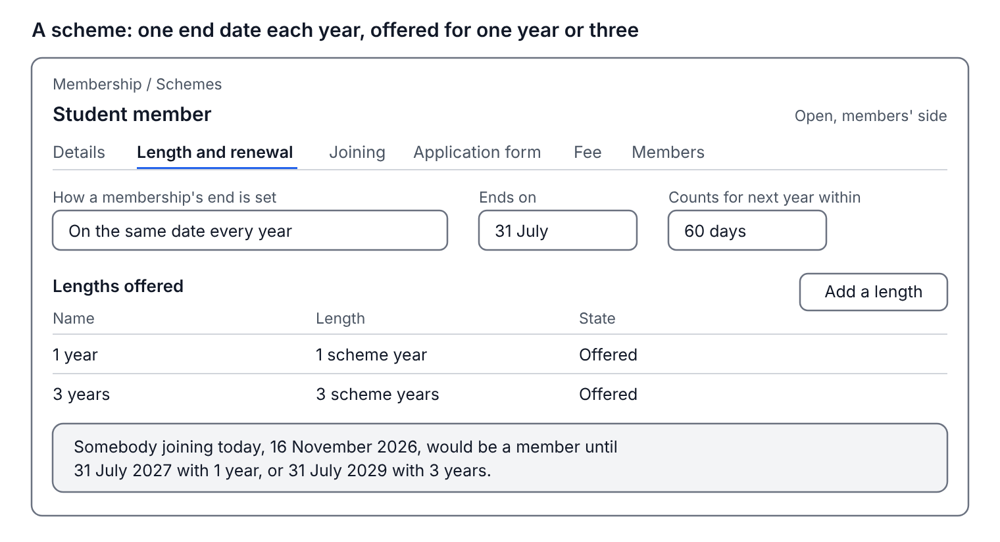
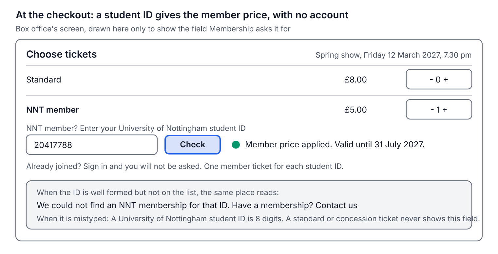

# 5. Screens

Membership has four pages on the audience side of My account, none in the members' area, and eight in the console. Every page is one of the Interface conventions' page types and uses its standard components; nothing here defines a new layout.

## Where the pages sit, and why

| Shell | Pages | Reason |
| --- | --- | --- |
| `account` | My membership; join; pay; renew | A person who is not yet a member must be able to reach all of it. This is the fix for the pain point: joining is never behind the door it opens |
| `members` | None. One home card | The members' area is for what members do. The state of the membership itself stays in My account, where it is still reachable after a lapse |
| `console` | Members, a membership, add a member, applications, schemes, a scheme, verification lists, settings | Staff work |
| Public pages | No page of the module's own. The component `MembershipSchemes` on the theatre's own content page | The public site belongs to the theatre. A "Join us" page is content in `site/content/`, and the component brings the live list of schemes into it |

No address prefix is reserved for the module. Every address is under `/account` or `/console`, which are already reserved.

## Navigation entries

| Id | Shell | To | Shown by | Group, section | Count |
| --- | --- | --- | --- | --- | --- |
| `membership.members` | console | `/console/membership` | `membership.membership.view` | Membership, everyday |  |
| `membership.applications` | console | `/console/membership/applications` | `membership.membership.verify` or `membership.membership.view` | Membership, everyday | `membership.applications-waiting` |
| `membership.schemes` | console | `/console/membership/schemes` | `membership.scheme.view` | Membership, setup |  |
| `membership.lists` | console | `/console/membership/lists` | `membership.verification-list.manage` | Membership, setup |  |

My membership is not a navigation entry. It is a section of My account, contributed to `core.account-section`, so it appears where a person's tickets and details are.

## Pages on the audience side

| Page | Address | Type | Shown to | Primary action |
| --- | --- | --- | --- | --- |
| My membership | `/account/membership` | Record | Anyone signed in, while a scheme is open or they have any membership | Renew, when the window is open; otherwise none |
| Join a scheme | `/account/membership/join/<scheme key>` | Steps | Anyone signed in; a signed-out visitor is sent to sign in and returned | Continue, then Join |
| An application | `/account/membership/<membership id>` | Record | Its holder | The next thing the person must do: Verify an address, Pay now, or none while staff are checking |
| Pay | `/account/membership/<membership id>/pay` | Steps | Its holder, when a charge is open. Fees module | Pay |

### My membership

The page has three parts, in this order, and each part is absent when it has nothing to say.

1. **What I hold.** One card per current or upcoming membership: scheme name, member number, "Valid until 31 July 2027" or "No end date", and a status strip when something needs doing ("Renewal is open", "Ended on 31 July. You can still renew until 14 August"). The card can be opened full screen to show at the door or the bar.
2. **In progress.** Open applications, each with its one next step.
3. **Join.** Open schemes the person does not hold, each with its summary, fee and a Join button. Then, collapsed, past memberships.

```text
My account  >  Membership

+----------------------------------------------------------+
| STUDENT MEMBER                              No. M-00412  |
| Alex Example                                             |
| Valid until 31 July 2027                    [ Show card ]|
+----------------------------------------------------------+
  ! Renewal opens on 1 July 2027.

In progress
  Friend of the theatre      Waiting for payment  [ Pay £15.00 ]

Other ways to join
  Life member                By invitation of the committee

> Past memberships (2)
```



*wireframe · My membership*

Rules for this page:

- The card shows the holder's name from the account, the scheme and the end date. Opened full screen, it carries a code that the door or the desk scans on the same page as tickets (MEM-51). The code is signed with the current key each time the page is opened.
- A lapsed member sees the same page with "Your membership ended on 31 July" and a Renew or Join again button. This page is on the audience side precisely so it is still there.
- Nothing on the page links into the members' area. The header's members' entry, drawn by the shell from `describeViewer`, is the only way in.
- Where the scheme allows it, ending a membership is a secondary action in the card's menu, with a confirmation naming what is lost.

### Join a scheme

A Steps page. Steps the scheme does not need are not shown, so a free, unchecked scheme is one step.

| Step | Shown when | Content |
| --- | --- | --- |
| 1. About | Always | The scheme's name and summary, what it gives, the fee, what will be checked, and the dates the membership would run for if it started today |
| 2. Your details | A form is attached | `FormsSlot` for `membership.application`. A long form's own pages appear as sub-steps |
| 3. Check | The scheme has a verifier other than staff | What is being checked and its result. On a miss, the remedy in place: "Add your university address" opens Identity's add-address flow and returns here |
| 4. Pay | The scheme requires payment and the earlier steps are met | The amount, the methods from `methodsFor('online')`, then the provider's own step |
| Done | Always | "You are a member until 31 July 2027", the card, and for a members' scheme a button into the members' area. Or "We are checking your application" with what happens next |



*wireframe · Join a scheme, steps 1 and 2 shown together*

The wireframe shows steps 1 and 2 on one sheet. The length question belongs to step 1 and appears only when the scheme offers more than one length (rule D8). Where the fees module is on, each length shows its price.

- Submitting step 2 writes the application (rule J1). From then on the person can leave and come back; the page reopens at the next unmet step.
- Paying uses the same countdown and "your payment did not complete" patterns as Box office's checkout.
- If the person already holds the scheme outside its renewal window, step 1 says so and offers nothing to submit.

## Home cards

| Card | Shell | Shown to | Says |
| --- | --- | --- | --- |
| Renewal | members, account | A holder inside the renewal window or in grace | "Your Student membership ends on 31 July. Renew" |
| Finish joining | account | A person with an open application whose next step is theirs | "Pay £15.00 to finish joining Friends of the theatre" |
| Applications waiting | console | Holders of `membership.membership.verify` | "4 applications are waiting to be checked" |

## Pages in the console

| Page | Address | Type | Ability | Primary action |
| --- | --- | --- | --- | --- |
| Members | `/console/membership` | List | `membership.membership.view` | Add a member |
| A membership | `/console/membership/<membership id>` | Record | `membership.membership.view` | The next staff step, if any |
| Add a member | `/console/membership/add` | Form | `membership.membership.add` | Add |
| Applications | `/console/membership/applications` | List | `membership.membership.view` | None; each row has Pass and Decline for holders of `membership.membership.verify` |
| Schemes | `/console/membership/schemes` | List | `membership.scheme.view` | New scheme |
| A scheme | `/console/membership/schemes/<scheme id>` | Record with tabs | `membership.scheme.view`; changes need `membership.scheme.manage` | Open, Close or Archive, by state |
| Verification lists | `/console/membership/lists` | List | `membership.verification-list.manage` | New list |
| Settings | `/console/membership/settings` | Settings | `membership.settings.manage` | Generated from the settings registry. The fees module's page is /console/membership-fees/settings; the two retention groups are drawn on /admin/advanced instead (tab 6) |

### Members

A List page of memberships, one row per membership, not per person, because the dates and the scheme are what staff act on.

| Element | Content |
| --- | --- |
| Columns | Name, member number, scheme, status (derived: Current, In grace, Upcoming, Lapsed, Ended), valid until, joined. Custom fields from `membership.member-fields` can be added as columns through `fieldColumns` |
| Saved views | Current (the default), Renewing soon (ends within 30 days, not yet renewed), In grace, Lapsed this year, Ended, Everyone |
| Filters | Scheme, side, status, joined between, ends between |
| Row actions | Open; open the person's account page |
| Bulk actions | Export the current view, for holders of `membership.membership.export`. Built as a bulk job and delivered through Files |
| Empty state | "No members yet. Add a member, or open a scheme so people can join." |

```text
Membership  >  Members                         [ Add a member ]

[ Current ] Renewing soon  In grace  Lapsed this year  Ended  Everyone
Scheme: all v   Search name or number [             ]    Export

Name             No.      Scheme           Status      Valid until
Alex Example     M-00412  Student member   Current     31 Jul 2027
Billy Sample     M-00087  Life member      Current     No end date
Casey Person     M-00390  Student member   In grace    31 Jul 2026
...
214 current memberships
```

### A membership

A Record page. The header shows the person's name (linking to their account page for those who may read it), the scheme, the member number and the derived status.

| Tab | Content | Ability |
| --- | --- | --- |
| Details | Dates, origin, the requirement checklist with who met each and when, the staff note, the membership it renews and the one that renews it | `membership.membership.view` |
| Application | The form response, shown by the form builder's own component with its own read rules | The form's abilities |
| Fields | The custom fields from `membership.member-fields`, through `FormsRecordFields` | `membership.membership.view`, and the form's rules for restricted answers |
| Payment | The charge, the payment, refunds, and the posting's reference. Fees module | `membership-fees.charge.view` |
| History | The audit entries for this record | `core.audit.view`, as Foundations defines it |

Actions, each a confirmed dialog with the standard refusal handling: Pass verification, Decline, Change dates, End membership, Take payment, Send a payment link, Waive the fee, Request a refund. Each is shown only to somebody who holds its ability and only in a state where it applies.

### Add a member

A Form page: the person (picker, or name and address), the scheme, the dates (prefilled from the scheme's rule, editable under rule D7), the note, and for a scheme that requires payment the three choices of rule P9. The summary line before the button reads, for example, "Casey Person will be a Student member from today until 31 July 2027 and will see the members' area." That last clause is there so nobody adds a supporter and expects them to get in, or the reverse.

### Applications

A List page of pending memberships that need a person: waiting on a staff check (verifier `staff`, or `needs-staff` from another verifier), or stuck (failed verification for more than three days, unpaid for more than seven). Approval through a form's decision stage is not here: it is in the form builder's Reviews, and the row links to it.

Each row shows the applicant, the scheme, what it is waiting for and for how long. Pass and Decline open a dialog showing the application's answers, the verifier's reason and a note field. A person never sees their own application in this queue (rule V3).



*wireframe · Applications, with the check panel*

The panel shows the length the applicant chose and lets the member of staff change it before passing (rule D10). This is where a committee member who has looked somebody up on the students' union's website records what the union shows. Where the applicant's reference is on a list, the panel shows the name on that entry beside the name on the account.

### A scheme

| Tab | Content |
| --- | --- |
| Details | Name, key, summary, side, order. The side control explains in a sentence what each side does and is locked once the scheme has memberships |
| Length and renewal | The length rule with a live example ("Somebody joining today would be a member until 31 July 2027"), rollover days, when renewal opens, grace |
| Joining | Who may join, the verifier with its own configuration component (domains, or a list), whether renewal checks again, whether approval is needed, whether the scheme counts for voting |
| Application form | The form attached in `membership.application`, with attach and detach, provided by the form builder's placement control. The custom fields form in `membership.member-fields` |
| Fee | Fees module: the price in force, its tax code, a different renewal price, and price history. A new price takes a from-date |
| Members | A count by status, linking to the Members list filtered to this scheme |



*wireframe · A scheme, Length and renewal*

The wireframe shows Length and renewal with its Lengths offered table (rule D8). Joining also holds "Accept a student ID or member number in place of signing in" (`accepts_reference`) and "Members may end their membership themselves" (`holder_may_end`). With the fees module on, Fee holds a price for each length.

Opening a scheme runs the checks of rule S4 and lists what is missing. Closing or archiving shows the change-impact line: "214 current members keep their membership. 3 open applications will continue."

### Verification lists

A List page: name, key kind, entries, uploaded when and by whom, valid until, and which schemes use it. A list's form holds its name, key kind and, for a reference list, the label phrase shown wherever the reference is asked for and what a well-formed reference looks like (rule V13). A list's page offers four actions. **Upload a new file** takes a CSV of up to three columns (address or reference, end date, name) and replaces the entries when the job finishes; the page then shows the count loaded and the count of rows rejected as malformed. **Add an entry** takes a reference or address, an end date and a name. **Check a reference** answers "On the list until 31 July 2027, in the name of Alex Example" or "Not on the list" and nothing more, for holders of `membership.verification-list.check`. **Find by name** lets a holder of `membership.verification-list.manage` find one entry to remove or redact it. The page never shows the list. A notice explains that each reference or address is kept only in a scrambled form, that names are kept for staff to compare, and that the file is deleted after loading.

## Contributions to other pages

| Where | What |
| --- | --- |
| The console page of an account (`core.record-tab`) | A Membership tab: the person's memberships and applications, with Add a member prefilled |
| My account (`core.account-section`) | The Membership section, which is My membership above |
| A theatre's content page (`core.public-component`) | `MembershipSchemes`, with props for which schemes to show and whether to show fees |
| Search (`core.search-source`) | Members by name or number. A name or email is found through Identity's `findAccounts`, here and in the members list's search box, under core.account.find, which membership.membership.view implies. Membership matches the number itself |

## States every page handles

Following the Interface conventions: loading, empty, refusal (inside the shell) and not found. Three are particular to this module.

| Situation | What is shown |
| --- | --- |
| `membership` is switched off | Every address answers not found, and the account section and public component render nothing |
| A scheme requires payment and the fees module is off | The scheme is listed with "Joining online is not available at the moment" and no button |
| An address under `/account/membership/<id>` for somebody else's membership | Not found, never a refusal, so the existence of a membership is not revealed |

## Wording

British English throughout, through the translation catalogue. The interface says "member" and "membership" to people, with the theatre's own scheme names; "holder", "side" and "standing" are specification words and never appear on a screen. Where the members' area is named, the name comes from Identity's setting `core.members-area.name`.

## Screens that belong to other modules

Two things Membership relies on are drawn on Box office's screens and specified there. They are described here so the whole journey can be read in one place.

- **Choosing tickets.** A ticket type whose requirement can be met by a reference stays listed for a buyer whose account does not meet it. Once chosen, it shows one field per ticket, with the label Membership supplies printed unchanged ("NNT member? Enter your University of Nottingham student ID"; for a further ticket, "Booking for another NNT member? Enter their University of Nottingham student ID"). A signed-in holder's first ticket shows no field and the price already applied. No other ticket type shows the field.
- **The door page** (`/live/door`). A ticket with a requirement shows Membership's summary under the scan result: "Member: current until 31 July 2027", or "Membership ended on 31 July: ask to see their card". A ticket bought by reference also shows "Card should be in the name of ...". A membership card scanned on the same page shows the summary and admits nobody.



*wireframe · the student ID field at the checkout (Box office's screen)*
