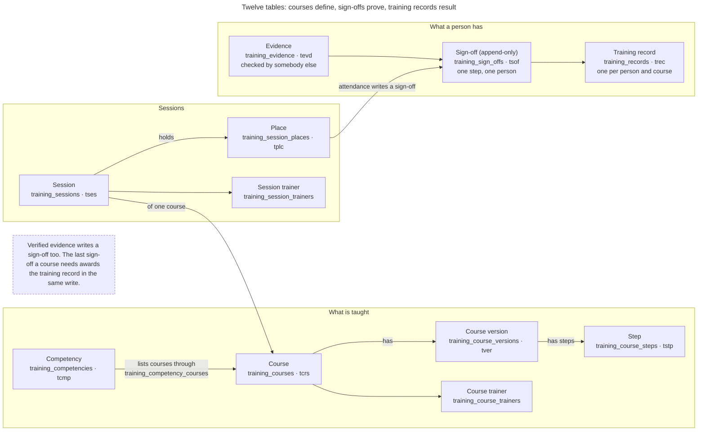

# 2. Data model

*data model · 11 of the 12 tables in three groups*

The join table between competencies and courses is drawn as a line, not a box. Every table is described in full below.

Training owns 12 tables, all prefixed `training_`. Five describe what is taught and who may teach it, three describe sessions, and four describe what a person has done. Each is given in the Foundations data-class layout.

## The tables and their id prefixes

Every prefix starts with `t` and has four letters, as the form builder's start with `f`. None clashes with the index in Foundations part 4 as read on 16 November 2026, and Foundations has registered them there.

| Table | Prefix | Holds | Realm | Subject |
| --- | --- | --- | --- | --- |
| `training_courses` | `tcrs` | One row per course | operational | none |
| `training_course_versions` | `tver` | The numbered versions of a course | operational | none |
| `training_course_steps` | `tstp` | The steps of one version | operational | none |
| `training_competencies` | `tcmp` | Named competencies | operational | none |
| `training_competency_courses` | none | Which courses make up a competency; keyed by its two columns | operational | none |
| `training_course_trainers` | none | Who may teach a course; keyed by its two columns | members | `account_id` |
| `training_sessions` | `tses` | Dated sessions of a course | operational | none |
| `training_session_trainers` | none | Who leads a session; keyed by its two columns | members | `account_id` |
| `training_session_places` | `tplc` | One person's place on a session | members | `account_id` |
| `training_sign_offs` | `tsof` | One step confirmed for one person, or the voiding of one | members | `account_id` |
| `training_records` | `trec` | A completed course for one person | members | `account_id` |
| `training_evidence` | `tevd` | A certificate issued elsewhere | members | `account_id` |

All ids are time-sorted. Nothing in Training grants access by being known, so no table needs a random id or a token.

## What is taught

**`training_courses`**: realm operational; subject none; no retention; not append-only.

| Column | Type | Constraints | Class | On erasure | Notes |
| --- | --- | --- | --- | --- | --- |
| `id` | id | primary key | internal | keep |  |
| `title` | text | not null, at most 120 | internal | keep |  |
| `slug` | text | not null, unique | internal | keep | Used in addresses |
| `summary` | text | at most 500 | internal | keep | Shown in the catalogue |
| `category_term_id` | ref `core_terms` | nullable | internal | keep | Vocabulary `training.course-category` |
| `delivery` | text | one of `in-person`, `online`, `on-the-job`, `external` | internal | keep | A label for filtering. The steps decide what is actually needed |
| `expires` | boolean | not null | internal | keep | False for a course whose training record never lapses |
| `valid_for` | integer | seconds; not null when `expires` | internal | keep | Defaults from `training.records.default-valid-for` |
| `self_sign_up` | boolean | not null, default true | internal | keep | False where places are given by staff only |
| `status` | text | one of `unpublished`, `live`, `retired` | internal | keep | Part 3 |
| `live_version_id` | ref `training_course_versions` | nullable | internal | keep | Null until first published |
| `created_by` | account, actor | not null | internal | keep | Follows a merge |
| `created_at`, `updated_at` | timestamp | not null | internal | keep |  |

**`training_course_versions`**: realm operational; subject none; no retention; not append-only. Unique on (`course_id`, `number`).

| Column | Type | Constraints | Class | On erasure | Notes |
| --- | --- | --- | --- | --- | --- |
| `id` | id | primary key | internal | keep |  |
| `course_id` | ref `training_courses` | not null | internal | keep |  |
| `number` | integer | not null, from 1 | internal | keep |  |
| `status` | text | one of `in-preparation`, `live`, `replaced` | internal | keep | Not "draft", which the glossary keeps for core and forms |
| `change_kind` | text | one of `records-stand`, `retraining-required`; null until published | internal | keep | Chosen at publication. Version 1 is always `records-stand` |
| `change_note` | text | at most 500 | internal | keep | What changed, shown to people who hold the course |
| `cut_to` | timestamp | nullable | internal | keep | For `retraining-required`: the instant older training records were cut short to |
| `published_by` | account, actor | nullable | internal | keep |  |
| `published_at` | timestamp | nullable | internal | keep |  |
| `created_at` | timestamp | not null | internal | keep |  |

A live or replaced version and its steps are never edited. A change is a new version.

**`training_course_steps`**: realm operational; subject none; no retention; not append-only. Unique on (`version_id`, `position`).

| Column | Type | Constraints | Class | On erasure | Notes |
| --- | --- | --- | --- | --- | --- |
| `id` | id | primary key | internal | keep |  |
| `version_id` | ref `training_course_versions` | not null | internal | keep |  |
| `position` | integer | not null, from 1 | internal | keep |  |
| `title` | text | not null, at most 120 | internal | keep |  |
| `kind` | text | one of `session`, `practical`, `reading`, `certificate` | internal | keep | Part 3 says what signs each off |
| `needed_for` | text | one of `first`, `renewal`, `both`; default `both` | internal | keep | Which completions need the step |
| `times_required` | integer | not null, 1 to 20, default 1 | internal | keep | Practical steps only: "two supervised shifts" |
| `guidance` | text | at most 2,000 | internal | keep | What the trainer checks, or what the person reads |
| `material_url` | text | nullable | internal | keep | A content page or an outside address |
| `material_file_id` | ref `core_files` | nullable | internal | keep | File slot `training.step-material` |
| `evidence_expiry` | text | one of `required`, `optional`, `none` | internal | keep | Certificate steps: must the evidence carry an expiry date |
| `evidence_file` | text | one of `required`, `optional`, `forbidden` | internal | keep | `forbidden` for a check that may only be recorded as seen |
| carries\_step\_id | ref training\_course\_steps | nullable; a step of the previous version | internal | keep | The step this one continues unchanged. Sign-offs for that step count for this one (part 3, V3) |

**`training_competencies`**: realm operational; subject none; no retention; not append-only.

| Column | Type | Constraints | Class | On erasure | Notes |
| --- | --- | --- | --- | --- | --- |
| `id` | id | primary key | internal | keep |  |
| `title` | text | not null, at most 80 | internal | keep | "Till operator" |
| `slug` | text | not null, unique | internal | keep |  |
| `description` | text | at most 500 | internal | keep |  |
| `status` | text | one of `active`, `retired` | internal | keep | A retired competency meets nothing and is hidden from pickers |
| `created_at`, `updated_at` | timestamp | not null | internal | keep |  |

**`training_competency_courses`**: realm operational; subject none; keyed by (`competency_id`, `course_id`).

| Column | Type | Constraints | Class | On erasure | Notes |
| --- | --- | --- | --- | --- | --- |
| `competency_id` | ref `training_competencies` | not null | internal | keep |  |
| `course_id` | ref `training_courses` | not null | internal | keep |  |
| `created_at` | timestamp | not null | internal | keep |  |

A competency with no courses is held by nobody. The screen refuses to make one active until it lists a course.

**`training_course_trainers`**: realm members; subject `account_id`; no retention; keyed by (`course_id`, `account_id`); on erasure delete the row.

| Column | Type | Constraints | Class | On erasure | Notes |
| --- | --- | --- | --- | --- | --- |
| `course_id` | ref `training_courses` | not null | internal | delete the row | Rows go when the course is deleted |
| `account_id` | `col.account`, role subject | not null; on merge: handler | personal | delete the row | A merge that would make two rows keeps one |
| `added_by` | `col.account`, role actor | nullable; on merge: move | internal | delete the row | Who named the trainer |
| `added_at` | timestamp | not null | internal | delete the row |  |

A row means the person may teach that course: run its sessions and sign off its steps. The fact `training.course-trainer` reads this table (part 6), so naming a trainer needs `training.course.manage` at the course and never a grant from Identity. `training_session_trainers`, below, says who is leading one session, and may only name a trainer of the course or a holder of `training.session.manage`.

## Sessions

**`training_sessions`**: realm operational; subject none; no retention; not append-only.

| Column | Type | Constraints | Class | On erasure | Notes |
| --- | --- | --- | --- | --- | --- |
| `id` | id | primary key | internal | keep |  |
| `course_id` | ref `training_courses` | not null | internal | keep |  |
| `version_id` | ref `training_course_versions` | not null | internal | keep | The version live when the session was published; follows a later publication (part 3) |
| `title` | text | nullable, at most 120 | internal | keep | Defaults to the course title |
| `starts_at`, `ends_at` | timestamp | not null; end after start | internal | keep |  |
| `space_id` | ref `core_spaces` | nullable | internal | keep | Reported to `core.space-busy` |
| `place_note` | text | at most 200 | internal | keep | Where to meet |
| `capacity` | integer | not null, at least 1 | internal | keep | Defaults from `training.sessions.default-capacity` |
| `places_taken` | integer | not null, default 0; check: at most `capacity` | internal | keep | Kept by a trigger on places. Never written by code |
| `sign_up` | text | one of `open`, `invited` | internal | keep | Defaults from the course's `self_sign_up` |
| `status` | text | one of `unpublished`, `published`, `cancelled`, `completed` | internal | keep | Part 3 |
| `cancel_reason` | text | at most 300 | internal | keep | Sent to people with a place. About the session, never a person |
| `attendance_closed_at` | timestamp | nullable | internal | keep | Set when the session is completed |
| `created_by` | account, actor | not null | internal | keep |  |
| `created_at`, `updated_at` | timestamp | not null | internal | keep |  |

**`training_session_trainers`**: realm members; subject `account_id`; retention `training.retention.attendance`; keyed by (`session_id`, `account_id`); on erasure delete the row.

| Column | Type | Constraints | Class | On erasure | Notes |
| --- | --- | --- | --- | --- | --- |
| `session_id` | ref `training_sessions` | not null | internal | keep |  |
| `account_id` | account, subject | not null; on merge: handler | internal | keep | A merge that would make two rows keeps one |
| `created_at` | timestamp | not null | internal | keep |  |

**`training_session_places`**: realm members; subject `account_id`; retention `training.retention.attendance`; not append-only. Unique on (`session_id`, `account_id`) where `state` is not `cancelled`.

| Column | Type | Constraints | Class | On erasure | Notes |
| --- | --- | --- | --- | --- | --- |
| `id` | id | primary key | internal | keep |  |
| `session_id` | ref `training_sessions` | not null | internal | keep |  |
| `account_id` | account, subject | not null; on merge: handler | internal | keep | May be an unclaimed account, for a person staff added by name |
| `state` | text | one of `booked`, `waiting`, `cancelled`, `attended`, `absent` | internal | keep | Part 3 |
| `counted` | integer | 0 or 1 | internal | keep | 1 while the place takes capacity: booked, attended or absent. The trigger sums it into `places_taken` |
| `waiting_since` | timestamp | nullable | internal | keep | Orders the session waiting list |
| `added_by` | account, actor | not null; on merge: move | internal | keep | The person themselves, or staff |
| `cancelled_at` | timestamp | nullable | internal | keep |  |
| `cancel_kind` | text | one of `self`, `staff`, `session-cancelled`; nullable | internal | keep |  |
| `marked_by` | account, actor | nullable; on merge: move | internal | keep | Who marked attendance |
| `marked_at` | timestamp | nullable | internal | keep |  |
| `note` | text | at most 300 | free text | redact | A trainer's note, such as "left at the interval" |
| `created_at`, `updated_at` | timestamp | not null | internal | keep |  |

## What a person has done

**`training_sign_offs`**: realm members; subject `account_id`; append-only, with `note` erasable. A sign-off made in error is cancelled by a second row of kind `void`, never by an edit.

| Column | Type | Constraints | Class | On erasure | Notes |
| --- | --- | --- | --- | --- | --- |
| `id` | id | primary key | internal | keep |  |
| `account_id` | account, subject | not null; on merge: alias | internal | keep | Alias because the table is append-only |
| `course_id` | ref `training_courses` | not null | internal | keep | Repeated from the step, so progress is one indexed read |
| `step_id` | ref `training_course_steps` | not null | internal | keep |  |
| `kind` | text | one of `trainer`, `attendance`, `self`, `evidence`, `form`, `void` | internal | keep | How the step was confirmed |
| `signed_by` | account, actor | nullable; on merge: alias | internal | keep | The trainer or verifier. Null where the system or the person signed |
| `occurred_on` | local date | not null; not in the future | internal | keep | The day the thing was done, which may be before it was entered |
| `place_id` | ref `training_session_places` | nullable | internal | keep | Kind `attendance` |
| `evidence_id` | ref `training_evidence` | nullable | internal | keep | Kind `evidence` |
| `response_id` | ref `forms_responses` | nullable | internal | keep | Kind `form` |
| `voids_id` | ref `training_sign_offs` | nullable, unique | internal | keep | Kind `void`: the sign-off cancelled. Unique, so one cannot be voided twice |
| `note` | text | at most 500; required for a void | free text | redact | A trainer's comment, or why it was voided |
| `created_at` | timestamp | not null | internal | keep |  |

**`training_records`**: realm members; subject `account_id`; not append-only. Unique on (`account_id`, `course_id`) where `status` is `awarded`, so a person has at most one live training record per course.

| Column | Type | Constraints | Class | On erasure | Notes |
| --- | --- | --- | --- | --- | --- |
| `id` | id | primary key | internal | keep |  |
| `account_id` | account, subject | not null; on merge: handler | internal | keep | Two awarded rows for one course cannot both move |
| `course_id` | ref `training_courses` | not null | internal | keep |  |
| `version_id` | ref `training_course_versions` | not null | internal | keep | The version completed |
| `origin` | text | one of `steps`, `direct`, `import` | internal | keep |  |
| `sign_off_ids` | JSON | list of ids; empty unless `origin` is `steps` | internal | keep | The sign-offs that earned it |
| `awarded_at` | timestamp | not null | internal | keep |  |
| `awarded_by` | account, actor | nullable; on merge: move | internal | keep | Set for `direct` and `import` |
| `direct_reason` | text | at most 500; required for `direct` | free text | redact | Why it was awarded without the steps |
| `expires_at` | timestamp | nullable | internal | keep | Null means it never lapses. The one date every reader uses |
| `natural_expires_at` | timestamp | nullable | internal | keep | What `expires_at` was before it was cut short |
| `cut_reason` | text | `material-changed` or null | internal | keep |  |
| `status` | text | one of `awarded`, `superseded`, `revoked` | internal | keep | Lapsed is not stored: it is `awarded` with `expires_at` in the past |
| `ended_at` | timestamp | nullable | internal | keep | When it was superseded or revoked |
| `superseded_by` | ref `training_records` | nullable | internal | keep |  |
| `revoked_by` | account, actor | nullable; on merge: move | internal | keep |  |
| `revoke_code` | text | one of `entered-in-error`, `no-longer-competent`, `left`, `other`; nullable | internal | keep |  |
| `revoke_note` | text | at most 500 | free text | redact |  |
| `warned_at` | timestamp | nullable | internal | keep | When the expiry warning was sent |
| `lapse_announced_at` | timestamp | nullable | internal | keep | When the lapse was announced |
| `retention_due_at` | timestamp | nullable | internal | keep | Set when the row stops being current: end or expiry plus `training.retention.records` |
| `created_at`, `updated_at` | timestamp | not null | internal | keep |  |

**`training_evidence`**: realm members; subject `account_id`; not append-only; on erasure delete the row. The file is removed by Training's contribution to `core.erasure-handler`.

| Column | Type | Constraints | Class | On erasure | Notes |
| --- | --- | --- | --- | --- | --- |
| `id` | id | primary key | internal | keep |  |
| `account_id` | account, subject | not null; on merge: move | internal | keep |  |
| `course_id` | ref `training_courses` | not null | internal | keep |  |
| `step_id` | ref `training_course_steps` | not null | internal | keep | A certificate step |
| `issuer` | text | not null, at most 120 | personal | clear | "St John Ambulance" |
| `reference` | text | at most 80 | personal | clear | The certificate's number. Refused where the step forbids a file |
| `issued_on` | local date | not null; not in the future | personal | clear |  |
| `expires_on` | local date | nullable; after `issued_on` | personal | clear | Required where the step says so |
| `file_id` | ref `core_files` | nullable | internal | keep | File slot `training.evidence-file`. Null and refused where the step forbids a file |
| `seen_only` | boolean | not null | internal | keep | True where a verifier looked at the original and nothing was kept |
| `state` | text | one of `submitted`, `verified`, `rejected`, `withdrawn` | internal | keep | Part 3 |
| `submitted_by` | account, actor | not null; on merge: move | internal | keep | The person, or staff for them |
| `decided_by` | account, actor | nullable; on merge: move | internal | keep |  |
| `decided_at` | timestamp | nullable | internal | keep |  |
| `reject_reason` | text | at most 300 | free text | redact |  |
| `retention_due_at` | timestamp | nullable | internal | keep | The training record's end plus `training.retention.evidence` |
| `created_at`, `updated_at` | timestamp | not null | internal | keep |  |

## Rules the schema enforces

| Rule | How |
| --- | --- |
| The last place on a session is taken once | The trigger on `training_session_places` keeps `places_taken`, and the check `places_taken <= capacity` fails the whole unit of work. This is Box office's proved mechanism with one counter |
| A person holds one place on a session | The partial unique index on places |
| A person has one live training record per course | The partial unique index on training records |
| A sign-off is never altered | Append-only triggers, generated by the build |
| A sign-off is voided at most once | The unique `voids_id` |
| A published version is never edited | The service refuses; a check in the integration tests covers every write path |

## Erasure, download and retention

- **A person's download** holds their places, sign-offs, training records and evidence, under the members' realm. Evidence files come through Training's contribution to `core.export-contributor`.
- **Erasure** removes evidence and its files at once, takes the person off every course's and session's list of trainers, and redacts every free-text note. Places, sign-offs and training records keep their rows: with the account a tombstone they say only that somebody was trained, which the session counts and the course history still need.
- **Retention.** A training record that is no longer current is anonymised when `retention_due_at` passes, by the task `training.sweep-retention`, along with the sign-offs it lists. Evidence is deleted on its own, shorter date. Places and session-trainer rows use the registry's ordinary sweep.
- **A merge** moves evidence and actor columns, aliases sign-offs, and calls Training's merge handler for places, session trainers, course trainers and training records, which keeps one row where two would collide: the place with the stronger state, and the training record with the later expiry, the other superseded.

## What is deliberately not stored

- No "current" flag on a training record and no stored list of who holds a competency. Both are read from dates, so neither can be stale.
- No copy of a person's name or address. Every person is an account, unclaimed if need be.
- No result, number or image of a criminal-record check (question 3).
- No per-venue or per-production settings. A value that varies is a column that defaults from a setting as `valid_for` and `capacity` do.
