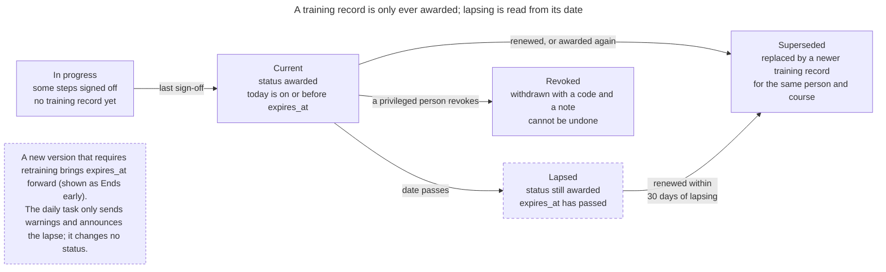

# 3. Rules and flows

*training record lifecycle · 5 states*

The picture is the whole of rules L1 to L4: the only statuses ever written are awarded, superseded and revoked. Lapsed is what a reader concludes from the date.

One rule runs through this part: whether a person is trained is always worked out from sign-offs and dates at the moment somebody asks, and is never a flag that a task must remember to flip. Rules are numbered so stories and tests can cite them.

## Courses and versions

| Thing | From | To | By | Condition |
| --- | --- | --- | --- | --- |
| Course | `unpublished` | `live` | Publishing version 1 | At least one step |
| Course | `live` | `retired` | A course manager | Confirmed, with the competencies and future sessions it affects named |
| Course | `retired` | `live` | A course manager | None |
| Version | `in-preparation` | `live` | Publishing | The version before it becomes `replaced` in the same write |

- **V1.** A course has at most one version in preparation. Starting one copies the live version's steps, each new step carrying from the step it copies.
- **V2.** A live or replaced version is never edited. Correcting a typing mistake is still a new version, published as `records-stand`.
- **V3.** Editing a copied step's title or guidance keeps what it carries from. Changing its kind or its times required, or the author ticking "this step has changed", clears it. A sign-off for a step counts for any later step that carries from it.
- **V4.** Publishing asks one question: do training records stand, or is retraining required? Version 1 is not asked.
- **V5. Records stand.** Nothing changes for anyone who holds the course. People part-way through keep every sign-off whose step is carried.
- **V6. Retraining required.** Every awarded training record for the course has its expiry brought forward to the end of the day `training.versions.retrain-grace` from now, unless it already ends sooner. The old date is kept in `natural_expires_at`, and each holder is told what changed and by when. A holder completes the new version by being signed off on every step that carries from nothing.
- **V7.** Sessions that have not started move to the new version when it is published. A session already started stays on the version it was held under.
- **V8.** A retired course takes no new sessions, sign-offs or evidence. Its training records run to their dates. A competency that lists it still requires it, so retiring a course inside a competency is how that competency is wound down, and the confirmation says so.

## Steps and what signs each off

| Step kind | Signed off by | Sign-off kind | Guard |
| --- | --- | --- | --- |
| Session | A place on a session of the course being marked attended | `attendance` | Written in the same unit as the mark |
| Practical | A person holding `training.sign-off.record` on the course | `trainer` | Never the person themself |
| Reading | The person confirming they have read the material | `self` | Signed in; the material was opened in this session |
| Reading with a knowledge check | A form response reaching approved, through the outcome action `training.sign-off-step` | `form` | Later release |
| Certificate | Evidence for the step being verified | `evidence` | Never verified by its own subject |

- **S1.** A step is met when the person has at least `times_required` sign-offs for it that are not voided and still count (S3).
- **S2.** A sign-off records the day the thing was done. A trainer may enter one for a past day, never a future one.
- **S3.** A sign-off counts towards an award for `training.progress.complete-within` from that day. An evidence sign-off counts for as long as the evidence has not expired.
- **S4.** Nobody signs themself off on a practical or verifies their own evidence, whatever role they hold. This is a guard in Training's service using Identity's `notSelf`, because the permission model only allows.
- **S5.** A sign-off made in error is voided by the person who made it or by a holder of `training.record.revoke`, with a reason. Voiding does not withdraw a training record already awarded: the screen offers revocation as a separate, deliberate act.
- **S6.** Marking a place attended signs off every session step of the session's version at once. A course whose session steps need different occasions is modelled as separate courses in one competency.

## Awarding a training record

- **A1.** Every write of a sign-off evaluates the award in the same unit of work. If every needed step of the live version is met, the training record, its audit entry and the event `training.record.awarded` are in that batch. There is no separate "complete" button and no nightly job.
- **A2. Which steps are needed.**

| The person | Needs |
| --- | --- |
| Has never held the course, or last held it more than `training.records.renew-grace` ago | Steps marked `first` or `both` |
| Holds it now, or it lapsed within the grace | Steps marked `renewal` or `both` |
| Holds it, cut short by a new version | Every step of the new version that carries from nothing |
| Had it revoked | Steps marked `first` or `both`, whatever the dates |

- **A3. The expiry date.** The validity runs from the award. When a renewal is completed within `training.records.renew-window` before the old expiry, it runs from the old expiry instead, so renewing early loses nothing. The date is then brought forward to the earliest expiry of any evidence that earned it. Expiry is always the end of a day in the theatre's time zone, so "valid until 14 March" includes the 14th.
- **A4.** A course that does not expire gives a training record with no expiry date, unless its evidence has one.
- **A5.** A new training record supersedes the awarded one for the same person and course in the same batch.
- **A6. Direct award.** A holder of `training.record.award` may award a training record without the steps, giving a reason and an expiry no later than the course allows. Never to themself. This is how training done before the platform, or elsewhere, is recognised.

## The life of a training record

| From | To | By | Written |
| --- | --- | --- | --- |
| (none) | awarded | A1, A6 or an import | The row, audit, event |
| awarded | lapsed | The clock passing `expires_at` | Nothing. Lapsed is read from the date |
| awarded | awarded, cut short | Publishing a version as retraining required (V6) | `expires_at`, `natural_expires_at`, `cut_reason` |
| awarded or lapsed | superseded | A newer training record (A5) | `status`, `ended_at`, `superseded_by` |
| awarded or lapsed | revoked | A holder of `training.record.revoke`, with a code and a note | `status`, `ended_at`, the revoker, audit, event |

- **L1.** Current means awarded and not past its expiry. Only a current training record satisfies a competency.
- **L2.** Revocation takes effect on the next read by anyone. It cannot be undone; a revocation made in error is put right by a direct award, which leaves both acts on the history.
- **L3.** The daily task `training.sweep-records` does two things and decides nothing. It sends the expiry warning once, `training.records.warn-before` ahead, and it announces `training.record.lapsed` once after the date. If the task never ran, every answer about who is trained would still be right.
- **L4.** A person always sees their own training records and progress. Seeing another person's needs `training.record.view`.

## Competencies and verdicts

- **C1.** A person holds a competency at an instant when the competency is active and, for every course it lists, they have a training record that was awarded before that instant, not ended before it, and not expired at it.
- **C2.** The instant may be in the future. A host checking a shift three weeks away gets "not met: Fire marshal expires on 2 March, before this shift". This is the main reason expiry is a date and not a flag.
- **C3.** The instant may be in the past, for the question asked after an incident: was she trained that night. The answer uses the same rule over the same rows.
- **C4.** A verdict says met or not, until when it stays met (the earliest expiry among the courses), and when not met, each course that is missing, lapsed or about to be, with the next session the person could sign up for.
- **C5.** Changing which courses a competency lists changes who holds it from the next read. The screen shows how many people hold it before and after the change, and the change is audited.
- **C6.** Training never blocks anything itself. It answers; the host that asked decides whether to refuse, warn or allow with an override.
- **C7. Merged accounts.** Every read, count and claim by account uses the kit's account scope: the surviving account and its aliases. After a merge a person's training records, sign-offs, places and evidence stay on the ids they were written under and are read together, so C1 is judged over the whole scope. Where two of the merged accounts each hold a current training record for one course, the course is held and its `until` is the later of the two expiries. The next award for that course is written to the surviving account and supersedes every awarded record for it in the scope (A5). Sign-offs from either account count towards the same steps. The facts `training.competent` and `training.course-trainer`, the source's verdicts, the one-place-per-session check (P2) and every count of holders use the same scope, so a merged person is answered once and counted once.

## Evidence

| From | To | By |
| --- | --- | --- |
| (none) | `submitted` | The person, when `training.evidence.self-submit` is on; or staff for them |
| (none) | `verified` | A verifier recording that they saw the original (`seen_only`) |
| `submitted` | `verified` | A holder of `training.evidence.verify`, never its subject |
| `submitted` | `rejected` | The same, with a reason the person sees |
| `submitted` | `withdrawn` | The person |

- **E1.** Verifying writes the evidence sign-off and evaluates the award in the same unit.
- **E2.** Where a step forbids a file, the route refuses an upload and a reference number, and only a seen-only entry can be made.
- **E3.** Evidence past its own expiry signs nothing off, and the training record it earned has already ended on that date (A3).
- **E4.** Only the person and holders of `training.evidence.verify` can open an evidence file. Every opening by anyone else is audited as a read.

## Sessions and places

| Thing | From | To | By | Condition |
| --- | --- | --- | --- | --- |
| Session | `unpublished` | `published` | A session manager | The course is live; start is in the future |
| Session | `published` | `cancelled` | A session manager, with a reason | Not completed. Every place is cancelled and told in the same unit |
| Session | `published` | `completed` | A trainer closing attendance | Every counted place is marked attended or absent |
| Place | (none) | `booked` | The person or staff | Capacity allows |
| Place | (none) | `waiting` | The person or staff | Full, and `training.sessions.waiting-list` is on |
| Place | `waiting` | `booked` | The system, on a place being freed | Earliest `waiting_since` first |
| Place | `booked` or `waiting` | `cancelled` | The person, staff, or the session's cancellation | The person only until `training.sessions.cancel-until` before the start |
| Place | `booked` | `attended` or `absent` | A trainer | From the start time until `training.sessions.mark-within` after the end |
| Place | `attended` | `absent`, or back | A trainer, inside the same window | The attendance sign-offs are voided, or written, in the same unit |

- **P1.** A person may sign themself up when they hold `training.place.book`, the session's sign-up is open, and the time is before `training.sessions.sign-up-closes-before` ahead of the start. Staff with `training.place.manage` may add anyone at any time before attendance closes, including a person with no account, through `findOrCreateAccount`.
- **P2.** The last place is taken once. Two people pressing at the same moment produce one place and one refusal that offers the waiting list. The database check decides, not a count read beforehand.
- **P3.** Freeing a counted place and promoting the first waiting person are one unit of work, and the promoted person is told at once. They did not choose the moment, so they may cancel without penalty up to the start.
- **P4.** Lowering capacity below the places taken is refused. Raising it promotes from the waiting list in the same unit.
- **P5.** Changing a published session's time or space tells everyone with a place, and tells them again if it changes back.
- **P6.** A person who already holds the course may still sign up, and is told plainly whether attending would renew it (A2).
- **P7.** A walk-in is added and marked attended in one act by the trainer. Capacity still applies; the trainer raises it first if the room allows.
- **P8.** A session still unmarked `training.sessions.mark-within` after it ended shows as a card on the home page of its trainers and of the holders of `training.session.manage` until it is completed. Nothing is marked automatically: an unmarked place is never assumed attended.
- **P9.** A reminder goes to each booked person `training.sessions.reminder-before` ahead of the start.
- **P10.** Publishing a session into a space, or moving a published session's space or time, first asks core's `isSpaceFree` for that space and period. If the space is taken the write is refused with the code `training.session.space-taken`, and the refusal names what holds the space. A session never bumps a booking.
- **P11.** A published session is not a booking. It reaches the room calendar only through the `core.space-busy` contribution, which carries the module id and the label "Training session". A draft or cancelled session holds nothing.

## Time, the clock and switching off

- **T1.** Every instant is stored in UTC and shown in the theatre's time zone. Every "now" comes from the kit's clock, so tests can move it.
- **T2.** With the module switched off, its facts grant nothing and its requirement source is absent, so the kit answers `unavailable` for a stored requirement and the host gets the verdict it named in `whenUnavailable`: `met` where the requirement restricts, so nothing is enforced, and `not-met` where it grants a benefit (part 4). Rows are kept. Switching it on again restores every answer, because the answers were never stored.
- **T3.** No rule in this part contains a number. Each period is a setting in part 6.
- **T4.** A write that touches many rows is written set-wise, as Foundations rules U7 to U9 require: one statement over the set, fed by one JSON parameter, with `unit.announce()` and `unit.audit()` given the set. This covers cancelling a session's places, marking a whole session's attendance (S6) and promoting from the waiting list when capacity is raised (P4), so no unit of work grows a statement for each person. Where the set can pass `core.units.set-rows-limit`, as with every holder of a course cut short (V6), the unit makes the change in one statement and enqueues the job `training.notify-holders`, which tells the holders in pages.
