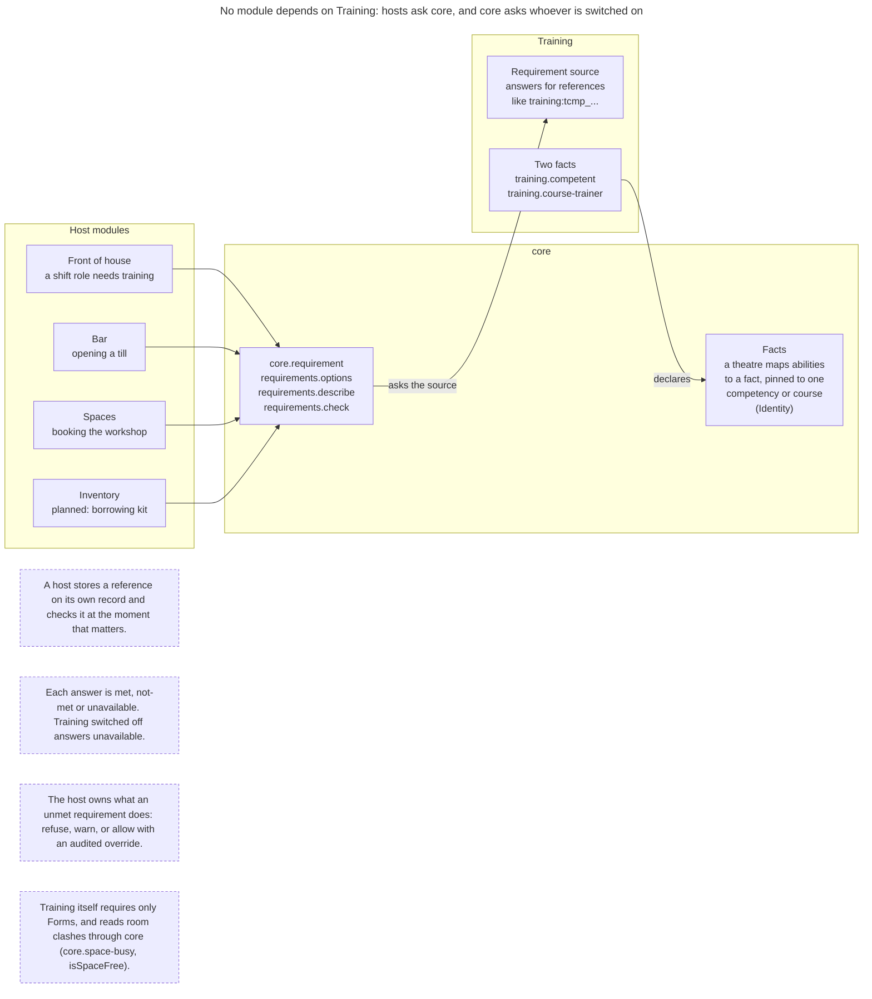

# 4. Interface to other modules

*how other modules reach Training · two routes through core*

Both routes pass through core, so a host can be installed and working with Training switched off.

Other modules need one thing from Training, the answer to "is this person trained for this, then?", and they must get it without naming Training. This part gives the two routes for that answer, then everything else in the Foundations manifest's terms, then an index of every name.

## Index of names

| Kind | Names |
| --- | --- |
| Module | `training`; requires `forms`; uses `front-of-house`, `bar`, `spaces` |
| Record types | `training.course`, `training.session`, `training.record`, `training.competency` |
| Fact | `training.competent`, `training.course-trainer` |
| Points offered | `training.step-source` (later release) |
| Core point used | `core.requirement` |
| Requirement source | `training` (references read `training:<competency id>`) |
| Events | `training.course.published`, `training.course.retired`, `training.session.published`, `training.session.changed`, `training.session.cancelled`, `training.session.completed`, `training.place.booked`, `training.place.promoted`, `training.place.cancelled`, `training.sign-off.recorded`, `training.sign-off.voided`, `training.record.awarded`, `training.record.expiring`, `training.record.lapsed`, `training.record.cut-short`, `training.record.revoked`, `training.evidence.submitted`, `training.evidence.decided` |
| Jobs | `training.notify-holders`, `training.build-export` |
| Tasks | `training.sweep-records`, `training.send-reminders`, `training.sweep-retention`, `training.send-digest` |
| Form slots | `training.session-signup`; `training.knowledge-check` (later) |
| Outcome action | `training.sign-off-step` (later) |
| File slots | `training.step-material`, `training.evidence-file` |
| Vocabulary | `training.course-category` |
| Notification topic | `training` |
| Id prefixes | `tcrs`, `tver`, `tstp`, `tcmp`, `tses`, `tplc`, `tsof`, `trec`, `tevd` |
| Secrets, credentials | None |

## Route one: a requirement (the usual route)

A requirement is a condition a host module attaches to one of its own records: this shift role needs "Duty manager", opening a till needs "Till operator", booking the workshop needs "Workshop induction". The host stores the requirement and decides what an unmet one does. Training supplies the choices and the verdicts.

The Foundations formats give one core point for this, `core.requirement`, shared by every host. Front of house, Bar and Spaces attach training requirements through it, as an inventory module is intended to once it is specified and its id reserved, and Membership and Identity answer the same kind of question ("is a current member", "is over 18") through it. No module declares a point of its own for a per-person condition. A source contributes the contract below, and a host reaches it only through the kit's `requirements.options`, `requirements.describe`, `requirements.check` and `requirements.holder`.

| Part of the contract | Meaning |
| --- | --- |
| `source` | The contributing module's id. Training's is `training` |
| `options(query)` | The requirements this source can check, each with a reference, a label and a description. Training returns its active competencies. A host's picker lists the options of every source that is switched on |
| `describe(refs)` | Labels for stored references, including ones no longer offered |
| `check(accountIds, refs, at, record?, presented?)` | A verdict for every pair, in one call. `at` is the instant the host cares about, which may be in the future or the past |
| A verdict | `met`, `not-met` or `unavailable` for each pair, with `until` (when a met verdict stops being met), a translated `reason` for the person, and optionally a `summary` for staff, `evidence`, a help link and a `quantity`. Training gives `until`; a `reason` naming each course that is missing, lapsed or about to lapse; a help link to that course, where the next session is; and a `summary` such as "Till operator: current until 14 March 2027". It gives no `evidence` and no `quantity` |

- A reference is the text `<source>:<id>`, such as `training:tcmp_01J...`. The host stores it on its own record and never interprets it.
- `check` takes many accounts and many references because a rota screen asks about forty people at once. Training answers any call in at most two queries, whatever the numbers, and reads each account through the kit's account scope (part 3, C7).
- `unavailable` is what the kit answers for a reference whose source module is switched off or whose option was retired. The host chooses what that means each time it asks: `requirements.check` takes a required argument `whenUnavailable`, and there is no default. A host passes `met` where the requirement restricts who may do something, such as a duty or a booking, so a theatre is never locked out by a module being switched off. It passes `not-met` where the requirement grants a benefit, such as a member price, so switching a module off never gives the benefit to everyone. Every use of a training requirement restricts, so none is enforced while Training is off. The answer still says it came from an unavailable source, and the host's screen says so.
- A source's reader runs as a plain read with no actor: the verdict is about the subject, not the person asking. Reasons and summaries name courses and dates only, which the host may show to a rota manager. They never include a revocation's reason or an evidence detail. For that reason Training names no `checkAbility` and answers for any account, as a rota needs, and it offers no `holder`, because none of its answers needs a name.
- The host owns the consequence. It stores the reference on its own record, checks with the instant that matters (the start of the shift, not now), and decides whether not met refuses, warns or allows. Training's suggested default, which Matt accepted on 16 November 2026 for the hosts to adopt (part 9, question 6): refuse at the moment of acting, with the verdict's reason as the refusal's remedy, and offer a privileged, audited override that the host declares.

Two parts of the contract are not used by Training. Any declared fact also answers as a reference of the form `fact:<name>`, so a host can require "is a current member" or "is on shift" with no second mechanism. And `check` takes an optional `record`, for a source whose answer depends on the thing being acted on, and an optional `presented`, for a value shown by a person with no account. Training ignores both, since a training record always belongs to an account.

## Route two: the fact (authority that follows from training)

| Fact | On | Holds when | Standing |
| --- | --- | --- | --- |
| `training.competent` | `training.competency` | The account holds that competency now (part 3, C1) | No. Being trained does not by itself open the members' area |
| `training.course-trainer` | `training.course` | The account is listed as a trainer of that course in `training_course_trainers` (part 2) | No. A trainer is expected to be a member already (part 5) |

A theatre maps abilities to a fact as it does to a role. Both facts are declared `pin: true`, so a mapping may name one record: "holders of Lighting desk may book the lighting desk" pins `training.competent` to that competency, and the fact is then judged against that record whatever record the ability is being used on. Identity owns the mapping table, `core_fact_abilities`, keyed by fact, ability and pinned record, and the permission screen. A mapping whose pinned record no longer exists grants nothing and shows there as broken. The presets map `training.course-trainer` unpinned, so it is judged against the course in hand: a trainer of a course runs its sessions and signs off its steps, and nothing else (part 6). Each fact is resolved in one keyed read over the account scope, so a merged person's records under either account count (part 3, C7). A fact never carries a privileged ability by default, and none of the abilities the presets map to these facts is privileged.

| Use | Route |
| --- | --- |
| A person already has authority (a role, a shift) and must also be trained | Requirement. Facts only allow, so a fact cannot express "and also" |
| Being trained is itself the authority | The fact `training.competent`, pinned to a competency |
| A form asks different questions of trained people | Fact, read by the form builder's conditions on who is answering |
| Teaching a course is itself the authority to run its sessions and sign off its steps | The fact for a course's trainers, judged against the course in hand |

## Services

No upstream module lists Training in `requires`, so these exist for a theatre's own modules and for Reports. Each is a named export of `layers/training/server/services.ts`. A service that writes adds statements to the caller's unit of work and never commits.

| Service | Takes | Gives back | Writes |
| --- | --- | --- | --- |
| `verdicts` | Account ids, competency ids, an instant | The same verdicts the requirement source gives | No |
| `competenciesOf` | An account id, an instant | The competencies held, each with its `until` | No |
| `holdersOfCompetency` | A competency id, an instant | Account ids, each once, canonical after merges | No |
| `trainingRecordsOf` | The actor, an account id | That person's training records and progress, after the ability check | No |
| `addDirectAward` | The unit, account, course, reason, expiry | The training record id | Through the unit |
| `addSignOff` | The unit, account, step, the day, the signer | The sign-off id, and the training record id if it completed the course | Through the unit |
| `matrix` | Filters, a page | People against competencies, for a report | No |

## Events announced

Each is written in the same unit of work as its change. Payloads carry ids and internal values only. Every event about a person is declared `internal: true`: that somebody was trained, lapsed or had training revoked is about their standing, and by Foundations' ruling must not reach a webhook.

| Event | When | Payload | Internal |
| --- | --- | --- | --- |
| `training.course.published` | A version goes live | course id, version id, number, change kind | No |
| `training.course.retired` | A course is retired | course id | No |
| `training.session.published` | A session opens | session id, course id | No |
| `training.session.changed` | Its time, space or capacity changes | session id | No |
| `training.session.cancelled` | It is cancelled | session id | No |
| `training.session.completed` | Attendance is closed | session id, counts attended and absent | No |
| `training.place.booked` | A place is booked or joins the waiting list | place id, session id, account id, state | Yes |
| `training.place.promoted` | A waiting place becomes booked | place id, session id, account id | Yes |
| `training.place.cancelled` | A place is cancelled | place id, session id, account id, cancel kind | Yes |
| `training.sign-off.recorded` | A sign-off is written | sign-off id, account id, course id, step id, kind | Yes |
| `training.sign-off.voided` | A sign-off is voided | sign-off id, account id, course id | Yes |
| `training.record.awarded` | A training record is awarded | training record id, account id, course id, expires at | Yes |
| `training.record.expiring` | The warning period begins | training record id, account id, course id, expires at | Yes |
| `training.record.lapsed` | The daily task finds the date has passed | training record id, account id, course id | Yes |
| `training.record.cut-short` | A version required retraining | training record id, account id, course id, expires at | Yes |
| `training.record.revoked` | It is revoked | training record id, account id, course id | Yes |
| `training.evidence.submitted` | Evidence awaits a verifier | evidence id, course id | Yes |
| `training.evidence.decided` | It is verified or rejected | evidence id, account id, state | Yes |

- A listener that needs to know what a person can now do asks `core.requirement` again. The events say that something changed, never what the answer is.
- `lapsed` and `expiring` are announced by a daily task and can be up to a day late. Nothing may rely on them for a decision; decisions use a verdict.
- There is no event for a competency being gained or lost, because that is derived. A host that wants to react listens for the training-record events and re-checks.

## Events listened for

None in the first release. A merge is handled by Training's contribution to `core.merge-handler` as a step of the staged merge that is safe to repeat; an erasure by the registry and `core.erasure-handler`; a space disappearing by `core.delete-guard`.

## Points offered

| Point | Kind | A contribution is | Empty means | Release |
| --- | --- | --- | --- | --- |
| `training.step-source` | code | A way a practical step can be signed off from another module's activity: its id, label, and a reader that reports how many times a person has done the thing since a date. Front of house could contribute "worked a shadowed shift in this role" | Practical steps are signed off by trainers only | Later |

## What Training contributes to others' points

| Point | Contribution |
| --- | --- |
| `core.requirement` | The source `training` (above) |
| `core.navigation` | Menu `members`: "Training" at `/members/training`, shown with `training.course.view`, and "Teaching" at `/members/training/teaching`, shown with `training.session.run`. Menu `console`, group "Training": Courses, Sessions, People, Competencies, Evidence (with a count of evidence waiting), and Settings in the setup section. Part 5 has the list |
| `core.record-resolver` | Title, link and parent for each of the four record types |
| `core.account-section` | "Training" on My account, members' side: the person's own training records. "Training" on the console's account page, shown with `training.record.view` |
| `core.home-card` | Members' home: "First aid expires in 20 days. Renew"; "You are on Till training on Thursday"; "3 people are waiting for you to sign them off". Console home: "4 certificates to check"; "2 sessions have attendance to mark"; "7 training records lapse this month" |
| `core.search-source` | Courses and sessions, for holders of `training.course.view` |
| `core.notification-topic`, `core.notification-type` | The topic `training` and the types listed below |
| `core.vocabulary` | `training.course-category`, the theatre's own list |
| `core.file-slot` | `training.step-material` (one file per step) and `training.evidence-file` (one file per evidence row; images and PDF) |
| `core.file-access` | Step material: anyone with `training.course.view`. Evidence: its subject and holders of `training.evidence.verify`, each other opening audited |
| `core.space-busy` | A published session with a space is busy there from start to end. The contribution carries the module id and the label "Training session", so the room calendar can name it. Training calls core's isSpaceFree before publishing a session into a space and refuses if the space is taken; a session never bumps a booking |
| `core.delete-guard` | A space with a published future session cannot be deleted; the guard names the sessions |
| `core.merge-handler` | Places only, where two merged accounts hold a place on one session (part 2). Every other account column is alias and is read through the kit's account scope (part 3, C7). The handler also gives the undo that Identity asks of it (part 2) |
| `core.erasure-handler` | Deletes evidence files |
| `core.export-contributor` | Adds evidence files to a person's download |
| `core.setup-step` | "Add your first course" (required) and "Say who can train" (optional) |
| `forms.slot` | `training.session-signup`: submission mode, subject `training.session`, answered by the person booking, one form per course or per session, no pages, no workflow, no payment. `training.knowledge-check`, later |
| `forms.outcome-action` | `training.sign-off-step`: signs off one reading step for the response's submitter. Safe to run twice. Later |

Training contributes no erasure hold. Nothing about a person's training is a reason to refuse their erasure.

## Notification types

All go to the members' side of the person's account, through core's notification service inside the unit of work that causes them.

| Type | To | Can be switched off by the person |
| --- | --- | --- |
| `training.place-booked`, `training.place-promoted` | The person | No: it confirms something they hold |
| `training.session-reminder` | Booked people | Yes |
| `training.session-changed`, `training.session-cancelled` | People with a place, and the session's trainers | No |
| `training.place-cancelled-by-staff` | The person | No |
| `training.record-awarded` | The person | Yes |
| `training.record-expiring`, `training.record-lapsed` | The person | Yes; on by default |
| `training.record-cut-short`, `training.record-revoked` | The person | No |
| `training.evidence-submitted` | Holders of `training.evidence.verify`, through `holdersOf` | Yes |
| `training.evidence-decided` | The person | No |
| `training.attendance-overdue` | The session's trainers | Yes |
| `training.weekly-digest` | Holders of `training.record.view` site-wide, when `training.records.digest` is on | Yes |

## Jobs and scheduled tasks

| Name | Kind | Does |
| --- | --- | --- |
| `training.notify-holders` | Job, bulk lane | Tells each holder of a course that it was cut short, in pages, so publishing a version is one quick write however many people hold it |
| `training.build-export` | Job, bulk lane | Builds a people or matrix export and stores it through Files |
| `training.sweep-records` | Task, daily at 06:00 | Sends expiry warnings and announces lapses (part 3, L3) |
| `training.send-reminders` | Task, every 30 minutes | Sends session reminders that have come due |
| `training.sweep-retention` | Task, daily at 03:30 | Anonymises ended training records and their sign-offs past `retention_due_at`; deletes evidence past its date |
| `training.send-digest` | Task, weekly on Monday at 08:00 | The weekly digest of lapsing training records and unmarked sessions |

Every task is safe to run twice: each acts only on rows whose marker column is still empty. Each writes set-wise, as part 3, rule T4, requires.

## Presets

| Preset | On | Notes |
| --- | --- | --- |
| `student-society` | Yes | Members' fact `core.member` is suggested `training.course.view` and `training.place.book` |
| `amateur-company` | Yes | The same |
| `small-venue` | No | A venue with paid staff often keeps training elsewhere; switched on from the modules screen |

A preset creates no courses. The setup step offers three starting courses to copy (an induction, a till course, a first-aid certificate) as examples the theatre edits. Training adds no preset role: part 6 says which of Identity's preset roles and which facts receive its abilities.
