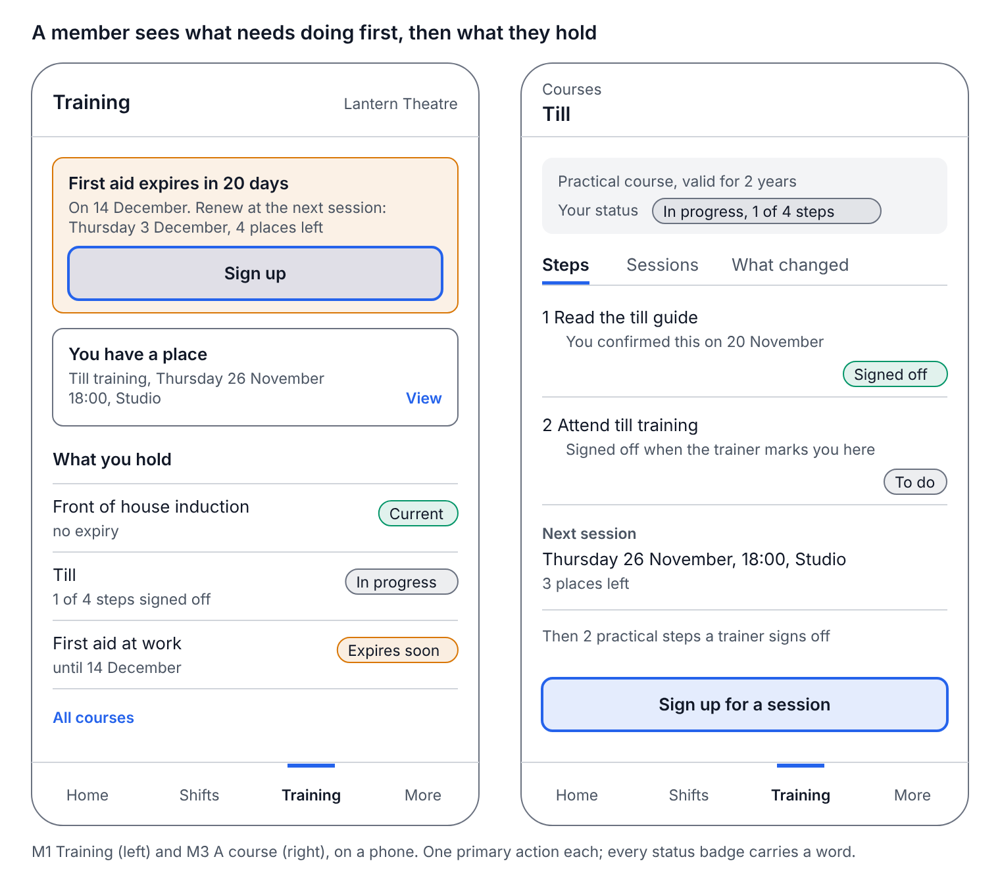
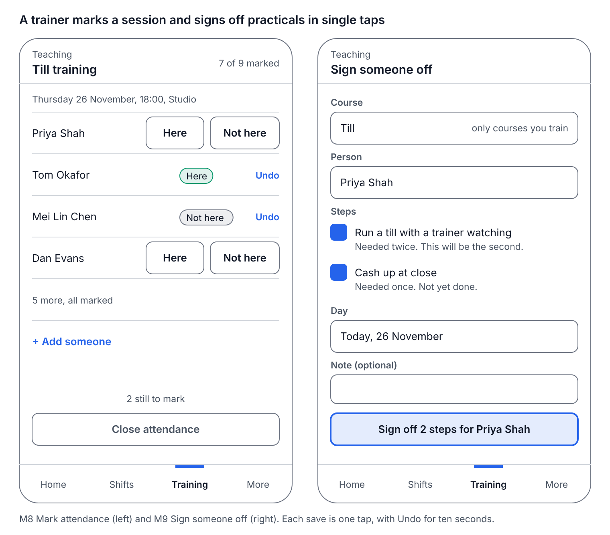
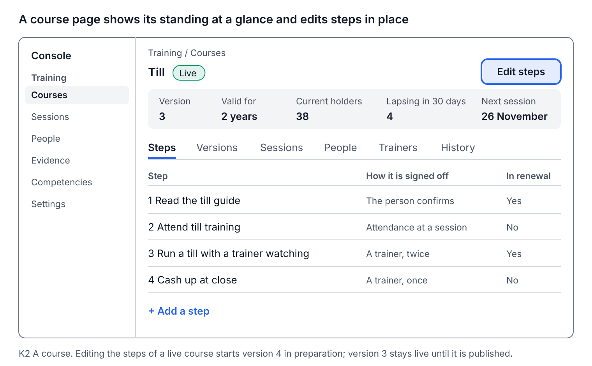
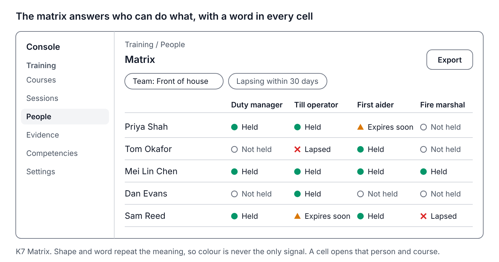

# 5. Screens

Training has 18 screens in two shells and none for the audience. Each is one of Interface's page types with its slots filled; none designs its own page. A learner's own training (M1 to M6) and a trainer's own work (M7 to M9) are in the members' area, usually on a phone. Running the programme for the theatre (K1 to K9) is in the console. Interface confirmed this split. Session lists that show dates use Interface's shared Calendar component.

## Navigation entries

Contributions to `core.navigation`. A fact never shows an entry; it does so by being mapped to the ability.

| Id | `menu` | To | Shown with | `group`, `section` | Count |
| --- | --- | --- | --- | --- | --- |
| `training.home` | members | `/members/training` | `training.course.view` |  |  |
| `training.teach` | members | `/members/training/teaching` | `training.session.run` or `training.sign-off.record` |  | `training.sign-offs-waiting` |
| `training.courses` | console | `/console/training/courses` | `training.course.manage` | Training, everyday |  |
| `training.sessions` | console | `/console/training/sessions` | `training.session.manage` or `training.place.manage` | Training, everyday | `training.sessions-unmarked` |
| `training.people` | console | `/console/training/people` | `training.record.view` | Training, everyday |  |
| `training.evidence` | console | `/console/training/evidence` | `training.evidence.verify` | Training, everyday | `training.evidence-waiting` |
| `training.competencies` | console | `/console/training/competencies` | `training.competency.manage` | Training, setup |  |
| `training.settings` | console | `/console/training/settings` | `training.settings.manage` | Training, setup |  |

## Members' area: learning

| Screen | Address | Page type | Shows | Primary action |
| --- | --- | --- | --- | --- |
| M1 Training | `/members/training` | Home | Cards in order of urgency: lapsed, expiring, places I hold, courses in progress. Then what I hold, as a short list | The most urgent card's own |
| M2 Courses | `/members/training/courses` | List | Live courses: title, category, delivery, my status. Filters: category, "not yet held" | None; a row opens the course |
| M3 A course | `/members/training/courses/<slug>` | Record | Summary strip: delivery, valid for, my status, expiry. Tabs: Steps (each with my sign-offs), Sessions, What changed | "Sign up for a session", or "Confirm reading", by what is next |
| M4 A session | `/members/training/sessions/<id>` | Record | When, where, trainers, places left in words, my place | "Sign up", "Join the waiting list" or "Cancel my place" |
| M5 My training | `/members/training/mine` | List | Every training record I have held, with status and dates; my evidence. Also the Training section of My account | "Add a certificate" |
| M6 Add a certificate | panel over M5 | Form | Course, issuer, dates, reference, file. Fields the step forbids are absent | "Send for checking" |

## Members' area: teaching

| Screen | Address | Page type | Shows | Primary action |
| --- | --- | --- | --- | --- |
| M7 Teaching | `/members/training/teaching` | Home | Sessions I lead that need marking, sessions coming up, people part-way through my courses | "Sign someone off" |
| M8 Mark attendance | `/members/training/teaching/sessions/<id>` | Record | Everyone with a place, each with two large controls, "Here" and "Not here"; a running count; "Add someone" | "Close attendance" once every place is marked |
| M9 Sign someone off | `/members/training/teaching/sign-off` | Form | Course (only ones I may sign), person, the practical steps with how many times each is done, the day, a note | "Sign off 2 steps for Priya Shah" |

M8 and M9 are used standing up in a rehearsal room. Their controls meet the members' area's 44-pixel target and each save is one tap with Undo for ten seconds, as Interface's "undo beats confirm" asks. They are not live-mode screens and need a connection in the first release (question 9).

A trainer reaches these screens as a member. The fact `training.course-trainer` is not a standing in the first release, so a theatre that brings in an outside trainer makes them a member or has a member mark the session (part 6).

## Wireframes: members' area

These show layout and wording, not visual design; colours and type come from the theatre's branding through Interface's components.



*wireframe · M1 Training and M3 A course, on a phone*



*wireframe · M8 Mark attendance and M9 Sign someone off, on a phone*

## Console

| Screen | Address | Page type | Shows | Primary action |
| --- | --- | --- | --- | --- |
| K1 Courses | `/console/training/courses` | List | Title, status, version, people current, lapsing in 30 days | "New course" |
| K2 A course | `/console/training/courses/<id>` | Record | Summary strip: status, version, valid for, current holders, next session. Tabs: Steps, Versions, Sessions, People, Trainers, History | "Publish" while a version is in preparation; otherwise "Edit steps" |
| K3 Sessions | `/console/training/sessions` | List | Date, course, space, places taken of capacity, waiting, status. Filters: course, upcoming, needs marking | "New session" |
| K4 A session | `/console/training/sessions/<id>` | Record | Tabs: Places, Waiting list, Attendance, History | "Add a person" |
| K5 People | `/console/training/people` | List | One row per person and course: status, awarded, expires. Filters: competency, course, status, lapsing within. Exports | None |
| K6 A person's training | Training section of the console's account page | Record tab | Competencies held, training records, progress, evidence | "Award directly" |
| K7 Matrix | `/console/training/matrix` | List, full width | People down, competencies across; each cell a word and a shape. K5 is its list equivalent | "Export" |
| K8 Competencies | `/console/training/competencies` and `/<id>` | List, Record | Title, courses, how many hold it now | "New competency" |
| K9 Evidence | `/console/training/evidence` | List | Evidence waiting, oldest first; a row opens a panel with the file beside the fields | "Verify" in the panel |

Settings at `/console/training/settings` is the generated Settings page and is not designed here.

## Wireframes: console



*wireframe · K2 A course, in the console*



*wireframe · K7 Matrix, in the console*

## Two screens in outline

M1, a member with one thing to do:

```text
Training

[!] First aid expires in 20 days (14 December)
    Renew: next session Thursday 3 December, 4 places left      [ Sign up ]

[i] You are on Till training, Thursday 26 November, 18:00, Studio
                                                           [ View ]

What you hold
  Front of house induction    Current    no expiry
  Till                        In progress, 1 of 4 steps
  First aid at work           Expires soon, 14 December
                                                  [ All courses ]
```

M8, a trainer marking a session on a phone:

```text
Till training, Thursday 26 November              7 of 9 marked

  Priya Shah            [ Here ]  [ Not here ]
  Tom Okafor            Here                         Undo
  Mei Lin Chen          Not here                     Undo
  ...
  [ + Add someone ]

                                        [ Close attendance ]
```

## Status words

Every status badge carries a word, and colour is never the only signal.

| Badge | Means | Shown to |
| --- | --- | --- |
| Current | Awarded and inside its dates | Everyone who can see the training record |
| Expires soon | Current, inside `training.records.warn-before` | The same |
| Lapsed | Past its expiry | The same |
| Ends early | Cut short by a new version, with the new date | The same |
| Revoked | Withdrawn. The reason is shown to the person and to holders of `training.record.revoke`, not on lists | As stated |
| In progress, n of m steps | Some steps signed off | The person, trainers of the course, viewers |
| Waiting, 2nd in line | A place on the session waiting list | The person |

## Dialogs that name the thing and the consequence

| Act | The dialog says |
| --- | --- |
| Publish, retraining required | "Publish version 4 of Till? 38 people hold this course. Their training will end on 14 December unless they complete the 2 changed steps. They will be told now." Button: "Publish and require retraining" |
| Publish, records stand | No dialog. A toast with Undo is not possible for a publication, so the button is on a summary step that lists what changed |
| Cancel a session | "Cancel Till training on Thursday 26 November? 9 people with a place and 2 waiting will be told." A reason is required |
| Revoke | "Revoke Tom Okafor's Till training? He will stop meeting any requirement that needs it at once. This cannot be undone." A code and a note are required |
| Retire a course | "Retire Fire marshal? It is part of the competency Duty manager, which nobody will be able to gain. 12 people hold it and keep it until their dates." |
| Change a competency's courses | "Add First aid to Duty manager? 14 people hold Duty manager now; 6 will after this change." |

## Empty, refused and failed

| Screen | State | Wording |
| --- | --- | --- |
| M1 | Nothing held, nothing booked | "You have no training yet. Courses you can take are listed here." with "See courses" |
| M4 | Full, waiting list off | "This session is full. The next one is on 3 December." |
| M4 | Too late to cancel | "It is too late to cancel online. Tell the trainer, Sam Reed, so your place can go to somebody waiting." |
| M9 | Signing yourself off | "You cannot sign off your own training. Ask another trainer for Till." |
| K1 | No courses | "A course is something you train people in, such as the till. Add your first, or copy an example." |
| K9 | Own evidence | "This is your own certificate. Somebody else must check it." |
| Any | Module's requirement shown elsewhere | The host's screen shows Training's reason: "Needs Till operator. Till lapsed on 2 March. Next session: 9 March." |

## Help and setup

Every screen's help link opens `docs/members/training-*.md` or `docs/console/training-*.md`, one page per screen. The setup step "Add your first course" is a Steps page of three steps: name it and say how long it lasts; add its steps; say who can train it.
